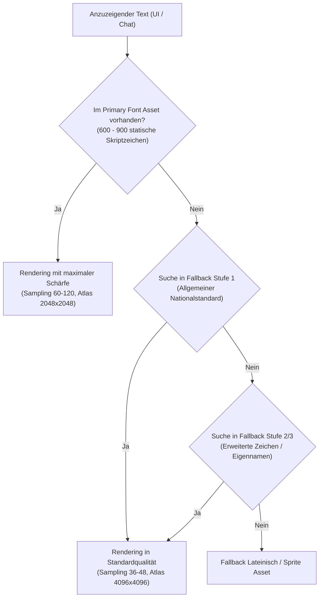

## **1. Projektüberblick und Herausforderungen der Echtzeit-Lokalisierung**

Das Projekt **GilongWorld** stellt eine äußerst komplexe und global angelegte technische Anforderung: umfassende Lokalisierungsunterstützung (*Localization*) für **15 Zielsprachen**. Diese Liste umfasst Englisch, Vietnamesisch, Französisch, Italienisch, Deutsch, Spanisch (Spanien), Polnisch, Portugiesisch (Brasilien), Portugiesisch (Portugal), Koreanisch, Russisch, Japanisch, Türkisch, vereinfachtes Chinesisch und traditionelles Chinesisch. In der modernen Spieleentwicklung mit der Unity-Engine beschränkt sich die Verwaltung und Darstellung von Text im Echtzeit-Grafikraum nicht auf das bloße Austauschen von Zeichenketten. Sie erfordert eine ganzheitlich optimierte Schriftarchitektur, um Ästhetik, Schärfe der Darstellung bei jeder Kameraentfernung und vor allem Effizienz bei der Nutzung des Systemspeichers sicherzustellen.

Das Standardwerkzeug mit der höchsten Leistungsfähigkeit im Unity-Ökosystem zur Textdarstellung ist derzeit **TextMeshPro (TMP)**. Völlig anders als herkömmliche Benutzeroberflächen-Textsysteme (UI Text), die jedes Zeichen als Bitmap-Bild rastern und beim Vergrößern unscharf werden lassen, erfordert TextMeshPro die Konvertierung von Standard-Schriftdateien in spezialisierte Ressourcen, sogenannte **Font Assets**[^1]. Diese Font Assets enthalten eine oder mehrere Texturen (*Atlas Texture*), die auf der Technologie **Signed Distance Field (SDF)** basieren. Die SDF-Technologie ermöglicht es, Text unendlich ohne Pixelbildung (*Pixelation*) zu skalieren, und liefert gleichzeitig die mathematische Grundlage dafür, dass der Shader komplexe grafische Effekte wie Schlagschatten, Konturen, Strichstärke und Leuchteffekte direkt auf der GPU berechnet[^1].

Die Leistungsfähigkeit von SDF geht jedoch mit einer unvermeidlichen physikalischen Herausforderung einher: **Speichergrenzen**. Sämtliche Zeichen aller 15 Zielsprachen in einer einzigen Atlas-Textur unterzubringen ist unmöglich[^1]. Insbesondere die Sprachen der CJK-Gruppe (*Chinese, Japanese, Korean*) verfügen über gewaltige ideographische Schriftsysteme mit Zehntausenden von Zeichen. Der Versuch, dieses gesamte System in eine einzige Atlas Texture zu pressen, würde die maximale Texturgröße überschreiten, die Hardware — insbesondere mobile Endgeräte — verarbeiten kann (üblicherweise $4096 \times 4096$ oder $8192 \times 8192$ Pixel), was zu VRAM-Überlauf oder zum Absturz der Anwendung (*Crash*) führt[^5]. Dieser Bericht stellt präzise und detailliert den gesamten Ablauf dar: von der Auswahl und dem Download der Quellschriftarten über die Analyse der Schriftmerkmale bis hin zur Konfiguration der internen TextMeshPro-Parameter, der Verwaltung der Fallback-Kette (*Fallback Chain*) und der endgültigen Lösung des Problems der Han-Vereinheitlichung (*Han Unification*) über das Unity-Localization-Paket.

---

## **2. Schriftzeichentheoretische Grundlagen und Strategie zur Beschaffung von Quellschriftarten**

Der erste und wichtigste Schritt beim Aufbau eines mehrsprachigen Textsystems ist die präzise Auswahl der Quellschriftdatei (*Source Font File*). Visuelle Konsistenz über 15 Sprachen hinweg erfordert eine Open-Source-Schriftfamilie, die Unicode-Bereiche von den Basisblöcken bis zu den Erweiterungen umfassend abdeckt und ein einheitliches Design hinsichtlich Grundlinie (*Baseline*) sowie Strichstärke (*Weight*) besitzt.

In der Softwareindustrie gilt die Schriftfamilie **Google Noto** (Kurzform für *„No Tofu“* — mit der Mission, leere Platzhalterkästchen bei fehlenden Zeichen auf dem Gerät, umgangssprachlich „Tofu“ genannt, zu beseitigen) als Goldstandard[^7]. Das von Google in Zusammenarbeit mit führenden Schriftdesign-Partnern entwickelte Noto-System stellt sicher, dass Zeichen des lateinischen, kyrillischen und der CJK-Schriftsysteme nebeneinander in derselben Textzeile dargestellt werden können, ohne dass Proportionssprünge oder stilistische Brüche entstehen[^8]. Eine harmonische Darstellung bei gemischtsprachigem Text ist für das Nutzererlebnis in GilongWorld von entscheidender Bedeutung.

### **Leitfaden zum Extrahieren und Importieren von Schriftdaten in Unity**

Zu Beginn der Integration müssen die Originalschriftdateien direkt aus der Bibliothek von **Google Fonts** heruntergeladen werden. Der Download und Import in Unity sollte einem strengen Ablauf folgen, um ein unnötiges Aufblähen des Projektumfangs zu vermeiden:

1. **Gruppe der 11 Sprachen mit lateinischem und kyrillischem Schriftsystem** (*Englisch, Vietnamesisch, Französisch, Italienisch, Deutsch, Spanisch, Polnisch, Portugiesisch - Brasilien, Portugiesisch - Portugal, Russisch, Türkisch*): Das System benötigt lediglich die Basisschriftfamilie **Noto Sans**[^8]. Diese Schriftfamilie enthält über 3.700 Glyphen (*Glyphs*) und deckt Unicode-Blöcke wie Latin Extended, Cyrillic sowie kombinierende diakritische Zeichen ab, womit alle Anforderungen der genannten Sprachen vollständig erfüllt werden[^8]. Auf Google Fonts liefert der Download ein komprimiertes Archiv mit mehreren Strichstärken (wie *Thin, Regular, Medium, Bold, Black*) im TrueType-Format (`.ttf`).
2. **Gruppe der 4 CJK-Sprachen**: Der Download-Prozess wird deutlich komplexer. Entwickler müssen auf separate Varianten zugreifen, darunter **Noto Sans JP** (Japanisch), **Noto Sans KR** (Koreanisch), **Noto Sans SC** (vereinfachtes Chinesisch) und **Noto Sans TC** (traditionelles Chinesisch)[^7]. Diese CJK-Dateien sind aufgrund der enormen Menge an Grafikdaten sehr groß und liegen zwischen 15 MB und 20 MB pro Schriftschnitt. Das für diese Gruppe übliche Format ist OpenType (`.otf`), das komplexere Zeichentabellenstrukturen als TrueType unterstützt[^5].

Nach dem Entpacken der Dateien von Google Fonts folgt der Import (*Import*) in das Unity-Projekt. Eine bewährte Methode (*Best Practice*) im Asset-Management besteht darin, eine eigene Ordnerstruktur anzulegen, beispielsweise `Assets/GilongWorld_Resources/Fonts/Source_Files/`. Die `.ttf`- und `.otf`-Dateien (es empfiehlt sich, aus Speichergründen nur eine Standardschnittstärke wie *Regular* oder *Medium* zu wählen, sofern das UI-Design nicht ausdrücklich fette Varianten verlangt) werden direkt aus dem Betriebssystem per Drag-and-drop über das Project-Fenster des Unity Editors in diesen Ordner gezogen[^10].

> [!NOTE]
> TextMeshPro verwendet diese `.ttf`- oder `.otf`-Dateien zur Laufzeit nicht direkt für das Text-Rendering; sie dienen lediglich als Rohmaterial für das Tool Font Asset Creator, um Umrissdaten zu extrahieren und in eine SDF-Textur zu kompilieren[^1]. Die Verwaltung der Quelldateien in einem separaten Ordner erleichtert es erheblich, sie aus den finalen Builds auszuschließen (sofern kein Dynamic SDF genutzt wird), was die Installationsgröße des Spiels verringert.

---

## **3. Analyse der Schriftsystem-Merkmale und Anforderungen an Unicode-Bereiche**

Die Vielfalt der 15 Sprachen im Projekt GilongWorld erfordert eine tiefgehende Analyse der Zeichenkodierung im internationalen Unicode-Standard. TextMeshPro verwendet das Hexadezimalsystem (Basis 16), um die aus der Quellschriftdatei zu extrahierenden Bereiche (*Unicode Ranges*) festzulegen[^13]. Die exakte Deklaration dieser Bereiche sichert nicht nur eine vollständige Sprachabdeckung, sondern verhindert auch das Laden unnötiger Zeichen, die die Größe der Atlas-Textur aufblähen würden.

Auf Basis ihrer morphologischen Struktur werden die 15 Sprachen für das Ressourcen-Management in drei Hauptgruppen unterteilt.

### **Untergruppe 1: Erweitertes Lateinisch und Diakritika**

Diese Gruppe umfasst Englisch, Französisch, Italienisch, Deutsch, Spanisch, Polnisch, Portugiesisch (Brasilien), Portugiesisch (Portugal), Türkisch und Vietnamesisch. Obwohl sie alle auf dem lateinischen Grundalphabet (`U+0020` bis `U+007E`) aufbauen, tritt in den erweiterten Blöcken eine deutliche Differenzierung zutage[^1]:

- **West- und Südeuropa** (*Französisch, Spanisch, Italienisch, Portugiesisch, Deutsch*): Verwenden überwiegend den Block *Latin-1 Supplement* (`U+00A0` bis `U+00FF`), der grundlegende Akzentvokale und Zeichen wie `á`, `é`, `í`, `ó`, `ú`, `ñ`, `ü` und `ç` enthält.
- **Mitteleuropa und Türkei** (*Polnisch, Türkisch*): Sind auf den Block *Latin Extended-A* (`U+0100` bis `U+017F`) angewiesen, um spezifische Zeichen wie `ą`, `ł`, `ş` und `ğ` darzustellen[^10].
- **Vietnamesisch**: Die anspruchsvollste Sprache dieser Gruppe. Durch das komplexe Tonsystem in Kombination mit Zirkumflex-Vokalen (`â`, `ê`, `ô`) oder Haken-Vokalen (`ơ`, `ư`) erfordert Vietnamesisch den Block *Latin Extended Additional* (`U+1E00` bis `U+1E9F`)[^14]. Die gestapelten Diakritika im Vietnamesischen erzeugen sehr hohe Zeichenformen (zum Beispiel kann `Ể` die übliche Versalhöhe des lateinischen Alphabets überschreiten), weshalb Zeilenhöhe (*Line Height*) und *Padding* in TextMeshPro sorgfältig abgestimmt werden müssen, um ein Abschneiden (*Clipping*) der Zeichenspitzen zu verhindern.

### **Untergruppe 2: Kyrillisches System**

Die einzige Sprache im Projekt aus diesem System ist **Russisch**. Das kyrillische Alphabet ist hinsichtlich der Kodierung vollständig unabhängig vom lateinischen System und liegt geschlossen im Block `U+0400` bis `U+04FF`[^10]. Trotz der separaten Kodierung teilt das Kyrillische viele morphologische Eigenschaften mit dem Lateinischen hinsichtlich Zeichenbreite und Grundlinienhöhe, sodass es sich nahtlos zusammen mit der lateinischen Gruppe in ein gemeinsames Font Asset packen lässt, ohne ein visuelles Ungleichgewicht zu verursachen.

### **Untergruppe 3: CJK-System und die historische Han Unification**

Die dritte Gruppe umfasst **Koreanisch, Japanisch, vereinfachtes Chinesisch und traditionelles Chinesisch**. Dies ist der komplexeste Bereich, in dem die technischen Grenzen von TextMeshPro regelmäßig auf die Probe gestellt werden. Die Ursache liegt nicht nur in der enormen Zeichenzahl, sondern auch in einer umstrittenen technischen Konvention des Unicode-Konsortiums namens **Han Unification** (*Vereinheitlichung der Han-Zeichen*)[^7].

In den frühen Jahren der Entwicklung des Unicode-Standards beschlossen Software-Ingenieure, um den Kodierungsraum auf 16 Bit zu begrenzen, historisch verwandte Ideogramme aus China, Japan und Korea auf denselben gemeinsamen Codepunkt (*Code Point*) zusammenzulegen[^7]. Dieser Block trägt den Namen *CJK Unified Ideographs* und erstreckt sich von `U+4E00` bis `U+9FA5`[^12].

Diese Entscheidung hat gravierende Folgen für das Rendering: **Obwohl sie denselben Unicode-Code teilen, wird die tatsächliche grafische Form desselben Zeichens (Glyphe) in den einzelnen Ländern unterschiedlich gezeichnet**, bedingt durch kulturelle Entwicklung, Kalligraphietraditionen und abweichende Bildungsstandards:

- Ein typisches Beispiel ist das Zeichen für „Knochen“ mit dem Unicode `U+9AA8` (`骨`). Die Strichstruktur im oberen Rechteck dieses Zeichens ist in Schriftarten für vereinfachtes Chinesisch (SC) horizontal von links nach rechts angeordnet, während sie im traditionellen Chinesisch (TC) und im Japanischen (JP) eine völlig andere Strichführung aufweist[^7].
- Ebenso weisen Zeichen wie „Schnee“ (`雪`) oder „gerade“ (`直`) subtile, für Muttersprachler jedoch sofort erkennbare Unterschiede auf.

Eine Text-Rendering-Engine kann keine morphologische Absicht erraten; sie erhält lediglich einen Unicode-Code und liest die entsprechende Grafik aus der aktiven Schriftart aus. Die Verwendung einer einzigen gemeinsamen CJK-Schriftart für alle ostasiatischen Sprachen hätte daher zur Folge, dass japanische Spieler japanischen Text im chinesischen Zeichenstil lesen müssten — oder umgekehrt[^7]. Für Muttersprachler wirkt der Text dadurch fehlerhaft, unprofessionell oder „zusammengewürfelt“, was die Immersion in die Spielwelt vollständig zerstört[^7]. Die einzige Lösung für diese Einschränkung besteht darin, die Font Assets für jede CJK-Sprache strikt zu trennen und die Fallback-Kette flexibel zu steuern.

---

## **4. Technischer Mechanismus von TextMeshPro und Signed Distance Field (SDF)**

Für eine präzise Einrichtung ist ein fundiertes Verständnis der Funktionsweise von **Signed Distance Field (SDF)** in TextMeshPro unerlässlich. Anders als herkömmliche Bitmap-Schriften, die Pixelfarbwerte speichern, speichert SDF den mathematischen Abstand jedes Texels zur nächstgelegenen Kante (Kontur) des Zeichens[^1]:
- Liegt ein Texel **innerhalb** des Zeichens, besitzt der Abstand einen **positiven** Wert.
- Liegt er **außerhalb**, besitzt er einen **negativen** Wert.
- Liegt er **exakt auf der Kante**, beträgt der Abstand **null** ($0$).

Diese Abstandsdaten werden als Graustufenbild (*Grayscale*) in einer Atlas Texture gespeichert. Zur Laufzeit führt der GPU-Shader von TextMeshPro eine bilineare Interpolation (*Bilinear Interpolation*) dieser Abstandswerte durch. Der Shader prüft den Wert jedes Fragments (*Fragment*) auf dem Bildschirm: Ist der Wert $> 0$, wird das Fragment eingefärbt; ist er $< 0$, wird es transparent. Da es sich um eine kontinuierliche mathematische Interpolation statt diskreter Pixelraster handelt, stellt SDF selbst dann gestochen scharfe Kurven dar, wenn die Kamera extrem nah an das Objekt heranfährt[^1].

Dieser Mechanismus bestimmt zwei Kernparameter bei der Erstellung eines Font Assets:
1. **Sampling Point Size:** Bestimmt die physische Größe des Zeichens beim Zeichnen auf die Atlas Texture. Je größer dieser Wert, desto detailreicher sind die Abstandsdaten.
2. **Padding (Abstandsrand):** Der Schlüssel zur Stärke von SDF. Der Pufferbereich um jedes Zeichen ermöglicht es dem Abstandsgradienten, gleichmäßig auf tiefere negative Werte abzufallen. Je breiter das Padding, desto mehr „Spielraum“ hat der SDF-Algorithmus, um dicke Konturen (*Outline*), Schlagschatten (*Shadow*) oder Leuchteffekte (*Glow*) ohne abruptes Abschneiden zu erzeugen[^13].

---

## **5. Detaillierte Einrichtungsanleitung über den Font Asset Creator**

Die Erstellung der Schrifttextur-Dateien erfolgt über das integrierte Unity-Werkzeug **Font Asset Creator**, erreichbar über das Menü:

```text
Window > TextMeshPro > Font Asset Creator
```

Auf Basis der Analyse aus Abschnitt 3 ist die optimale Struktur für die 15 Sprachen in GilongWorld ein segmentiertes Modell: **ein gemeinsames Font Asset für die 11 lateinisch/kyrillischen Sprachen sowie 4 separate Font Assets für jede einzelne CJK-Sprache**.

### **5.1. Statische Konfiguration für Lateinisch, Kyrillisch und Vietnamesisch**

Das Bündeln von 11 Sprachen (*Englisch, Französisch, Italienisch, Deutsch, Spanisch, Polnisch, Portugiesisch BR, Portugiesisch PT, Türkisch, Russisch, Vietnamesisch*) in einem einzigen **Primary Static Font Asset** ist die effektivste Methode, um die Anzahl der Zeichenaufrufe (*Draw Calls*) auf der GPU zu minimieren — ein zentraler Faktor für eine stabile Bildrate (*Frame Rate*)[^14].

Die Konfiguration im Font Asset Creator erfolgt mit folgenden strikten Parametern[^12]:

| Konfigurationseigenschaft | Technische Empfehlung | Analytische Begründung |
| :--- | :--- | :--- |
| **Source Font File** | `NotoSans-Regular.ttf` | Die Quelldatei aus dem `Assets`-Ordner per Drag-and-drop in dieses Feld ziehen. Sie liefert die Geometriedaten[^1]. |
| **Sampling Point Size** | `Custom Size: 60 - 90` | Der Modus Auto Sizing versucht lediglich, alle Zeichen in den verfügbaren Platz zu quetschen. Durch manuelles Festlegen von Custom Size zwischen 60 und 90 wird eine gleichbleibende SDF-Qualität über die gesamte Textur garantiert[^1]. |
| **Padding** | `6 - 9` (Verhältnis ~10 %) | Als Standardregel in TextMeshPro gilt, dass Padding etwa 10 % der Sampling Point Size betragen sollte[^4]. Bei Sampling 60 ist Padding 6 ideal. Verlangt das UI-Design sehr dicke Konturen, kann dieser Wert auf 10 erhöht werden. |
| **Packing Method** | `Optimum` | Der Optimum-Algorithmus benötigt deutlich mehr Rechenzeit als Fast, führt jedoch iterative Optimierungen durch, um Glyphen möglichst dicht zu packen und Pixelverschwendung zu minimieren[^12]. |
| **Atlas Resolution** | `2048 x 2048` | Die Zeichenzahl dieser 11 Sprachen liegt bei etwa 1.500 bis 2.000 Glyphen. Eine Auflösung von $2048 \times 2048$ bietet ausreichend Platz für Sampling Point Size 60, ohne dass Zeichen abgeschnitten werden[^7]. |
| **Character Set** | `Unicode Range (Hex)` | Statt vordefinierter Sätze bietet dieser Modus absolute Kontrolle über die geladenen Zeichen[^2]. |

Das Feld **Custom Character List** wird mit der Hexadezimal-Bereichskette gefüllt, die alle 11 Sprachen vollständig abdeckt:

```text
0020-007E, 00A0-00FF, 0100-017F, 0180-024F, 1E00-1E9F, 0300-036F, 0400-04FF, 0500-052F, 2000-206F
```

Nachdem alle Parameter ausgefüllt wurden:
1. Auf **Generate Font Atlas** klicken. Das Tool berechnet nun die Abstandsdaten und rendert das Bild (dies kann je nach CPU einige Minuten dauern).
2. Sobald der Vorgang abgeschlossen ist und die Texturvorschau erscheint, auf **Save** klicken.
3. Die Datei unter dem Namen `Global_Latin_Cyrillic_SDF.asset` im Projektordner speichern[^1].

### **5.2. Statische Konfiguration für CJK und hierarchische Fallback-Architektur**

Die Verarbeitung der 4 CJK-Sprachen erfordert aufgrund der gewaltigen Datenmenge einen völlig anderen Ansatz. Der obige Vorgang muss viermal für `NotoSansCJKjp`, `NotoSansCJKkr`, `NotoSansCJKsc` und `NotoSansCJKtc` wiederholt werden. Der Versuch, eine gesamte CJK-Tabelle über Unicode-Bereiche in einen einzigen statischen Atlas aufzunehmen, schlägt jedoch fehl, da die maximale physische Texturgröße überschritten wird[^5].

Die bewährte technische Lösung besteht in der Anwendung eines **hierarchischen Zeichen-Mapping-Modells (Hierarchical Character Mapping)** in Verbindung mit der Option **Characters from File**[^7]:

#### **1. Erstellung eines Primary SDF Font Assets für bekannte Zeichen (Known Characters)**
- Extrahieren aller statischen Textzeichenketten aus den **String Tables** des Projekts (Menüs, Quests, Items, Dialoge, Skills).
- Diese Menge eindeutiger Zeichen (*Unique Characters*) umfasst in der Praxis meist **unter 1.000 Zeichen** (im Projekt GilongWorld entfallen beispielsweise genau **855 Zeichen** auf vereinfachtes Chinesisch, **870** auf traditionelles Chinesisch, **694** auf Japanisch und **588** auf Koreanisch).
- **Maximierung der Abtastqualität (Maximize Sampling Size):** Da die Zeichenanzahl unter 1.000 liegt, lässt sich eine **hohe Sampling Point Size** (`60` bis `90` oder `120`) bei einer Atlas Resolution von `2048 x 2048` wählen. Dies gewährleistet, dass sämtliche offiziellen UI-Texte bei jeder Kameraentfernung gestochen scharf dargestellt werden.

#### **2. Aufbau der Fallback-Ebenen auf Basis nationaler Zeichenstandards (Standard Fallbacks for UGC/Chat)**
Um Eingaben von Spielern (Charakternamen, Community-Chat) lückenlos ohne Tofu-Kästchen darzustellen, ergänzt das System die Primary Assets um Fallback Font Assets aus **nationalen Standard-Zeichenkorpora**:

| Sprache | Nationaler Standard-Zeichensatz | Zeichenanzahl | Herausgebende Stelle & Open-Source-Referenz |
| :--- | :--- | :---: | :--- |
| **Vereinfachtes Chinesisch (zh-Hans)** | **TGSCC (通用规范汉字表)**<br/>- Stufe 1 (Allgemein): 3.500 Zeichen<br/>- Stufe 2 (Erweitert): 3.000 Zeichen<br/>- Stufe 3 (Eigennamen/Orte): 1.605 Zeichen | **8.105** | Bildungsministerium der VR China<br/>*Open Source:* [GitHub chinese-character-table](https://github.com/maple-leaf/chinese-character-table) |
| **Traditionelles Chinesisch (zh-Hant)** | **Tabelle der Standardformen gebräuchlicher Nationalzeichen** (*常用國字標準字體表*) | **4.808** | Bildungsministerium Taiwan (MOE Taiwan)<br/>*Open Source:* [Taiwan Open-Data-Portal](https://data.gov.tw/dataset/5961) / [GitHub cjktables](https://github.com/ButTaiwan/cjktables) |
| **Japanisch (ja)** | - **Jōyō Kanji** (常用漢字 - Alltagsgebrauch): 2.136 Zeichen<br/>- **Jinmeiyō Kanji** (人名用漢字 - Personennamen): 863 Zeichen | **2.999** | Amt für kulturelle Angelegenheiten (文化庁)<br/>*Open Source:* [KanjiAPI](https://kanjiapi.dev/) / [GitHub kanji-data](https://github.com/davidluzgouveia/kanji-data) |
| **Koreanisch (ko)** | **Standard KS X 1001** (die 2.350 häufigsten Hangul-Silben, decken 99,9 % der Kommunikation ab) | **2.350** | Koreanische Behörde für Technologie und Standards (KATS)<br/>*Open Source:* [GitHub ksx1001](https://github.com/korean-character-sets/ksx1001) / Extrahiert über `euc-kr` |



#### **3. Die unveränderliche Regel: Konstantes Verhältnis von Sampling Point Size / Padding (Ratio Consistency)**

Ein zentrales Grafikprinzip im TextMeshPro-Shader lautet: **Die Stärke von Effekten wie Outline (Kontur), Underlay / Shadow (Schatten) und Glow (Leuchten) wird aus dem Verhältnis zwischen Sampling Point Size und Padding berechnet**[^13].

##### **Warum benötigen Fallbacks nicht dieselbe Point Size wie das Primary Asset?**
- **Primary Font (~855 UI-Skriptzeichen):** Zu 100 % der Spielzeit sichtbar $\rightarrow$ **Qualitätsmaximierung** erforderlich (`Sampling Size = 120`, `Padding = 10`, Atlas $2048 \times 2048$).
- **Fallback Fonts (2.700 – 8.000 seltene Zeichen für Chat/Namen):** Erscheinen sehr selten $\rightarrow$ **Verringerung der Abtastgröße** (`Sampling Size = 60` oder `48`), um Tausende von Zeichen in derselben Atlas-Größe zu verdichten, ohne den VRAM aufzublähen.

##### **Warum muss zwingend dasselbe Verhältnis ($\text{Ratio} = \frac{\text{Sampling}}{\text{Padding}}$) gewahrt bleiben?**
Wenn innerhalb eines Satzes ein Zeichen aus dem Primary Asset direkt neben einem Zeichen aus dem Fallback Asset steht:
- **Bei abweichendem Verhältnis:** Das Primary-Zeichen (Size 120, Pad 10 $\rightarrow$ Ratio 12) besitzt eine feine, saubere Kontur, während das Fallback-Zeichen (Size 60, aber versehentlich mit Pad 10 $\rightarrow$ Ratio 6) eine **doppelt so dicke, verformte Kontur erhält, die die Striche des Zeichens verschluckt**.
- **Bei gleichem Verhältnis ($\text{Ratio} = 12$):** Unabhängig davon, ob das Zeichen aus dem Primary stammt oder auf einen Fallback zurückgreift, **bleiben Konturstärke und Schattenwurf zu 100 % einheitlich**.

| Font-Asset-Ebene | Rolle | Sampling Point Size *(Custom)* | Padding | Atlas Resolution | Verhältnis (Ratio) |
| :--- | :--- | :---: | :---: | :---: | :---: |
| **Primary Font** | Haupt-UI-Skript | **120** *(oder 96)* | **10 px** *(oder 8 px)* | $2048 \times 2048$ | **12** *(Maximale Schärfe)* |
| **Fallback Stufe 1** | ~2.725 gebräuchliche Zeichen | **60** | **5 px** | $2048 \times 2048$ | **12** *(VRAM-schonend)* |
| **Fallback Stufe 2** | ~2.992 erweiterte Zeichen | **60** | **5 px** | $2048 \times 2048$ | **12** *(VRAM-schonend)* |
| **Fallback Stufe 3** | ~1.605 seltene Zeichen/Namen | **48** | **4 px** | $2048 \times 2048$ | **12** *(VRAM-schonend)* |

> [!TIP]
> **Praktischer Hinweis:** Stellen Sie im *Font Asset Creator* `Sampling Point Size` von *Auto Sizing* auf **Custom Size** um, um Abtastgröße und Padding exakt gemäß den Verhältnissen der obigen Tabelle zu fixieren.

---

### **5.3. Ordnerstruktur und praktische Automatisierung in Unity**

Für einfache Erweiterbarkeit und langfristige Wartbarkeit definiert das Projekt GilongWorld eine strukturierte Ordnerhierarchie für sämtliche Quellzeichendaten:

```text
Assets/_GilongWorld/_Project/Art/Fonts/_chars/
├── 01_Latin_Cyrillic/        # [Gemeinsamer Primary Font] 11 lateinische/kyrillische Sprachen
│   ├── vi_chars.txt          # Vietnamesisch
│   ├── en_chars.txt          # Englisch
│   ├── ru_chars.txt          # Russisch
│   └── ...                   # Französisch, Deutsch, Italienisch, Spanisch, Polnisch, Portugiesisch, Türkisch
│
├── 02_CJK/                   # [CJK Primary Fonts] Statische In-Game-Skriptzeichen
│   ├── ja_chars.txt          # Japanisch (694 tatsächliche Zeichen)
│   ├── ko_chars.txt          # Koreanisch (588 tatsächliche Zeichen)
│   ├── zh_Hans_chars.txt     # Vereinfachtes Chinesisch (855 tatsächliche Zeichen)
│   ├── zh_Hant_chars.txt     # Traditionelles Chinesisch (870 tatsächliche Zeichen)
│   │
│   ├── Standard_Fallbacks/   # [Standardquellen] 7 nationale Rohdatensätze
│   │   ├── zh_Hans_TGSCC_Level1_3500.txt
│   │   ├── zh_Hans_TGSCC_Level2_3000.txt
│   │   ├── zh_Hans_TGSCC_Level3_1605.txt
│   │   ├── zh_Hant_Common_4808.txt
│   │   ├── ja_Joyo_Kanji_2136.txt
│   │   ├── ja_Jinmeiyo_Kanji_863.txt
│   │   └── ko_KS_X_1001_2350.txt
│   │
│   └── Subtracted_Fallbacks/ # [Optimierte Fallbacks] Primary-Zeichen abgezogen
│       ├── zh_Hans_Fallback_Level1.txt    (TGSCC Stufe 1 minus Primary)
│       ├── zh_Hans_Fallback_Level2.txt    (TGSCC Stufe 2 minus Primary)
│       ├── zh_Hans_Fallback_Level3.txt    (TGSCC Stufe 3 minus Primary)
│       ├── zh_Hant_Fallback_Common.txt    (TW-Standard 4808 minus Primary)
│       ├── ja_Fallback_Joyo.txt           (Joyo Kanji minus Primary)
│       ├── ja_Fallback_Jinmeiyo.txt       (Jinmeiyo Kanji minus Primary)
│       └── ko_Fallback_KS_X_1001.txt      (KS X 1001 minus Primary)
```

#### **Automatisches Werkzeug zur Extraktion & Subtraktion von Fallback-Zeichen (`GWCharacterExtractor.cs`)**
Um Entwickler vom manuellen CSV-Export und der Dublettenfilterung zu befreien, integriert das spezialisierte Unity-Editor-Werkzeug [`GWCharacterExtractor.cs`](file:///d:/Unity-Projects/GLW/Assets/_GilongWorld/_Project/Editor/Localization/GWCharacterExtractor.cs) einen Zwei-in-eins-Prozess:
- **Menüpfad:** `GilongWorld → Localization → Extract CJK Characters From String Tables`
- **Mechanismus 1 (Primary-Extraktion):** Durchsucht alle `StringTableCollections` in Unity Localization, sammelt sämtliche verwendeten Zeichenketten in einem `HashSet<char>` (100 % Eindeutigkeit garantiert), sortiert sie aufsteigend nach Unicode-Code und schreibt die 4 Primary-Dateien in `02_CJK/`.
- **Mechanismus 2 (Automatische Fallback-Subtraktion):** Das Skript liest automatisch die 7 Datensätze aus `Standard_Fallbacks/`, gleicht sie ab, **entfernt alle bereits im Primary Asset enthaltenen Zeichen** und exportiert die bereinigten Listen nach `Subtracted_Fallbacks/`. Dadurch wird jede VRAM-Verschwendung durch doppelte Zeichen zwischen Primary Atlas und Fallback Atlas vollständig ausgeschlossen.

#### **Oberfläche `GWSDFGeneratorWindow` und Umgehung der API-Beschränkungen in Unity 6**
Um die Regel „Verhältnis Sampling / Padding = 12“ strikt einzuhalten, stellt das Projekt ein eigenes Editor Window bereit, das Parameter entgegennimmt und automatisch warnt, sobald das Verhältnis abweicht.
Insbesondere in Unity 6 wurde die Eigenschaft `clearDynamicDataOnBuild` des Font Assets auf die Zugriffsebene `internal` gesperrt, sodass sich Altlasten vor dem Build nicht mehr über regulären Code bereinigen lassen. Dieses Werkzeug löst das Problem sauber durch Reflection über `SerializedObject`:

```csharp
var serializedObject = new SerializedObject(fontAsset);
serializedObject.FindProperty("m_ClearDynamicDataOnBuild").boolValue = true;
serializedObject.ApplyModifiedProperties();
```

Dadurch wird der fehlerhafte 137-MB-Atlas des alten Systems vollständig bereinigt und die Build-Größe auf das Minimum reduziert.

---

## **6. Architektur zur Verwaltung der Fallback-Kette (Fallback Chain) und Lösung der Han Unification**

Der Kern eines reibungslos funktionierenden mehrsprachigen Spiels liegt in der Steuerung der **Fallback Chain** (Ausweichkette). Erhält eine TextMeshPro-UI-Komponente eine Zeichenkette mit einem Zeichen, das im Primary Font Asset fehlt, führt das System eine rekursive Suche durch die Fallback-Listen durch, um eine passende Ersatzglyphe zu finden.

Der Suchalgorithmus folgt einer strengen Hierarchie:
1. `TextMeshPro Primary Font Asset`
2. `Interne Liste der Fallback Font Assets des Primary Font`
3. `Internes Sprite Asset`
4. `Global in TMP_Settings definierte General Fallback Font Assets`
5. `Default Sprite Asset`
6. `Default Font Asset`[^20]

> [!WARNING]
> Das System durchsucht diese Liste sequenziell von oben nach unten und **bricht sofort ab, sobald der erste passende Unicode-Codepunkt gefunden wird**[^7].

Wie in Abschnitt 3 analysiert, führt die Han Unification dazu, dass Zeichen in SC, TC und JP denselben Unicode-Code teilen, aber unterschiedliche Formen besitzen[^7]. Fügen Entwickler alle CJK-Dateien in die Liste General Fallback Font Assets von `TMP_Settings` ein, entscheidet die Reihenfolge über das typografische Schicksal des Textes. Lautet die Reihenfolge beispielsweise `Font_CJK_JP_SDF` $\rightarrow$ `Font_CJK_SC_SDF` $\rightarrow$ `Font_CJK_TC_SDF`, wird bei einem Text in vereinfachtem Chinesisch von oben nach unten gesucht, zuerst die japanische Datei gefunden, der passende Unicode-Codepunkt entdeckt und umgehend der japanische Kanji-Stil auf dem Bildschirm ausgegeben, während die darunter liegende chinesische Schriftart völlig ignoriert wird[^7].

### **Lokale Isolationsarchitektur (Local Fallback Architecture)**

Um dieses Problem endgültig zu beseitigen, muss die Fallback-Struktur isoliert werden:

> [!IMPORTANT]
> **Fügen Sie CJK-Schriftarten niemals in die globale Fallback-Liste (Global Fallback List) in `TMP_Settings` ein**[^1]. Stattdessen wird die Architektur über die lokale Fallback-Struktur (*Local Fallback*) jedes einzelnen Assets verknüpft und zur Laufzeit dynamisch verwaltet.

Eine typografische Grundregel besagt, dass CJK-Schriftarten häufig schlecht proportionierte oder optisch unpassende lateinische Buchstaben und arabische Ziffern im Vergleich zu rein lateinischen Schriftarten mitführen[^9]. Daher müssen lateinische Zeichen stets vorrangig über `Global_Latin_Cyrillic_SDF` gerendert werden. Die lokale Verknüpfungsstruktur wird wie folgt aufgebaut:
1. Öffnen Sie `Font_CJK_SC_SDF.asset`, fügen Sie unter **Fallback Font Assets** die chinesischen Fallback-Stufen 1–3 hinzu und hängen Sie `Global_Latin_Cyrillic_SDF` an[^1].
2. Wiederholen Sie denselben Vorgang für die Dateien TC, JP und KR.

Dies garantiert, dass eingestreute Zahlen oder englische Eigennamen in chinesischen Texten den statischen chinesischen Atlas durchlaufen (da lateinische Zeichen beim Export über *Characters from File* ausgeschlossen wurden) und vom Fallback mit hochwertiger lateinischer Schrift abgefangen werden[^7].

---

## **7. Integration des Unity-Localization-Pakets für dynamisches Umschalten (Runtime Swapping)**

Um kulturell korrekte Schriftformen bei gleichzeitiger VRAM-Optimierung zu gewährleisten, dürfen TextMeshPro-UI-Komponenten keine dauerhaft statische Konfiguration behalten. Wechselt der Nutzer die Sprache (*Locale*), muss die Basisschriftart (*Primary Font Asset*) automatisch zur Laufzeit (*Runtime*) ausgetauscht (*Swap*) werden[^23].

Das Paket **Unity Localization** (`com.unity.localization`) bietet leistungsstarke Werkzeuge zur Umsetzung dieser Logik, statt jeden Sprachwechsel fest im Code zu verankern (*Hardcoding*)[^25]. Die Integrationsarchitektur basiert auf der Überwachung des globalen Sprachwechsel-Ereignisses über `LocalizationSettings.SelectedLocaleChanged`[^24].

Es gibt zwei Implementierungsansätze:

### **Methode 1: Zentralisierter Font Manager (`GWFontManager.cs`)**

Anstatt Tausenden einzelnen UI-Text-Objekten manuell Localized-Asset-Komponenten zuzuweisen (was durch Tausende überflüssige `MonoBehaviour`-Instanzen und Garbage Collection enormen Speicherdruck erzeugt), nutzt GilongWorld die Strategie einer **zentralisierten Verwaltung mittels Addressables**.

Das Skript `GWFontManager.cs` (mit Flag `DontDestroyOnLoad`) abonniert das Ereignis `LocalizationSettings.SelectedLocaleChanged`. Sobald dieses Ereignis auslöst, führt der Manager zwei präzise Aufgaben aus:
1. **Asynchrones Laden (Async Load):** Ruft `LocalizationSettings.AssetDatabase.GetLocalizedAssetAsync<TMP_FontAsset>("Fonts_Table", "PrimaryFont")` auf, um das passende Primary Font Asset der aktuellen Sprache aus den Addressables nachzuladen.
2. **Globaler Durchlauf (Global Sweep):** Verwendet `FindObjectsByType<TMP_Text>`, um die gesamte Szene zu durchsuchen und die neue Schriftart allen UI-Texten zuzuweisen. Dieser Befehl kostet nur wenige Millisekunden CPU-Zeit, läuft aber ausschließlich einmalig beim Sprachwechsel oder Szenenladen und befreit im Gegenzug den Arbeitsspeicher vollständig vom Ballast Tausender Einzelkomponenten. Unmittelbar nach der Zuweisung wird die Schriftart der vorherigen Sprache per `Addressables.Release()` freigegeben.

Diese Methode schließt eine „Querkontamination“ (*Cross-Pollination*) zwischen den CJK-Sprachen komplett aus, da ausschließlich der Atlas der aktuell gewählten Sprache im Speicher verbleibt[^7].

### **Methode 2: Asset Tables von Unity Localization**

Der nativste Ansatz (*Native*) besteht in der Verwendung von **Localized Asset Tables**[^23]. Ähnlich wie Localized String Tables Textzeichenketten ersetzen, erlauben Asset Tables die Zuordnung unterschiedlicher Font Assets zu den jeweiligen Sprachen. Localized-Text-Komponenten in der Benutzeroberfläche lassen sich so konfigurieren, dass sie nicht nur die Textzeichenkette, sondern automatisch auch die Eigenschaft `FontAsset` des TextMeshPro-Objekts austauschen[^23].

Dieser Ansatz erfordert eine Einrichtung im Inspector, bietet jedoch hohe Stabilität und erspart dem Team die Pflege einer eigenen Zuordnungslogik im Code[^28].

---

## **8. Verwaltung dynamischer Inhalte (UGC), Speicheroptimierung und Addressables-Integration**

Die statische Architektur (*Static Architecture*) löst die Anforderungen an die Systemoberfläche vollständig. Von Spielern erstellte Inhalte (**User-Generated Content - UGC**) wie Charakternamen, Gildenbeschreibungen oder der Community-Chat stellen jedoch eine deutlich größere Herausforderung dar. Es lässt sich nicht vorhersehen, welche Zeichen aus den 15 Sprachen die Nutzer eingeben werden, und sämtliche Hunderttausende Zeichen der Welt in den RAM zu laden ist unmöglich.

### **Die hybride Architekturlösung (Hybrid SDF System)**

Das herkömmliche **Dynamic SDF**-System von TextMeshPro startet ein Font Asset mit einer leeren Atlas-Textur ($0 \times 0$ Pixel). Sobald ein neues Zeichen erkannt wird, rendert es dieses auf der CPU und fügt es zur Laufzeit in die Textur ein[^6].
Ein rein dynamischer Betrieb würde jedoch schon auf dem ersten Bildschirm zu starken Rucklern (*Frame Spikes*) führen. Daher setzt GilongWorld eine **hybride Architektur (Hybrid)** ein:

1. **Reibungslose statische Vorbefüllung (Static Population):** Über das Werkzeug `GWCharacterExtractor.cs` werden Tausende der gebräuchlichsten Zeichen bereits im Editor per `TryAddCharacters` fest in den Atlas eingebrannt. Im Spiel sind diese Zeichen sofort verfügbar, was eine absolut stabile Bildrate (FPS) garantiert.
2. **Sicherer dynamischer Rückfall (Dynamic Fallback):** Das Font Asset bleibt dennoch im Dynamic-Modus mit dem Flag `isMultiAtlasTexturesEnabled = true` gespeichert. Tippt ein Spieler im Chat ein äußerst seltenes Zeichen ein, das im ersten Atlas fehlt, erzeugt TMP augenblicklich eine weitere Atlas Texture (`Atlas 0 1`, `Atlas 0 2`...), um das Zeichen dort unterzubringen statt ein Tofu-Kästchen anzuzeigen. Dies stellt die optimale Kombination dar.

> [!CAUTION]
> Die Dynamic-SDF-Methode ist mit konkretem Ressourcenaufwand verbunden: Jeder dynamische Atlas der Größe $2048 \times 2048$ belegt unmittelbar rund **4 MB** Systemspeicher. Entstehen zahlreiche Zusatz-Atlanten, steigt der Speicherdruck auf mobilen Geräten rapide an[^31].

### **Die versteckte Addressables-Falle und VRAM-Speicherkonflikte**

Moderne Großprojekte wie GilongWorld nutzen fast ausnahmslos das **Addressables**-System zum Laden von Ressourcen. Ein fataler Fehler vieler Entwickler besteht in der **Annahme, Addressables noch nicht aktiviert zu haben, weshalb Fonts bedenkenlos im `Resources`-Ordner belassen werden.**

Tatsächlich baut das Paket **Unity Localization direkt auf Addressables auf**. Selbst wenn Sie es nicht aktiv verwenden, läuft Addressables im Hintergrund zur Verwaltung der String Tables.
Referenziert ein über Addressables gepacktes UI-Prefab ein Font Asset aus dem `Resources`-Ordner, begeht der Asset-Manager von Unity einen gravierenden Duplizierungsfehler (*Duplicate Assets*):
1. Unity erstellt eine vollständige Kopie dieser Atlas-Textur und packt sie direkt in das Addressables-AssetBundle[^32].
2. Beim Spielstart ist der Atlas aus `Resources` bereits geladen, und der Atlas aus dem AssetBundle wird ein weiteres Mal in den RAM geladen — was zu einer **doppelten und verschwenderischen VRAM-Belegung** führt[^31]. Dieser Fehler tritt äußerst häufig auf und bringt mobile Anwendungen mit strengen RAM-Obergrenzen leicht zum Absturz[^33].

**Endgültige Lösung:**
- Verschieben Sie `TMP_Settings` und sämtliche Font Assets vollständig aus dem `Resources`-Ordner in ein Standardverzeichnis wie `Assets/_GilongWorld/_Project/Art/Fonts/SDF/`.
- Wählen Sie alle SDF-Dateien aus, weisen Sie sie einer eigenen Addressables Group (z. B. `Fonts_Addressables`) zu und richten Sie die Zuordnung in der **Asset Table** (`Fonts_Table`) von Localization ein.
- **Bereinigung dynamischer Fonts im Editor:** Dynamic Font Assets speichern generierte Texturdaten dauerhaft. Vor jedem Build müssen die dynamischen Daten zwingend gelöscht werden (in unserer Pipeline automatisiert über `GWSDFGeneratorWindow` mit der oben gezeigten `SerializedObject`-Technik)[^30].
- **Speicherbereinigung zur Laufzeit:** Rufen Sie beim Wechsel zwischen großen Szenen die API `TMP_FontAsset.ClearFontAssetData(true)` oder `FontEngine.DestroyFontEngine()` auf, um nicht mehr benötigte dynamische Textur-Arrays restlos freizugeben[^35].

---

## **9. Live-Diagnose und technische Fehlerbehebung (Troubleshooting)**

Im praktischen Einsatz auf vielfältigen Plattformen zeigen Lokalisierungssysteme häufig typische Fehlersymptome. Das Verständnis der Diagnoseprinzipien hilft dem Technikteam, Störungen rasch einzugrenzen:

### **Text erscheint auf mobilen Builds als leere Kästchen (Tofu Boxes), funktioniert im Editor aber normal**
- **Ursache:** Der Asset-Manager von Unity erfasst Fallback Font Assets nicht als Abhängigkeiten (*Dependencies*), wenn sie nur lose über `FallbackFontAssetTable` zur Laufzeit verknüpft sind, statt direkt von einem statischen GameObject in der Szene referenziert zu werden. Der Build-Prozess von Unity entfernt (*strip*) diese Assets automatisch zur Optimierung der Paketgröße[^1].
- **Behebung:** Nutzen Sie `TMP_Settings.fallbackFontAssets` als globale Referenz, damit Unity deren Existenz erkennt, oder stellen Sie sicher, dass alle potenziellen Font Assets explizit über das Addressables-Manifest zum Vorladen (*Pre-Load*) markiert sind[^1].

### **Ausnahmefehler: `"The variable m_AtlasTextures of TMP_FontAsset has not been assigned"`**
- **Ursache:** Hängt direkt mit dem Dynamic-Font-Asset-System bei aktivierten Multi Atlas Textures zusammen[^34]. Wenn das System automatisch zusätzliche Textur-Arrays für neue Zeichen anlegt, dieser Vorgang jedoch unterbrochen oder aufgrund instanziierter Prefabs (*Instantiated Prefabs*) fehlerhaft freigegeben wird, behält dieses Array eine Nullreferenz (*Null Reference*).
- **Behebung:** Führen Sie vor dem Build über das Kontextmenü des Font Assets im Inspector manuell einen **Reset** durch, um wieder ein sauberes leeres Textur-Array herzustellen[^34].

### **Text wirkt bei großen Darstellungsgrößen unscharf (Blurry)**
- **Ursache:** Die Auflösung des SDF-Atlas oder die `Sampling Point Size` ist im Verhältnis zur tatsächlichen Rendergröße auf dem Bildschirm zu niedrig[^1].
- **Behebung:** Für große Überschriften (Heading / Banner) muss die `Sampling Point Size` auf `150` oder höher eingestellt werden. Lässt sich kein ausreichend großer Atlas für alle Zeichen bei diesem Wert erzeugen, sollten die speziellen Zeichen der Titelbildschirme in ein separates Static Font Asset ausgelagert werden, um maximale Schärfe zu erreichen, statt dieselbe Ressource wie beim Fließtext zu nutzen[^1].

### **Authentifizierungsfehler beim Pull von Übersetzungstabellen aus Google Sheets (`invalid_grant: Token has been expired or revoked`)**
- **Symptom:** Beim Synchronisieren (*Pull*) von Localization-Tabellen (wie `RPGB_General` oder String Tables) aus Google Sheets nach Unity meldet das System einen kritischen Fehler: `Pull from Google sheets: Failed - Error: "invalid_grant", Description: "Token has been expired or revoked."`
- **Ursache:** **Zeitzonenversatz / Systemuhr-Abweichung (Timezone Skew / Clock Drift)**. Die Google-OAuth-2-Authentifizierung verlangt eine sehr strenge Zeitgenauigkeit für den in der Anfrage gesendeten Zeitstempel (*Timestamp*). Weichen Zeitzone oder Systemuhr des Rechners ab oder hält der Unity Editor einen veralteten Zeit-Cache vor, weist der Google-Auth-Server die Anfrage sofort mit `invalid_grant` ab.
- **Behebung:**
  - **Unity Editor neu starten:** Schließen und öffnen Sie den Unity Editor erneut, damit die Engine die exakte Echtzeit des Betriebssystems neu einliest $\rightarrow$ ein erneuter **Pull** gelingt daraufhin sofort.

---

## **10. Abschließende Architekturempfehlungen**

Das Projekt GilongWorld mit seinem Umfang von 15 Sprachen erfordert eine Textgrafik-Architektur, die strengsten Anforderungen an die VRAM-Speicherzuteilung und an eine kulturgerechte visuelle Darstellung gerecht wird:

1. **Typografische Konsistenz (Typography):** Setzen Sie durchgängig auf das Ökosystem Google Noto Sans und Noto Sans CJK, um bei beliebigen gemischtsprachigen Texten eine nahtlose Grundlinien-Metrik (*Baseline*) zu wahren.
2. **Atlas-Segmentierung (Atlas Segmentation):** Pressen Sie niemals alle Sprachen in einen einzigen Atlas. Erstellen Sie ein einziges $2048 \times 2048$ großes Primary Static Font Asset mit den Bereichen aller 11 lateinischen und kyrillischen Sprachen (*Englisch, Vietnamesisch, Französisch, Italienisch, Deutsch, Spanisch, Polnisch, Portugiesisch, Russisch, Türkisch*).
3. **Ostasiatische Optimierung & hierarchisches Fallback-Modell:** Trennen Sie die 4 CJK-Sprachen (*vereinfachtes Chinesisch, traditionelles Chinesisch, Japanisch, Koreanisch*) in eigenständige Font Assets. Kombinieren Sie ein **Primary SDF Font Asset (< 1.000 statische Skriptzeichen mit hochwertiger Sampling Size 60–120)** mit **3 Fallback-Ebenen (bis zu 8.105 Zeichen nach nationalem Standard TGSCC)** für Spielereingaben und Chat. Halten Sie zwingend ein **einheitliches Verhältnis von Sampling Point Size / Padding** (Ratio $\approx 10-12$) zwischen Primary und Fallback ein, damit Shader-Effekte (Outline, Shadow, Glow) sauber und verzerrungsfrei gerendert werden.
4. **Kontrolle der Fallback-Kette (Han Unification Control):** Verwenden Sie für das CJK-System niemals die Global Fallback List. Nutzen Sie stattdessen das dynamische Austauschen (*Runtime Swapping*) des Pakets Unity Localization, um das Primary Font Asset passend zum aktiven Locale zu aktualisieren und jede falsche regionale Zeichendarstellung auszuschließen. Lateinische Zeichen werden stets als lokaler Fallback (*Local Fallback*) für die CJK-Dateien eingerichtet.
5. **Integration dynamischer Inhalte & Speicherverwaltung (UGC & Memory Handling):** Nutzen Sie Dynamic Font Assets mit Multi Atlas Texture, um unerwartete Zeichen aus dem Spielerchat abzufangen. Entfernen Sie schließlich die gesamte Architektur aus dem `Resources`-Ordner, verwalten Sie die Ressourcen über **Addressables**, um doppelte Atlanten zu verhindern, und nutzen Sie spezialisierte Speicherbereinigungs-APIs zur Freigabe von VRAM in langen Spielsitzungen.

---

## **Referenzen**

[^1]: Fix: Unity TextMeshPro Font Asset Missing or Fallback | Bugnet Blog, [https://bugnet.io/blog/fix-unity-textmeshpro-font-asset-missing](https://bugnet.io/blog/fix-unity-textmeshpro-font-asset-missing)
[^2]: Fix: Unity UI TextMeshPro Falling Back to Default Font | Bugnet Blog, [https://bugnet.io/blog/fix-unity-ui-text-mesh-pro-falling-back-default-font](https://bugnet.io/blog/fix-unity-ui-text-mesh-pro-falling-back-default-font)
[^3]: textmeshpro | Skills Marketplace · LobeHub, [https://lobehub.com/de/skills/xeldaralz-helm-textmeshpro](https://lobehub.com/de/skills/xeldaralz-helm-textmeshpro)
[^4]: Chinese Traditional, Simplified and English text looks blurred, [https://discussions.unity.com/t/chinese-traditional-simplified-and-english-text-looks-blurred/723916](https://discussions.unity.com/t/chinese-traditional-simplified-and-english-text-looks-blurred/723916)
[^5]: Creating asset from font with a lot of characters - Page 2 - Unity Engine, [https://discussions.unity.com/t/creating-asset-from-font-with-a-lot-of-characters/708290?page=2](https://discussions.unity.com/t/creating-asset-from-font-with-a-lot-of-characters/708290?page=2)
[^6]: Bug where TextMeshPro dynamic font atlas exhaustion causes, [https://unity-trouble-atlas.7colorsgame.com/en/article/unity-tmp-dynamic-font-atlas-exhaustion/](https://unity-trouble-atlas.7colorsgame.com/en/article/unity-tmp-dynamic-font-atlas-exhaustion/)
[^7]: Unity Font: The 2026 Complete Guide to TextMesh Pro Font Assets, [https://www.transphere.com/unity-font-textmesh-pro-font-assets-fallbacks-and-localization/](https://www.transphere.com/unity-font-textmesh-pro-font-assets-fallbacks-and-localization/)
[^8]: Noto Sans - Google Fonts, [https://fonts.google.com/noto/specimen/Noto+Sans](https://fonts.google.com/noto/specimen/Noto+Sans)
[^9]: Force a font to use fallbacks - Unity Discussions, [https://discussions.unity.com/t/force-a-font-to-use-fallbacks/711511](https://discussions.unity.com/t/force-a-font-to-use-fallbacks/711511)
[^10]: Multiple Language Support Not Working in TextMesh Pro, [https://stackoverflow.com/questions/44922738/multiple-language-support-not-working-in-textmesh-pro](https://stackoverflow.com/questions/44922738/multiple-language-support-not-working-in-textmesh-pro)
[^11]: How to display Japanese in Unity TextMeshPro using Noto Sans CJK, [https://zenn.dev/uliboooo/articles/c3a2f489d8ee9a?locale=en](https://zenn.dev/uliboooo/articles/c3a2f489d8ee9a?locale=en)
[^12]: TextMeshPro Font Asset Creation & Packaging Guide - GitHub, [https://github.com/bbepis/XUnity.AutoTranslator/wiki/TextMeshPro-Font-Asset-Creation-&-Packaging-Guide](https://github.com/bbepis/XUnity.AutoTranslator/wiki/TextMeshPro-Font-Asset-Creation-&-Packaging-Guide)
[^13]: Font Asset Creator | TextMeshPro | 3.2.0-pre.15 - Unity - Manual, [https://docs.unity3d.com/Packages/com.unity.textmeshpro@3.2/manual/FontAssetsCreator.html](https://docs.unity3d.com/Packages/com.unity.textmeshpro@3.2/manual/FontAssetsCreator.html)
[^14]: [UNITY] Optimizing TextMesh Pro Font Atlas for language localization., [https://killertee.wordpress.com/2021/04/23/optimizing-workflow-textmesh-pro-font-atlas-for-language-localization/](https://killertee.wordpress.com/2021/04/23/optimizing-workflow-textmesh-pro-font-atlas-for-language-localization/)
[^15]: [Solved] TextMeshPro - Text(UI): Shows empty squares - Unity Engine, [https://discussions.unity.com/t/solved-textmeshpro-text-ui-shows-empty-squares/787844](https://discussions.unity.com/t/solved-textmeshpro-text-ui-shows-empty-squares/787844)
[^16]: Character set for multiple languages - Unity Discussions, [https://discussions.unity.com/t/character-set-for-multiple-languages/696758](https://discussions.unity.com/t/character-set-for-multiple-languages/696758)
[^17]: FYI: missing chinese/japanese/korean characters in Unity may not, [https://www.reddit.com/r/Unity3D/comments/1l37yfi/fyi_missing_chinesejapanesekorean_characters_in/](https://www.reddit.com/r/Unity3D/comments/1l37yfi/fyi_missing_chinesejapanesekorean_characters_in/)
[^18]: Saving / loading font atlas for TextMeshPro Font assets during runtime, [https://discussions.unity.com/t/saving-loading-font-atlas-for-textmeshpro-font-assets-during-runtime/891878](https://discussions.unity.com/t/saving-loading-font-atlas-for-textmeshpro-font-assets-during-runtime/891878)
[^19]: Having issues displaying Chinese characters using Text Mesh Pro, [https://www.reddit.com/r/Unity3D/comments/178zt0q/having_issues_displaying_chinese_characters_using/](https://www.reddit.com/r/Unity3D/comments/178zt0q/having_issues_displaying_chinese_characters_using/)
[^20]: Fallback font assets | TextMeshPro | 4.0.0-pre.2 - Unity - Manual, [https://docs.unity3d.com/Packages/com.unity.textmeshpro@4.0/manual/FontAssetsFallback.html](https://docs.unity3d.com/Packages/com.unity.textmeshpro@4.0/manual/FontAssetsFallback.html)
[^21]: Fallback font assets | TextMeshPro | 3.2.0-pre.15 - Unity - Manual, [https://docs.unity3d.com/Packages/com.unity.textmeshpro@3.2/manual/FontAssetsFallback.html](https://docs.unity3d.com/Packages/com.unity.textmeshpro@3.2/manual/FontAssetsFallback.html)
[^22]: Issue using the TMPro fallback system to render Chinese or, [https://discussions.unity.com/t/issue-using-the-tmpro-fallback-system-to-render-chinese-or-japanese-w-specific-fonts/837526](https://discussions.unity.com/t/issue-using-the-tmpro-fallback-system-to-render-chinese-or-japanese-w-specific-fonts/837526)
[^23]: Localization - Unity - Manual, [https://docs.unity3d.com/6000.5/Documentation/Manual/best-practice-guides/ui-toolkit-for-advanced-unity-developers/localization.html](https://docs.unity3d.com/6000.5/Documentation/Manual/best-practice-guides/ui-toolkit-for-advanced-unity-developers/localization.html)
[^24]: Issues with Localization and TMP Rendering in Unity, [https://discussions.unity.com/t/issues-with-localization-and-tmp-rendering-in-unity/948421](https://discussions.unity.com/t/issues-with-localization-and-tmp-rendering-in-unity/948421)
[^25]: A Comprehensive Guide to Unity Localization | Phrase, [https://phrase.com/blog/posts/localizing-unity-games-official-localization-package/](https://phrase.com/blog/posts/localizing-unity-games-official-localization-package/)
[^26]: How to Use the Unity Localization Package: A Complete Guide, [https://www.languagesunlimited.com/unity-localization-package/](https://www.languagesunlimited.com/unity-localization-package/)
[^27]: Change Locale in runtime - Unity Discussions, [https://discussions.unity.com/t/change-locale-in-runtime/812317](https://discussions.unity.com/t/change-locale-in-runtime/812317)
[^28]: TMP Font Asset and localization - Unity Discussions, [https://discussions.unity.com/t/tmp-font-asset-and-localization/936355](https://discussions.unity.com/t/tmp-font-asset-and-localization/936355)
[^29]: Localization, font switching and font material presets - Unity Engine, [https://discussions.unity.com/t/localization-font-switching-and-font-material-presets/770975](https://discussions.unity.com/t/localization-font-switching-and-font-material-presets/770975)
[^30]: Dynamic fonts assets | TextMeshPro | 3.2.0-pre.15 - Unity - Manual, [https://docs.unity3d.com/Packages/com.unity.textmeshpro@3.2/manual/FontAssetsDynamicFonts.html](https://docs.unity3d.com/Packages/com.unity.textmeshpro@3.2/manual/FontAssetsDynamicFonts.html)
[^31]: TextMesh Pro - Font atlases memory leak? - Unity Engine, [https://discussions.unity.com/t/textmesh-pro-font-atlases-memory-leak/885808](https://discussions.unity.com/t/textmesh-pro-font-atlases-memory-leak/885808)
[^32]: TextMeshPro & Addressables (Asset Bundles) - Unity Discussions, [https://discussions.unity.com/t/textmeshpro-addressables-asset-bundles/855482](https://discussions.unity.com/t/textmeshpro-addressables-asset-bundles/855482)
[^33]: TextMesh Pro Fallback Font Displays Boxes on Instantiated Objects, [https://discussions.unity.com/t/textmesh-pro-fallback-font-displays-boxes-on-instantiated-objects-unity-6-mobile-build-only-works-in-editor-and-unity-2022/1652497](https://discussions.unity.com/t/textmesh-pro-fallback-font-displays-boxes-on-instantiated-objects-unity-6-mobile-build-only-works-in-editor-and-unity-2022/1652497)
[^34]: Text Mesh Pro FallBack localization - Unity Discussions, [https://discussions.unity.com/t/text-mesh-pro-fallback-localization/797911](https://discussions.unity.com/t/text-mesh-pro-fallback-localization/797911)
[^35]: Issue with removing fonts from fallbackFontAssetTable (memory leak), [https://discussions.unity.com/t/issue-with-removing-fonts-from-fallbackfontassettable-memory-leak/826070](https://discussions.unity.com/t/issue-with-removing-fonts-from-fallbackfontassettable-memory-leak/826070)
