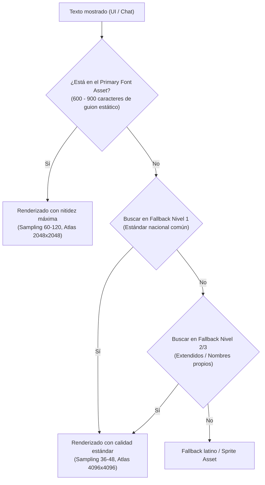

## **1. Visión general del proyecto y retos de la localización en tiempo real**

El proyecto **GilongWorld** plantea un requisito técnico de enorme complejidad y alcance global: ofrecer soporte integral de localización (*localization*) para 15 idiomas objetivo. La lista incluye inglés, vietnamita, francés, italiano, alemán, español (España), polaco, portugués (Brasil), portugués (Portugal), coreano, ruso, japonés, turco, chino simplificado y chino tradicional. En el desarrollo moderno de videojuegos con el motor Unity, gestionar y renderizar texto en un espacio gráfico en tiempo real no se limita a sustituir cadenas de texto. Exige una arquitectura tipográfica integral que garantice la coherencia estética, la nitidez visual a cualquier distancia de cámara y, por encima de todo, una gestión eficiente de la memoria del sistema.

La herramienta estándar y más potente del ecosistema Unity para el renderizado de texto es **TextMeshPro (TMP)**. A diferencia de los sistemas tradicionales de texto de interfaz (UI Text), que rasterizan cada carácter como una imagen de mapa de bits borrosa al ampliarse, TextMeshPro requiere convertir los archivos de fuentes estándar en recursos especializados denominados **Font Asset**[^1]. Estos Font Assets contienen una o varias texturas (*Atlas Texture*) basadas en la tecnología **Signed Distance Field (SDF)**. La tecnología SDF permite escalar el texto de forma infinita sin pixelación (*pixelation*), al tiempo que proporciona la base matemática para que el shader de renderizado genere efectos gráficos complejos en la GPU en tiempo real, como sombras paralelas, contornos, dilatación del trazo y resplandores[^1].

Sin embargo, la potencia de SDF conlleva una limitación física inevitable: **los límites de memoria**. Alojar la totalidad de los caracteres de los 15 idiomas objetivo en una única textura atlas es físicamente imposible[^1]. En particular, los idiomas del grupo CJK (*chino, japonés y coreano*) poseen sistemas de escritura ideográfica monumentales con decenas de miles de caracteres. Si se intenta empaquetar todo este repertorio en un único Atlas Texture, sus dimensiones superarán el límite máximo que el hardware —especialmente en dispositivos móviles— puede procesar (habitualmente $4096 \times 4096$ u $8192 \times 8192$ píxeles), provocando desbordamiento de VRAM o cierres inesperados de la aplicación (*crashes*)[^5]. Este informe detalla paso a paso el proceso completo: desde la selección y descarga de las fuentes originales y el análisis morfológico de cada sistema de escritura, hasta el ajuste interno de los parámetros de TextMeshPro, la gestión de cadenas de respaldo (*Fallback Chain*) y la resolución definitiva del problema de la unificación Han (*Han Unification*) mediante el paquete Unity Localization.

---

## **2. Fundamentos tipográficos y estrategia de adquisición de fuentes originales**

El primer paso, y el más determinante, al diseñar un sistema tipográfico multilingüe es elegir con precisión el archivo de fuente original (*Source Font File*). Mantener la coherencia visual en 15 idiomas exige una familia tipográfica de código abierto que cubra de forma exhaustiva los bloques Unicode básicos y extendidos, con una métrica de línea base (*baseline*) y un grosor de trazo (*weight*) uniformes.

En la industria del software, la familia tipográfica **Google Noto** (acrónimo de *"No Tofu"*, por su misión de erradicar los recuadros vacíos cuando faltan glifos, apodados coloquialmente «tofu») está reconocida como el estándar de referencia[^7]. Diseñada por Google en colaboración con fundiciones tipográficas líderes, Noto garantiza que los caracteres latinos, cirílicos y CJK puedan mostrarse juntos en una misma línea de texto sin descompensaciones de escala ni discrepancias de estilo[^8]. Esa fluidez cuando coexisten varios idiomas en una misma frase resulta vital para la inmersión del jugador en GilongWorld.

### **Guía para extraer e importar los archivos de fuente en Unity**

Para iniciar la integración, las fuentes originales deben descargarse directamente desde la biblioteca **Google Fonts**. El proceso de descarga e importación en Unity debe seguir una disciplina estricta para evitar inflar innecesariamente el tamaño del proyecto:

1. **Grupo de 11 idiomas con alfabeto latino y cirílico** (*inglés, vietnamita, francés, italiano, alemán, español, polaco, portugués de Brasil, portugués de Portugal, ruso y turco*): el sistema solo necesita la familia base **Noto Sans**[^8]. Esta fuente alberga más de 3.700 glifos (*glyphs*) que cubren bloques Unicode como Latin Extended, Cyrillic y marcas diacríticas combinadas, satisfaciendo por completo los requisitos de los idiomas mencionados[^8]. Al descargarla desde Google Fonts se obtiene un archivo comprimido con varios pesos tipográficos (*Thin, Regular, Medium, Bold, Black*) en formato TrueType (`.ttf`).
2. **Grupo de 4 idiomas CJK**: la adquisición es más compleja. Es necesario descargar por separado las variantes **Noto Sans JP** (japonés), **Noto Sans KR** (coreano), **Noto Sans SC** (chino simplificado) y **Noto Sans TC** (chino tradicional)[^7]. Estos archivos CJK son muy pesados —oscilan entre 15 MB y 20 MB por cada grosor— debido a su ingente volumen de datos gráficos. El formato habitual en este grupo es OpenType (`.otf`), que soporta tablas tipográficas más complejas que TrueType[^5].

Tras descomprimir los archivos descargados de Google Fonts, el siguiente paso es importarlos (*import*) al proyecto de Unity. Una buena práctica (*best practice*) en la organización de recursos es crear una estructura de carpetas específica, por ejemplo `Assets/GilongWorld_Resources/Fonts/Source_Files/`. Los archivos `.ttf` y `.otf` (conviene seleccionar un único peso estándar como *Regular* o *Medium* para optimizar la memoria, salvo que el diseño de interfaz exija variantes en negrita específicas) se arrastran y sueltan directamente desde el sistema operativo hasta esta carpeta en la ventana Project del Editor de Unity[^10].

> [!NOTE]
> TextMeshPro no utiliza directamente estos archivos `.ttf` ni `.otf` para renderizar texto en tiempo de ejecución; solo sirven como materia prima para que la herramienta Font Asset Creator extraiga los datos vectoriales y los compile en texturas SDF[^1]. Mantener las fuentes originales en una carpeta independiente facilita su exclusión de las compilaciones finales (cuando no se emplea Dynamic SDF), reduciendo así el tamaño del paquete de instalación del juego.

---

## **3. Análisis morfológico de los sistemas de escritura y rangos Unicode**

La diversidad de los 15 idiomas de GilongWorld exige un análisis detallado de cómo se codifican sus caracteres en el estándar internacional Unicode. TextMeshPro utiliza notación hexadecimal (base 16) para especificar los rangos de código (*Unicode Ranges*) que deben extraerse de cada fuente original[^13]. Declarar con exactitud estos rangos no solo asegura una cobertura lingüística total, sino que también evita cargar símbolos innecesarios que desperdicien espacio en la textura Atlas.

Atendiendo a su estructura morfológica, los 15 idiomas se dividen en tres grandes grupos estratégicos para la gestión de recursos.

### **Subgrupo 1: Alfabeto latino extendido y diacríticos**

Este grupo abarca inglés, francés, italiano, alemán, español, polaco, portugués (Brasil), portugués (Portugal), turco y vietnamita. Aunque todos comparten el bloque latino básico (`U+0020` a `U+007E`), las necesidades divergen notablemente en los bloques extendidos[^1]:

- **Europa Occidental y del Sur** (*francés, español, italiano, portugués y alemán*): dependen principalmente del bloque *Latin-1 Supplement* (`U+00A0` a `U+00FF`), que incluye vocales acentuadas y signos esenciales como `á`, `é`, `í`, `ó`, `ú`, `ñ`, `ü` y `ç`.
- **Europa Central y Turquía** (*polaco y turco*): requieren el bloque *Latin Extended-A* (`U+0100` a `U+017F`) para representar grafemas específicos como `ą`, `ł`, `ş` y `ğ`[^10].
- **Vietnamita**: es el idioma latino más exigente. Su sistema tonal complejo combinado con vocales con acento circunflejo (`â`, `ê`, `ô`) o con gancho (`ơ`, `ư`) exige incorporar el bloque *Latin Extended Additional* (`U+1E00` a `U+1E9F`)[^14]. La superposición de marcas diacríticas genera glifos de gran altura vertical (por ejemplo, la letra `Ể` supera ampliamente la altura estándar de las mayúsculas latinas), lo que obliga a ajustar cuidadosamente el interlineado (*line height*) y el relleno (*padding*) en TextMeshPro para evitar recortes (*clipping*) en la parte superior de los caracteres.

### **Subgrupo 2: Alfabeto cirílico**

El único idioma del proyecto perteneciente a este sistema es el **ruso**. Aunque el alfabeto cirílico es totalmente independiente del latino en cuanto a codificación —se sitúa en el bloque `U+0400` a `U+04FF`[^10]—, comparte proporciones de anchura y altura de línea base con el sistema latino de Noto Sans. Esto permite integrarlo sin fisuras en el mismo Font Asset que el grupo latino sin provocar desequilibrios visuales.

### **Subgrupo 3: Sistemas CJK y el problema histórico de la unificación Han**

El tercer grupo engloba al **coreano, japonés, chino simplificado y chino tradicional**. Es el ámbito más complejo, donde los límites técnicos de TextMeshPro se ponen constantemente a prueba. La causa raíz no reside únicamente en el enorme número de caracteres, sino también en una controvertida convención técnica del Consorcio Unicode conocida como **Han Unification** (*Unificación Han*)[^7].

En los primeros años del estándar Unicode, para encajar los sistemas de escritura de Asia Oriental dentro de un espacio de 16 bits, los ingenieros decidieron fusionar bajo un mismo punto de código (*code point*) los ideogramas de origen histórico común utilizados en China, Japón y Corea[^7]. Este bloque se denomina *CJK Unified Ideographs* y abarca desde `U+4E00` hasta `U+9FA5`[^12].

Esta decisión acarrea una consecuencia grave en el renderizado de texto: **aunque compartan el mismo código Unicode, la forma gráfica real de un mismo carácter (glifo) se dibuja de manera distinta según el país**, fruto de la evolución cultural, la caligrafía y las normativas educativas propias de cada región:

- Un caso paradigmático es el carácter de «hueso», con código Unicode `U+9AA8` (骨). La disposición de los trazos internos dentro del rectángulo superior de este carácter en el chino simplificado (SC) sigue una orientación horizontal izquierda-derecha, mientras que en el chino tradicional (TC) y en el japonés (JP) adopta una estructura de trazos claramente distinta[^7].
- De igual modo, caracteres cotidianos como «nieve» (雪) o «recto» (直) presentan diferencias sutiles en su trazo que un lector nativo identifica al instante.

El motor de renderizado de texto no puede deducir el contexto cultural por sí solo; simplemente recibe un código Unicode y consulta el glifo correspondiente en la fuente activa. En consecuencia, utilizar un único Font Asset CJK para todos los idiomas de Asia Oriental obligaría a los jugadores japoneses a leer textos en japonés con la grafía china, o viceversa[^7]. Para un hablante nativo, esto produce la sensación de un error de fuente, falta de rigor profesional o un texto «híbrido», destruyendo por completo la inmersión en el mundo del juego[^7]. La única solución fiable consiste en aislar Font Assets independientes para cada idioma CJK y gestionar dinámicamente las cadenas de respaldo.

---

## **4. Mecánica técnica de TextMeshPro y Signed Distance Field (SDF)**

Para configurar correctamente los recursos tipográficos, es imprescindible comprender cómo funciona el **Signed Distance Field (SDF)** dentro de TextMeshPro. A diferencia de las fuentes de mapa de bits tradicionales que almacenan el color de cada píxel, una textura SDF almacena la distancia matemática desde cada téxel hasta el borde (contorno) más cercano del carácter[^1]:
- Si el punto está **dentro** del carácter, la distancia toma un valor **positivo**.
- Si está **fuera**, toma un valor **negativo**.
- Si está **exactamente sobre el borde**, la distancia es **cero** ($0$).

Estos valores de distancia se codifican en escala de grises (*grayscale*) dentro de una Atlas Texture. En tiempo de ejecución, el shader de GPU de TextMeshPro aplica una interpolación bilineal (*bilinear interpolation*) sobre dichas muestras. Para cada fragmento en pantalla, el shader evalúa el valor interpolado: si es $> 0$, dibuja el color del texto; si es $< 0$, lo deja transparente. Al depender de una interpolación matemática continua en lugar de una rejilla discreta de píxeles, el texto SDF mantiene curvas perfectamente definidas incluso cuando la cámara se acerca al máximo al objeto[^1].

Esta mecánica define los dos parámetros fundamentales al generar un Font Asset:
1. **Sampling Point Size:** determina la resolución física en téxeles con la que se rasteriza cada glifo en la Atlas Texture. Cuanto mayor sea el valor, mayor será la fidelidad de los contornos curvos.
2. **Padding (relleno):** es la clave de la versatilidad del SDF. El margen alrededor de cada glifo proporciona espacio para que el gradiente de distancia descienda hacia valores negativos más profundos. Cuanto mayor sea el padding, más margen tendrá el algoritmo SDF para renderizar contornos gruesos (*outline*), sombras paralelas (*shadow*) o resplandores (*glow*) sin cortes abruptos[^13].

---

## **5. Guía detallada de configuración con Font Asset Creator**

La generación de los archivos de textura tipográfica se realiza mediante la herramienta integrada en Unity: **Font Asset Creator**, accesible desde el menú:

```text
Window > TextMeshPro > Font Asset Creator
```

De acuerdo con el análisis del apartado 3, la arquitectura óptima para los 15 idiomas de GilongWorld sigue un modelo segmentado: **crear un Font Asset compartido para los 11 idiomas latinos y cirílicos, y 4 Font Assets independientes para cada idioma CJK**.

### **5.1. Configuración estática (Static) para sistemas latino, cirílico y vietnamita**

Agrupar los 11 idiomas (*inglés, francés, italiano, alemán, español, polaco, portugués BR, portugués PT, turco, ruso y vietnamita*) en un único **Primary Static Font Asset** es la estrategia más eficaz para reducir el número de llamadas de dibujo (*draw calls*) en la GPU, un factor decisivo para mantener una tasa de fotogramas (*frame rate*) estable[^14].

La configuración en Font Asset Creator debe aplicarse con estos parámetros estrictos[^12]:

| Propiedad de configuración | Recomendación técnica | Justificación del análisis |
| :--- | :--- | :--- |
| **Source Font File** | `NotoSans-Regular.ttf` | Arrastrar el archivo original desde la carpeta `Assets` hasta este campo como fuente geométrica[^1]. |
| **Sampling Point Size** | `Custom Size: 60 - 90` | El modo Auto Sizing se limita a encajar los glifos en el espacio disponible. Fijar manualmente Custom Size entre 60 y 90 garantiza una precisión SDF uniforme en toda la textura[^1]. |
| **Padding** | `6 - 9` (Proporción ~10%) | La regla estándar en TextMeshPro dicta que el Padding equivalga aproximadamente al 10% del Sampling Point Size[^4]. Con Sampling 60, un Padding de 6 es óptimo (puede subirse a 10 si la interfaz requiere contornos muy gruesos). |
| **Packing Method** | `Optimum` | El algoritmo Optimum tarda bastante más que Fast, pero realiza pasadas iterativas para empaquetar los glifos al máximo y minimizar el espacio desperdiciado[^12]. |
| **Atlas Resolution** | `2048 x 2048` | El conjunto de estos 11 idiomas suma entre 1.500 y 2.000 glifos. Una resolución de $2048 \times 2048$ ofrece espacio de sobra para mantener Sampling Point Size 60 sin omitir ningún carácter[^7]. |
| **Character Set** | `Unicode Range (Hex)` | En lugar de usar conjuntos predefinidos, este modo ofrece un control absoluto sobre los caracteres exactos que se compilan[^2]. |

En el campo **Custom Character List** se introduce la lista de rangos hexadecimales que cubre por completo los 11 idiomas:

```text
0020-007E, 00A0-00FF, 0100-017F, 0180-024F, 1E00-1E9F, 0300-036F, 0400-04FF, 0500-052F, 2000-206F
```

Una vez completados los parámetros:
1. Hacer clic en **Generate Font Atlas**. La herramienta calculará el campo de distancias y generará la textura (puede tardar varios minutos según la CPU).
2. Al finalizar y mostrarse la vista previa de la textura, pulsar **Save**.
3. Guardar el archivo con el nombre `Global_Latin_Cyrillic_SDF.asset` en la carpeta correspondiente del proyecto[^1].

### **5.2. Configuración estática (Static) para CJK y arquitectura jerárquica de Fallback**

Gestionar los 4 idiomas CJK exige un enfoque totalmente distinto debido al volumen masivo de datos. Es obligatorio repetir el proceso cuatro veces por separado para `NotoSansCJKjp`, `NotoSansCJKkr`, `NotoSansCJKsc` y `NotoSansCJKtc`. No obstante, intentar compilar todos los rangos Unicode CJK en un único atlas estático fallará de inmediato por superar los límites físicos de textura[^5].

La solución estándar de ingeniería consiste en aplicar un **Modelo Jerárquico de Mapeo de Caracteres (Hierarchical Character Mapping)** combinado con la opción **Characters from File**[^7]:

#### **1. Crear un Primary SDF Font Asset para los caracteres conocidos (Known Characters)**
- Extraer todas las cadenas de texto estáticas de las **String Tables** del proyecto (menús, misiones, objetos, diálogos y habilidades).
- En la práctica, este conjunto de caracteres únicos (*unique characters*) suele ser **inferior a 1.000 caracteres** (en GilongWorld ocupa exactamente **855 caracteres** en chino simplificado, **870** en chino tradicional, **694** en japonés y **588** en coreano).
- **Maximizar la calidad (Maximize Sampling Size):** al haber menos de 1.000 glifos, se puede elevar el **Sampling Point Size** (`60` a `90` o `120`) dentro de un Atlas `2048 x 2048`. Esto asegura que toda la interfaz oficial del juego mantenga una nitidez impecable a cualquier distancia de cámara.

#### **2. Construir niveles de Fallback heredados de estándares nacionales (Standard Fallbacks para UGC/Chat)**
Para permitir que los jugadores introduzcan texto libre (nombres de personaje, descripciones de clan o chat comunitario) sin encontrarse nunca con recuadros «tofu», el sistema añade Font Assets Fallback basados en **conjuntos de caracteres estándar nacionales**:

| Idioma | Conjunto estándar nacional de caracteres | Número de caracteres | Organismo emisor y referencia abierta |
| :--- | :--- | :---: | :--- |
| **Chino simplificado (zh-Hans)** | **TGSCC (通用规范汉字表)**<br/>- Nivel 1 (Común): 3.500 caracteres<br/>- Nivel 2 (Extendido): 3.000 caracteres<br/>- Nivel 3 (Nombres propios/Lugares): 1.605 caracteres | **8.105** | Ministerio de Educación de la RPCh<br/>*Código abierto:* [GitHub chinese-character-table](https://github.com/maple-leaf/chinese-character-table) |
| **Chino tradicional (zh-Hant)** | **Tabla de formas estándar de caracteres nacionales comunes** (*常用國字標準字體表*) | **4.808** | Ministerio de Educación de Taiwán (MOE Taiwan)<br/>*Código abierto:* [Taiwan Open Data](https://data.gov.tw/dataset/5961) / [GitHub cjktables](https://github.com/ButTaiwan/cjktables) |
| **Japonés (ja)** | - **Jōyō Kanji** (常用漢字 - Uso habitual): 2.136 caracteres<br/>- **Jinmeiyō Kanji** (人名用漢字 - Nombres propios): 863 caracteres | **2.999** | Agencia de Asuntos Culturales de Japón (文化庁)<br/>*Código abierto:* [KanjiAPI](https://kanjiapi.dev/) / [GitHub kanji-data](https://github.com/davidluzgouveia/kanji-data) |
| **Coreano (ko)** | **Estándar KS X 1001** (2.350 sílabas Hangul más frecuentes, cobertura del 99,9% en comunicación) | **2.350** | Agencia Coreana de Tecnología y Estándares (KATS)<br/>*Código abierto:* [GitHub ksx1001](https://github.com/korean-character-sets/ksx1001) / Extraído vía `euc-kr` |



#### **3. La regla invariable: mantener la proporción Sampling Point Size / Padding (Ratio Consistency)**

Un principio gráfico fundamental en el shader de TextMeshPro es que **el grosor de los efectos Outline (contorno), Underlay / Shadow (sombra) y Glow (resplandor) se calcula directamente a partir de la proporción entre Sampling Point Size y Padding**[^13].

##### **¿Por qué los Fallback no necesitan el mismo Point Size que el Primary?**
- **Primary Font (~855 caracteres de guion UI):** visibles el 100% del tiempo de juego $\rightarrow$ **maximizar la calidad** (`Sampling Size = 120`, `Padding = 10`, Atlas $2048 \times 2048$).
- **Fallback Fonts (2.700 – 8.000 caracteres raros para chat/nombres):** aparecen con poca frecuencia $\rightarrow$ **reducir el muestreo** (`Sampling Size = 60` o `48`) para empaquetar miles de caracteres en la misma superficie de atlas sin disparar el consumo de VRAM.

##### **¿Por qué es obligatorio mantener la misma proporción ($\text{Ratio} = \frac{\text{Sampling}}{\text{Padding}}$)?**
Si en una misma frase coexisten un carácter del Primary y otro de un Fallback:
- **Si la proporción difiere:** el carácter del Primary (Size 120, Pad 10 $\rightarrow$ Ratio 12) luce un contorno fino y nítido, mientras que el carácter del Fallback (Size 60, si se dejó por error Pad 10 $\rightarrow$ Ratio 6) mostrará un **contorno el doble de grueso, deformado, que devora los trazos internos de la letra**.
- **Si se conserva la proporción ($\text{Ratio} = 12$):** tanto si el carácter proviene del Primary como de cualquiera de los Fallback, **el grosor del contorno y la extensión de la sombra serán 100% idénticos**.

| Nivel de Font Asset | Función | Sampling Point Size *(Custom)* | Padding | Resolución del Atlas | Proporción (Ratio) |
| :--- | :--- | :---: | :---: | :---: | :---: |
| **Primary Font** | Guion principal de UI | **120** *(o 96)* | **10 px** *(o 8 px)* | $2048 \times 2048$ | **12** *(Máxima nitidez)* |
| **Fallback Nivel 1** | ~2.725 caracteres comunes | **60** | **5 px** | $2048 \times 2048$ | **12** *(Ahorro de VRAM)* |
| **Fallback Nivel 2** | ~2.992 caracteres extendidos | **60** | **5 px** | $2048 \times 2048$ | **12** *(Ahorro de VRAM)* |
| **Fallback Nivel 3** | ~1.605 caracteres raros/nombres | **48** | **4 px** | $2048 \times 2048$ | **12** *(Ahorro de VRAM)* |

> [!TIP]
> **Consejo práctico:** en *Font Asset Creator*, cambia `Sampling Point Size` de *Auto Sizing* a **Custom Size** para fijar exactamente el tamaño de muestreo y el Padding según las proporciones de la tabla anterior.

---

### **5.3. Organización de carpetas y automatización práctica en Unity**

Para facilitar la escalabilidad y el mantenimiento a largo plazo, GilongWorld organiza todos los conjuntos de caracteres en una estructura de carpetas jerárquica y bien delimitada:

```text
Assets/_GilongWorld/_Project/Art/Fonts/_chars/
├── 01_Latin_Cyrillic/        # [Primary Font compartido] 11 idiomas latinos/cirílicos
│   ├── vi_chars.txt          # Vietnamita
│   ├── en_chars.txt          # Inglés
│   ├── ru_chars.txt          # Ruso
│   └── ...                   # Francés, alemán, italiano, español, polaco, portugués, turco
│
├── 02_CJK/                   # [Primary Fonts CJK] Caracteres estáticos del guion del juego
│   ├── ja_chars.txt          # Japonés (694 caracteres reales)
│   ├── ko_chars.txt          # Coreano (588 caracteres reales)
│   ├── zh_Hans_chars.txt     # Chino simplificado (855 caracteres reales)
│   ├── zh_Hant_chars.txt     # Chino tradicional (870 caracteres reales)
│   │
│   ├── Standard_Fallbacks/   # [Corpus estándar] 7 conjuntos nacionales originales
│   │   ├── zh_Hans_TGSCC_Level1_3500.txt
│   │   ├── zh_Hans_TGSCC_Level2_3000.txt
│   │   ├── zh_Hans_TGSCC_Level3_1605.txt
│   │   ├── zh_Hant_Common_4808.txt
│   │   ├── ja_Joyo_Kanji_2136.txt
│   │   ├── ja_Jinmeiyo_Kanji_863.txt
│   │   └── ko_KS_X_1001_2350.txt
│   │
│   └── Subtracted_Fallbacks/ # [Fallbacks optimizados] Sin caracteres duplicados del Primary
│       ├── zh_Hans_Fallback_Level1.txt    (TGSCC Nivel 1 menos Primary)
│       ├── zh_Hans_Fallback_Level2.txt    (TGSCC Nivel 2 menos Primary)
│       ├── zh_Hans_Fallback_Level3.txt    (TGSCC Nivel 3 menos Primary)
│       ├── zh_Hant_Fallback_Common.txt    (Estándar TW 4808 menos Primary)
│       ├── ja_Fallback_Joyo.txt           (Joyo Kanji menos Primary)
│       ├── ja_Fallback_Jinmeiyo.txt       (Jinmeiyo Kanji menos Primary)
│       └── ko_Fallback_KS_X_1001.txt      (KS X 1001 menos Primary)
```

#### **Herramienta automatizada de extracción y resta de Fallback (`GWCharacterExtractor.cs`)**
Para liberar a los programadores de exportar CSV manualmente y depurar caracteres duplicados, la herramienta de Editor [`GWCharacterExtractor.cs`](file:///d:/Unity-Projects/GLW/Assets/_GilongWorld/_Project/Editor/Localization/GWCharacterExtractor.cs) integra un flujo 2 en 1:
- **Ruta de menú:** `GilongWorld → Localization → Extract CJK Characters From String Tables`
- **Mecanismo 1 (Extracción del Primary):** explora todas las `StringTableCollections` de Unity Localization, recopila todas las cadenas utilizadas en una estructura `HashSet<char>` (garantizando un 100% de unicidad), las ordena por código Unicode ascendente y genera los 4 archivos Primary dentro de `02_CJK/`.
- **Mecanismo 2 (Resta automática de Fallback):** el script lee automáticamente los 7 conjuntos de `Standard_Fallbacks/`, los contrasta y **elimina todos los caracteres ya presentes en el Primary Asset**, guardando el resultado en `Subtracted_Fallbacks/`. Esto erradica por completo el desperdicio de VRAM por caracteres repetidos entre el Atlas Primary y los Atlas Fallback.

#### **Ventana `GWSDFGeneratorWindow` y superación de bloqueos de API en Unity 6**
Para garantizar el cumplimiento estricto de la regla «Proporción Sampling / Padding = 12», el proyecto incluye una ventana de Editor específica que valida los parámetros y muestra alertas si la proporción se desvía.
Cabe destacar que, en Unity 6, la propiedad `clearDynamicDataOnBuild` del Font Asset pasó a estar protegida bajo el modificador de acceso `internal`, impidiendo activar la limpieza previa a la compilación mediante código convencional. Esta herramienta resuelve el problema limpiamente aplicando reflexión mediante `SerializedObject`:

```csharp
var serializedObject = new SerializedObject(fontAsset);
serializedObject.FindProperty("m_ClearDynamicDataOnBuild").boolValue = true;
serializedObject.ApplyModifiedProperties();
```

Gracias a ello, el atlas heredado corrupto de 137 MB quedó completamente purgado, reduciendo el tamaño de compilación al mínimo imprescindible.

---

## **6. Arquitectura de la cadena de respaldo (Fallback Chain) y solución a la unificación Han**

La fluidez de un juego multilingüe depende de cómo se gobierne la **cadena de respaldo (*Fallback Chain*)**. Cuando un componente de UI TextMeshPro recibe una cadena que contiene un carácter ausente en su Primary Font Asset, el sistema ejecuta una búsqueda recursiva en las listas de respaldo hasta encontrar un glifo alternativo.

El algoritmo de búsqueda respeta una jerarquía estricta:
1. `TextMeshPro Primary Font Asset`
2. `Lista local de Fallback Font Assets del Primary Font`
3. `Sprite Asset local`
4. `General Fallback Font Assets definidos globalmente en TMP_Settings`
5. `Default Sprite Asset`
6. `Default Font Asset`[^20]

> [!WARNING]
> El sistema recorre esta cadena secuencialmente de arriba abajo y **se detiene inmediatamente al encontrar la primera coincidencia de punto de código Unicode**[^7].

Como se analizó en el apartado 3, la unificación Han hace que SC, TC y JP compartan puntos de código Unicode pese a poseer trazos distintos[^7]. Si el desarrollador introduce todos los archivos CJK en la lista General Fallback Font Assets de `TMP_Settings`, el orden de la lista dictará el estilo regional mostrado. Por ejemplo, si el orden es `Font_CJK_JP_SDF` $\rightarrow$ `Font_CJK_SC_SDF` $\rightarrow$ `Font_CJK_TC_SDF`, al mostrar un texto en chino simplificado el sistema recorrerá la lista, encontrará primero el archivo japonés con ese código Unicode y renderizará los caracteres con estilo Kanji japonés, ignorando por completo la fuente china situada más abajo[^7].

### **Arquitectura de aislamiento local (Local Fallback Architecture)**

Para erradicar de raíz esta contaminación cruzada, la estructura de Fallback debe permanecer estrictamente aislada por idioma:

> [!IMPORTANT]
> **Nunca incluyas fuentes CJK en la lista global de respaldo (Global Fallback List) de `TMP_Settings`**[^1]. En su lugar, vincula los niveles de respaldo dentro de la lista **Local Fallback** de cada Asset y gestiona el intercambio de forma dinámica en tiempo de ejecución.

Una regla básica de tipografía establece que las fuentes CJK suelen incluir letras latinas y números arábigos mal proporcionados en comparación con las tipografías latinas dedicadas[^9]. Por ello, los caracteres latinos y numéricos deben resolverse siempre a través de `Global_Latin_Cyrillic_SDF`. La vinculación local se configura así:
1. Abrir `Font_CJK_SC_SDF.asset`, añadir en **Fallback Font Assets** los niveles de respaldo 1-3 de chino simplificado y agregar finalmente `Global_Latin_Cyrillic_SDF`[^1].
2. Repetir exactamente el mismo esquema para TC, JP y KR.

De este modo se garantiza que, cuando el juego esté en chino y aparezcan cifras o nombres propios en inglés, esos caracteres atraviesen limpiamente el atlas estático chino (ya que los glifos latinos se excluyeron durante la extracción *Characters from File*) y sean capturados por el asset latino/cirílico de alta calidad[^7].

---

## **7. Integración con Unity Localization para el intercambio dinámico (Runtime Swapping)**

Para asegurar una representación culturalmente fiel de los caracteres Han y optimizar el uso de VRAM, los componentes UI de TextMeshPro no pueden conservar una referencia estática permanente. Cuando el usuario cambia de idioma (*Locale*), el **Primary Font Asset** debe intercambiarse (*swap*) automáticamente en tiempo de ejecución (*runtime*)[^23].

El paquete **Unity Localization** (`com.unity.localization`) ofrece herramientas sólidas para automatizar esta lógica sin recurrir a sentencias condicionales rígidas (*hardcoding*)[^25], apoyándose en el evento global `LocalizationSettings.SelectedLocaleChanged`[^24].

Existen dos enfoques de implementación:

### **Método 1: Gestor centralizado de fuentes (Centralized Font Manager)**

En lugar de asociar componentes Localized Asset manualmente a miles de textos UI (lo cual sobrecarga la memoria con miles de objetos `MonoBehaviour` redundantes y presión sobre el recolector de basura), GilongWorld emplea una estrategia de **gestión centralizada mediante Addressables**.

El script `GWFontManager.cs` (marcado con `DontDestroyOnLoad`) se suscribe al evento `LocalizationSettings.SelectedLocaleChanged`. Al dispararse el cambio de idioma, el gestor ejecuta dos operaciones clave:
1. **Carga asíncrona (Async Load):** utiliza `LocalizationSettings.AssetDatabase.GetLocalizedAssetAsync<TMP_FontAsset>("Fonts_Table", "PrimaryFont")` para obtener desde Addressables el Font Asset correspondiente al idioma activo.
2. **Barrido global (Global Sweep):** llama a `FindObjectsByType<TMP_Text>` para recorrer toda la escena y asignar la nueva fuente a todos los componentes de texto. Aunque esta operación consume unos pocos milisegundos de CPU, solo se ejecuta al cambiar de idioma o al cargar una escena, liberando la memoria RAM de miles de componentes oyentes individuales. Justo después de la asignación, el recurso del idioma anterior se libera mediante `Addressables.Release()`.

Este método elimina por completo la «contaminación cruzada» (*cross-pollination*) entre idiomas CJK, ya que solo permanece cargado en memoria el atlas del idioma seleccionado[^7].

### **Método 2: Asset Tables de Unity Localization**

La alternativa más nativa es utilizar las **Localized Asset Tables**[^23]. De forma análoga a las Localized String Tables que sustituyen textos, las Asset Tables permiten vincular distintos recursos Font Asset a cada idioma. Los componentes Localized Text de la interfaz pueden configurarse para actualizar automáticamente tanto la cadena de texto como la propiedad `FontAsset` del objeto TextMeshPro[^23].

Este enfoque requiere configuración directa en el Inspector, pero ofrece gran estabilidad y evita mantener código personalizado de mapeo[^28].

---

## **8. Gestión de contenido dinámico (UGC), optimización de memoria e integración con Addressables**

La arquitectura estática (*Static Architecture*) resuelve íntegramente la interfaz oficial y los diálogos del sistema. No obstante, el contenido generado por los usuarios (**User-Generated Content - UGC**), como nombres de personaje, descripciones de clan o el chat comunitario, plantea un reto mayor: es imposible prever qué caracteres introducirán los jugadores entre los 15 idiomas, y cargar en RAM los cientos de miles de caracteres existentes en el mundo es inviable.

### **La solución híbrida (Hybrid SDF System)**

El modo **Dynamic SDF** estándar de TextMeshPro parte de una textura atlas vacía ($0 \times 0$ píxeles) y rasteriza cada carácter nuevo mediante CPU en tiempo de ejecución[^6]. Sin embargo, abusar de un enfoque puramente dinámico provoca fuertes caídas de fotogramas (*frame spikes*) al abrir las primeras pantallas. Por ello, GilongWorld implementa una **Arquitectura Híbrida (Hybrid)**:

1. **Población estática fluida (Static Population):** mediante `GWCharacterExtractor.cs`, se precompilan miles de caracteres frecuentes en el atlas usando `TryAddCharacters` directamente desde el Editor. Durante el juego normal, todos esos caracteres ya residen en memoria, garantizando una tasa de FPS totalmente estable.
2. **Desbordamiento dinámico seguro (Dynamic Fallback):** el Font Asset se guarda en modo Dynamic con `isMultiAtlasTexturesEnabled = true`. Si un jugador escribe en el chat un carácter extremadamente raro que no figura en el primer atlas, TMP genera al instante una nueva textura atlas auxiliar (`Atlas 0 1`, `Atlas 0 2`...) para alojarlo en lugar de mostrar un recuadro «tofu». Es la combinación óptima de rendimiento y cobertura.

> [!CAUTION]
> El método Dynamic SDF tiene un coste tangible en memoria: cada textura atlas dinámica de $2048 \times 2048$ generada al vuelo consume de inmediato alrededor de **4 MB** de memoria del sistema. Si se acumulan múltiples atlas auxiliares, la presión sobre dispositivos móviles aumentará rápidamente[^31].

### **La trampa oculta de Addressables y la duplicación de VRAM**

Los proyectos modernos a gran escala como GilongWorld recurren casi siempre a **Addressables** para gestionar la carga de recursos. Sin embargo, muchos equipos cometen un error crítico: **asumir que no están usando Addressables para las fuentes y dejar los Font Assets dentro de una carpeta `Resources`.**

En realidad, **el paquete Unity Localization está construido directamente sobre Addressables**. Incluso si no gestionas fuentes manualmente con Addressables, Localization lo utiliza en segundo plano para las String Tables.
Cuando un Prefab de interfaz empaquetado como Addressable referencia un Font Asset ubicado dentro de `Resources`, el sistema de compilación de Unity incurre en una grave duplicación de activos (*duplicate assets*):
1. Unity empaqueta una copia íntegra de esa textura Atlas dentro del AssetBundle de Addressables[^32].
2. Al ejecutarse el juego, se carga la copia desde `Resources` y, además, se vuelve a cargar la copia contenida en el AssetBundle, **duplicando innecesariamente el consumo de VRAM**[^31]. Este fallo silencioso es muy habitual y provoca con facilidad cierres por falta de memoria en dispositivos móviles con límites estrictos de RAM[^33].

**La solución definitiva:**
- Sacar por completo `TMP_Settings` y todos los Font Assets de la carpeta `Resources`, trasladándolos a una ruta estándar del proyecto como `Assets/_GilongWorld/_Project/Art/Fonts/SDF/`.
- Seleccionar todos los archivos SDF e incluirlos en un grupo Addressables específico (por ejemplo, `Fonts_Addressables`), registrando su mapeo en la **Asset Table** (`Fonts_Table`) de Localization.
- **Limpiar datos dinámicos en el Editor:** los Dynamic Font Assets conservan en disco las texturas generadas. Es obligatorio purgar los datos dinámicos antes de cada compilación (proceso ya automatizado en `GWSDFGeneratorWindow` mediante la técnica de `SerializedObject` explicada anteriormente)[^30].
- **Limpieza de memoria en tiempo de ejecución:** al transicionar entre escenas grandes, invocar `TMP_FontAsset.ClearFontAssetData(true)` o `FontEngine.DestroyFontEngine()` para liberar por completo las texturas dinámicas que ya no estén en uso[^35].

---

## **9. Diagnóstico en vivo y resolución de problemas técnicos (Troubleshooting)**

Durante las pruebas reales en múltiples plataformas, los sistemas de localización suelen manifestar síntomas de fallo reconocibles. Comprender la causa técnica permite al equipo aislar y resolver las incidencias con rapidez:

### **El texto aparece como recuadros vacíos (Tofu Boxes) en compilaciones móviles pero funciona en el Editor**
- **Causa:** el gestor de dependencias de Unity no registra los Fallback Font Assets como dependencias de compilación si solo están referenciados de forma dinámica o laxa en `FallbackFontAssetTable` en tiempo de ejecución, en lugar de estar vinculados directamente a un GameObject estático de la escena. En consecuencia, el proceso de compilación los descarta (*strip*) para ahorrar espacio[^1].
- **Solución:** registrar referencias globales mediante `TMP_Settings.fallbackFontAssets` para que Unity las rastree, o marcar todos los posibles Font Assets para su precarga (*pre-load*) a través del manifiesto de Addressables[^1].

### **Excepción: `"The variable m_AtlasTextures of TMP_FontAsset has not been assigned"`**
- **Causa:** se produce en Dynamic Font Assets con Multi Atlas Textures habilitado[^34]. Cuando el sistema asigna texturas adicionales en tiempo de ejecución para nuevos caracteres y el proceso se interrumpe o la memoria se libera de forma anómala junto con prefabs instanciados (*instantiated prefabs*), la matriz interna conserva una referencia nula (*null reference*).
- **Solución:** ejecutar manualmente un **Reset** del Font Asset desde su menú contextual en el Inspector antes de compilar para restablecer la matriz de texturas inicial[^34].

### **El texto se ve borroso (Blurry) en tamaños de visualización grandes**
- **Causa:** la resolución del Atlas SDF o el valor de `Sampling Point Size` son demasiado bajos en comparación con la altura real en píxeles de los títulos grandes en pantalla[^1].
- **Solución:** para titulares o rótulos grandes (Heading / Banner), configurar `Sampling Point Size` en `150` o superior. Si el atlas no puede alojar todo el conjunto de caracteres a ese tamaño, separar los caracteres empleados en esos encabezados en un Static Font Asset independiente en lugar de compartir el atlas del texto general[^1].

### **Error de autenticación al hacer Pull de tablas de traducción desde Google Sheets (`invalid_grant: Token has been expired or revoked`)**
- **Síntoma:** al sincronizar (*Pull*) tablas de cadenas de localización (como `RPGB_General` o String Tables) desde Google Sheets hacia Unity, aparece el error en rojo: `Pull from Google sheets: Failed - Error: "invalid_grant", Description: "Token has been expired or revoked."`
- **Causa:** **desfase horario / deriva del reloj del sistema (Timezone Skew / Clock Drift)**. La autenticación Google OAuth2 aplica una validación temporal muy estricta sobre la marca de tiempo incluida en la petición. Si el reloj del ordenador o la zona horaria están desfasados, o si el Editor de Unity conserva una caché temporal desactualizada, el servidor de Google rechaza inmediatamente el token con `invalid_grant`.
- **Solución:**
  - **Reiniciar el Editor de Unity:** cerrar y volver a abrir Unity para que el motor sincronice de nuevo la hora real del sistema operativo $\rightarrow$ al volver a pulsar **Pull**, la sincronización funcionará de inmediato.

---

## **10. Recomendaciones arquitectónicas finales**

Soportar 15 idiomas en el proyecto **GilongWorld** exige una arquitectura gráfica tipográfica diseñada bajo los estándares más estrictos de eficiencia en VRAM y fidelidad visual multicultural:

1. **Coherencia tipográfica (Typography):** estandarizar todo el proyecto con **Google Noto Sans** y **Noto Sans CJK** para preservar una línea base (*baseline*) y un grosor visual uniformes cuando coexisten distintos idiomas en una misma línea.
2. **Segmentación de atlas (Atlas Segmentation):** no comprimir todos los idiomas en una única textura. Generar un único Primary Static Font Asset de $2048 \times 2048$ que abarque los 11 idiomas latinos y cirílicos (*inglés, vietnamita, francés, italiano, alemán, español, polaco, portugués, ruso y turco*).
3. **Optimización de Asia Oriental y niveles de Fallback:** separar los 4 idiomas CJK (*chino simplificado, chino tradicional, japonés y coreano*) en Font Assets independientes. Combinar un **Primary SDF Font Asset (< 1.000 caracteres estáticos del guion con Sampling Size 60–120 de alta calidad)** con **3 niveles de Fallback (hasta 8.105 caracteres de estándares nacionales como TGSCC)** para el chat y los nombres de jugador. Es obligatorio mantener una **proporción uniforme de Sampling Point Size / Padding** (Ratio $\approx 10-12$) entre Primary y Fallback para que los efectos del shader (Outline, Shadow, Glow) se rendericen sin deformaciones.
4. **Control de la cadena de respaldo (Han Unification):** no utilizar nunca la lista Global Fallback para fuentes CJK. En su lugar, aplicar el intercambio dinámico en tiempo de ejecución (*Runtime Swapping*) mediante Unity Localization para cargar el Primary Font Asset acorde al Locale activo, eliminando el riesgo de mostrar glifos de una región incorrecta. Configurar siempre `Global_Latin_Cyrillic_SDF` como Fallback local de los archivos CJK.
5. **Contenido dinámico y disciplina de memoria (UGC & Addressables):** habilitar Dynamic Font Assets con Multi Atlas Texture para cubrir caracteres imprevistos en el chat de jugadores. Finalmente, retirar toda la arquitectura de la carpeta `Resources`, gestionar los recursos mediante **Addressables** para erradicar la duplicación de atlas en VRAM y utilizar las API de limpieza antes de compilar y entre escenas para mantener la memoria estable en sesiones prolongadas.

---

## **Referencias**

[^1]: Fix: Unity TextMeshPro Font Asset Missing or Fallback | Bugnet Blog, [https://bugnet.io/blog/fix-unity-textmeshpro-font-asset-missing](https://bugnet.io/blog/fix-unity-textmeshpro-font-asset-missing)
[^2]: Fix: Unity UI TextMeshPro Falling Back to Default Font | Bugnet Blog, [https://bugnet.io/blog/fix-unity-ui-text-mesh-pro-falling-back-default-font](https://bugnet.io/blog/fix-unity-ui-text-mesh-pro-falling-back-default-font)
[^3]: textmeshpro | Skills Marketplace · LobeHub, [https://lobehub.com/de/skills/xeldaralz-helm-textmeshpro](https://lobehub.com/de/skills/xeldaralz-helm-textmeshpro)
[^4]: Chinese Traditional, Simplified and English text looks blurred, [https://discussions.unity.com/t/chinese-traditional-simplified-and-english-text-looks-blurred/723916](https://discussions.unity.com/t/chinese-traditional-simplified-and-english-text-looks-blurred/723916)
[^5]: Creating asset from font with a lot of characters - Page 2 - Unity Engine, [https://discussions.unity.com/t/creating-asset-from-font-with-a-lot-of-characters/708290?page=2](https://discussions.unity.com/t/creating-asset-from-font-with-a-lot-of-characters/708290?page=2)
[^6]: Bug where TextMeshPro dynamic font atlas exhaustion causes, [https://unity-trouble-atlas.7colorsgame.com/en/article/unity-tmp-dynamic-font-atlas-exhaustion/](https://unity-trouble-atlas.7colorsgame.com/en/article/unity-tmp-dynamic-font-atlas-exhaustion/)
[^7]: Unity Font: The 2026 Complete Guide to TextMesh Pro Font Assets, [https://www.transphere.com/unity-font-textmesh-pro-font-assets-fallbacks-and-localization/](https://www.transphere.com/unity-font-textmesh-pro-font-assets-fallbacks-and-localization/)
[^8]: Noto Sans - Google Fonts, [https://fonts.google.com/noto/specimen/Noto+Sans](https://fonts.google.com/noto/specimen/Noto+Sans)
[^9]: Force a font to use fallbacks - Unity Discussions, [https://discussions.unity.com/t/force-a-font-to-use-fallbacks/711511](https://discussions.unity.com/t/force-a-font-to-use-fallbacks/711511)
[^10]: Multiple Language Support Not Working in TextMesh Pro, [https://stackoverflow.com/questions/44922738/multiple-language-support-not-working-in-textmesh-pro](https://stackoverflow.com/questions/44922738/multiple-language-support-not-working-in-textmesh-pro)
[^11]: How to display Japanese in Unity TextMeshPro using Noto Sans CJK, [https://zenn.dev/uliboooo/articles/c3a2f489d8ee9a?locale=en](https://zenn.dev/uliboooo/articles/c3a2f489d8ee9a?locale=en)
[^12]: TextMeshPro Font Asset Creation & Packaging Guide - GitHub, [https://github.com/bbepis/XUnity.AutoTranslator/wiki/TextMeshPro-Font-Asset-Creation-&-Packaging-Guide](https://github.com/bbepis/XUnity.AutoTranslator/wiki/TextMeshPro-Font-Asset-Creation-&-Packaging-Guide)
[^13]: Font Asset Creator | TextMeshPro | 3.2.0-pre.15 - Unity - Manual, [https://docs.unity3d.com/Packages/com.unity.textmeshpro@3.2/manual/FontAssetsCreator.html](https://docs.unity3d.com/Packages/com.unity.textmeshpro@3.2/manual/FontAssetsCreator.html)
[^14]: [UNITY] Optimizing TextMesh Pro Font Atlas for language localization., [https://killertee.wordpress.com/2021/04/23/optimizing-workflow-textmesh-pro-font-atlas-for-language-localization/](https://killertee.wordpress.com/2021/04/23/optimizing-workflow-textmesh-pro-font-atlas-for-language-localization/)
[^15]: [Solved] TextMeshPro - Text(UI): Shows empty squares - Unity Engine, [https://discussions.unity.com/t/solved-textmeshpro-text-ui-shows-empty-squares/787844](https://discussions.unity.com/t/solved-textmeshpro-text-ui-shows-empty-squares/787844)
[^16]: Character set for multiple languages - Unity Discussions, [https://discussions.unity.com/t/character-set-for-multiple-languages/696758](https://discussions.unity.com/t/character-set-for-multiple-languages/696758)
[^17]: FYI: missing chinese/japanese/korean characters in Unity may not, [https://www.reddit.com/r/Unity3D/comments/1l37yfi/fyi_missing_chinesejapanesekorean_characters_in/](https://www.reddit.com/r/Unity3D/comments/1l37yfi/fyi_missing_chinesejapanesekorean_characters_in/)
[^18]: Saving / loading font atlas for TextMeshPro Font assets during runtime, [https://discussions.unity.com/t/saving-loading-font-atlas-for-textmeshpro-font-assets-during-runtime/891878](https://discussions.unity.com/t/saving-loading-font-atlas-for-textmeshpro-font-assets-during-runtime/891878)
[^19]: Having issues displaying Chinese characters using Text Mesh Pro, [https://www.reddit.com/r/Unity3D/comments/178zt0q/having_issues_displaying_chinese_characters_using/](https://www.reddit.com/r/Unity3D/comments/178zt0q/having_issues_displaying_chinese_characters_using/)
[^20]: Fallback font assets | TextMeshPro | 4.0.0-pre.2 - Unity - Manual, [https://docs.unity3d.com/Packages/com.unity.textmeshpro@4.0/manual/FontAssetsFallback.html](https://docs.unity3d.com/Packages/com.unity.textmeshpro@4.0/manual/FontAssetsFallback.html)
[^21]: Fallback font assets | TextMeshPro | 3.2.0-pre.15 - Unity - Manual, [https://docs.unity3d.com/Packages/com.unity.textmeshpro@3.2/manual/FontAssetsFallback.html](https://docs.unity3d.com/Packages/com.unity.textmeshpro@3.2/manual/FontAssetsFallback.html)
[^22]: Issue using the TMPro fallback system to render Chinese or, [https://discussions.unity.com/t/issue-using-the-tmpro-fallback-system-to-render-chinese-or-japanese-w-specific-fonts/837526](https://discussions.unity.com/t/issue-using-the-tmpro-fallback-system-to-render-chinese-or-japanese-w-specific-fonts/837526)
[^23]: Localization - Unity - Manual, [https://docs.unity3d.com/6000.5/Documentation/Manual/best-practice-guides/ui-toolkit-for-advanced-unity-developers/localization.html](https://docs.unity3d.com/6000.5/Documentation/Manual/best-practice-guides/ui-toolkit-for-advanced-unity-developers/localization.html)
[^24]: Issues with Localization and TMP Rendering in Unity, [https://discussions.unity.com/t/issues-with-localization-and-tmp-rendering-in-unity/948421](https://discussions.unity.com/t/issues-with-localization-and-tmp-rendering-in-unity/948421)
[^25]: A Comprehensive Guide to Unity Localization | Phrase, [https://phrase.com/blog/posts/localizing-unity-games-official-localization-package/](https://phrase.com/blog/posts/localizing-unity-games-official-localization-package/)
[^26]: How to Use the Unity Localization Package: A Complete Guide, [https://www.languagesunlimited.com/unity-localization-package/](https://www.languagesunlimited.com/unity-localization-package/)
[^27]: Change Locale in runtime - Unity Discussions, [https://discussions.unity.com/t/change-locale-in-runtime/812317](https://discussions.unity.com/t/change-locale-in-runtime/812317)
[^28]: TMP Font Asset and localization - Unity Discussions, [https://discussions.unity.com/t/tmp-font-asset-and-localization/936355](https://discussions.unity.com/t/tmp-font-asset-and-localization/936355)
[^29]: Localization, font switching and font material presets - Unity Engine, [https://discussions.unity.com/t/localization-font-switching-and-font-material-presets/770975](https://discussions.unity.com/t/localization-font-switching-and-font-material-presets/770975)
[^30]: Dynamic fonts assets | TextMeshPro | 3.2.0-pre.15 - Unity - Manual, [https://docs.unity3d.com/Packages/com.unity.textmeshpro@3.2/manual/FontAssetsDynamicFonts.html](https://docs.unity3d.com/Packages/com.unity.textmeshpro@3.2/manual/FontAssetsDynamicFonts.html)
[^31]: TextMesh Pro - Font atlases memory leak? - Unity Engine, [https://discussions.unity.com/t/textmesh-pro-font-atlases-memory-leak/885808](https://discussions.unity.com/t/textmesh-pro-font-atlases-memory-leak/885808)
[^32]: TextMeshPro & Addressables (Asset Bundles) - Unity Discussions, [https://discussions.unity.com/t/textmeshpro-addressables-asset-bundles/855482](https://discussions.unity.com/t/textmeshpro-addressables-asset-bundles/855482)
[^33]: TextMesh Pro Fallback Font Displays Boxes on Instantiated Objects, [https://discussions.unity.com/t/textmesh-pro-fallback-font-displays-boxes-on-instantiated-objects-unity-6-mobile-build-only-works-in-editor-and-unity-2022/1652497](https://discussions.unity.com/t/textmesh-pro-fallback-font-displays-boxes-on-instantiated-objects-unity-6-mobile-build-only-works-in-editor-and-unity-2022/1652497)
[^34]: Text Mesh Pro FallBack localization - Unity Discussions, [https://discussions.unity.com/t/text-mesh-pro-fallback-localization/797911](https://discussions.unity.com/t/text-mesh-pro-fallback-localization/797911)
[^35]: Issue with removing fonts from fallbackFontAssetTable (memory leak), [https://discussions.unity.com/t/issue-with-removing-fonts-from-fallbackfontassettable-memory-leak/826070](https://discussions.unity.com/t/issue-with-removing-fonts-from-fallbackfontassettable-memory-leak/826070)
