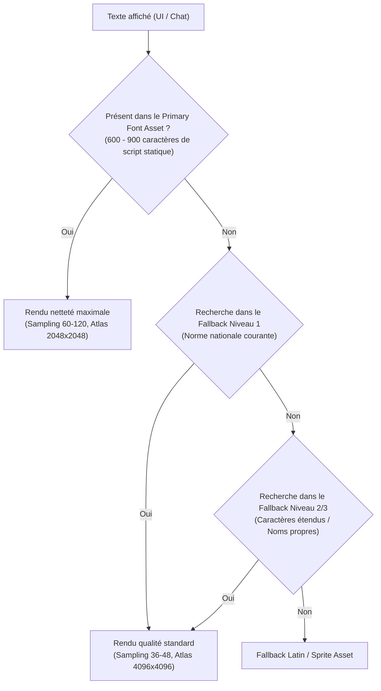

## **1. Aperçu du projet et défis de la localisation en temps réel**

Le projet **GilongWorld** impose une exigence technique extrêmement complexe et d'envergure mondiale : prendre en charge une localisation (*localization*) complète pour **15 langues cibles**. Cette liste comprend l'anglais, le vietnamien, le français, l'italien, l'allemand, l'espagnol (Espagne), le polonais, le portugais (Brésil), le portugais (Portugal), le coréen, le russe, le japonais, le turc, le chinois simplifié et le chinois traditionnel. Dans le développement moderne de jeux vidéo sous le moteur Unity, la gestion et l'affichage du texte dans un espace graphique en temps réel ne se résument pas à un simple remplacement de chaînes de caractères. Cela exige une architecture typographique entièrement optimisée afin de garantir l'esthétique, la netteté visuelle à toute distance de caméra et, surtout, une gestion rigoureuse de la mémoire système.

L'outil standard le plus puissant actuellement dans l'écosystème Unity pour le rendu de texte est **TextMeshPro (TMP)**. Contrairement aux systèmes traditionnels d'interface texte (UI Text) qui rastérisent chaque caractère sous forme d'image bitmap devenant floue lors d'un agrandissement, TextMeshPro nécessite la conversion des fichiers de polices standard en ressources spécialisées appelées **Font Asset**[^1]. Ces Font Assets contiennent une ou plusieurs textures d'atlas (*Atlas Texture*) exploitant la technologie **Signed Distance Field (SDF)**. La technologie SDF permet au texte d'être agrandi à l'infini sans pixellisation (*pixelation*), tout en fournissant la base mathématique permettant au shader de calculer directement sur le GPU des effets graphiques complexes tels que les ombres portées, les contours, l'épaisseur et la lueur[^1].

Cependant, la puissance du SDF s'accompagne d'une contrainte physique incontournable : **les limites de mémoire**. Regrouper la totalité des caractères des 15 langues cibles dans une seule texture d'atlas est physiquement impossible[^1]. En particulier, les langues du groupe CJK (*Chinese, Japanese, Korean*) possèdent un système d'écriture idéographique massif comptant des dizaines de milliers de caractères. Tenter de forcer l'ensemble de ce répertoire dans une seule Atlas Texture ferait dépasser aux dimensions de la texture la limite maximale supportée par le matériel, notamment sur les appareils mobiles (généralement limitée à $4096 \times 4096$ ou $8192 \times 8192$ pixels), entraînant une saturation de la mémoire VRAM ou un plantage de l'application (*crash*)[^5]. Ce rapport présente de manière minutieuse et détaillée l'ensemble du processus, depuis la sélection et le téléchargement des polices sources, l'analyse des spécificités scripturales, jusqu'à la configuration des paramètres internes de TextMeshPro, la gestion de la chaîne de repli (*Fallback Chain*) et la résolution définitive du problème d'unification des sinogrammes (*Han Unification*) via le package Unity Localization.

---

## **2. Fondements typographiques et stratégie d'acquisition des polices sources**

La première étape, et la plus déterminante, dans la mise en place d'un système de texte multilingue consiste à choisir avec précision le fichier de police source (*Source Font File*). La cohérence visuelle sur 15 langues requiert une famille de polices open source couvrant de façon exhaustive les plages Unicode de base et étendues, avec une conception homogène concernant la ligne de base (*baseline*) ainsi que l'épaisseur des traits (*weight*).

Dans l'industrie logicielle, la famille de polices **Google Noto** (abréviation de *"No Tofu"* — une mission visant à éliminer les carrés vides affichés lorsqu'un appareil manque d'un glyphe, familièrement surnommés « tofu ») est reconnue comme la solution de référence[^7]. Conçu par Google en partenariat avec des fonderies typographiques de premier plan, le système Noto garantit que les caractères des alphabets latin, cyrillique et des écritures CJK peuvent s'afficher côte à côte sur une même ligne sans créer de décalage de proportion ni de rupture de style artistique[^8]. La fluidité d'affichage lorsque le texte mêle plusieurs langues est un facteur vital pour l'expérience utilisateur dans GilongWorld.

### **Guide d'extraction et d'importation des données de polices dans Unity**

Pour démarrer l'intégration, les fichiers de polices d'origine doivent être téléchargés directement depuis la bibliothèque **Google Fonts**. Le téléchargement et l'importation dans Unity doivent suivre un protocole strict afin d'éviter d'alourdir inutilement le volume du projet :

1. **Groupe des 11 langues utilisant les alphabets latin et cyrillique** (*anglais, vietnamien, français, italien, allemand, espagnol, polonais, portugais - Brésil, portugais - Portugal, russe, turc*) : le système ne requiert que la famille de base **Noto Sans**[^8]. Cette police renferme plus de 3 700 glyphes (*glyphs*) couvrant les blocs Unicode tels que Latin Extended, Cyrillic et les diacritiques combinants, répondant intégralement aux besoins des langues citées[^8]. Sur le site de Google Fonts, le téléchargement fournit une archive compressée contenant plusieurs graisses (*Thin, Regular, Medium, Bold, Black*) au format TrueType (`.ttf`).
2. **Groupe des 4 langues CJK** : le processus de téléchargement devient plus complexe. Les développeurs doivent accéder aux variantes régionales distinctes incluant **Noto Sans JP** (japonais), **Noto Sans KR** (coréen), **Noto Sans SC** (chinois simplifié) et **Noto Sans TC** (chinois traditionnel)[^7]. Ces fichiers CJK sont très volumineux, oscillant entre 15 Mo et 20 Mo par graisse en raison de la quantité colossale de données vectorielles qu'ils contiennent. Le format courant pour ce groupe est l'OpenType (`.otf`), qui prend en charge des tables de caractères plus complexes que le TrueType[^5].

Après avoir extrait les archives provenant de Google Fonts, l'étape suivante consiste à les importer (*import*) dans l'environnement du projet Unity. Une bonne pratique (*best practice*) en gestion de ressources consiste à créer une arborescence dédiée, par exemple `Assets/GilongWorld_Resources/Fonts/Source_Files/`. Les fichiers `.ttf` et `.otf` (il est conseillé de ne sélectionner qu'une seule graisse standard comme *Regular* ou *Medium* pour optimiser la mémoire, sauf si le design UI exige explicitement des variantes en gras) seront glissés-déposés directement depuis le système d'exploitation vers ce dossier via la fenêtre Project de l'éditeur Unity[^10].

> [!NOTE]
> TextMeshPro n'utilise pas directement ces fichiers `.ttf` ou `.otf` pour le rendu du texte à l'exécution ; ils servent uniquement de matière première à l'outil Font Asset Creator pour extraire les données géométriques et les compiler en texture SDF[^1]. Isoler les fichiers sources dans un dossier séparé facilite grandement leur exclusion des builds finaux (lorsque la fonctionnalité Dynamic SDF n'est pas utilisée), contribuant ainsi à réduire la taille du paquet d'installation du jeu.

---

## **3. Analyse morphologique des écritures et exigences des plages Unicode**

La diversité des 15 langues du projet GilongWorld exige une analyse approfondie de la manière dont les caractères sont encodés dans la norme internationale Unicode. TextMeshPro utilise la notation hexadécimale (base 16) pour définir les plages (*Unicode Ranges*) à extraire du fichier de police source[^13]. Déclarer avec exactitude ces plages assure non seulement une couverture linguistique absolue, mais empêche également le chargement de caractères inutiles qui gonfleraient la taille de la texture d'atlas.

Sur la base de leur structure morphologique, les 15 langues sont réparties en trois groupes stratégiques principaux pour la gestion des ressources.

### **Sous-groupe 1 : Latin étendu et diacritiques**

Ce groupe inclut l'anglais, le français, l'italien, l'allemand, l'espagnol, le polonais, le portugais (Brésil), le portugais (Portugal), le turc et le vietnamien. Bien qu'ils partagent la base de l'alphabet latin fondamental (`U+0020` à `U+007E`), une forte différenciation apparaît dans les blocs d'extension[^1] :

- **Europe de l'Ouest et du Sud** (*français, espagnol, italien, portugais, allemand*) : utilisent principalement le bloc *Latin-1 Supplement* (`U+00A0` à `U+00FF`), qui contient les voyelles accentuées courantes et caractères tels que `á`, `é`, `í`, `ó`, `ú`, `ñ`, `ü` et `ç`.
- **Europe centrale et Turquie** (*polonais, turc*) : dépendent du bloc *Latin Extended-A* (`U+0100` à `U+017F`) pour afficher des caractères spécifiques tels que `ą`, `ł`, `ş` et `ğ`[^10].
- **Vietnamien** : le cas le plus exigeant de ce groupe. Avec son système tonal complexe combiné aux voyelles coiffées d'un accent circonflexe (`â`, `ê`, `ô`) ou d'une corne (`ơ`, `ư`), le vietnamien requiert le bloc *Latin Extended Additional* (`U+1E00` à `U+1E9F`)[^14]. La superposition des diacritiques vietnamiens génère des structures de glyphes très hautes (par exemple, la lettre `Ể` peut dépasser la hauteur de capitale habituelle de l'alphabet latin), exigeant un réglage minutieux de la hauteur de ligne (*line height*) et du *padding* dans TextMeshPro pour éviter le rognage (*clipping*) du sommet des caractères.

### **Sous-groupe 2 : Système cyrillique**

La seule langue du projet appartenant à ce système est le **russe**. L'alphabet cyrillique est totalement indépendant du système latin sur le plan de l'encodage, résidant entièrement dans le bloc `U+0400` à `U+04FF`[^10]. Bien qu'indépendant par son encodage, le cyrillique partage de nombreuses caractéristiques morphologiques avec le latin en matière de largeur de glyphe et de hauteur de ligne de base, ce qui permet de le fusionner parfaitement dans le même Font Asset que le groupe latin sans provoquer de déséquilibre visuel.

### **Sous-groupe 3 : Système CJK et le problème historique de la Han Unification**

Le troisième groupe rassemble le **coréen, le japonais, le chinois simplifié et le chinois traditionnel**. Il s'agit du domaine le plus complexe, où les limites technologiques de TextMeshPro sont régulièrement mises à l'épreuve. La cause profonde ne réside pas seulement dans le nombre gigantesque de caractères, mais aussi dans une convention technique controversée du Consortium Unicode appelée **Han Unification** (*unification des sinogrammes*)[^7].

Au cours des premières années de développement de la norme Unicode, afin de restreindre l'espace d'encodage à 16 bits, les ingénieurs logiciels ont décidé de fusionner des idéogrammes partageant une même origine historique issus de Chine, du Japon et de Corée sous un point de code (*code point*) unique[^7]. Ce bloc est nommé *CJK Unified Ideographs* et s'étend de `U+4E00` à `U+9FA5`[^12].

Cette décision entraîne une conséquence majeure pour le rendu technique : **bien qu'ils partagent un même code Unicode, la forme graphique réelle d'un même caractère (glyphe) est dessinée différemment selon les pays** en raison d'évolutions culturelles, calligraphiques et de normes éducatives divergentes :

- Un exemple emblématique est le caractère signifiant « os » (code Unicode `U+9AA8`, `骨`). La structure des traits à l'intérieur du rectangle supérieur de ce caractère dans une police de chinois simplifié (SC) est agencée horizontalement de gauche à droite, tandis qu'en chinois traditionnel (TC) et en japonais (JP), cette structure interne est tracée de façon tout à fait différente[^7].
- De même, des caractères comme « neige » (`雪`) ou « droit » (`直`) présentent des différences subtiles mais immédiatement perceptibles par un locuteur natif.

Un moteur de rendu de texte ne peut pas deviner l'intention morphologique ; il reçoit uniquement un code Unicode et extrait l'image correspondante de la police active. Par conséquent, utiliser une seule police CJK pour toutes les langues d'Asie de l'Est amènerait les joueurs japonais à lire du texte japonais dessiné dans un style chinois, ou inversement[^7]. Pour les natifs, cela donne l'impression d'une erreur de police, d'un manque de professionnalisme ou d'un aspect « hybride », brisant totalement l'immersion dans l'univers du jeu[^7]. La seule solution pour surmonter cette limitation consiste à isoler complètement les Font Assets pour chaque langue CJK et à orchestrer dynamiquement la chaîne de repli.

---

## **4. Mécanisme technique de TextMeshPro et du Signed Distance Field (SDF)**

Pour exécuter une configuration rigoureuse, il est indispensable de maîtriser le fonctionnement du **Signed Distance Field (SDF)** dans TextMeshPro. Contrairement aux polices Bitmap traditionnelles qui stockent la couleur des pixels, le SDF stocke la distance mathématique entre chaque texel et le bord (contour) le plus proche du caractère[^1] :
- Si un texel se trouve **à l'intérieur** du caractère, la distance prend une valeur **positive**.
- S'il se trouve **à l'extérieur**, elle prend une valeur **négative**.
- S'il se situe **exactement sur le contour**, la distance est égale à **zéro** ($0$).

Ces données de distance sont encodées en niveaux de gris (*grayscale*) dans une Atlas Texture. À l'exécution, le shader GPU de TextMeshPro effectue une interpolation bilinéaire (*bilinear interpolation*) de ces valeurs de distance. Le shader évalue la valeur de chaque fragment (*fragment*) à l'écran : si la valeur est $> 0$, le fragment est coloré ; si elle est $< 0$, il est rendu transparent. Reposant sur une interpolation mathématique continue plutôt que sur une grille discrète de pixels, le texte SDF affiche des courbes d'une netteté extrême même lorsque la caméra s'approche très près de l'objet[^1].

Ce mécanisme définit deux paramètres fondamentaux lors de la création d'un Font Asset :
1. **Sampling Point Size :** détermine la taille physique du caractère lorsqu'il est dessiné sur l'Atlas Texture. Plus cette taille est élevée, plus la précision des données de distance est fine.
2. **Padding (Marge de remplissage) :** la clé de la puissance du SDF. L'espace tampon autour de chaque caractère permet au gradient de distance de décroître progressivement vers des valeurs négatives plus profondes. Plus le *padding* est large, plus l'algorithme SDF dispose « d'espace » pour générer des effets de contour (*outline*), d'ombre portée (*shadow*) ou de lueur (*glow*) de forte épaisseur sans coupure brutale[^13].

---

## **5. Guide de configuration détaillé via Font Asset Creator**

La génération des fichiers de textures de polices s'effectue via l'outil intégré d'Unity, **Font Asset Creator**, accessible depuis la barre de menus :

```text
Window > TextMeshPro > Font Asset Creator
```

D'après l'analyse de la section 3, l'architecture optimale pour les 15 langues de GilongWorld suit un modèle segmenté : **créer un Font Asset partagé pour les 11 langues latines/cyrilliques, et 4 Font Assets distincts pour chacune des langues CJK**.

### **5.1. Configuration statique pour les systèmes latin, cyrillique et vietnamien**

Regrouper 11 langues (*anglais, français, italien, allemand, espagnol, polonais, portugais BR, portugais PT, turc, russe, vietnamien*) dans un unique **Primary Static Font Asset** constitue la méthode la plus efficace pour réduire le nombre d'appels de rendu (*draw call*) sur le GPU, un levier essentiel pour maintenir un taux de rafraîchissement (*frame rate*) stable[^14].

La configuration dans le Font Asset Creator s'effectue avec les paramètres stricts suivants[^12] :

| Propriété de configuration | Recommandation technique | Justification analytique |
| :--- | :--- | :--- |
| **Source Font File** | `NotoSans-Regular.ttf` | Glissez-déposez le fichier source depuis `Assets` dans ce champ. C'est la source des données géométriques[^1]. |
| **Sampling Point Size** | `Custom Size: 60 - 90` | Le mode Auto Sizing se contente de compresser les glyphes dans l'espace disponible. En fixant manuellement Custom Size entre 60 et 90, la qualité des données SDF est garantie uniforme sur toute la texture[^1]. |
| **Padding** | `6 - 9` (Ratio ~10 %) | La règle standard dans TextMeshPro stipule que le Padding doit représenter environ 10 % de la Sampling Point Size[^4]. Avec un Sampling à 60, un Padding de 6 est idéal. Si le style UI requiert des contours très épais, cette valeur peut monter à 10. |
| **Packing Method** | `Optimum` | L'algorithme Optimum demande nettement plus de temps de calcul que Fast, mais il procède par itérations pour imbriquer les glyphes de façon optimale et minimiser le gaspillage de pixels[^12]. |
| **Atlas Resolution** | `2048 x 2048` | Le nombre de glyphes pour ces 11 langues se situe entre 1 500 et 2 000. Une résolution de $2048 \times 2048$ offre suffisamment d'espace pour conserver un Sampling Point Size de 60 sans tronquer aucun caractère[^7]. |
| **Character Set** | `Unicode Range (Hex)` | Au lieu de choisir des jeux prédéfinis, ce mode offre un contrôle absolu sur les caractères chargés[^2]. |

Le champ **Custom Character List** doit être rempli avec la chaîne de plages hexadécimales couvrant intégralement les besoins des 11 langues :

```text
0020-007E, 00A0-00FF, 0100-017F, 0180-024F, 1E00-1E9F, 0300-036F, 0400-04FF, 0500-052F, 2000-206F
```

Une fois tous les paramètres renseignés :
1. Cliquez sur le bouton **Generate Font Atlas**. L'outil va calculer les champs de distance et générer l'image (cela peut prendre quelques minutes selon le CPU).
2. Lorsque le calcul est terminé et que l'aperçu de texture s'affiche, cliquez sur **Save**.
3. Enregistrez le fichier sous le nom `Global_Latin_Cyrillic_SDF.asset` dans le dossier du projet[^1].

### **5.2. Configuration statique pour le CJK et architecture de repli hiérarchique**

Le traitement des 4 langues CJK exige une approche totalement différente en raison du volume massif de données. Il est indispensable de répéter le processus ci-dessus quatre fois pour `NotoSansCJKjp`, `NotoSansCJKkr`, `NotoSansCJKsc` et `NotoSansCJKtc`. Toutefois, tenter d'intégrer toute la table CJK dans un seul atlas statique via des plages Unicode échouera systématiquement car la taille physique maximale de la texture sera dépassée[^5].

La solution technique de référence consiste à appliquer un **modèle de cartographie hiérarchique des caractères (Hierarchical Character Mapping)** combiné à l'option **Characters from File**[^7] :

#### **1. Créer un Primary SDF Font Asset pour les caractères connus (Known Characters)**
- Extraire toutes les chaînes statiques issues des tables de chaînes (*String Tables*) du projet (menus, quêtes, objets, dialogues, compétences).
- Cet ensemble de caractères uniques (*unique characters*) compte en pratique **moins de 1 000 caractères** (dans le projet GilongWorld, cela représente précisément **855 caractères** pour le chinois simplifié, **870** pour le chinois traditionnel, **694** pour le japonais et **588** pour le coréen).
- **Maximiser la qualité d'échantillonnage (Maximize Sampling Size) :** le nombre de glyphes étant inférieur à 1 000, on peut fixer une **Sampling Point Size élevée** (de `60` à `90` ou `120`) avec une Atlas Resolution de `2048 x 2048`. Cela garantit que tout le texte officiel de l'interface conserve une netteté irréprochable à toute distance de caméra.

#### **2. Construire des niveaux de repli hérités des jeux de caractères nationaux standard (Standard Fallbacks for UGC/Chat)**
Pour prendre en charge intégralement la saisie des joueurs (noms de personnages, chat communautaire) sans jamais afficher de carrés Tofu, le système complète les Primary Assets par des Font Assets de repli issus de **corpus de caractères nationaux standardisés** :

| Langue | Jeu de caractères national standard | Nombre de caractères | Autorité émettrice et référence open source |
| :--- | :--- | :---: | :--- |
| **Chinois simplifié (zh-Hans)** | **TGSCC (通用规范汉字表)**<br/>- Niveau 1 (Courant) : 3 500 caractères<br/>- Niveau 2 (Étendu) : 3 000 caractères<br/>- Niveau 3 (Noms propres/Lieux) : 1 605 caractères | **8 105** | Ministère de l'Éducation de la RPC<br/>*Open source :* [GitHub chinese-character-table](https://github.com/maple-leaf/chinese-character-table) |
| **Chinois traditionnel (zh-Hant)** | **Tableau des formes standard des caractères nationaux courants** (*常用國字標準字體表*) | **4 808** | Ministère de l'Éducation de Taïwan (MOE Taiwan)<br/>*Open source :* [Portail Open Data de Taïwan](https://data.gov.tw/dataset/5961) / [GitHub cjktables](https://github.com/ButTaiwan/cjktables) |
| **Japonais (ja)** | - **Jōyō Kanji** (常用漢字 - Usage courant) : 2 136 caractères<br/>- **Jinmeiyō Kanji** (人名用漢字 - Prénoms) : 863 caractères | **2 999** | Agence pour les affaires culturelles (文化庁)<br/>*Open source :* [KanjiAPI](https://kanjiapi.dev/) / [GitHub kanji-data](https://github.com/davidluzgouveia/kanji-data) |
| **Coréen (ko)** | **Norme KS X 1001** (2 350 syllabes Hangul les plus courantes, couvrant 99,9 % des échanges) | **2 350** | Agence coréenne pour la technologie et les normes (KATS)<br/>*Open source :* [GitHub ksx1001](https://github.com/korean-character-sets/ksx1001) / Extrait via `euc-kr` |



#### **3. La règle immuable : maintenir la cohérence du ratio Sampling Point Size / Padding (Ratio Consistency)**

Un principe graphique fondamental du shader TextMeshPro est que **l'épaisseur des effets Outline (contour), Underlay / Shadow (ombre portée) et Glow (lueur) est calculée à partir du ratio entre la Sampling Point Size et le Padding**[^13].

##### **Pourquoi les Fallbacks n'ont-ils pas besoin du même Point Size que le Primary ?**
- **Primary Font (~855 caractères de script UI) :** affiché 100 % du temps de jeu $\rightarrow$ nécessité de **maximiser la qualité** (`Sampling Size = 120`, `Padding = 10`, Atlas $2048 \times 2048$).
- **Fallback Fonts (2 700 à 8 000 caractères rares pour chat/noms) :** apparaissent très rarement $\rightarrow$ **réduction de la taille d'échantillonnage** (`Sampling Size = 60` ou `48`) pour compresser des milliers de caractères dans la même taille d'atlas sans faire exploser la VRAM.

##### **Pourquoi est-il impératif de conserver le même ratio ($\text{Ratio} = \frac{\text{Sampling}}{\text{Padding}}$) ?**
Si une même phrase juxtapose un caractère issu du Primary et un caractère issu du Fallback :
- **En cas de ratio divergent :** le caractère Primary (Size 120, Pad 10 $\rightarrow$ Ratio 12) présente un contour fin et élégant, tandis que le caractère Fallback (Size 60, mais laissé par erreur à Pad 10 $\rightarrow$ Ratio 6) affichera un **contour deux fois plus épais, déformé et engloutissant le tracé du glyphe**.
- **En conservant le même ratio ($\text{Ratio} = 12$) :** que le glyphe provienne du Primary ou descende vers un Fallback, **l'épaisseur du contour et l'ombre portée restent uniformes à 100 %**.

| Niveau de Font Asset | Rôle | Sampling Point Size *(Custom)* | Padding | Atlas Resolution | Ratio |
| :--- | :--- | :---: | :---: | :---: | :---: |
| **Primary Font** | Script principal de l'UI | **120** *(ou 96)* | **10 px** *(ou 8 px)* | $2048 \times 2048$ | **12** *(Netteté maximale)* |
| **Fallback Niveau 1** | ~2 725 caractères courants | **60** | **5 px** | $2048 \times 2048$ | **12** *(Économie de VRAM)* |
| **Fallback Niveau 2** | ~2 992 caractères étendus | **60** | **5 px** | $2048 \times 2048$ | **12** *(Économie de VRAM)* |
| **Fallback Niveau 3** | ~1 605 caractères rares/noms | **48** | **4 px** | $2048 \times 2048$ | **12** *(Économie de VRAM)* |

> [!TIP]
> **Manipulation pratique :** dans *Font Asset Creator*, basculez `Sampling Point Size` de *Auto Sizing* vers **Custom Size** afin de verrouiller exactement la taille d'échantillonnage et le Padding selon le ratio du tableau ci-dessus.

---

### **5.3. Organisation des dossiers et automatisation pratique dans Unity**

Pour faciliter l'extension et la maintenance à long terme, le projet GilongWorld met en place une structure de répertoires dédiée et hiérarchisée pour l'ensemble des fichiers sources de caractères :

```text
Assets/_GilongWorld/_Project/Art/Fonts/_chars/
├── 01_Latin_Cyrillic/        # [Primary Font partagé] 11 langues latines/cyrilliques
│   ├── vi_chars.txt          # Vietnamien
│   ├── en_chars.txt          # Anglais
│   ├── ru_chars.txt          # Russe
│   └── ...                   # Français, allemand, italien, espagnol, polonais, portugais, turc
│
├── 02_CJK/                   # [Primary Fonts CJK] Caractères de script statique en jeu
│   ├── ja_chars.txt          # Japonais (694 caractères réels)
│   ├── ko_chars.txt          # Coréen (588 caractères réels)
│   ├── zh_Hans_chars.txt     # Chinois simplifié (855 caractères réels)
│   ├── zh_Hant_chars.txt     # Chinois traditionnel (870 caractères réels)
│   │
│   ├── Standard_Fallbacks/   # [Sources standard] 7 jeux de données nationaux bruts
│   │   ├── zh_Hans_TGSCC_Level1_3500.txt
│   │   ├── zh_Hans_TGSCC_Level2_3000.txt
│   │   ├── zh_Hans_TGSCC_Level3_1605.txt
│   │   ├── zh_Hant_Common_4808.txt
│   │   ├── ja_Joyo_Kanji_2136.txt
│   │   ├── ja_Jinmeiyo_Kanji_863.txt
│   │   └── ko_KS_X_1001_2350.txt
│   │
│   └── Subtracted_Fallbacks/ # [Fallbacks optimisés] Caractères du Primary soustraits
│       ├── zh_Hans_Fallback_Level1.txt    (TGSCC Niveau 1 moins Primary)
│       ├── zh_Hans_Fallback_Level2.txt    (TGSCC Niveau 2 moins Primary)
│       ├── zh_Hans_Fallback_Level3.txt    (TGSCC Niveau 3 moins Primary)
│       ├── zh_Hant_Fallback_Common.txt    (Norme TW 4808 moins Primary)
│       ├── ja_Fallback_Joyo.txt           (Joyo Kanji moins Primary)
│       ├── ja_Fallback_Jinmeiyo.txt       (Jinmeiyo Kanji moins Primary)
│       └── ko_Fallback_KS_X_1001.txt      (KS X 1001 moins Primary)
```

#### **Outil automatique d'extraction et de soustraction des caractères de Fallback (`GWCharacterExtractor.cs`)**
Afin de libérer les développeurs des exports CSV et du filtrage manuel des doublons, l'outil Unity Editor dédié [`GWCharacterExtractor.cs`](file:///d:/Unity-Projects/GLW/Assets/_GilongWorld/_Project/Editor/Localization/GWCharacterExtractor.cs) intègre un pipeline deux-en-un :
- **Menu d'accès :** `GilongWorld → Localization → Extract CJK Characters From String Tables`
- **Mécanisme 1 (Extraction Primary) :** analyse l'ensemble des `StringTableCollections` dans Unity Localization, collecte toutes les chaînes utilisées dans un `HashSet<char>` (garantissant une unicité à 100 %), les trie par code Unicode croissant et écrit les 4 fichiers Primary dans `02_CJK/`.
- **Mécanisme 2 (Soustraction automatique des Fallbacks) :** le script lit automatiquement les 7 jeux de données dans `Standard_Fallbacks/`, compare et **supprime tous les caractères déjà présents dans le Primary Asset**, puis exporte les fichiers dédupliqués dans `Subtracted_Fallbacks/`. Cela élimine totalement le gaspillage de VRAM dû aux caractères dupliqués entre le Primary Atlas et les Fallback Atlas.

#### **Fenêtre `GWSDFGeneratorWindow` et contournement des restrictions d'API d'Unity 6**
Pour garantir le respect absolu de la règle « Ratio Sampling / Padding = 12 », le projet fournit une Editor Window dédiée permettant de saisir les paramètres et de déclencher automatiquement un avertissement si le ratio dévie.
En particulier, sous Unity 6, la propriété `clearDynamicDataOnBuild` du Font Asset a été verrouillée au niveau d'accès `internal`, empêchant de purger les données résiduelles avant le build via du code classique. Cet outil résout le problème proprement en appliquant la technique de réflexion (*Reflection*) via `SerializedObject` :

```csharp
var serializedObject = new SerializedObject(fontAsset);
serializedObject.FindProperty("m_ClearDynamicDataOnBuild").boolValue = true;
serializedObject.ApplyModifiedProperties();
```

Grâce à cela, l'ancien atlas défectueux de 137 Mo est entièrement nettoyé, réduisant la taille du build au strict minimum.

---

## **6. Architecture de gestion de la chaîne de repli (Fallback Chain) et résolution de la Han Unification**

Le cœur du fonctionnement fluide d'un jeu multilingue réside dans la maîtrise de la chaîne de repli (*Fallback Chain*). Lorsqu'un composant UI TextMeshPro reçoit une chaîne contenant un caractère absent du Primary Font Asset, le système exécute un algorithme de recherche récursive à travers les listes de repli pour trouver un glyphe de substitution.

L'algorithme de recherche suit une hiérarchie stricte :
1. `TextMeshPro Primary Font Asset`
2. `Liste interne des Fallback Font Assets du Primary Font`
3. `Sprite Asset interne`
4. `General Fallback Font Assets définis globalement dans TMP_Settings`
5. `Default Sprite Asset`
6. `Default Font Asset`[^20]

> [!WARNING]
> Le système parcourt cette liste séquentiellement de haut en bas et **s'arrête immédiatement dès qu'il trouve la première correspondance de point de code Unicode**[^7].

Comme analysé dans la section 3, le phénomène de Han Unification fait que les caractères des langues SC, TC et JP partagent le même code Unicode tout en ayant des formes distinctes[^7]. Si un développeur place tous les fichiers CJK dans la liste General Fallback Font Assets de `TMP_Settings`, l'ordre de la liste décidera du sort typographique du texte. Par exemple, si la liste est ordonnée ainsi : `Font_CJK_JP_SDF` $\rightarrow$ `Font_CJK_SC_SDF` $\rightarrow$ `Font_CJK_TC_SDF`, lorsqu'un texte en chinois simplifié est affiché, le système scanne du haut vers le bas, rencontre d'abord le fichier japonais, trouve le code Unicode correspondant et applique aussitôt le style Kanji japonais à l'écran, en ignorant totalement la police chinoise placée plus bas[^7].

### **Architecture d'isolation par Fallback local (Local Fallback Architecture)**

Pour éradiquer définitivement ce problème, la structure de Fallback doit être isolée :

> [!IMPORTANT]
> **Ne placez jamais les polices CJK dans la liste de repli globale (Global Fallback List) de `TMP_Settings`**[^1]. À la place, l'architecture doit être reliée via la structure de repli locale (*Local Fallback*) propre à chaque Asset, et gérée dynamiquement à l'exécution.

Une règle typographique fondamentale veut que les polices CJK intègrent souvent des caractères latins et des chiffres arabes mal dessinés ou mal proportionnés par rapport aux polices purement latines[^9]. Par conséquent, les caractères latins doivent toujours être rendus en priorité par le fichier `Global_Latin_Cyrillic_SDF`. La structure de liaison locale est construite comme suit :
1. Ouvrez le fichier `Font_CJK_SC_SDF.asset`, dans la section **Fallback Font Assets**, ajoutez les niveaux de repli 1 à 3 du chinois, puis ajoutez `Global_Latin_Cyrillic_SDF`[^1].
2. Répétez la même opération pour les fichiers TC, JP et KR.

Cela garantit que lorsque le jeu s'affiche en chinois, s'il contient des nombres ou des noms propres anglais intercalés, ces caractères traversent sans encombre l'atlas statique chinois (les caractères latins ayant été exclus lors de l'extraction *Characters from File*) et sont interceptés par le Fallback contenant l'alphabet latin de haute qualité[^7].

---

## **7. Intégration du package Unity Localization pour la commutation dynamique (Runtime Swapping)**

Pour assurer le rendu fidèle de la morphologie culturelle des sinogrammes tout en optimisant la VRAM, les composants UI TextMeshPro ne peuvent pas conserver une configuration statique. Lorsque l'utilisateur change de langue (*Locale*), la police de base (*Primary Font Asset*) doit être permutée (*swap*) automatiquement à l'exécution (*runtime*)[^23].

Le package **Unity Localization** (`com.unity.localization`) fournit des outils robustes pour implémenter ce flux logique sans recourir à un codage en dur (*hardcoding*) pour chaque événement de bascule[^25]. L'architecture d'intégration repose sur l'écoute de l'événement global de changement de langue via `LocalizationSettings.SelectedLocaleChanged`[^24].

Deux méthodes d'implémentation existent :

### **Méthode 1 : Gestionnaire de polices centralisé (`GWFontManager.cs`)**

Plutôt que d'attacher manuellement des composants Localized Asset sur des milliers d'objets UI Text (ce qui exerce une pression énorme sur la mémoire à cause de milliers de `MonoBehaviour` superflus et du *Garbage Collection*), le projet GilongWorld adopte une stratégie de **gestion centralisée via Addressables**.

Le script `GWFontManager.cs` (marqué `DontDestroyOnLoad`) écoute l'événement `LocalizationSettings.SelectedLocaleChanged`. Lorsque cet événement se déclenche, le Manager exécute deux opérations précises :
1. **Chargement asynchrone (Async Load) :** utilise `LocalizationSettings.AssetDatabase.GetLocalizedAssetAsync<TMP_FontAsset>("Fonts_Table", "PrimaryFont")` pour charger le Primary Font Asset de la langue active depuis les Addressables.
2. **Balayage global (Global Sweep) :** appelle `FindObjectsByType<TMP_Text>` pour parcourir toute la scène et appliquer la nouvelle police à tous les textes UI. Cette commande consomme quelques millisecondes de CPU mais ne s'exécute qu'une seule fois lors du changement de langue ou du chargement d'une scène, tout en libérant intégralement la RAM de milliers de composants individuels. Aussitôt après l'assignation, la police de l'ancienne langue est déchargée via `Addressables.Release()`.

Cette méthode supprime totalement le phénomène de « contamination croisée » (*cross-pollination*) entre les langues CJK, car le système ne charge en mémoire que l'atlas de la langue actuellement sélectionnée[^7].

### **Méthode 2 : Asset Tables d'Unity Localization**

L'approche la plus native (*native*) consiste à utiliser les **Localized Asset Tables**[^23]. À l'image des Localized String Tables qui remplacent les chaînes de texte, les Asset Tables permettent d'associer différents Font Assets à chaque langue. Les composants Localized Text de l'interface peuvent être configurés pour mettre à jour non seulement la chaîne de texte mais aussi automatiquement la propriété `FontAsset` de l'objet TextMeshPro[^23].

Cette approche requiert une configuration dans l'Inspector, mais offre une grande stabilité et dispense l'équipe de maintenir un système personnalisé de correspondance dans le code[^28].

---

## **8. Gestion du contenu dynamique (UGC), optimisation mémoire et intégration Addressables**

L'architecture statique (*Static Architecture*) résout parfaitement la question de l'interface du système. Cependant, le contenu généré par les utilisateurs (**User-Generated Content - UGC**), tel que les noms de personnages, les descriptions de guilde ou le chat communautaire, pose un défi bien plus vaste. Il est impossible de prédire quels caractères issus des 15 langues les joueurs saisiront, et embarquer en RAM les centaines de milliers de caractères du monde entier est impensable.

### **La solution d'architecture hybride (Hybrid SDF System)**

En mode **Dynamic SDF** classique, TextMeshPro démarre avec une texture d'atlas vide ($0 \times 0$ pixels). Lorsqu'un nouveau caractère est rencontré, il utilise le CPU pour le rastériser et l'insérer dans la texture à l'exécution[^6].
Cependant, recourir exclusivement au mode Dynamic provoquerait de sévères saccades (*frame spike*) dès le premier écran. C'est pourquoi GilongWorld applique une **architecture hybride (Hybrid)** :

1. **Pré-remplissage statique fluide (Static Population) :** via l'outil `GWCharacterExtractor.cs`, des milliers de caractères les plus courants sont pré-intégrés dans l'atlas à l'aide de `TryAddCharacters` dès l'éditeur. En jeu, ces caractères sont déjà disponibles, garantissant un *frame rate* (FPS) d'une stabilité absolue.
2. **Repli dynamique sécurisé (Dynamic Fallback) :** le Font Asset reste enregistré en mode Dynamic avec le drapeau `isMultiAtlasTexturesEnabled = true`. Si un joueur envoie dans le chat un caractère rarissime absent du premier atlas, TMP génère instantanément une nouvelle texture d'atlas (`Atlas 0 1`, `Atlas 0 2`...) pour y loger ce glyphe au lieu d'afficher un carré Tofu. C'est la combinaison idéale.

> [!CAUTION]
> La méthode Dynamic SDF a un coût matériel concret : chaque atlas dynamique de taille $2048 \times 2048$ consomme immédiatement environ **4 Mo** de mémoire système. Si de nombreux atlas secondaires sont générés, la pression sur les appareils mobiles augmente rapidement[^31].

### **Le piège caché d'Addressables et le conflit de mémoire VRAM**

Les projets de grande envergure comme GilongWorld utilisent presque systématiquement le système **Addressables** pour charger leurs ressources. Une erreur fatale que commettent de nombreux développeurs consiste à **penser qu'ils n'ont pas activé Addressables et à laisser tranquillement les polices dans le dossier `Resources`.**

En réalité, le package **Unity Localization est directement bâti sur Addressables**. Même si vous ne l'utilisez pas activement, Addressables tourne en arrière-plan pour gérer les String Tables.
Lorsqu'un Prefab UI géré par Addressables référence un Font Asset stocké dans le dossier `Resources`, le gestionnaire de ressources d'Unity commet une erreur de duplication (*duplicate assets*) :
1. Unity crée une copie complète de cette texture d'atlas et l'embarque dans l'AssetBundle d'Addressables[^32].
2. Au lancement du jeu, l'atlas issu de `Resources` est déjà chargé, et l'atlas issu de l'AssetBundle est chargé une seconde fois en RAM, entraînant une **consommation de VRAM doublée** en pure perte[^31]. Ce problème est extrêmement courant et peut facilement faire planter les applications mobiles dont le budget RAM maximal est strictement contrôlé[^33].

**Solution définitive :**
- Déplacez entièrement le fichier `TMP_Settings` et tous les Font Assets hors du dossier `Resources`, vers un dossier standard tel que `Assets/_GilongWorld/_Project/Art/Fonts/SDF/`.
- Sélectionnez tous ces fichiers SDF et placez-les dans un groupe Addressables dédié (par exemple `Fonts_Addressables`), tout en configurant leur correspondance dans l'**Asset Table** (`Fonts_Table`) de Localization.
- **Nettoyer les polices dynamiques dans l'éditeur :** les Dynamic Font Assets conservent leurs données de texture générées sur disque. Il est impératif de purger les données dynamiques avant chaque compilation de build (ce qui est automatisé dans notre pipeline par l'outil `GWSDFGeneratorWindow` exploitant `SerializedObject`)[^30].
- **Libération mémoire à l'exécution :** lors des transitions entre grandes scènes, appelez l'API `TMP_FontAsset.ClearFontAssetData(true)` ou `FontEngine.DestroyFontEngine()` pour libérer intégralement les tableaux de textures dynamiques inutilisés[^35].

---

## **9. Diagnostics en direct et dépannage technique (Troubleshooting)**

Lors du déploiement réel sur des plateformes variées, le système de localisation révèle souvent des symptômes d'anomalies typiques. Comprendre les mécanismes de diagnostic permet à l'équipe technique d'isoler rapidement les incidents :

### **Le texte s'affiche sous forme de carrés vides (Tofu Boxes) sur build mobile mais normalement dans l'éditeur**
- **Cause :** le gestionnaire de ressources d'Unity ne recense pas les Fallback Font Assets comme des dépendances (*dependencies*) s'ils ne sont liés que de manière lâche dans la table `FallbackFontAssetTable` à l'exécution, au lieu d'être référencés directement par un GameObject statique de la scène. Le processus de build d'Unity les supprime automatiquement (*strip*) pour optimiser la taille du paquet[^1].
- **Correctif :** utilisez `TMP_Settings.fallbackFontAssets` comme référence globale afin qu'Unity détecte leur existence, ou assurez-vous que chaque Font Asset potentiel est explicitement marqué pour le préchargement (*pre-load*) via le manifeste Addressables[^1].

### **Exception : `"The variable m_AtlasTextures of TMP_FontAsset has not been assigned"`**
- **Cause :** directement liée au système Dynamic Font Asset avec l'option Multi Atlas Textures activée[^34]. Lorsque le système alloue automatiquement des textures supplémentaires pour de nouveaux glyphes mais que ce processus est interrompu ou libéré incorrectement lors de la destruction de Prefabs instanciés (*instantiated prefabs*), ce tableau interne conserve une référence nulle (*null reference*).
- **Correctif :** effectuez un **Reset** manuel de l'asset via le menu contextuel du Font Asset dans l'Inspector avant de lancer le build afin de réinitialiser un tableau de textures propre[^34].

### **Le texte apparaît flou (Blurry) aux grandes tailles d'affichage**
- **Cause :** la résolution de l'atlas SDF ou la `Sampling Point Size` est trop faible par rapport à la taille réelle de rendu à l'écran[^1].
- **Correctif :** pour les grands titres (Heading / Banner), la `Sampling Point Size` doit être reconfigurée à `150` ou plus. S'il est impossible de générer un atlas assez grand pour contenir tout le jeu de caractères à cette taille, isolez les caractères spécifiques des écrans titres dans un Static Font Asset dédié afin d'optimiser la netteté plutôt que de partager l'atlas du texte courant[^1].

### **Erreur d'authentification lors du Pull des tables de traduction depuis Google Sheets (`invalid_grant: Token has been expired or revoked`)**
- **Symptôme :** lors de la synchronisation (*Pull*) des tables de localisation (telles que `RPGB_General` ou les String Tables) depuis Google Sheets vers Unity, une erreur critique s'affiche : `Pull from Google sheets: Failed - Error: "invalid_grant", Description: "Token has been expired or revoked."`
- **Cause :** **décalage de fuseau horaire / dérive de l'horloge système (Timezone Skew / Clock Drift)**. Le mécanisme d'authentification Google OAuth 2 impose une précision horaire très stricte sur le *timestamp* envoyé dans la requête. Si l'horloge ou le fuseau horaire du poste local dérive, ou si l'éditeur Unity conserve en cache un décalage temporel obsolète, le serveur d'authentification Google rejette immédiatement la requête avec `invalid_grant`.
- **Correctif :**
  - **Redémarrer l'éditeur Unity :** fermez puis rouvrez Unity Editor afin que le moteur se resynchronise avec l'horloge système exacte du système d'exploitation $\rightarrow$ relancer le **Pull** réussira immédiatement.

---

## **10. Synthèse des recommandations architecturales finales**

Le projet GilongWorld, avec son envergure de 15 langues, exige une architecture graphique de texte répondant aux normes les plus strictes en matière d'allocation mémoire VRAM et de qualité visuelle interculturelle :

1. **Cohérence typographique (Typography) :** adoptez de façon généralisée l'écosystème Google Noto Sans et Noto Sans CJK afin de maintenir une continuité parfaite de ligne de base (*baseline*) sur tous les textes mêlant plusieurs langues.
2. **Segmentation des atlas (Atlas Segmentation) :** ne compressez jamais toutes les langues dans un seul atlas. Générez un unique Primary Static Font Asset $2048 \times 2048$ couvrant les plages des 11 langues latines/cyrilliques (*anglais, vietnamien, français, italien, allemand, espagnol, polonais, portugais, russe, turc*).
3. **Optimisation est-asiatique et modèle hiérarchique de repli :** isolez les 4 langues CJK (*chinois simplifié, chinois traditionnel, japonais, coréen*) dans des Font Assets distincts. Associez un **Primary SDF Font Asset (< 1 000 caractères de script statique avec une Sampling Size haute qualité de 60 à 120)** à **3 niveaux de Fallback (jusqu'à 8 105 caractères de la norme nationale TGSCC)** pour la saisie et le chat des joueurs. Maintenez impérativement un **ratio Sampling Point Size / Padding identique** (Ratio $\approx 10-12$) entre Primary et Fallback afin que les effets de shader (Outline, Shadow, Glow) restent parfaitement homogènes sans déformation.
4. **Contrôle de la chaîne de repli (Han Unification Control) :** n'utilisez en aucun cas la liste Global Fallback pour le système CJK. Privilégiez le remplacement dynamique (*Runtime Swapping*) via le package Unity Localization pour mettre à jour le Primary Font Asset selon la Locale active, éliminant tout risque d'affichage d'un style régional erroné. Configurez toujours les caractères latins en repli local (*Local Fallback*) sur chaque asset CJK.
5. **Contenu dynamique et gestion mémoire (UGC & Memory Handling) :** exploitez les Dynamic Font Assets combinés au Multi Atlas Texture pour absorber les caractères imprévus du chat joueur. Enfin, retirez intégralement cette architecture du dossier `Resources`, orchestrez les ressources via **Addressables** pour supprimer les duplications d'atlas, et utilisez les API de nettoyage mémoire afin de libérer la VRAM lors des sessions de jeu prolongées.

---

## **Références**

[^1]: Fix: Unity TextMeshPro Font Asset Missing or Fallback | Bugnet Blog, [https://bugnet.io/blog/fix-unity-textmeshpro-font-asset-missing](https://bugnet.io/blog/fix-unity-textmeshpro-font-asset-missing)
[^2]: Fix: Unity UI TextMeshPro Falling Back to Default Font | Bugnet Blog, [https://bugnet.io/blog/fix-unity-ui-text-mesh-pro-falling-back-default-font](https://bugnet.io/blog/fix-unity-ui-text-mesh-pro-falling-back-default-font)
[^3]: textmeshpro | Skills Marketplace · LobeHub, [https://lobehub.com/de/skills/xeldaralz-helm-textmeshpro](https://lobehub.com/de/skills/xeldaralz-helm-textmeshpro)
[^4]: Chinese Traditional, Simplified and English text looks blurred, [https://discussions.unity.com/t/chinese-traditional-simplified-and-english-text-looks-blurred/723916](https://discussions.unity.com/t/chinese-traditional-simplified-and-english-text-looks-blurred/723916)
[^5]: Creating asset from font with a lot of characters - Page 2 - Unity Engine, [https://discussions.unity.com/t/creating-asset-from-font-with-a-lot-of-characters/708290?page=2](https://discussions.unity.com/t/creating-asset-from-font-with-a-lot-of-characters/708290?page=2)
[^6]: Bug where TextMeshPro dynamic font atlas exhaustion causes, [https://unity-trouble-atlas.7colorsgame.com/en/article/unity-tmp-dynamic-font-atlas-exhaustion/](https://unity-trouble-atlas.7colorsgame.com/en/article/unity-tmp-dynamic-font-atlas-exhaustion/)
[^7]: Unity Font: The 2026 Complete Guide to TextMesh Pro Font Assets, [https://www.transphere.com/unity-font-textmesh-pro-font-assets-fallbacks-and-localization/](https://www.transphere.com/unity-font-textmesh-pro-font-assets-fallbacks-and-localization/)
[^8]: Noto Sans - Google Fonts, [https://fonts.google.com/noto/specimen/Noto+Sans](https://fonts.google.com/noto/specimen/Noto+Sans)
[^9]: Force a font to use fallbacks - Unity Discussions, [https://discussions.unity.com/t/force-a-font-to-use-fallbacks/711511](https://discussions.unity.com/t/force-a-font-to-use-fallbacks/711511)
[^10]: Multiple Language Support Not Working in TextMesh Pro, [https://stackoverflow.com/questions/44922738/multiple-language-support-not-working-in-textmesh-pro](https://stackoverflow.com/questions/44922738/multiple-language-support-not-working-in-textmesh-pro)
[^11]: How to display Japanese in Unity TextMeshPro using Noto Sans CJK, [https://zenn.dev/uliboooo/articles/c3a2f489d8ee9a?locale=en](https://zenn.dev/uliboooo/articles/c3a2f489d8ee9a?locale=en)
[^12]: TextMeshPro Font Asset Creation & Packaging Guide - GitHub, [https://github.com/bbepis/XUnity.AutoTranslator/wiki/TextMeshPro-Font-Asset-Creation-&-Packaging-Guide](https://github.com/bbepis/XUnity.AutoTranslator/wiki/TextMeshPro-Font-Asset-Creation-&-Packaging-Guide)
[^13]: Font Asset Creator | TextMeshPro | 3.2.0-pre.15 - Unity - Manual, [https://docs.unity3d.com/Packages/com.unity.textmeshpro@3.2/manual/FontAssetsCreator.html](https://docs.unity3d.com/Packages/com.unity.textmeshpro@3.2/manual/FontAssetsCreator.html)
[^14]: [UNITY] Optimizing TextMesh Pro Font Atlas for language localization., [https://killertee.wordpress.com/2021/04/23/optimizing-workflow-textmesh-pro-font-atlas-for-language-localization/](https://killertee.wordpress.com/2021/04/23/optimizing-workflow-textmesh-pro-font-atlas-for-language-localization/)
[^15]: [Solved] TextMeshPro - Text(UI): Shows empty squares - Unity Engine, [https://discussions.unity.com/t/solved-textmeshpro-text-ui-shows-empty-squares/787844](https://discussions.unity.com/t/solved-textmeshpro-text-ui-shows-empty-squares/787844)
[^16]: Character set for multiple languages - Unity Discussions, [https://discussions.unity.com/t/character-set-for-multiple-languages/696758](https://discussions.unity.com/t/character-set-for-multiple-languages/696758)
[^17]: FYI: missing chinese/japanese/korean characters in Unity may not, [https://www.reddit.com/r/Unity3D/comments/1l37yfi/fyi_missing_chinesejapanesekorean_characters_in/](https://www.reddit.com/r/Unity3D/comments/1l37yfi/fyi_missing_chinesejapanesekorean_characters_in/)
[^18]: Saving / loading font atlas for TextMeshPro Font assets during runtime, [https://discussions.unity.com/t/saving-loading-font-atlas-for-textmeshpro-font-assets-during-runtime/891878](https://discussions.unity.com/t/saving-loading-font-atlas-for-textmeshpro-font-assets-during-runtime/891878)
[^19]: Having issues displaying Chinese characters using Text Mesh Pro, [https://www.reddit.com/r/Unity3D/comments/178zt0q/having_issues_displaying_chinese_characters_using/](https://www.reddit.com/r/Unity3D/comments/178zt0q/having_issues_displaying_chinese_characters_using/)
[^20]: Fallback font assets | TextMeshPro | 4.0.0-pre.2 - Unity - Manual, [https://docs.unity3d.com/Packages/com.unity.textmeshpro@4.0/manual/FontAssetsFallback.html](https://docs.unity3d.com/Packages/com.unity.textmeshpro@4.0/manual/FontAssetsFallback.html)
[^21]: Fallback font assets | TextMeshPro | 3.2.0-pre.15 - Unity - Manual, [https://docs.unity3d.com/Packages/com.unity.textmeshpro@3.2/manual/FontAssetsFallback.html](https://docs.unity3d.com/Packages/com.unity.textmeshpro@3.2/manual/FontAssetsFallback.html)
[^22]: Issue using the TMPro fallback system to render Chinese or, [https://discussions.unity.com/t/issue-using-the-tmpro-fallback-system-to-render-chinese-or-japanese-w-specific-fonts/837526](https://discussions.unity.com/t/issue-using-the-tmpro-fallback-system-to-render-chinese-or-japanese-w-specific-fonts/837526)
[^23]: Localization - Unity - Manual, [https://docs.unity3d.com/6000.5/Documentation/Manual/best-practice-guides/ui-toolkit-for-advanced-unity-developers/localization.html](https://docs.unity3d.com/6000.5/Documentation/Manual/best-practice-guides/ui-toolkit-for-advanced-unity-developers/localization.html)
[^24]: Issues with Localization and TMP Rendering in Unity, [https://discussions.unity.com/t/issues-with-localization-and-tmp-rendering-in-unity/948421](https://discussions.unity.com/t/issues-with-localization-and-tmp-rendering-in-unity/948421)
[^25]: A Comprehensive Guide to Unity Localization | Phrase, [https://phrase.com/blog/posts/localizing-unity-games-official-localization-package/](https://phrase.com/blog/posts/localizing-unity-games-official-localization-package/)
[^26]: How to Use the Unity Localization Package: A Complete Guide, [https://www.languagesunlimited.com/unity-localization-package/](https://www.languagesunlimited.com/unity-localization-package/)
[^27]: Change Locale in runtime - Unity Discussions, [https://discussions.unity.com/t/change-locale-in-runtime/812317](https://discussions.unity.com/t/change-locale-in-runtime/812317)
[^28]: TMP Font Asset and localization - Unity Discussions, [https://discussions.unity.com/t/tmp-font-asset-and-localization/936355](https://discussions.unity.com/t/tmp-font-asset-and-localization/936355)
[^29]: Localization, font switching and font material presets - Unity Engine, [https://discussions.unity.com/t/localization-font-switching-and-font-material-presets/770975](https://discussions.unity.com/t/localization-font-switching-and-font-material-presets/770975)
[^30]: Dynamic fonts assets | TextMeshPro | 3.2.0-pre.15 - Unity - Manual, [https://docs.unity3d.com/Packages/com.unity.textmeshpro@3.2/manual/FontAssetsDynamicFonts.html](https://docs.unity3d.com/Packages/com.unity.textmeshpro@3.2/manual/FontAssetsDynamicFonts.html)
[^31]: TextMesh Pro - Font atlases memory leak? - Unity Engine, [https://discussions.unity.com/t/textmesh-pro-font-atlases-memory-leak/885808](https://discussions.unity.com/t/textmesh-pro-font-atlases-memory-leak/885808)
[^32]: TextMeshPro & Addressables (Asset Bundles) - Unity Discussions, [https://discussions.unity.com/t/textmeshpro-addressables-asset-bundles/855482](https://discussions.unity.com/t/textmeshpro-addressables-asset-bundles/855482)
[^33]: TextMesh Pro Fallback Font Displays Boxes on Instantiated Objects, [https://discussions.unity.com/t/textmesh-pro-fallback-font-displays-boxes-on-instantiated-objects-unity-6-mobile-build-only-works-in-editor-and-unity-2022/1652497](https://discussions.unity.com/t/textmesh-pro-fallback-font-displays-boxes-on-instantiated-objects-unity-6-mobile-build-only-works-in-editor-and-unity-2022/1652497)
[^34]: Text Mesh Pro FallBack localization - Unity Discussions, [https://discussions.unity.com/t/text-mesh-pro-fallback-localization/797911](https://discussions.unity.com/t/text-mesh-pro-fallback-localization/797911)
[^35]: Issue with removing fonts from fallbackFontAssetTable (memory leak), [https://discussions.unity.com/t/issue-with-removing-fonts-from-fallbackfontassettable-memory-leak/826070](https://discussions.unity.com/t/issue-with-removing-fonts-from-fallbackfontassettable-memory-leak/826070)
