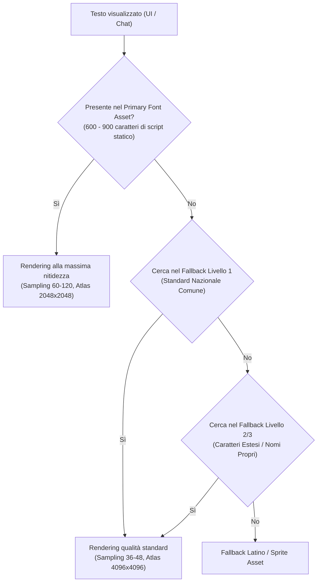

## **1. Panoramica del progetto e sfide della localizzazione in tempo reale**

Il progetto **GilongWorld** pone un requisito tecnico estremamente complesso e di portata globale: supportare una localizzazione (*localization*) completa per **15 lingue di destinazione**. L'elenco comprende inglese, vietnamita, francese, italiano, tedesco, spagnolo (Spagna), polacco, portoghese (Brasile), portoghese (Portogallo), coreano, russo, giapponese, turco, cinese semplificato e cinese tradizionale. Nello sviluppo moderno di videogiochi con il motore Unity, gestire e visualizzare il testo in uno spazio grafico in tempo reale non significa semplicemente sostituire stringhe di testo. Richiede un'architettura tipografica completamente ottimizzata per garantire coerenza estetica, nitidezza visiva a qualsiasi distanza della telecamera e, soprattutto, efficienza nell'uso della memoria di sistema.

Lo strumento standard più potente oggi nell'ecosistema Unity per il rendering del testo è **TextMeshPro (TMP)**. A differenza dei sistemi tradizionali di testo dell'interfaccia utente (UI Text), che rasterizzano ogni carattere come un'immagine bitmap sfocata quando viene ingrandita, TextMeshPro richiede la conversione dei file di font standard in risorse specializzate chiamate **Font Asset**[^1]. Questi Font Asset contengono una o più texture di atlante (*Atlas Texture*) basate sulla tecnologia **Signed Distance Field (SDF)**. La tecnologia SDF consente di ingrandire il testo all'infinito senza sgranature (*pixelation*), fornendo al contempo la base matematica affinché lo shader calcoli direttamente sulla GPU effetti grafici complessi come ombre portate, contorni, spessore e bagliore[^1].

Tuttavia, la potenza dell'SDF comporta una sfida fisica inevitabile: **i limiti di memoria**. Inserire tutti i caratteri delle 15 lingue di destinazione in un'unica texture di atlante è impossibile[^1]. In particolare, le lingue del gruppo CJK (*Chinese, Japanese, Korean*) possiedono un vasto sistema di scrittura ideografica composto da decine di migliaia di caratteri. Tentare di comprimere l'intero repertorio in una sola Atlas Texture supererebbe le dimensioni massime gestibili dall'hardware, soprattutto sui dispositivi mobili (tipicamente limitate a $4096 \times 4096$ o $8192 \times 8192$ pixel), provocando esaurimento della memoria VRAM o arresti anomali dell'applicazione (*crash*)[^5]. Questo documento illustra in modo dettagliato e rigoroso l'intero processo: dalla scelta e dal download dei font sorgente, all'analisi delle caratteristiche dei sistemi di scrittura, fino alla configurazione dei parametri interni di TextMeshPro, alla gestione della catena di fallback (*Fallback Chain*) e alla risoluzione definitiva del problema dell'unificazione dei caratteri Han (*Han Unification*) tramite il pacchetto Unity Localization.

---

## **2. Fondamenti tipografici e strategia di acquisizione dei font sorgente**

Il primo e più importante passo nella realizzazione di un sistema di testo multilingue è selezionare con precisione il file di font sorgente (*Source Font File*). L'uniformità visiva attraverso 15 lingue richiede una famiglia tipografica open source che supporti in modo completo gli intervalli Unicode di base ed estesi e presenti un design coerente per linea di base (*baseline*) e spessore del tratto (*weight*).

Nell'industria del software, la famiglia di font **Google Noto** (abbreviazione di *"No Tofu"* — una missione volta a eliminare i riquadri vuoti mostrati quando mancano i glifi sul dispositivo, comunemente chiamati «tofu») è riconosciuta come la soluzione standard di riferimento[^7]. Progettato da Google in collaborazione con importanti fonderie tipografiche, il sistema Noto garantisce che i caratteri degli alfabeti latino, cirillico e dei sistemi di scrittura CJK possano apparire fianco a fianco sulla stessa riga senza squilibri di proporzione o stile artistico[^8]. La fluidità di lettura quando il testo combina più lingue è un fattore vitale per l'esperienza utente in GilongWorld.

### **Guida all'estrazione e all'importazione dei font in Unity**

Per avviare l'integrazione, i file di font originali devono essere scaricati direttamente dalla libreria **Google Fonts**. Il processo di download e importazione in Unity deve rispettare regole rigorose per evitare di appesantire inutilmente le dimensioni del progetto:

1. **Gruppo delle 11 lingue con alfabeto latino e cirillico** (*inglese, vietnamita, francese, italiano, tedesco, spagnolo, polacco, portoghese - Brasile, portoghese - Portogallo, russo, turco*): il sistema richiede esclusivamente la famiglia di base **Noto Sans**[^8]. Questo font contiene oltre 3.700 glifi (*glyphs*) che coprono blocchi Unicode come Latin Extended, Cyrillic e segni diacritici combinati, soddisfacendo pienamente tutte le lingue elencate[^8]. Su Google Fonts, il download fornisce un archivio compresso con diverse varianti di peso (*Thin, Regular, Medium, Bold, Black*) in formato TrueType (`.ttf`).
2. **Gruppo delle 4 lingue CJK**: il processo di download diventa più articolato. Gli sviluppatori devono scaricare le varianti dedicate **Noto Sans JP** (giapponese), **Noto Sans KR** (coreano), **Noto Sans SC** (cinese semplificato) e **Noto Sans TC** (cinese tradizionale)[^7]. Questi file CJK sono molto pesanti, variando dai 15 MB ai 20 MB per ciascun peso a causa dell'enorme quantità di dati grafici inclusi. Il formato tipico per questo gruppo è OpenType (`.otf`), che supporta tabelle di mappatura dei caratteri più complesse rispetto al TrueType[^5].

Dopo aver estratto gli archivi scaricati da Google Fonts, il passo successivo è importarli (*import*) nell'ambiente del progetto Unity. Una buona pratica (*best practice*) nella gestione degli asset è creare una struttura di cartelle dedicata, ad esempio `Assets/GilongWorld_Resources/Fonts/Source_Files/`. I file `.ttf` e `.otf` (è opportuno selezionare un solo peso standard come *Regular* o *Medium* per ottimizzare la memoria, salvo specifiche esigenze di grassetto nel design UI) vengono trascinati direttamente dal sistema operativo in questa cartella tramite la finestra Project di Unity Editor[^10].

> [!NOTE]
> TextMeshPro non utilizza direttamente questi file `.ttf` o `.otf` per il rendering del testo a runtime; essi fungono esclusivamente da materia prima per lo strumento Font Asset Creator al fine di estrarre i dati dei contorni e compilarli in texture SDF[^1]. Gestire i file sorgente in una cartella separata rende molto più semplice escluderli dalle build finali (quando non si usa Dynamic SDF), contribuendo a ridurre le dimensioni del pacchetto di installazione del gioco.

---

## **3. Analisi morfologica dei sistemi di scrittura e requisiti Unicode**

La varietà delle 15 lingue nel progetto GilongWorld richiede un'analisi approfondita di come i caratteri siano codificati nello standard internazionale Unicode. TextMeshPro utilizza la notazione esadecimale (base 16) per definire gli intervalli (*Unicode Ranges*) da estrarre dal font sorgente[^13]. Dichiarare con esattezza tali intervalli garantisce la copertura linguistica totale e impedisce il caricamento di caratteri superflui che aumenterebbero inutilmente le dimensioni della texture Atlas.

In base alla struttura morfologica, le 15 lingue sono suddivise in tre gruppi strategici principali per la gestione delle risorse.

### **Sottogruppo 1: Latino esteso e segni diacritici**

Questo gruppo include inglese, francese, italiano, tedesco, spagnolo, polacco, portoghese (Brasile), portoghese (Portogallo), turco e vietnamita. Pur condividendo la base dell'alfabeto latino fondamentale (`U+0020` – `U+007E`), si osserva una forte differenziazione nei blocchi estesi[^1]:

- **Europa occidentale e meridionale** (*francese, spagnolo, italiano, portoghese, tedesco*): impiegano principalmente il blocco *Latin-1 Supplement* (`U+00A0` – `U+00FF`), che racchiude le vocali accentate essenziali e caratteri come `á`, `é`, `í`, `ó`, `ú`, `ñ`, `ü` e `ç`.
- **Europa centrale e Turchia** (*polacco, turco*): dipendono dal blocco *Latin Extended-A* (`U+0100` – `U+017F`) per visualizzare glifi specifici come `ą`, `ł`, `ş` e `ğ`[^10].
- **Vietnamita**: il caso più impegnativo del gruppo. Con un sistema tonale articolato combinato con vocali dotate di accento circonflesso (`â`, `ê`, `ô`) o uncino (`ơ`, `ư`), il vietnamita richiede il blocco *Latin Extended Additional* (`U+1E00` – `U+1E9F`)[^14]. La sovrapposizione dei diacritici vietnamiti genera glifi dall'altezza verticale considerevole (ad esempio, la lettera `Ể` può superare l'altezza standard delle maiuscole latine), richiedendo una calibrazione attenta di interlinea (*line height*) e *padding* in TextMeshPro per evitare il taglio (*clipping*) della parte superiore del carattere.

### **Sottogruppo 2: Sistema cirillico**

L'unica lingua del progetto appartenente a questo sistema è il **russo**. L'alfabeto cirillico è completamente indipendente dal sistema latino sul piano della codifica, occupando interamente il blocco `U+0400` – `U+04FF`[^10]. Nonostante la separazione nella codifica, il cirillico condivide molte caratteristiche morfologiche con l'alfabeto latino in termini di larghezza dei caratteri e linea di base, consentendone l'integrazione ottimale nello stesso Font Asset del gruppo latino senza creare squilibri visivi.

### **Sottogruppo 3: Sistema CJK e il problema storico della Han Unification**

Il terzo gruppo include **coreano, giapponese, cinese semplificato e cinese tradizionale**. È l'area più complessa, dove i limiti tecnologici di TextMeshPro vengono messi costantemente alla prova. La causa primaria non risiede solo nell'enorme numero di caratteri, ma anche in una controversa convenzione tecnica del Consorzio Unicode denominata **Han Unification** (*unificazione dei caratteri Han*)[^7].

Nei primi anni di sviluppo dello standard Unicode, per confinare lo spazio di codifica entro 16 bit, gli ingegneri decisero di raggruppare ideogrammi con la medesima origine storica provenienti da Cina, Giappone e Corea sotto un unico punto di codice (*code point*) condiviso[^7]. Questo blocco è denominato *CJK Unified Ideographs* e copre l'intervallo da `U+4E00` a `U+9FA5`[^12].

Questa scelta comporta una grave conseguenza nel rendering: **pur condividendo un unico codice Unicode, la forma visiva effettiva dello stesso carattere (glifo) viene disegnata diversamente nei vari paesi** a causa di evoluzioni culturali, tradizioni calligrafiche e standard scolastici divergenti:

- Tipico è il caso del carattere per «osso», con codice Unicode `U+9AA8` (`骨`). La struttura dei tratti interni al rettangolo superiore di questo carattere nei font di cinese semplificato (SC) è disposta orizzontalmente da sinistra a destra, mentre in cinese tradizionale (TC) e giapponese (JP) presenta una costruzione grafica del tutto diversa[^7].
- Analogamente, caratteri come «neve» (`雪`) o «dritto» (`直`) mostrano differenze sottili ma immediatamente riconoscibili per i parlanti nativi.

Il motore di rendering del testo non può dedurre autonomamente l'intento morfologico: riceve soltanto un codice Unicode ed estrae l'immagine corrispondente dal font attivo. Di conseguenza, utilizzare un unico font CJK condiviso per tutte le lingue dell'Asia orientale costringerebbe i giocatori giapponesi a leggere testi in giapponese disegnati secondo lo stile cinese, o viceversa[^7]. Per un utente madrelingua, ciò produce la sensazione di un errore di font, poca cura professionale o un aspetto «ibrido», distruggendo l'immersione nel mondo di gioco[^7]. L'unica soluzione per superare questo limite consiste nel separare completamente i Font Asset per ciascuna lingua CJK e gestire dinamicamente la catena di fallback.

---

## **4. Meccanismo tecnico di TextMeshPro e Signed Distance Field (SDF)**

Per eseguire correttamente la configurazione, è fondamentale comprendere il funzionamento del **Signed Distance Field (SDF)** all'interno di TextMeshPro. A differenza dei font Bitmap tradizionali che memorizzano i colori dei pixel, l'SDF memorizza la distanza matematica da ciascun texel al bordo (contorno) più vicino del carattere[^1]:
- Se un texel si trova **all'interno** del carattere, la distanza assume un valore **positivo**.
- Se si trova **all'esterno**, assume un valore **negativo**.
- Se si trova **esattamente sul bordo**, la distanza è **zero** ($0$).

Questi dati di distanza sono codificati in scala di grigi (*grayscale*) all'interno di una Atlas Texture. A runtime, lo shader GPU di TextMeshPro esegue un'interpolazione bilineare (*bilinear interpolation*) di tali valori di distanza. Lo shader verifica il valore di ogni frammento (*fragment*) sullo schermo: se il valore è $> 0$, il frammento viene colorato; se è $< 0$, viene reso trasparente. Basandosi su un'interpolazione matematica continua anziché su una griglia discreta di pixel, il testo SDF mantiene curve nitidissime anche quando la telecamera si avvicina moltissimo all'oggetto[^1].

Questo meccanismo determina due parametri essenziali durante la creazione di un Font Asset:
1. **Sampling Point Size:** stabilisce la dimensione fisica del carattere quando viene disegnato sull'Atlas Texture. Maggiore è la dimensione, maggiore è la fedeltà dei dati di distanza.
2. **Padding (Spaziatura di margine):** la chiave della potenza dell'SDF. Lo spazio cuscinetto attorno al carattere consente al gradiente di distanza di decrescere gradualmente verso valori negativi più profondi. Più ampio è il padding, più «spazio» ha l'algoritmo SDF per generare effetti di contorno (*outline*), ombra (*shadow*) o bagliore (*glow*) di elevato spessore senza tagli improvvisi[^13].

---

## **5. Guida alla configurazione dettagliata con Font Asset Creator**

La generazione delle texture dei font avviene tramite lo strumento integrato in Unity, **Font Asset Creator**, accessibile dal menu:

```text
Window > TextMeshPro > Font Asset Creator
```

In base all'analisi della sezione 3, la struttura ottimale per le 15 lingue di GilongWorld è un modello segmentato: **creare un Font Asset condiviso per le 11 lingue latino/cirilliche e 4 Font Asset separati per ciascuna lingua CJK**.

### **5.1. Configurazione statica per i sistemi latino, cirillico e vietnamita**

Raggruppare 11 lingue (*inglese, francese, italiano, tedesco, spagnolo, polacco, portoghese BR, portoghese PT, turco, russo, vietnamita*) in un unico **Primary Static Font Asset** è il metodo più efficace per ridurre il numero di chiamate di disegno (*draw call*) sulla GPU, fattore chiave per mantenere stabile il *frame rate*[^14].

La configurazione in Font Asset Creator segue questi parametri rigorosi[^12]:

| Proprietà di configurazione | Raccomandazione tecnica | Motivazione analitica |
| :--- | :--- | :--- |
| **Source Font File** | `NotoSans-Regular.ttf` | Trascinare il file sorgente dalla cartella `Assets` in questo campo. È la fonte dei dati geometrici[^1]. |
| **Sampling Point Size** | `Custom Size: 60 - 90` | La modalità Auto Sizing tenta semplicemente di stipare i caratteri nello spazio disponibile. Fissando manualmente Custom Size tra 60 e 90, la qualità dei dati SDF rimane uniforme su tutta la texture[^1]. |
| **Padding** | `6 - 9` (Rapporto ~10%) | La regola standard in TextMeshPro prevede che il Padding sia circa il 10% del Sampling Point Size[^4]. Con Sampling 60, un Padding di 6 è ideale. Se l'UI richiede contorni molto spessi, il valore può arrivare a 10. |
| **Packing Method** | `Optimum` | L'algoritmo Optimum richiede sensibilmente più tempo di elaborazione rispetto a Fast, ma esegue passaggi iterativi per impacchettare i glifi nel modo più compatto possibile, riducendo lo spreco di pixel[^12]. |
| **Atlas Resolution** | `2048 x 2048` | Il numero di caratteri di queste 11 lingue si aggira tra 1.500 e 2.000 glifi. Una risoluzione $2048 \times 2048$ offre spazio sufficiente per mantenere Sampling Point Size 60 senza troncare alcun carattere[^7]. |
| **Character Set** | `Unicode Range (Hex)` | Invece di usare set predefiniti, questa modalità garantisce il controllo assoluto sui caratteri caricati[^2]. |

Il campo **Custom Character List** va compilato con la stringa di intervalli esadecimali che copre integralmente tutte le 11 lingue:

```text
0020-007E, 00A0-00FF, 0100-017F, 0180-024F, 1E00-1E9F, 0300-036F, 0400-04FF, 0500-052F, 2000-206F
```

Completati tutti i parametri:
1. Premere il pulsante **Generate Font Atlas**. Lo strumento calcolerà il campo di distanza e genererà la texture (può richiedere alcuni minuti in base alla CPU).
2. Al termine, quando appare l'anteprima della texture, premere **Save**.
3. Salvare il file come `Global_Latin_Cyrillic_SDF.asset` nella cartella del progetto[^1].

### **5.2. Configurazione statica per CJK e architettura gerarchica di Fallback**

La gestione delle 4 lingue CJK richiede un approccio completamente diverso a causa della mole enorme di dati. È obbligatorio ripetere il processo quattro volte per `NotoSansCJKjp`, `NotoSansCJKkr`, `NotoSansCJKsc` e `NotoSansCJKtc`. Tuttavia, tentare di inserire l'intera tabella CJK in un unico atlante statico mediante intervalli Unicode porterà al fallimento per superamento delle dimensioni fisiche massime della texture[^5].

La soluzione tecnica standard consiste nell'applicare un **Modello Gerarchico di Mappatura dei Caratteri (Hierarchical Character Mapping)** combinato con l'opzione **Characters from File**[^7]:

#### **1. Creare il Primary SDF Font Asset per i caratteri noti (Known Characters)**
- Estrarre tutte le stringhe statiche dalle tabelle di stringhe (*String Tables*) del progetto (Menu, Quest, Oggetti, Dialoghi, Abilità).
- Questo insieme di caratteri unici (*unique characters*) nella pratica è generalmente **inferiore a 1.000 caratteri** (nel progetto GilongWorld ammonta esattamente a **855 caratteri** per il cinese semplificato, **870** per il cinese tradizionale, **694** per il giapponese e **588** per il coreano).
- **Massimizzare la qualità di campionamento (Maximize Sampling Size):** poiché i caratteri sono meno di 1.000, è possibile impostare una **Sampling Point Size elevata** (da `60` a `90` o `120`) con Atlas Resolution `2048 x 2048`. Ciò assicura che tutto il testo ufficiale dell'interfaccia mantenga la massima nitidezza a ogni distanza di camera.

#### **2. Costruire i livelli di Fallback derivati dai set nazionali standard (Standard Fallbacks for UGC/Chat)**
Per supportare pienamente l'input dei giocatori (nomi dei personaggi, chat della community) senza mai mostrare riquadri Tofu, il sistema integra i Primary Asset con Font Asset di Fallback derivati da **set di caratteri nazionali standardizzati**:

| Lingua | Set di caratteri nazionale standard | Numero di caratteri | Ente emittente e fonte di riferimento |
| :--- | :--- | :---: | :--- |
| **Cinese semplificato (zh-Hans)** | **TGSCC (通用规范汉字表)**<br/>- Livello 1 (Comune): 3.500 caratteri<br/>- Livello 2 (Esteso): 3.000 caratteri<br/>- Livello 3 (Nomi propri/Luoghi): 1.605 caratteri | **8.105** | Ministero dell'Istruzione della RPC<br/>*Open source:* [GitHub chinese-character-table](https://github.com/maple-leaf/chinese-character-table) |
| **Cinese tradizionale (zh-Hant)** | **Tabella delle forme standard dei caratteri nazionali comuni** (*常用國字標準字體表*) | **4.808** | Ministero dell'Istruzione di Taiwan (MOE Taiwan)<br/>*Open source:* [Portale Open Data Taiwan](https://data.gov.tw/dataset/5961) / [GitHub cjktables](https://github.com/ButTaiwan/cjktables) |
| **Giapponese (ja)** | - **Jōyō Kanji** (常用漢字 - Uso comune): 2.136 caratteri<br/>- **Jinmeiyō Kanji** (人名用漢字 - Nomi propri): 863 caratteri | **2.999** | Agenzia per gli Affari Culturali (文化庁)<br/>*Open source:* [KanjiAPI](https://kanjiapi.dev/) / [GitHub kanji-data](https://github.com/davidluzgouveia/kanji-data) |
| **Coreano (ko)** | **Standard KS X 1001** (le 2.350 sillabe Hangul più comuni, copre il 99,9% della comunicazione) | **2.350** | Agenzia Coreana per la Tecnologia e gli Standard (KATS)<br/>*Open source:* [GitHub ksx1001](https://github.com/korean-character-sets/ksx1001) / Estratto tramite `euc-kr` |



#### **3. La regola invariante: mantenere il rapporto Sampling Point Size / Padding (Ratio Consistency)**

Un principio grafico fondamentale nello shader TextMeshPro è che **lo spessore degli effetti Outline (contorno), Underlay / Shadow (ombra) e Glow (bagliore) viene calcolato in base al rapporto tra Sampling Point Size e Padding**[^13].

##### **Perché i Fallback non necessitano dello stesso Point Size del Primary?**
- **Primary Font (~855 caratteri dello script UI):** visibili il 100% del tempo di gioco $\rightarrow$ necessario **massimizzare la qualità** (`Sampling Size = 120`, `Padding = 10`, Atlas $2048 \times 2048$).
- **Fallback Fonts (2.700 – 8.000 caratteri rari per Chat/Nomi):** compaiono raramente $\rightarrow$ **ridurre la dimensione di campionamento** (`Sampling Size = 60` o `48`) per comprimere migliaia di caratteri nella stessa dimensione dell'Atlas senza espandere la VRAM.

##### **Perché è obbligatorio mantenere lo stesso rapporto ($\text{Ratio} = \frac{\text{Sampling}}{\text{Padding}}$)?**
Se in una stessa frase un carattere del Primary è adiacente a un carattere del Fallback:
- **Se il rapporto diverge:** il carattere Primary (Size 120, Pad 10 $\rightarrow$ Ratio 12) mostra un contorno sottile ed elegante, mentre il carattere Fallback (Size 60, ma lasciato per errore a Pad 10 $\rightarrow$ Ratio 6) avrà un **contorno doppio di spessore, deformato, che inghiotte i tratti del carattere**.
- **Se si mantiene lo stesso rapporto ($\text{Ratio} = 12$):** che il carattere provenga dal Primary o scenda al Fallback, **spessore del contorno e ombra rimangono identici al 100%**.

| Livello Font Asset | Ruolo | Sampling Point Size *(Custom)* | Padding | Atlas Resolution | Rapporto (Ratio) |
| :--- | :--- | :---: | :---: | :---: | :---: |
| **Primary Font** | Script UI principale | **120** *(o 96)* | **10 px** *(o 8 px)* | $2048 \times 2048$ | **12** *(Nitidezza massima)* |
| **Fallback Livello 1** | ~2.725 caratteri comuni | **60** | **5 px** | $2048 \times 2048$ | **12** *(Risparmio VRAM)* |
| **Fallback Livello 2** | ~2.992 caratteri estesi | **60** | **5 px** | $2048 \times 2048$ | **12** *(Risparmio VRAM)* |
| **Fallback Livello 3** | ~1.605 caratteri rari/nomi | **48** | **4 px** | $2048 \times 2048$ | **12** *(Risparmio VRAM)* |

> [!TIP]
> **Operazione pratica:** in *Font Asset Creator*, cambiare `Sampling Point Size` da *Auto Sizing* a **Custom Size** per bloccare la dimensione di campionamento e il Padding esattamente secondo i rapporti della tabella sopra.

---

### **5.3. Organizzazione delle cartelle e automazione pratica in Unity**

Per facilitare l'estensione e la manutenzione nel lungo periodo, il progetto GilongWorld adotta una struttura di cartelle dedicata e raggruppata per tutti i dati sorgente dei caratteri:

```text
Assets/_GilongWorld/_Project/Art/Fonts/_chars/
├── 01_Latin_Cyrillic/        # [Primary Font condiviso] 11 lingue latine/cirilliche
│   ├── vi_chars.txt          # Vietnamita
│   ├── en_chars.txt          # Inglese
│   ├── ru_chars.txt          # Russo
│   └── ...                   # Francese, tedesco, italiano, spagnolo, polacco, portoghese, turco
│
├── 02_CJK/                   # [Primary Fonts CJK] Caratteri di script statico in gioco
│   ├── ja_chars.txt          # Giapponese (694 caratteri effettivi)
│   ├── ko_chars.txt          # Coreano (588 caratteri effettivi)
│   ├── zh_Hans_chars.txt     # Cinese semplificato (855 caratteri effettivi)
│   ├── zh_Hant_chars.txt     # Cinese tradizionale (870 caratteri effettivi)
│   │
│   ├── Standard_Fallbacks/   # [Sorgenti standard] 7 dataset nazionali originali
│   │   ├── zh_Hans_TGSCC_Level1_3500.txt
│   │   ├── zh_Hans_TGSCC_Level2_3000.txt
│   │   ├── zh_Hans_TGSCC_Level3_1605.txt
│   │   ├── zh_Hant_Common_4808.txt
│   │   ├── ja_Joyo_Kanji_2136.txt
│   │   ├── ja_Jinmeiyo_Kanji_863.txt
│   │   └── ko_KS_X_1001_2350.txt
│   │
│   └── Subtracted_Fallbacks/ # [Fallback ottimizzati] Caratteri Primary sottratti
│       ├── zh_Hans_Fallback_Level1.txt    (TGSCC Livello 1 meno Primary)
│       ├── zh_Hans_Fallback_Level2.txt    (TGSCC Livello 2 meno Primary)
│       ├── zh_Hans_Fallback_Level3.txt    (TGSCC Livello 3 meno Primary)
│       ├── zh_Hant_Fallback_Common.txt    (Standard TW 4808 meno Primary)
│       ├── ja_Fallback_Joyo.txt           (Joyo Kanji meno Primary)
│       ├── ja_Fallback_Jinmeiyo.txt       (Jinmeiyo Kanji meno Primary)
│       └── ko_Fallback_KS_X_1001.txt      (KS X 1001 meno Primary)
```

#### **Strumento automatico di estrazione e sottrazione dei caratteri Fallback (`GWCharacterExtractor.cs`)**
Per liberare gli sviluppatori dall'esportazione CSV e dalla rimozione manuale dei duplicati, lo strumento dedicato per Unity Editor [`GWCharacterExtractor.cs`](file:///d:/Unity-Projects/GLW/Assets/_GilongWorld/_Project/Editor/Localization/GWCharacterExtractor.cs) integra una pipeline due in uno:
- **Menu di accesso:** `GilongWorld → Localization → Extract CJK Characters From String Tables`
- **Meccanismo 1 (Estrazione Primary):** analizza tutte le `StringTableCollections` in Unity Localization, raccoglie ogni stringa usata in una struttura `HashSet<char>` (garantendo unicità al 100%), le ordina per codice Unicode crescente e salva i 4 file Primary in `02_CJK/`.
- **Meccanismo 2 (Sottrazione automatica Fallback):** lo script legge automaticamente i 7 dataset da `Standard_Fallbacks/`, li confronta ed **elimina tutti i caratteri già presenti nel Primary Asset**, quindi esporta il risultato in `Subtracted_Fallbacks/`. Ciò azzera completamente lo spreco di VRAM dovuto alla duplicazione dei caratteri tra Primary Atlas e Fallback Atlas.

#### **Interfaccia `GWSDFGeneratorWindow` e aggiramento dei vincoli API di Unity 6**
Per garantire il rispetto assoluto della regola «Rapporto Sampling / Padding = 12», il progetto mette a disposizione una Editor Window dedicata che consente di inserire i parametri e genera automaticamente un avviso se il rapporto risulta sbilanciato.
In particolare, in Unity 6 la proprietà `clearDynamicDataOnBuild` del Font Asset è stata bloccata con visibilità `internal`, impedendo di pulire i dati residui prima della build tramite codice ordinario. Questo strumento risolve completamente il problema applicando la tecnica di Reflection tramite `SerializedObject`:

```csharp
var serializedObject = new SerializedObject(fontAsset);
serializedObject.FindProperty("m_ClearDynamicDataOnBuild").boolValue = true;
serializedObject.ApplyModifiedProperties();
```

In tal modo, il vecchio atlante corrotto da 137 MB viene ripulito del tutto, riportando le dimensioni della build al minimo indispensabile.

---

## **6. Architettura di gestione della Fallback Chain e soluzione alla Han Unification**

Il cuore del funzionamento fluido di un gioco multilingue risiede nella gestione della **Fallback Chain** (catena di fallback). Quando un componente UI TextMeshPro riceve una stringa contenente un carattere assente dal Primary Font Asset, il sistema avvia un algoritmo di ricerca ricorsiva negli elenchi di riserva per trovare un glifo sostitutivo.

L'algoritmo di ricerca segue una gerarchia rigorosa:
1. `TextMeshPro Primary Font Asset`
2. `Elenco interno dei Fallback Font Assets del Primary Font`
3. `Sprite Asset interno`
4. `General Fallback Font Assets definiti globalmente in TMP_Settings`
5. `Default Sprite Asset`
6. `Default Font Asset`[^20]

> [!WARNING]
> Il sistema esegue la ricerca sequenzialmente dall'alto verso il basso e **si arresta immediatamente non appena individua il primo punto di codice Unicode corrispondente**[^7].

Come analizzato nella sezione 3, la Han Unification fa sì che i caratteri delle lingue SC, TC e JP condividano lo stesso codice Unicode pur avendo forme diverse[^7]. Se gli sviluppatori inseriscono tutti i file CJK nell'elenco General Fallback Font Assets di `TMP_Settings`, l'ordine dell'elenco determinerà l'aspetto tipografico del testo. Ad esempio, se l'elenco segue l'ordine `Font_CJK_JP_SDF` $\rightarrow$ `Font_CJK_SC_SDF` $\rightarrow$ `Font_CJK_TC_SDF`, quando viene mostrato un testo in cinese semplificato il sistema scansionerà dall'alto verso il basso, incontrerà per primo il file giapponese, troverà il codice Unicode corrispondente e renderizzerà immediatamente lo stile Kanji giapponese sullo schermo, ignorando del tutto il font cinese sottostante[^7].

### **Architettura di isolamento locale (Local Fallback Architecture)**

Per eliminare definitivamente questo problema, la struttura di Fallback deve essere isolata:

> [!IMPORTANT]
> **Non inserire mai i font CJK nell'elenco di Fallback globale (Global Fallback List) in `TMP_Settings`**[^1]. L'architettura va invece collegata attraverso la struttura di fallback locale (*Local Fallback*) di ciascun Asset e gestita dinamicamente a runtime.

Una regola fondamentale della tipografia è che i font CJK spesso integrano lettere latine e numeri arabi con proporzioni errate o estetica scadente rispetto ai font puramente latini[^9]. Di conseguenza, i caratteri latini devono sempre essere renderizzati prioritariamente dal file `Global_Latin_Cyrillic_SDF`. La struttura di collegamento locale viene costruita così:
1. Aprire il file `Font_CJK_SC_SDF.asset`, nella sezione **Fallback Font Assets** aggiungere i livelli di fallback 1–3 del cinese e aggiungere poi `Global_Latin_Cyrillic_SDF`[^1].
2. Ripetere la stessa operazione per i file TC, JP e KR.

Questo garantisce che, quando il gioco mostra testi in cinese con numeri o nomi propri inglesi intercalati, tali caratteri attraversino l'atlante statico cinese (poiché i caratteri latini sono stati esclusi durante l'estrazione *Characters from File*) e vengano intercettati dal Fallback contenente l'alfabeto latino ad alta qualità[^7].

---

## **7. Integrazione del pacchetto Unity Localization per lo scambio dinamico (Runtime Swapping)**

Per assicurare un rendering accurato delle varianti culturali dei caratteri Han e ottimizzare la memoria VRAM, i componenti UI TextMeshPro non possono mantenere una configurazione statica. Quando l'utente cambia lingua (*Locale*), il font di base (*Primary Font Asset*) deve essere scambiato (*swap*) automaticamente a runtime[^23].

Il pacchetto **Unity Localization** (`com.unity.localization`) fornisce strumenti potenti per implementare questo flusso logico senza dover scrivere codice fisso (*hardcoding*) per ogni evento di cambio lingua[^25]. L'architettura di integrazione si basa sul monitoraggio dell'evento globale di cambio lingua tramite `LocalizationSettings.SelectedLocaleChanged`[^24].

Esistono due approcci implementativi:

### **Approccio 1: Gestore centralizzato dei font (`GWFontManager.cs`)**

Invece di associare manualmente componenti Localized Asset a migliaia di singoli oggetti UI Text (che generano un'enorme pressione sulla memoria a causa di migliaia di `MonoBehaviour` superflui e dell'attività del Garbage Collector), il progetto GilongWorld adotta la strategia della **gestione centralizzata tramite Addressables**.

Lo script `GWFontManager.cs` (contrassegnato con `DontDestroyOnLoad`) rimane in ascolto dell'evento `LocalizationSettings.SelectedLocaleChanged`. Quando l'evento scatta, il Manager esegue due operazioni mirate:
1. **Caricamento asincrono (Async Load):** utilizza `LocalizationSettings.AssetDatabase.GetLocalizedAssetAsync<TMP_FontAsset>("Fonts_Table", "PrimaryFont")` per caricare da Addressables il Primary Font Asset corretto della lingua corrente.
2. **Scansione globale (Global Sweep):** invoca `FindObjectsByType<TMP_Text>` per esaminare l'intera scena e applicare il nuovo font a tutti gli elementi UI Text. Questo comando richiede pochi millisecondi di CPU ma viene eseguito una sola volta al cambio lingua o al caricamento della scena, liberando completamente la RAM dall'ingombro di migliaia di componenti sparsi. Subito dopo l'assegnazione, il font della lingua precedente viene rilasciato tramite `Addressables.Release()`.

Questo metodo elimina del tutto il fenomeno di «contaminazione incrociata» (*cross-pollination*) tra le lingue CJK, poiché il sistema carica in memoria esclusivamente l'atlante della lingua attualmente selezionata[^7].

### **Approccio 2: Asset Tables di Unity Localization**

L'approccio più nativo (*native*) consiste nell'utilizzare le **Localized Asset Tables**[^23]. Analogamente alle Localized String Tables usate per sostituire le stringhe di testo, le Asset Tables permettono di associare diversi Font Asset alle diverse lingue. I componenti Localized Text nell'interfaccia possono essere configurati per aggiornare automaticamente non solo la stringa di testo, ma anche la proprietà `FontAsset` dell'oggetto TextMeshPro[^23].

Questo approccio richiede una configurazione nell'Inspector, ma offre elevata stabilità ed esonera gli sviluppatori dalla manutenzione di una mappatura personalizzata nel codice[^28].

---

## **8. Gestione dei contenuti dinamici (UGC), ottimizzazione della memoria e integrazione Addressables**

L'architettura statica (*Static Architecture*) risolve perfettamente l'interfaccia di sistema. Tuttavia, i contenuti generati dagli utenti (**User-Generated Content - UGC**), come nomi di personaggi, descrizioni di gilde o chat della community, presentano una sfida più impegnativa. È impossibile prevedere quali caratteri delle 15 lingue verranno digitati dagli utenti ed è impensabile precaricare in RAM centinaia di migliaia di caratteri esistenti al mondo.

### **La soluzione ad architettura ibrida (Hybrid SDF System)**

Il normale sistema **Dynamic SDF** di TextMeshPro consente a un Font Asset di iniziare con una texture di atlante vuota ($0 \times 0$ pixel). Quando rileva un nuovo carattere, utilizza la CPU per rasterizzarlo e inserirlo nella texture a runtime[^6].
Tuttavia, abusare interamente della modalità Dynamic causerebbe gravi scatti (*frame spike*) nella schermata iniziale. Perciò GilongWorld applica un'**architettura ibrida (Hybrid)**:

1. **Popolamento statico fluido (Static Population):** attraverso lo strumento `GWCharacterExtractor.cs`, migliaia dei caratteri più comuni vengono pre-inseriti nell'atlante con la funzione `TryAddCharacters` già nell'Editor. Durante il gioco questi caratteri sono già pronti, garantendo un *frame rate* (FPS) assolutamente stabile.
2. **Meccanismo dinamico sicuro (Dynamic Fallback):** il Font Asset viene comunque salvato in modalità Dynamic con il flag `isMultiAtlasTexturesEnabled = true`. Se un giocatore scrive in chat un carattere rarissimo assente dal primo atlante, TMP genera all'istante una nuova Atlas Texture (`Atlas 0 1`, `Atlas 0 2`...) per inserirlo al posto di un riquadro Tofu. È la combinazione più efficace.

> [!CAUTION]
> Il metodo Dynamic SDF comporta un costo reale in termini di risorse: ogni atlante dinamico di dimensioni $2048 \times 2048$ consuma immediatamente circa **4 MB** di memoria di sistema. Se vengono generati molti atlanti secondari, la pressione sui dispositivi mobili aumenta rapidamente[^31].

### **La trappola nascosta di Addressables e il conflitto di memoria VRAM**

I moderni progetti su larga scala come GilongWorld utilizzano quasi sempre il sistema **Addressables** per caricare gli asset. Un errore fatale commesso da molti programmatori consiste nel **pensare di non aver attivato Addressables e lasciare tranquillamente i font nella cartella `Resources`.**

In realtà, il pacchetto **Unity Localization è costruito direttamente sulle fondamenta di Addressables**. Anche senza usarlo esplicitamente, Addressables è attivo in background per gestire le String Tables.
Quando un Prefab UI gestito via Addressables fa riferimento a un Font Asset situato nella cartella `Resources`, il gestore delle risorse di Unity commette un grave errore di duplicazione (*duplicate assets*):
1. Unity crea una copia completa di quella texture Atlas e la inserisce dentro l'AssetBundle di Addressables[^32].
2. Quando il gioco viene caricato, l'Atlas da `Resources` è già in memoria e l'Atlas dall'AssetBundle viene caricato una seconda volta in RAM, determinando un **consumo raddoppiato della VRAM**[^31]. Questo problema è molto comune e può facilmente causare il crash delle applicazioni mobili soggette a limiti severi di RAM massima[^33].

**Soluzione definitiva:**
- Spostare completamente `TMP_Settings` e tutti i Font Asset fuori dalla cartella `Resources`, collocandoli in una cartella standard come `Assets/_GilongWorld/_Project/Art/Fonts/SDF/`.
- Selezionare tutti questi file SDF e inserirli in un Group Addressables dedicato (ad esempio `Fonts_Addressables`), impostando al contempo la mappatura nell'**Asset Table** (`Fonts_Table`) di Localization.
- **Pulizia dei Dynamic Font nell'Editor:** i Dynamic Font Asset mantengono persistenti su disco i dati generati. È obbligatorio cancellare i dati dinamici prima di ogni compilazione della build (operazione automatizzata tramite `GWSDFGeneratorWindow` con la tecnica `SerializedObject` illustrata sopra)[^30].
- **Pulizia della memoria a runtime:** durante le transizioni tra scene principali, invocare `TMP_FontAsset.ClearFontAssetData(true)` o `FontEngine.DestroyFontEngine()` per liberare a fondo gli array di texture dinamiche non più utilizzati[^35].

---

## **9. Diagnostica dal vivo e risoluzione dei problemi (Troubleshooting)**

Durante la distribuzione effettiva su diverse piattaforme, il sistema di localizzazione manifesta spesso sintomi di errore ricorrenti. Conoscere i principi diagnostici aiuta il team tecnico a isolare rapidamente i guasti:

### **Il testo viene visualizzato come riquadri vuoti (Tofu Boxes) sulle build mobili ma funziona normalmente nell'Editor**
- **Causa:** il gestore degli asset di Unity non registra i Fallback Font Asset come dipendenze (*dependencies*) se sono collegati solo indirettamente nella tabella `FallbackFontAssetTable` a runtime invece di essere referenziati direttamente da un GameObject statico nella scena. Il processo di build di Unity li rimuove automaticamente (*strip*) per ridurre le dimensioni del pacchetto[^1].
- **Soluzione:** usare l'opzione `TMP_Settings.fallbackFontAssets` come riferimento globale affinché Unity ne rilevi la presenza, oppure assicurarsi che ogni potenziale Font Asset sia contrassegnato per il precaricamento (*pre-load*) tramite il Manifest di Addressables[^1].

### **Eccezione: `"The variable m_AtlasTextures of TMP_FontAsset has not been assigned"`**
- **Causa:** direttamente legata al sistema Dynamic Font Asset con Multi Atlas Textures abilitato[^34]. Quando il sistema alloca automaticamente ulteriori array di texture per contenere nuovi caratteri ma il processo viene interrotto o rilasciato in modo improprio a causa di Prefab istanziati (*instantiated prefabs*), tale array mantiene un riferimento nullo (*null reference*).
- **Soluzione:** eseguire manualmente un **Reset** della risorsa tramite il menu contestuale del Font Asset nell'Inspector prima della build per ripristinare l'array iniziale di texture[^34].

### **Il testo appare sfocato (Blurry) ad ampie dimensioni di visualizzazione**
- **Causa:** la risoluzione dell'Atlas SDF o il valore `Sampling Point Size` è troppo basso rispetto alle dimensioni effettive di rendering sullo schermo[^1].
- **Soluzione:** per i titoli grandi (Heading / Banner), riconfigurare `Sampling Point Size` almeno a `150`. Se non è possibile generare un Atlas più grande per contenere tale impostazione, separare i caratteri usati nelle schermate dei titoli in un Static Font Asset indipendente per ottimizzarne la nitidezza anziché condividere l'atlante del testo normale[^1].

### **Errore di autenticazione durante il Pull delle tabelle di traduzione da Google Sheets (`invalid_grant: Token has been expired or revoked`)**
- **Sintomo:** durante la sincronizzazione (*Pull*) delle tabelle di localizzazione (come `RPGB_General` o le String Tables) da Google Sheets a Unity, il sistema segnala un errore critico: `Pull from Google sheets: Failed - Error: "invalid_grant", Description: "Token has been expired or revoked."`
- **Causa:** **disallineamento del fuso orario / deriva dell'orologio di sistema (Timezone Skew / Clock Drift)**. L'autenticazione Google OAuth 2 richiede una precisione temporale molto severa sul *timestamp* inviato nella richiesta. Se il computer ha un fuso orario errato, l'orologio di sistema è disallineato oppure Unity Editor mantiene in cache un offset temporale obsoleto, il server di Google rifiuta immediatamente la richiesta segnalando il token non valido o scaduto (`invalid_grant`).
- **Soluzione:**
  - **Riavviare Unity Editor:** chiudere e riaprire Unity Editor affinché il motore acquisisca nuovamente l'orario esatto dal sistema operativo $\rightarrow$ premendo nuovamente **Pull** l'operazione avrà successo immediato.

---

## **10. Raccomandazioni architetturali finali**

Il progetto GilongWorld, con una scala di 15 lingue, richiede un'architettura grafica per il testo capace di soddisfare i più severi standard di efficienza nell'allocazione della memoria VRAM e di resa visiva interculturale:

1. **Coerenza tipografica (Typography):** adottare integralmente l'ecosistema Google Noto Sans e Noto Sans CJK per mantenere una perfetta uniformità della linea di base (*baseline*) in qualsiasi testo misto multilingue.
2. **Segmentazione degli atlanti (Atlas Segmentation):** non comprimere mai tutte le lingue in un solo Atlas. Generare un unico Primary Static Font Asset $2048 \times 2048$ contenente gli intervalli delle 11 lingue latino/cirilliche (*inglese, vietnamita, francese, italiano, tedesco, spagnolo, polacco, portoghese, russo, turco*).
3. **Ottimizzazione dell'Asia orientale e modello gerarchico di Fallback:** separare le 4 lingue CJK (*cinese semplificato, cinese tradizionale, giapponese, coreano*) in Font Asset indipendenti. Applicare un **Primary SDF Font Asset (< 1.000 caratteri di script statico con Sampling Size ad alta qualità 60–120)** abbinato a **3 livelli di Fallback (fino a 8.105 caratteri standard nazionali TGSCC)** per l'input/chat dei giocatori. Mantenere obbligatoriamente un **rapporto Sampling Point Size / Padding uniforme** (Ratio $\approx 10-12$) tra Primary e Fallback affinché gli effetti Shader (Outline, Shadow, Glow) risultino continui e privi di deformazioni.
4. **Controllo della catena di Fallback (Han Unification Control):** non utilizzare in alcun caso la lista Global Fallback per i font CJK. Adottare invece la sostituzione dinamica (*Runtime Swapping*) tramite il pacchetto Unity Localization per aggiornare il Primary Font Asset in base al Locale attivo, eliminando completamente il rischio di visualizzare varianti regionali errate. I caratteri latini vanno sempre configurati come *Local Fallback* per i file CJK.
5. **Contenuti dinamici e gestione della memoria (UGC & Memory Handling):** utilizzare la struttura Dynamic Font Assets con Multi Atlas Texture per gestire caratteri imprevisti dalla chat dei giocatori. Infine, rimuovere l'intera architettura dalla cartella `Resources`, orchestrare gli asset tramite **Addressables** per eliminare la duplicazione degli atlanti e impiegare le API dedicate alla pulizia della memoria per liberare VRAM durante sessioni di gioco prolungate.

---

## **Riferimenti**

[^1]: Fix: Unity TextMeshPro Font Asset Missing or Fallback | Bugnet Blog, [https://bugnet.io/blog/fix-unity-textmeshpro-font-asset-missing](https://bugnet.io/blog/fix-unity-textmeshpro-font-asset-missing)
[^2]: Fix: Unity UI TextMeshPro Falling Back to Default Font | Bugnet Blog, [https://bugnet.io/blog/fix-unity-ui-text-mesh-pro-falling-back-default-font](https://bugnet.io/blog/fix-unity-ui-text-mesh-pro-falling-back-default-font)
[^3]: textmeshpro | Skills Marketplace · LobeHub, [https://lobehub.com/de/skills/xeldaralz-helm-textmeshpro](https://lobehub.com/de/skills/xeldaralz-helm-textmeshpro)
[^4]: Chinese Traditional, Simplified and English text looks blurred, [https://discussions.unity.com/t/chinese-traditional-simplified-and-english-text-looks-blurred/723916](https://discussions.unity.com/t/chinese-traditional-simplified-and-english-text-looks-blurred/723916)
[^5]: Creating asset from font with a lot of characters - Page 2 - Unity Engine, [https://discussions.unity.com/t/creating-asset-from-font-with-a-lot-of-characters/708290?page=2](https://discussions.unity.com/t/creating-asset-from-font-with-a-lot-of-characters/708290?page=2)
[^6]: Bug where TextMeshPro dynamic font atlas exhaustion causes, [https://unity-trouble-atlas.7colorsgame.com/en/article/unity-tmp-dynamic-font-atlas-exhaustion/](https://unity-trouble-atlas.7colorsgame.com/en/article/unity-tmp-dynamic-font-atlas-exhaustion/)
[^7]: Unity Font: The 2026 Complete Guide to TextMesh Pro Font Assets, [https://www.transphere.com/unity-font-textmesh-pro-font-assets-fallbacks-and-localization/](https://www.transphere.com/unity-font-textmesh-pro-font-assets-fallbacks-and-localization/)
[^8]: Noto Sans - Google Fonts, [https://fonts.google.com/noto/specimen/Noto+Sans](https://fonts.google.com/noto/specimen/Noto+Sans)
[^9]: Force a font to use fallbacks - Unity Discussions, [https://discussions.unity.com/t/force-a-font-to-use-fallbacks/711511](https://discussions.unity.com/t/force-a-font-to-use-fallbacks/711511)
[^10]: Multiple Language Support Not Working in TextMesh Pro, [https://stackoverflow.com/questions/44922738/multiple-language-support-not-working-in-textmesh-pro](https://stackoverflow.com/questions/44922738/multiple-language-support-not-working-in-textmesh-pro)
[^11]: How to display Japanese in Unity TextMeshPro using Noto Sans CJK, [https://zenn.dev/uliboooo/articles/c3a2f489d8ee9a?locale=en](https://zenn.dev/uliboooo/articles/c3a2f489d8ee9a?locale=en)
[^12]: TextMeshPro Font Asset Creation & Packaging Guide - GitHub, [https://github.com/bbepis/XUnity.AutoTranslator/wiki/TextMeshPro-Font-Asset-Creation-&-Packaging-Guide](https://github.com/bbepis/XUnity.AutoTranslator/wiki/TextMeshPro-Font-Asset-Creation-&-Packaging-Guide)
[^13]: Font Asset Creator | TextMeshPro | 3.2.0-pre.15 - Unity - Manual, [https://docs.unity3d.com/Packages/com.unity.textmeshpro@3.2/manual/FontAssetsCreator.html](https://docs.unity3d.com/Packages/com.unity.textmeshpro@3.2/manual/FontAssetsCreator.html)
[^14]: [UNITY] Optimizing TextMesh Pro Font Atlas for language localization., [https://killertee.wordpress.com/2021/04/23/optimizing-workflow-textmesh-pro-font-atlas-for-language-localization/](https://killertee.wordpress.com/2021/04/23/optimizing-workflow-textmesh-pro-font-atlas-for-language-localization/)
[^15]: [Solved] TextMeshPro - Text(UI): Shows empty squares - Unity Engine, [https://discussions.unity.com/t/solved-textmeshpro-text-ui-shows-empty-squares/787844](https://discussions.unity.com/t/solved-textmeshpro-text-ui-shows-empty-squares/787844)
[^16]: Character set for multiple languages - Unity Discussions, [https://discussions.unity.com/t/character-set-for-multiple-languages/696758](https://discussions.unity.com/t/character-set-for-multiple-languages/696758)
[^17]: FYI: missing chinese/japanese/korean characters in Unity may not, [https://www.reddit.com/r/Unity3D/comments/1l37yfi/fyi_missing_chinesejapanesekorean_characters_in/](https://www.reddit.com/r/Unity3D/comments/1l37yfi/fyi_missing_chinesejapanesekorean_characters_in/)
[^18]: Saving / loading font atlas for TextMeshPro Font assets during runtime, [https://discussions.unity.com/t/saving-loading-font-atlas-for-textmeshpro-font-assets-during-runtime/891878](https://discussions.unity.com/t/saving-loading-font-atlas-for-textmeshpro-font-assets-during-runtime/891878)
[^19]: Having issues displaying Chinese characters using Text Mesh Pro, [https://www.reddit.com/r/Unity3D/comments/178zt0q/having_issues_displaying_chinese_characters_using/](https://www.reddit.com/r/Unity3D/comments/178zt0q/having_issues_displaying_chinese_characters_using/)
[^20]: Fallback font assets | TextMeshPro | 4.0.0-pre.2 - Unity - Manual, [https://docs.unity3d.com/Packages/com.unity.textmeshpro@4.0/manual/FontAssetsFallback.html](https://docs.unity3d.com/Packages/com.unity.textmeshpro@4.0/manual/FontAssetsFallback.html)
[^21]: Fallback font assets | TextMeshPro | 3.2.0-pre.15 - Unity - Manual, [https://docs.unity3d.com/Packages/com.unity.textmeshpro@3.2/manual/FontAssetsFallback.html](https://docs.unity3d.com/Packages/com.unity.textmeshpro@3.2/manual/FontAssetsFallback.html)
[^22]: Issue using the TMPro fallback system to render Chinese or, [https://discussions.unity.com/t/issue-using-the-tmpro-fallback-system-to-render-chinese-or-japanese-w-specific-fonts/837526](https://discussions.unity.com/t/issue-using-the-tmpro-fallback-system-to-render-chinese-or-japanese-w-specific-fonts/837526)
[^23]: Localization - Unity - Manual, [https://docs.unity3d.com/6000.5/Documentation/Manual/best-practice-guides/ui-toolkit-for-advanced-unity-developers/localization.html](https://docs.unity3d.com/6000.5/Documentation/Manual/best-practice-guides/ui-toolkit-for-advanced-unity-developers/localization.html)
[^24]: Issues with Localization and TMP Rendering in Unity, [https://discussions.unity.com/t/issues-with-localization-and-tmp-rendering-in-unity/948421](https://discussions.unity.com/t/issues-with-localization-and-tmp-rendering-in-unity/948421)
[^25]: A Comprehensive Guide to Unity Localization | Phrase, [https://phrase.com/blog/posts/localizing-unity-games-official-localization-package/](https://phrase.com/blog/posts/localizing-unity-games-official-localization-package/)
[^26]: How to Use the Unity Localization Package: A Complete Guide, [https://www.languagesunlimited.com/unity-localization-package/](https://www.languagesunlimited.com/unity-localization-package/)
[^27]: Change Locale in runtime - Unity Discussions, [https://discussions.unity.com/t/change-locale-in-runtime/812317](https://discussions.unity.com/t/change-locale-in-runtime/812317)
[^28]: TMP Font Asset and localization - Unity Discussions, [https://discussions.unity.com/t/tmp-font-asset-and-localization/936355](https://discussions.unity.com/t/tmp-font-asset-and-localization/936355)
[^29]: Localization, font switching and font material presets - Unity Engine, [https://discussions.unity.com/t/localization-font-switching-and-font-material-presets/770975](https://discussions.unity.com/t/localization-font-switching-and-font-material-presets/770975)
[^30]: Dynamic fonts assets | TextMeshPro | 3.2.0-pre.15 - Unity - Manual, [https://docs.unity3d.com/Packages/com.unity.textmeshpro@3.2/manual/FontAssetsDynamicFonts.html](https://docs.unity3d.com/Packages/com.unity.textmeshpro@3.2/manual/FontAssetsDynamicFonts.html)
[^31]: TextMesh Pro - Font atlases memory leak? - Unity Engine, [https://discussions.unity.com/t/textmesh-pro-font-atlases-memory-leak/885808](https://discussions.unity.com/t/textmesh-pro-font-atlases-memory-leak/885808)
[^32]: TextMeshPro & Addressables (Asset Bundles) - Unity Discussions, [https://discussions.unity.com/t/textmeshpro-addressables-asset-bundles/855482](https://discussions.unity.com/t/textmeshpro-addressables-asset-bundles/855482)
[^33]: TextMesh Pro Fallback Font Displays Boxes on Instantiated Objects, [https://discussions.unity.com/t/textmesh-pro-fallback-font-displays-boxes-on-instantiated-objects-unity-6-mobile-build-only-works-in-editor-and-unity-2022/1652497](https://discussions.unity.com/t/textmesh-pro-fallback-font-displays-boxes-on-instantiated-objects-unity-6-mobile-build-only-works-in-editor-and-unity-2022/1652497)
[^34]: Text Mesh Pro FallBack localization - Unity Discussions, [https://discussions.unity.com/t/text-mesh-pro-fallback-localization/797911](https://discussions.unity.com/t/text-mesh-pro-fallback-localization/797911)
[^35]: Issue with removing fonts from fallbackFontAssetTable (memory leak), [https://discussions.unity.com/t/issue-with-removing-fonts-from-fallbackfontassettable-memory-leak/826070](https://discussions.unity.com/t/issue-with-removing-fonts-from-fallbackfontassettable-memory-leak/826070)
