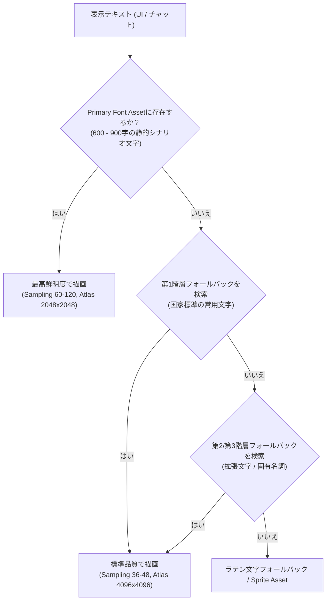

## **1. プロジェクト概要とリアルタイムローカライズの課題**

**GilongWorld**プロジェクトは、極めて複雑かつグローバル規模の技術的要件を掲げています。すなわち、English、Vietnamese、French、Italian、German、Spanish (Spain)、Polish、Portuguese (Brazil)、Portuguese (Portugal)、Korean、Russian、Japanese、Turkish、Simplified Chinese、Traditional Chineseの計15言語に対する包括的なローカライズ（*localization*）対応です。Unityエンジンを用いた現代のゲーム開発において、リアルタイムのグラフィックス空間でテキストを管理・表示することは、単に文字列を差し替えるだけの処理にとどまりません。美的品質、あらゆるカメラ距離における文字の鮮明さ、そして何よりシステムメモリの効率的な利用を保証する包括的なフォントアーキテクチャの最適化が不可欠となります。

現在のUnityエコシステムにおいて、テキスト描画の標準かつ最も強力なツールは**TextMeshPro（TMP）**です。拡大時にぼやけたビットマップ画像として各文字を描画していた従来のUI Textシステムとは根本的に異なり、TextMeshProでは標準フォントファイルを**Font Asset**と呼ばれる専用アセットへ変換する必要があります[^1]。これらのFont Assetには、**Signed Distance Field（SDF）**技術を用いた1枚以上のテクスチャ（*Atlas Texture*）が格納されます。SDF技術により、テキストをどれだけ拡大してもジャギーやピクセル化（*pixelation*）を起こさずに描画できるほか、ドロップシャドウ、アウトライン（縁取り）、太さの調整、発光（グロー）といった高度なグラフィックス効果をGPU上で直接計算するための数学的基盤がシェーダーに提供されます[^1]。

しかし、SDFの強力な表現力には避けられない物理的制約が伴います。それが**メモリ上限**です。対象となる15言語のすべての文字を単一のテクスチャアトラスに収めることは物理的に不可能です[^1]。とりわけCJK（*Chinese, Japanese, Korean*）グループに属する言語は、数万字に及ぶ膨大な表意文字体系を備えています。これらすべてを1枚のAtlas Textureに押し込もうとすれば、テクスチャサイズがハードウェア（特にモバイル端末）の処理上限（通常 $4096 \times 4096$ または $8192 \times 8192$ ピクセル）を突破し、VRAMの枯渇やアプリケーションのクラッシュ（*crash*）を引き起こします[^5]。本レポートでは、ソースフォントの選定・ダウンロードと各文字体系の特性分析から、TextMeshProの内部パラメータ構成、フォールバックチェーン（*Fallback Chain*）の管理、そしてUnity Localizationパッケージを活用した漢字統合（*Han Unification*）問題の根本的な解決に至るまで、一連の手順を詳細に解説します。

---

## **2. 文字学的基盤とソースフォント取得戦略**

多言語テキストシステムを構築するうえで最初かつ最も重要なステップは、適切な**ソースフォントファイル（*Source Font File*）**の選定です。15言語全体で視覚的な統一感を維持するには、基本領域から拡張領域までのUnicode範囲を網羅し、ベースライン（*baseline*）の高さや線幅（*weight*）が統一されたオープンソースのフォントファミリーが必要となります。

ソフトウェア業界において、**Google Noto**フォントファミリー（端末に対応する文字がない際に表示される四角い枠、俗に「豆腐（Tofu）」と呼ばれる現象をなくす使命を込めた *"No Tofu"* の略称）はゴールドスタンダードとして確立されています[^7]。Googleが主要なタイプファウンドリと協働して設計したNotoシステムは、ラテン文字、キリル文字、CJK文字が同一行内に混在しても、プロポーションの崩れやデザインの違和感が生じないよう保証しています[^8]。複数言語が混在するテキストを滑らかに描画できることは、GilongWorldのユーザー体験において極めて重要です。

### **フォントデータの抽出とUnityへのインポート手順**

統合プロセスを開始するには、**Google Fonts**ライブラリからソースフォントファイルを直接ダウンロードします。プロジェクト容量の不要な肥大化を防ぐため、ダウンロードとUnityへのインポートは以下の厳格な手順に従います。

1. **ラテン文字およびキリル文字を使用する11言語グループ**（*English, Vietnamese, French, Italian, German, Spanish, Polish, Portuguese - Brazil, Portuguese - Portugal, Russian, Turkish*）：システムに必要なのは基本の**Noto Sans**フォントセットのみです[^8]。このフォントにはLatin Extended、Cyrillic、結合発音区別符号（combining diacritics）などのUnicodeブロックをカバーする3,700以上のグリフ（*glyphs*）が収録されており、上記言語の要件を完全に満たします[^8]。Google Fontsのページからダウンロードすると、TrueType（`.ttf`）形式で複数の太さ（*Thin, Regular, Medium, Bold, Black*など）を含むZIPアーカイブが取得できます。
2. **4つのCJK言語グループ**：ダウンロード手順はより複雑になります。開発者は**Noto Sans JP**（日本語）、**Noto Sans KR**（韓国語）、**Noto Sans SC**（簡体字中国語）、**Noto Sans TC**（繁体字中国語）という地域別の各バリアントを個別に取得する必要があります[^7]。これらのCJKフォントファイルは膨大なグリフデータを内包しているため容量が非常に大きく、1ウェイトあたり15MB〜20MBに達します。このグループでは、TrueTypeよりも複雑な文字テーブル構造に対応できるOpenType（`.otf`）形式が一般的に使用されます[^5]。

Google Fontsから展開したファイルは、続いてUnityプロジェクト環境へインポート（*import*）します。アセット管理のベストプラクティス（*best practice*）として、`Assets/GilongWorld_Resources/Fonts/Source_Files/`のような専用ディレクトリ構成を作成します。`.ttf`および`.otf`ファイル（UIデザイン上、太字バリアントが明示的に不要であればメモリ最適化のため*Regular*や*Medium*など標準ウェイト1種類のみを選択推奨）をOSからUnity EditorのProjectウィンドウへ直接ドラッグ＆ドロップして取り込みます[^10]。

> [!NOTE]
> TextMeshProはランタイムのテキスト描画にこれらの`.ttf`や`.otf`ファイルを直接使用しません。これらはあくまでFont Asset Creatorツールが配列データを抽出し、SDFテクスチャへコンパイルするための原材料として機能します[^1]。ソースファイルを専用フォルダで管理しておくことで、（Dynamic SDF機能を使用しない場合に）最終ビルドから容易に除外でき、ゲームのインストールパッケージ容量を削減できます。

---

## **3. 文字体系の特性分析とUnicode範囲の要件**

GilongWorldプロジェクトにおける15言語の多様性に対応するには、国際標準規格Unicodeにおける文字の符号化方式を深く分析する必要があります。TextMeshProは、ソースフォントファイルから抽出すべき文字範囲（*Unicode Ranges*）を指定する際に16進数（Hexadecimal）を用います[^13]。これらの範囲を正確に指定することで、完全な言語カバレッジを確保すると同時に、不要な文字の読み込みによるAtlasテクスチャの肥大化を防ぐことができます。

形態学的構造に基づき、15言語はアセット管理上、大きく3つの戦略的グループに分類されます。

### **サブグループ1：拡張ラテン文字とダイアクリティカルマーク（発音区別符号）**

このグループにはEnglish、French、Italian、German、Spanish、Polish、Portuguese (Brazil)、Portuguese (Portugal)、Turkish、Vietnameseが含まれます。基本ラテン文字（`U+0020`〜`U+007E`）を共通基盤としつつも、拡張コードブロックにおいて明確な分岐が生じます[^1]。

- **西欧および南欧**（*French, Spanish, Italian, Portuguese, German*）：主に`á`、`é`、`í`、`ó`、`ú`、`ñ`、`ü`、`ç`などの基本アクセント付き母音・記号を含む*Latin-1 Supplement*（`U+00A0`〜`U+00FF`）ブロックを使用します。
- **中欧およびトルコ語**（*Polish, Turkish*）：`ą`、`ł`、`ş`、`ğ`などの固有文字を表示するため、*Latin Extended-A*（`U+0100`〜`U+017F`）ブロックに依存します[^10]。
- **ベトナム語**：このグループの中で最も要件が厳しい言語です。曲折アクセント（`â`、`ê`、`ô`）やホーン符号（`ơ`、`ư`）付き母音に複雑な声調符号が重なるため、*Latin Extended Additional*（`U+1E00`〜`U+1E9F`）ブロックが必須となります[^14]。ベトナム語の発音区別符号体系は縦方向に非常に背の高い文字構造（たとえば`Ể`は通常のラテン文字の大文字高を大きく超える）を生むため、文字の上部が欠ける（*clipping*）現象を防ぐべくTextMeshProの行間（*line height*）と余白（*padding*）を慎重に調整しなければなりません。

### **サブグループ2：キリル文字（Cyrillic）**

本プロジェクトでこれに該当する唯一の言語は**Russian（ロシア語）**です。キリル文字は符号化上ラテン文字から完全に独立しており、`U+0400`〜`U+04FF`のコードブロック内に収まります[^10]。符号化体系は独立しているものの、文字幅やベースライン高などの形態学的特徴はラテン文字と多くの共通点を持つため、視覚的な不均衡を起こすことなくラテングループと同一のFont Assetにシームレスに統合できます。

### **サブグループ3：CJK文字体系と歴史的課題「Han Unification」**

第3グループは**Korean、Japanese、Simplified Chinese、Traditional Chinese**で構成されます。ここはTextMeshProの技術的限界が最も頻繁に試される最難関領域です。その根本原因は文字数の多さだけでなく、Unicodeコンソーシアムによる議論の多い技術規約**Han Unification**（漢字統合）にも深く関係しています[^7]。

Unicode規格の策定初期、16ビットの符号空間内に東アジアの文字体系を収めるため、ソフトウェア技術者たちは中国・日本・韓国で歴史的起源を共有する漢字を単一の共有**コードポイント（*code point*）**へと統合する決定を下しました[^7]。このブロックは*CJK Unified Ideographs*と呼ばれ、`U+4E00`から`U+9FA5`に割り当てられています[^12]。

この決定は描画技術において深刻な弊害をもたらしました。**同一のUnicodeコードポイントを共有しているにもかかわらず、文化の発展、書道芸術、教育基準の分岐により、同じ文字（グリフ）の実際の字形が国・地域ごとに異なる形で描かれる**という点です。

- 典型例が「骨」という漢字（Unicode `U+9AA8`）です。この文字の上部にある四角形の内部の画構造は、簡体字中国語（SC）フォントでは左右の横線として配置されるのに対し、繁体字中国語（TC）および日本語（JP）ではまったく異なる筆画構造で描かれます[^7]。
- 同様に、「雪」や「直」といった日常的な文字にも、母語話者であれば即座に見分けられる微細ながら明確な字形差が存在します。

テキスト描画システムは文脈から字形を自動推測することはできず、Unicode値を受け取って現在有効なフォントセットから対応する画像を取り出すだけです。したがって、東アジアの全言語で1つのCJKフォントを共有すると、日本人プレイヤーが中国語風の字形で描かれた日本語テキストを読む羽目になり、その逆も同様に起こります[^7]。母語話者にとってこれは文字化けや素人っぽい不自然な表記に映り、ゲーム世界への没入感を完全に損ないます[^7]。この制約を克服する唯一の解決策は、各CJK言語ごとにFont Assetを完全に分離し、フォールバックチェーンを動的に制御することです。

---

## **4. TextMeshProとSigned Distance Field（SDF）の技術メカニズム**

正確なセットアップ手順を実行するには、TextMeshPro内部における**Signed Distance Field（SDF）**の動作原理を理解することが不可欠です。ピクセルの色情報をそのまま保持する従来のビットマップフォントとは異なり、SDFは各ピクセルから最も近い文字輪郭（エッジ）までの数学的距離を記録します[^1]。
- ピクセルが文字の**内側**にある場合、距離は**正の値**をとります。
- **外側**にある場合、**負の値**をとります。
- **正確に輪郭線上**にある場合、距離は**ゼロ**（$0$）になります。

この距離データはグレースケール（*grayscale*）情報としてエンコードされ、Atlas Textureに保存されます。実行時には、TextMeshProのGPUシェーダーがこの距離値に対してバイリニア補間（*bilinear interpolation*）を行います。シェーダーは画面上の各フラグメント（*fragment*）の値を判定し、$> 0$であれば色を描画し、$< 0$であれば透明として処理します。離散的なピクセル格子に依存せず連続的な数学的補間を用いるため、カメラがオブジェクトに極限まで近づいてもSDFテキストの曲線は極めてシャープに保たれます[^1]。

この仕組みにより、Font Asset生成時の2つの主要パラメータが決まります。
1. **Sampling Point Size：** 文字をAtlas Texture上に描画する際の物理的な解像度サイズを決定します。数値が大きいほど距離データの精度が高まります。
2. **Padding（余白）：** SDFの表現力を引き出す鍵です。文字周囲に設ける余白スペースにより、距離グラデーションがより深い負の値へと滑らかに減衰できるようになります。パディングが広いほどSDFアルゴリズムに十分な「余地」が生まれ、輪郭線（*outline*）、ドロップシャドウ（*shadow*）、発光（*glow*）といったエフェクトを太く設定しても途中で途切れることなく綺麗に描画できます[^13]。

---

## **5. Font Asset Creatorによる詳細セットアップ手順**

フォントテクスチャファイルの生成は、Unity内蔵ツールである**Font Asset Creator**を使用して行います。メニューバーから以下のパスで開きます。

```text
Window > TextMeshPro > Font Asset Creator
```

第3章の分析に基づき、GilongWorldプロジェクトの15言語に最適な構成は分割モデルとなります。すなわち、**ラテン／キリル文字系11言語用の共通Font Assetを1つ、そして各CJK言語用に個別のFont Assetを4つ生成する**構成です。

### **5.1. ラテン・キリル文字およびベトナム語向け静的（Static）設定**

11言語（*English, French, Italian, German, Spanish, Polish, Portuguese BR, Portuguese PT, Turkish, Russian, Vietnamese*）を単一の**Primary Static Font Asset**へ統合することは、GPUのドローコール（*draw call*）数を最小化し、安定したフレームレート（*frame rate*）を維持するうえで最も効果的なアプローチです[^14]。

Font Asset Creatorでは以下の厳格なパラメータで設定を行います[^12]。

| 設定プロパティ | 技術的推奨値 | 設計上の根拠 |
| :--- | :--- | :--- |
| **Source Font File** | `NotoSans-Regular.ttf` | `Assets`フォルダからソースファイルをこの欄にドラッグ＆ドロップします。形状データの元となります[^1]。 |
| **Sampling Point Size** | `Custom Size: 60 - 90` | Auto Sizingモードは利用可能なスペースに文字を詰め込もうとするだけです。Custom Sizeを60〜90に固定することで、テクスチャ全体で一貫したSDF品質が保証されます[^1]。 |
| **Padding** | `6 - 9`（約10%の比率） | TextMeshProの標準ルールとして、PaddingはSampling Point Sizeの約10%に設定します[^4]。Sampling 60に対してはPadding 6が理想的です。UIデザイン上きわめて太い縁取りが必要な場合は10まで引き上げることができます。 |
| **Packing Method** | `Optimum` | OptimumアルゴリズムはFastよりも処理に大幅に時間がかかりますが、反復計算によってスペース内にグリフを最も高密度に詰め込み、ピクセルの無駄を最小限に抑えます[^12]。 |
| **Atlas Resolution** | `2048 x 2048` | これら11言語の文字数は合計およそ1,500〜2,000グリフです。$2048 \times 2048$ の解像度があれば、文字欠落なしにSampling Point Size 60を十分に維持できます[^7]。 |
| **Character Set** | `Unicode Range (Hex)` | プリセットセットを選ぶ代わりにこのモードを使うことで、読み込む文字を完全に制御できます[^2]。 |

**Custom Character List**欄には、11言語の要件をすべてカバーする以下の16進数コード範囲を入力します。

```text
0020-007E, 00A0-00FF, 0100-017F, 0180-024F, 1E00-1E9F, 0300-036F, 0400-04FF, 0500-052F, 2000-206F
```

すべてのパラメータを入力し終えたら、次の手順を実行します。
1. **Generate Font Atlas**ボタンをクリックします。ツールが距離計算とテクスチャ生成を行います（CPU性能により数分かかる場合があります）。
2. 処理が完了してテクスチャプレビューが表示されたら、**Save**をクリックします。
3. プロジェクトフォルダに`Global_Latin_Cyrillic_SDF.asset`という名前で保存します[^1]。

### **5.2. CJK向け静的（Static）設定および階層型フォールバックアーキテクチャ**

4つのCJK言語を扱う場合、膨大なデータ量のため全く異なるアプローチが必要です。`NotoSansCJKjp`、`NotoSansCJKkr`、`NotoSansCJKsc`、`NotoSansCJKtc`に対して上記処理を4回繰り返すことは必須ですが、Unicode範囲指定でCJK全体を一枚の静的アトラスに収めようとするとテクスチャの物理サイズ上限を超えて失敗します[^5]。

標準的な技術解は、**Characters from File**オプションを組み合わせた**階層的文字マッピングモデル（Hierarchical Character Mapping）**を採用することです[^7]。

#### **1. 既知文字（Known Characters）用のPrimary SDF Font Asset作成**
- プロジェクトの文字列テーブル（*String Tables*：メニュー、クエスト、アイテム、会話、スキル）からすべての静的テキスト文字列を抽出します。
- このユニーク文字セット（*unique characters*）は実務上**1,000文字未満**に収まることが多く、GilongWorldプロジェクトでも簡体字中国語が**855文字**、繁体字中国語が**870文字**、日本語が**694文字**、韓国語が**588文字**にとどまります。
- **サンプリング品質の最大化（Maximize Sampling Size）：** 文字数が1,000文字未満であるため、Atlas Resolution `2048 x 2048` に対して **Sampling Point Sizeを高く**（`60`〜`90`または`120`）設定できます。これにより、ゲーム内の公式UIテキストはあらゆるカメラ距離において極めて高い鮮明度を維持できます。

#### **2. 国家標準文字セットに基づく階層フォールバックの構築（UGC／チャット用標準フォールバック）**
プレイヤーによる自由入力（キャラクター名、ギルド説明、コミュニティチャット）を完全にサポートし、豆腐（Tofu）現象を一切発生させないため、**国家標準文字データセット**を継承したFallback Font Assetを追加します。

| 言語 | 国家標準文字セット | 文字数 | 制定機関およびオープンソース参照 |
| :--- | :--- | :---: | :--- |
| **Simplified Chinese (zh-Hans)** | **TGSCC（通用规范汉字表）**<br/>- 第1級（常用）：3,500字<br/>- 第2級（拡張）：3,000字<br/>- 第3級（人名・地名）：1,605字 | **8,105** | 中華人民共和国教育部<br/>*オープンソース：* [GitHub chinese-character-table](https://github.com/maple-leaf/chinese-character-table) |
| **Traditional Chinese (zh-Hant)** | **常用国字標準字体表**（*常用國字標準字體表*） | **4,808** | 台湾教育部（MOE Taiwan）<br/>*オープンソース：* [台湾オープンデータポータル](https://data.gov.tw/dataset/5961) / [GitHub cjktables](https://github.com/ButTaiwan/cjktables) |
| **Japanese (ja)** | - **Jōyō Kanji**（常用漢字）：2,136字<br/>- **Jinmeiyō Kanji**（人名用漢字）：863字 | **2,999** | 日本国文化庁<br/>*オープンソース：* [KanjiAPI](https://kanjiapi.dev/) / [GitHub kanji-data](https://github.com/davidluzgouveia/kanji-data) |
| **Korean (ko)** | **KS X 1001規格**（日常会話の99.9%を網羅するハングル完成型2,350音節） | **2,350** | 韓国国家技術標準院（KATS）<br/>*オープンソース：* [GitHub ksx1001](https://github.com/korean-character-sets/ksx1001) / `euc-kr`経由で抽出 |



#### **3. 不変のルール：Sampling Point Size / Padding 比率の一貫性維持（Ratio Consistency）**

TextMeshProシェーダーにおける中核的なグラフィックス原理として、**Outline（縁取り）、Underlay / Shadow（影）、Glow（発光）エフェクトの太さは Sampling Point Size と Padding の比率に基づいて計算されます**[^13]。

##### **なぜFallbackはPrimaryと同じPoint Sizeを必要としないのか？**
- **Primary Font（UIスクリプト約855字）：** プレイ時間の100%を通じて画面に表示されるため $\rightarrow$ **品質の最大化**（`Sampling Size = 120`、`Padding = 10`、Atlas $2048 \times 2048$）が必要です。
- **Fallback Fonts（チャット／名前用の希少文字2,700〜8,000字）：** 出現頻度が非常に低いため $\rightarrow$ **サンプリング品質を下げて**（`Sampling Size = 60`または`48`）、VRAMを膨らませずに同じAtlasサイズへ数千文字を圧縮格納します。

##### **なぜ必ず同じ比率（$\text{Ratio} = \frac{\text{Sampling}}{\text{Padding}}$）を保たなければならないのか？**
同一の文中にPrimary由来の文字とFallback由来の文字が並んで表示されるケースを考えます。
- **比率がずれている場合：** Primaryの文字（Size 120, Pad 10 $\rightarrow$ Ratio 12）は細く美しい縁取りになる一方、Fallbackの文字（Size 60なのに誤ってPad 10のまま $\rightarrow$ Ratio 6）は**縁取りが2倍の太さに膨れ上がり、文字の画線を飲み込んで潰れてしまいます**。
- **比率を揃えた場合（$\text{Ratio} = 12$）：** 文字がPrimaryから描画されてもFallbackにフォールバックしても、**縁取りと影の太さは常に100%均一に保たれます**。

| Font Asset階層 | 役割 | Sampling Point Size *(Custom)* | Padding | Atlas Resolution | 比率 (Ratio) |
| :--- | :--- | :---: | :---: | :---: | :---: |
| **Primary Font** | 主要UIスクリプト | **120** *（または 96）* | **10 px** *（または 8 px）* | $2048 \times 2048$ | **12** *（最大鮮明度）* |
| **第1階層 Fallback** | 常用文字 約2,725字 | **60** | **5 px** | $2048 \times 2048$ | **12** *（VRAM節約）* |
| **第2階層 Fallback** | 拡張文字 約2,992字 | **60** | **5 px** | $2048 \times 2048$ | **12** *（VRAM節約）* |
| **第3階層 Fallback** | 希少／人名文字 約1,605字 | **48** | **4 px** | $2048 \times 2048$ | **12** *（VRAM節約）* |

> [!TIP]
> **実務上の操作ポイント：** *Font Asset Creator*内で`Sampling Point Size`を*Auto Sizing*から**Custom Size**に切り替え、上表の比率通りにサンプリングサイズとPaddingを固定してください。

---

### **5.3. Unityにおけるフォルダ構成手順と実践的な自動化**

長期的な拡張性と保守性を確保するため、GilongWorldプロジェクトではすべての元文字データをグループ分けした専用ディレクトリ構造を構築しています。

```text
Assets/_GilongWorld/_Project/Art/Fonts/_chars/
├── 01_Latin_Cyrillic/        # [共通Primary Font] ラテン／キリル11言語
│   ├── vi_chars.txt          # ベトナム語
│   ├── en_chars.txt          # 英語
│   ├── ru_chars.txt          # ロシア語
│   └── ...                   # フランス語、ドイツ語、イタリア語、スペイン語、ポーランド語、ポルトガル語、トルコ語
│
├── 02_CJK/                   # [CJK Primary Fonts] ゲーム内の静的スクリプト文字
│   ├── ja_chars.txt          # 日本語（実測694文字）
│   ├── ko_chars.txt          # 韓国語（実測588文字）
│   ├── zh_Hans_chars.txt     # 簡体字中国語（実測855文字）
│   ├── zh_Hant_chars.txt     # 繁体字中国語（実測870文字）
│   │
│   ├── Standard_Fallbacks/   # [標準ソース階層] 7つの国家標準元データセット
│   │   ├── zh_Hans_TGSCC_Level1_3500.txt
│   │   ├── zh_Hans_TGSCC_Level2_3000.txt
│   │   ├── zh_Hans_TGSCC_Level3_1605.txt
│   │   ├── zh_Hant_Common_4808.txt
│   │   ├── ja_Joyo_Kanji_2136.txt
│   │   ├── ja_Jinmeiyo_Kanji_863.txt
│   │   └── ko_KS_X_1001_2350.txt
│   │
│   └── Subtracted_Fallbacks/ # [最適化フォールバック階層] Primary文字を完全除外済み
│       ├── zh_Hans_Fallback_Level1.txt    (TGSCC 第1級からPrimaryを除外)
│       ├── zh_Hans_Fallback_Level2.txt    (TGSCC 第2級からPrimaryを除外)
│       ├── zh_Hans_Fallback_Level3.txt    (TGSCC 第3級からPrimaryを除外)
│       ├── zh_Hant_Fallback_Common.txt    (台湾標準4808からPrimaryを除外)
│       ├── ja_Fallback_Joyo.txt           (常用漢字からPrimaryを除外)
│       ├── ja_Fallback_Jinmeiyo.txt       (人名用漢字からPrimaryを除外)
│       └── ko_Fallback_KS_X_1001.txt      (KS X 1001からPrimaryを除外)
```

#### **自動文字抽出＆フォールバック差分ツール（`GWCharacterExtractor.cs`）**
プログラマーが手作業でCSVを出力し重複文字を除外する手間を省くため、専用Unity Editorツール [`GWCharacterExtractor.cs`](file:///d:/Unity-Projects/GLW/Assets/_GilongWorld/_Project/Editor/Localization/GWCharacterExtractor.cs) に2-in-1パイプラインを統合しています。
- **メニューパス：** `GilongWorld → Localization → Extract CJK Characters From String Tables`
- **処理1（Primary抽出）：** Unity Localization内の全`StringTableCollections`を走査し、使用中のテキスト文字列を`HashSet<char>`構造（100%の一意性を保証）へ収集してUnicode昇順にソートしたうえで、`02_CJK/`内の4つのPrimaryファイルに出力します。
- **処理2（フォールバック文字の自動減算）：** スクリプトが`Standard_Fallbacks/`内の7つのデータセットを自動読み込みして照合し、**Primary Assetにすでに含まれるすべての文字を除去**したうえで`Subtracted_Fallbacks/`ディレクトリへ書き出します。これにより、Primary AtlasとFallback Atlas間での文字重複によるVRAMの無駄遣いを完全に根絶します。

#### **GWSDFGeneratorWindow UIとUnity 6 API制限の突破**
「Sampling / Padding比率 = 12」のルールを確実に遵守するため、プロジェクトではパラメータを入力し、比率がずれた場合に即座に警告を出す専用Editor Windowを提供しています。
特にUnity 6では、Font Assetの`clearDynamicDataOnBuild`プロパティが`internal`アクセスレベルでロックされており、通常のコードからビルド前の不要な動的データをクリアできなくなっています。本ツールは`SerializedObject`を用いたリフレクション（Reflection）技術によってこの問題を完全に解決します。

```csharp
var serializedObject = new SerializedObject(fontAsset);
serializedObject.FindProperty("m_ClearDynamicDataOnBuild").boolValue = true;
serializedObject.ApplyModifiedProperties();
```

これにより、旧システムで肥大化していた137MBの破損アトラスが完全に一掃され、ビルド容量を最小限に抑えることができました。

---

## **6. フォールバックチェーン（Fallback Chain）管理アーキテクチャとHan Unification解決策**

多言語ゲームを滑らかに動作させる要となるのが、**フォールバックチェーン（*Fallback Chain*）**の制御能力です。TextMeshProのUIコンポーネントがPrimary Font Assetに存在しない文字を含む文字列を受け取ると、システムは代替となる字形（*glyph*）を探すため、フォールバックリストに対して再帰的な探索アルゴリズムを実行します。

探索アルゴリズムは以下の厳格な階層順序に従います。
1. `TextMeshPro Primary Font Asset`
2. `Primary Font内部のローカルFallback Font Assetsリスト`
3. `ローカルSprite Asset`
4. `TMP_Settingsでグローバル定義されたGeneral Fallback Font Assets`
5. `Default Sprite Asset`
6. `Default Font Asset`[^20]

> [!WARNING]
> システムは上から下へと順番に検索を行い、**最初に一致するUnicodeコードポイントを見つけた時点で即座に検索を停止します**[^7]。

第3章で解説したとおり、Han Unification現象によりSC、TC、JPの各言語は字形が異なるにもかかわらず同一のUnicodeコードを共有しています[^7]。仮に開発者がすべてのCJKファイルを`TMP_Settings`のGeneral Fallback Font Assetsリストへ一括登録してしまうと、リストの並び順がテキストの運命を決定づけることになります。たとえばリストが `Font_CJK_JP_SDF` $\rightarrow$ `Font_CJK_SC_SDF` $\rightarrow$ `Font_CJK_TC_SDF` の順に並んでいたとします。そこへ簡体字中国語のテキストが渡されると、システムは上から走査して最初に日本語ファイルに突き当たり、該当するUnicodeコードを発見して即座に日本語の漢字スタイルで画面へ描画してしまい、下位にある中国語ファイルを完全に無視します[^7]。

### **ローカルフォールバック分離アーキテクチャ（Local Fallback Architecture）**

この問題を根絶するには、フォールバック構造を言語ごとに完全に隔離する必要があります。

> [!IMPORTANT]
> **CJKフォントを`TMP_Settings`のグローバルフォールバックリスト（Global Fallback List）へ絶対に登録しないでください**[^1]。代わりに、各Assetファイル固有のローカルフォールバック（*Local Fallback*）構造によって紐付け、実行時に動的に管理します。

タイポグラフィの基本原則として、CJKフォントに同梱されているラテン文字やアラビア数字は、純粋なラテン文字専用フォントと比べて造形が劣っていたりプロポーションが不揃いだったりすることが一般的です[^9]。したがって、ラテン文字は常に`Global_Latin_Cyrillic_SDF`ファイルで優先描画させる必要があります。ローカル連結構造は以下のように構築します。
1. `Font_CJK_SC_SDF.asset`ファイルを開き、**Fallback Font Assets**欄に中国語用のFallback第1〜3階層を追加し、その末尾に`Global_Latin_Cyrillic_SDF`を追加します[^1]。
2. TC、JP、KRの各ファイルに対しても同様の設定を行います。

これにより、ゲーム内で中国語を表示している最中に数値や英語の固有名詞が混在していても、それらの文字は中国語の静的アトラス（*Characters from File*抽出時にラテン文字を除外済みのため）を素通りし、高品質なラテン文字セットを持つフォールバックファイルによって確実に捕捉・描画されます[^7]。

---

## **7. 動的切り替え（Runtime Swapping）のためのUnity Localization統合**

漢字の文化圏ごとの正しい字形描画とVRAMメモリの最適化を両立させるため、TextMeshProのUIコンポーネントは固定の静的設定を維持するわけにはいきません。ユーザーが言語（*Locale*）を切り替えるたび、ベースとなるフォント（*Primary Font Asset*）を実行時（*runtime*）に自動交換（*swap*）する必要があります[^23]。

**Unity Localization**パッケージ（`com.unity.localization`）は、個々の切り替え処理をハードコーディング（*hardcoding*）する代わりにこのロジックフローを実行できる強力な機能を備えています[^25]。統合アーキテクチャは、`LocalizationSettings.SelectedLocaleChanged`によるグローバルな言語変更イベント監視機構を軸に動作します[^24]。

実装アプローチは2通りあります。

### **アプローチ1：集中管理フォントマネージャーの実装（Centralized Font Manager）**

数千ものUI Textコンポーネントへ個別にLocalized Assetイベントを割り当てる（大量の余分な`MonoBehaviour`オブジェクトやガベージコレクション負荷を生み、メモリに甚大な圧力をかける）のではなく、GilongWorldプロジェクトでは**Addressablesを用いた集中管理戦略**を採用しています。

`GWFontManager.cs`スクリプト（`DontDestroyOnLoad`フラグ付き）が`LocalizationSettings.SelectedLocaleChanged`イベントを購読します。このイベントが発火すると、マネージャーは次の2つの洗練された処理を実行します。
1. **非同期ロード（Async Load）：** `LocalizationSettings.AssetDatabase.GetLocalizedAssetAsync<TMP_FontAsset>("Fonts_Table", "PrimaryFont")`を使用し、現在の言語に適したFont AssetをAddressablesから非同期で取得します。
2. **グローバルスキャン（Global Sweep）：** `FindObjectsByType<TMP_Text>`コマンドでシーン全体を走査し、すべてのUI Textに新しいフォントを一括適用します。この処理は数ミリ秒のCPU時間を要しますが、言語変更時またはシーンロード時に1度だけ実行されるため、代わりに数千個の個別コンポーネントが占有していたRAMを完全に解放できます。割り当て完了直後、旧言語のフォントは`Addressables.Release()`によって即座に破棄されます。

この方式により、フォールバックシステムは指定された現在の言語用Atlasのみをメモリに保持するため、CJK言語間の「交差汚染」（*cross-pollination*）現象を完全に排除できます[^7]。

### **アプローチ2：Unity Localization Asset Tables**

最もネイティブ（*native*）な統合手法は**Localized Asset Tables**の活用です[^23]。文字列を差し替えるLocalized String Tablesと同様に、Asset Tablesでは言語ごとに異なるアセットファイルを割り当てられます。UI上のLocalized Textコンポーネントは、String文字列だけでなくTextMeshProオブジェクトの`FontAsset`変数も自動で切り替えるよう設定可能です[^23]。

このアプローチはInspector上での設定作業を必要としますが、高い安定性を備え、開発者が独自のマッピングコードを保守する負担から解放してくれます[^28]。

---

## **8. 動的コンテンツ（UGC）管理・メモリ最適化・Addressables統合**

静的アーキテクチャ（*Static Architecture*）によってシステムUIの課題は完全に解決されました。しかし、キャラクター名、ギルド紹介文、コミュニティチャット欄などの**ユーザー生成コンテンツ（User-Generated Content - UGC）**はさらなる難題を突きつけます。プレイヤーが15言語の中からどの文字を入力するかは予測不可能であり、世界中の何十万もの文字をすべてRAMに常駐させることは現実的に不可能です。

### **ハイブリッドアーキテクチャによる解決策（Hybrid SDF System）**

TextMeshProの通常の**Dynamic SDF**システムは、Font Assetを空のテクスチャアトラス（$0 \times 0$ ピクセル）から開始させることができます。未知の文字を検出すると、CPUを用いてその文字をラスタライズし、ランタイムにテクスチャへ挿入します[^6]。
ただし、完全にDynamic方式へ依存すると、初回画面表示時に激しいフレーム落ち（frame spike）が発生します。そこでGilongWorldプロジェクトでは**ハイブリッドアーキテクチャ（Hybrid）**を採用しています。

1. **滑らかな静的プリロード（Static Population）：** `GWCharacterExtractor.cs`ツールを用いて、使用頻度の高い数千文字をエディタ段階で`TryAddCharacters`関数によりあらかじめAtlasへ焼き込んでおきます。ゲーム開始時点でこれらの文字はすでに利用可能であるため、フレームレート（FPS）が極めて安定します。
2. **安全な動的フォールバック（Dynamic Fallback）：** Font Asset自体は`isMultiAtlasTexturesEnabled = true`フラグを有効にしたDynamicモードで保存されます。プレイヤーがチャットで初期アトラスに未収録の極めて珍しい文字を入力した場合でも、TMPは豆腐（Tofu）を表示する代わりに即座に新たな補助Atlas Texture（`Atlas 0 1`、`Atlas 0 2`...）を生成してその文字を格納します。これこそ両者の利点を兼ね備えた理想的な構成です。

> [!CAUTION]
> Dynamic SDF手法にはリソースコストが伴います。$2048 \times 2048$ サイズの動的アトラスが1枚生成されるたびに、即座に約**4MB**のシステムメモリが消費されます。補助アトラスが多数生成されると、モバイル端末へのメモリ負荷が急増します[^31]。

### **潜むAddressablesの罠とVRAMメモリ競合**

GilongWorldのような現代の大規模プロジェクトでは、アセットの読み込みにほぼ確実に**Addressables**システムが採用されています。多くの開発者が陥る致命的な過ちは、**「Addressablesを明示的に有効にしていないので、フォントは`Resources`フォルダに入れておいて問題ない」と思い込んでしまうこと**です。

実際には、**Unity Localizationパッケージ自体がAddressables基盤の上に直接構築されています**。開発者が意識して使っていなくても、String Tables管理のためにバックグラウンドでAddressablesは稼働しています。
Addressablesでパッケージ化されたUIプレハブが`Resources`フォルダ内のFont Assetを参照していると、Unityのアセット管理機構は深刻なデータ重複（*duplicate assets*）エラーを引き起こします。
1. UnityがそのAtlasテクスチャの完全な複製を作成し、AddressablesのAssetBundle内部へ同梱してしまいます[^32]。
2. ゲーム起動時、`Resources`側のAtlasがすでに読み込まれているところへAssetBundle側のAtlasも追加でRAMへロードされ、結果として**VRAMが2倍消費される**という無駄が発生します[^31]。この不具合は非常に発生頻度が高く、最大RAM容量を厳しく制限されるモバイルアプリを容易にクラッシュさせます[^33]。

**抜本的な解決策：**
- `TMP_Settings`ファイルおよびすべてのFont Assetを`Resources`フォルダから完全に移動し、`Assets/_GilongWorld/_Project/Art/Fonts/SDF/`のような標準フォルダへ配置します。
- これらすべてのSDFファイルを選択して専用のAddressables Group（例：`Fonts_Addressables`）へ格納し、Localizationの**Asset Table**（`Fonts_Table`）でマッピングを設定します。
- **エディタ上でのDynamic Fontクリーンアップ：** Dynamic Font Assetファイルは生成データをディスク上に永続保持する性質があります。ビルドコンパイル前には必ず動的データを消去する必要があります（前述の`SerializedObject`手法を用いた`GWSDFGeneratorWindow`ツールにより自動化済み）[^30]。
- **ランタイムのメモリ解放：** 大規模なシーン遷移時には`TMP_FontAsset.ClearFontAssetData(true)`または`FontEngine.DestroyFontEngine()` APIを呼び出し、使われなくなった動的テクスチャ配列を確実に解放します[^35]。

---

## **9. 実践的なトラブルシューティング（Troubleshooting）**

マルチプラットフォーム環境での実運用テストでは、ローカライズシステムに特有の不具合症状が表面化することがあります。診断原理を把握しておくことで、エンジニアチームは問題を迅速に切り分けられます。

### **モバイルビルドではテキストが四角い空白（Tofu Boxes）になるが、Editor上では正常に表示される**
- **原因：** Fallback Font Assetsがシーン内の静的GameObjectから直接参照されず、ランタイムの`FallbackFontAssetTable`経由でのみ緩やかに参照されている場合、Unityのアセット管理システムはそれらを依存関係（*dependencies*）として認識しません。その結果、Unityのビルドパイプラインがパッケージ容量最適化のため自動的にそれらのリソースを除外（*strip*）してしまいます[^1]。
- **対処法：** `TMP_Settings.fallbackFontAssets`をグローバル参照先として設定しUnityに存在を認識させるか、使用され得るすべてのFont AssetがAddressables Manifestを通じて事前ロード（*pre-load*）されるように設定してください[^1]。

### **例外エラー：`"The variable m_AtlasTextures of TMP_FontAsset has not been assigned"`**
- **原因：** Multi Atlas Textures構成のDynamic Font Assetシステムに直接起因します[^34]。システムが新規文字を格納するため追加のテクスチャ配列を自動生成しようとした際、処理が中断されたり動的プレハブ（*instantiated prefabs*）の破棄に伴いメモリが不適切に解放されたりすると、この配列変数にnull参照（*null reference*）が残存します。
- **対処法：** ビルド前にFont Assetのコンテキストメニューから手動で**Reset**を実行し、初期状態の空テクスチャ配列を再構築してください[^34]。

### **大きな表示サイズでテキストがぼやける（Blurry）**
- **原因：** 画面上の実際の描画サイズに対して、SDF Atlasの解像度または`Sampling Point Size`が低すぎることが原因です[^1]。
- **対処法：** 大見出し（Heading / Banner）テキストについては、`Sampling Point Size`を`150`以上に再設定する必要があります。この設定値を収容できる十分な大きさのAtlasを作成できない場合は、通常本文とリソースを共有するのではなく、タイトル画面で使用する特定文字だけを切り出して独立したStatic Font Assetを作成し、鮮明度を最適化してください[^1]。

### **Google Sheetsから翻訳テーブルをPullする際の認証エラー（`invalid_grant: Token has been expired or revoked`）**
- **症状：** Google SheetsからUnityへローカライズ用文字列テーブル（`RPGB_General`やString Tablesなど）を同期（*Pull*）する際、次の赤いエラーが出力されます：`Pull from Google sheets: Failed - Error: "invalid_grant", Description: "Token has been expired or revoked."`
- **原因：** **タイムゾーンのズレ／システム時計の誤差（Timezone Skew / Clock Drift）**。Google OAuth2の認証機構はリクエストに含まれるタイムスタンプに対して極めて厳格な時刻精度を要求します。PCのタイムゾーン設定がずれていたり、システム時計に誤差が生じていたり、あるいはUnity Editorが未更新の古い時刻キャッシュを保持していたりすると、Googleの認証サーバーは即座にリクエストを拒否し、トークン無効または期限切れ（`invalid_grant`）を返します。
- **対処法：**
  - **Unity Editorの再起動：** Unity Editorを一度終了して再起動することで、エンジンがOSの正確な現在システム時刻を再取得します $\rightarrow$ その状態で再度**Pull**を実行すれば即座に成功します。

---

## **10. 最終的なアーキテクチャ推奨事項のまとめ**

15言語規模のGilongWorldプロジェクトには、VRAMメモリ配分の効率性と異文化間の視覚的体験に関する最も厳格な基準を満たすテキスト描画アーキテクチャが求められます。

1. **字形の一貫性（Typography）：** 複数言語が混在するあらゆるテキスト形式でベースライン（*baseline*）メトリクスを滑らかに揃えるため、Google Noto SansおよびNoto Sans CJKエコシステムを全面採用します。
2. **テクスチャ分割モデル（Atlas Segmentation）：** すべての言語を1枚のAtlasに押し込めないでください。ラテン／キリル文字系11言語（*English, Vietnamese, French, Italian, German, Spanish, Polish, Portuguese, Russian, Turkish*）のコード範囲を収めた単一の $2048 \times 2048$ Primary Static Font Assetを構築します。
3. **東アジア言語の最適化と階層型フォールバックモデル：** 4つのCJK言語（*Simplified Chinese, Traditional Chinese, Japanese, Korean*）を独立したFont Assetへ分離します。**高品質なPrimary SDF Font Asset（Sampling Size 60〜120、静的シナリオ文字1,000字未満）**と**3階層のFallback（TGSCCなど最大8,105字の国家標準文字）**を組み合わせ、プレイヤーの自由入力やチャット機能に対応します。シェーダー効果（Outline、Shadow、Glow）が歪みなく均一に表示されるよう、PrimaryとFallback間で**統一されたSampling Point Size / Padding比率**（Ratio $\approx 10-12$）を維持することが必須です。
4. **フォールバックチェーンの制御（Han Unification Control）：** CJK系には絶対にGlobal Fallbackリストを使用しないでください。代わりにUnity Localizationパッケージの動的差し替え（*Runtime Swapping*）ソリューションを適用し、現在のLocaleに応じたPrimary Font Assetを更新することで、他地域の字形が誤表示されるリスクを完全に排除します。ラテン文字は常に各CJKファイルのローカルフォールバック（*Local Fallback*）として設定します。
5. **動的コンテンツ統合とメモリ管理（UGC & Memory Handling）：** プレイヤーのチャット欄における未知文字を受け止めるため、Multi Atlas Textureを組み合わせたDynamic Font Assets構造を使用します。最後に、アーキテクチャ全体を`Resources`フォルダから外へ移し、Addressablesシステムでアセットを統制してAtlasの重複コピーを排除するとともに、専用のメモリクリーンアップAPIを活用して長時間のプレイセッションでもVRAMを確実に解放します。

---

## **参考文献**

[^1]: Fix: Unity TextMeshPro Font Asset Missing or Fallback | Bugnet Blog, [https://bugnet.io/blog/fix-unity-textmeshpro-font-asset-missing](https://bugnet.io/blog/fix-unity-textmeshpro-font-asset-missing)
[^2]: Fix: Unity UI TextMeshPro Falling Back to Default Font | Bugnet Blog, [https://bugnet.io/blog/fix-unity-ui-text-mesh-pro-falling-back-default-font](https://bugnet.io/blog/fix-unity-ui-text-mesh-pro-falling-back-default-font)
[^3]: textmeshpro | Skills Marketplace · LobeHub, [https://lobehub.com/de/skills/xeldaralz-helm-textmeshpro](https://lobehub.com/de/skills/xeldaralz-helm-textmeshpro)
[^4]: Chinese Traditional, Simplified and English text looks blurred, [https://discussions.unity.com/t/chinese-traditional-simplified-and-english-text-looks-blurred/723916](https://discussions.unity.com/t/chinese-traditional-simplified-and-english-text-looks-blurred/723916)
[^5]: Creating asset from font with a lot of characters - Page 2 - Unity Engine, [https://discussions.unity.com/t/creating-asset-from-font-with-a-lot-of-characters/708290?page=2](https://discussions.unity.com/t/creating-asset-from-font-with-a-lot-of-characters/708290?page=2)
[^6]: Bug where TextMeshPro dynamic font atlas exhaustion causes, [https://unity-trouble-atlas.7colorsgame.com/en/article/unity-tmp-dynamic-font-atlas-exhaustion/](https://unity-trouble-atlas.7colorsgame.com/en/article/unity-tmp-dynamic-font-atlas-exhaustion/)
[^7]: Unity Font: The 2026 Complete Guide to TextMesh Pro Font Assets, [https://www.transphere.com/unity-font-textmesh-pro-font-assets-fallbacks-and-localization/](https://www.transphere.com/unity-font-textmesh-pro-font-assets-fallbacks-and-localization/)
[^8]: Noto Sans - Google Fonts, [https://fonts.google.com/noto/specimen/Noto+Sans](https://fonts.google.com/noto/specimen/Noto+Sans)
[^9]: Force a font to use fallbacks - Unity Discussions, [https://discussions.unity.com/t/force-a-font-to-use-fallbacks/711511](https://discussions.unity.com/t/force-a-font-to-use-fallbacks/711511)
[^10]: Multiple Language Support Not Working in TextMesh Pro, [https://stackoverflow.com/questions/44922738/multiple-language-support-not-working-in-textmesh-pro](https://stackoverflow.com/questions/44922738/multiple-language-support-not-working-in-textmesh-pro)
[^11]: How to display Japanese in Unity TextMeshPro using Noto Sans CJK, [https://zenn.dev/uliboooo/articles/c3a2f489d8ee9a?locale=en](https://zenn.dev/uliboooo/articles/c3a2f489d8ee9a?locale=en)
[^12]: TextMeshPro Font Asset Creation & Packaging Guide - GitHub, [https://github.com/bbepis/XUnity.AutoTranslator/wiki/TextMeshPro-Font-Asset-Creation-&-Packaging-Guide](https://github.com/bbepis/XUnity.AutoTranslator/wiki/TextMeshPro-Font-Asset-Creation-&-Packaging-Guide)
[^13]: Font Asset Creator | TextMeshPro | 3.2.0-pre.15 - Unity - Manual, [https://docs.unity3d.com/Packages/com.unity.textmeshpro@3.2/manual/FontAssetsCreator.html](https://docs.unity3d.com/Packages/com.unity.textmeshpro@3.2/manual/FontAssetsCreator.html)
[^14]: [UNITY] Optimizing TextMesh Pro Font Atlas for language localization., [https://killertee.wordpress.com/2021/04/23/optimizing-workflow-textmesh-pro-font-atlas-for-language-localization/](https://killertee.wordpress.com/2021/04/23/optimizing-workflow-textmesh-pro-font-atlas-for-language-localization/)
[^15]: [Solved] TextMeshPro - Text(UI): Shows empty squares - Unity Engine, [https://discussions.unity.com/t/solved-textmeshpro-text-ui-shows-empty-squares/787844](https://discussions.unity.com/t/solved-textmeshpro-text-ui-shows-empty-squares/787844)
[^16]: Character set for multiple languages - Unity Discussions, [https://discussions.unity.com/t/character-set-for-multiple-languages/696758](https://discussions.unity.com/t/character-set-for-multiple-languages/696758)
[^17]: FYI: missing chinese/japanese/korean characters in Unity may not, [https://www.reddit.com/r/Unity3D/comments/1l37yfi/fyi_missing_chinesejapanesekorean_characters_in/](https://www.reddit.com/r/Unity3D/comments/1l37yfi/fyi_missing_chinesejapanesekorean_characters_in/)
[^18]: Saving / loading font atlas for TextMeshPro Font assets during runtime, [https://discussions.unity.com/t/saving-loading-font-atlas-for-textmeshpro-font-assets-during-runtime/891878](https://discussions.unity.com/t/saving-loading-font-atlas-for-textmeshpro-font-assets-during-runtime/891878)
[^19]: Having issues displaying Chinese characters using Text Mesh Pro, [https://www.reddit.com/r/Unity3D/comments/178zt0q/having_issues_displaying_chinese_characters_using/](https://www.reddit.com/r/Unity3D/comments/178zt0q/having_issues_displaying_chinese_characters_using/)
[^20]: Fallback font assets | TextMeshPro | 4.0.0-pre.2 - Unity - Manual, [https://docs.unity3d.com/Packages/com.unity.textmeshpro@4.0/manual/FontAssetsFallback.html](https://docs.unity3d.com/Packages/com.unity.textmeshpro@4.0/manual/FontAssetsFallback.html)
[^21]: Fallback font assets | TextMeshPro | 3.2.0-pre.15 - Unity - Manual, [https://docs.unity3d.com/Packages/com.unity.textmeshpro@3.2/manual/FontAssetsFallback.html](https://docs.unity3d.com/Packages/com.unity.textmeshpro@3.2/manual/FontAssetsFallback.html)
[^22]: Issue using the TMPro fallback system to render Chinese or, [https://discussions.unity.com/t/issue-using-the-tmpro-fallback-system-to-render-chinese-or-japanese-w-specific-fonts/837526](https://discussions.unity.com/t/issue-using-the-tmpro-fallback-system-to-render-chinese-or-japanese-w-specific-fonts/837526)
[^23]: Localization - Unity - Manual, [https://docs.unity3d.com/6000.5/Documentation/Manual/best-practice-guides/ui-toolkit-for-advanced-unity-developers/localization.html](https://docs.unity3d.com/6000.5/Documentation/Manual/best-practice-guides/ui-toolkit-for-advanced-unity-developers/localization.html)
[^24]: Issues with Localization and TMP Rendering in Unity, [https://discussions.unity.com/t/issues-with-localization-and-tmp-rendering-in-unity/948421](https://discussions.unity.com/t/issues-with-localization-and-tmp-rendering-in-unity/948421)
[^25]: A Comprehensive Guide to Unity Localization | Phrase, [https://phrase.com/blog/posts/localizing-unity-games-official-localization-package/](https://phrase.com/blog/posts/localizing-unity-games-official-localization-package/)
[^26]: How to Use the Unity Localization Package: A Complete Guide, [https://www.languagesunlimited.com/unity-localization-package/](https://www.languagesunlimited.com/unity-localization-package/)
[^27]: Change Locale in runtime - Unity Discussions, [https://discussions.unity.com/t/change-locale-in-runtime/812317](https://discussions.unity.com/t/change-locale-in-runtime/812317)
[^28]: TMP Font Asset and localization - Unity Discussions, [https://discussions.unity.com/t/tmp-font-asset-and-localization/936355](https://discussions.unity.com/t/tmp-font-asset-and-localization/936355)
[^29]: Localization, font switching and font material presets - Unity Engine, [https://discussions.unity.com/t/localization-font-switching-and-font-material-presets/770975](https://discussions.unity.com/t/localization-font-switching-and-font-material-presets/770975)
[^30]: Dynamic fonts assets | TextMeshPro | 3.2.0-pre.15 - Unity - Manual, [https://docs.unity3d.com/Packages/com.unity.textmeshpro@3.2/manual/FontAssetsDynamicFonts.html](https://docs.unity3d.com/Packages/com.unity.textmeshpro@3.2/manual/FontAssetsDynamicFonts.html)
[^31]: TextMesh Pro - Font atlases memory leak? - Unity Engine, [https://discussions.unity.com/t/textmesh-pro-font-atlases-memory-leak/885808](https://discussions.unity.com/t/textmesh-pro-font-atlases-memory-leak/885808)
[^32]: TextMeshPro & Addressables (Asset Bundles) - Unity Discussions, [https://discussions.unity.com/t/textmeshpro-addressables-asset-bundles/855482](https://discussions.unity.com/t/textmeshpro-addressables-asset-bundles/855482)
[^33]: TextMesh Pro Fallback Font Displays Boxes on Instantiated Objects, [https://discussions.unity.com/t/textmesh-pro-fallback-font-displays-boxes-on-instantiated-objects-unity-6-mobile-build-only-works-in-editor-and-unity-2022/1652497](https://discussions.unity.com/t/textmesh-pro-fallback-font-displays-boxes-on-instantiated-objects-unity-6-mobile-build-only-works-in-editor-and-unity-2022/1652497)
[^34]: Text Mesh Pro FallBack localization - Unity Discussions, [https://discussions.unity.com/t/text-mesh-pro-fallback-localization/797911](https://discussions.unity.com/t/text-mesh-pro-fallback-localization/797911)
[^35]: Issue with removing fonts from fallbackFontAssetTable (memory leak), [https://discussions.unity.com/t/issue-with-removing-fonts-from-fallbackfontassettable-memory-leak/826070](https://discussions.unity.com/t/issue-with-removing-fonts-from-fallbackfontassettable-memory-leak/826070)
