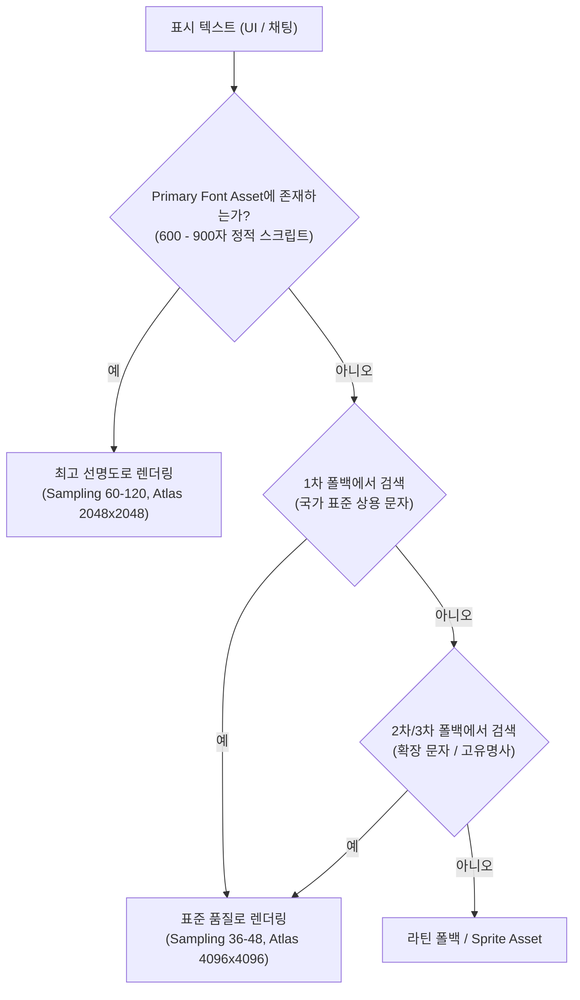

## **1. 프로젝트 개요 및 실시간 로컬라이제이션 과제**

**GilongWorld** 프로젝트는 글로벌 스케일의 매우 까다로운 기술적 요구사항을 제시합니다. 바로 English, Vietnamese, French, Italian, German, Spanish (Spain), Polish, Portuguese (Brazil), Portuguese (Portugal), Korean, Russian, Japanese, Turkish, Simplified Chinese, Traditional Chinese 등 총 15개 대상 언어에 대한 포괄적인 로컬라이제이션(*localization*) 지원입니다. Unity 엔진을 사용하는 현대 게임 개발 환경에서 실시간 그래픽 공간에 텍스트를 관리하고 표시하는 일은 단순히 문자열을 치환하는 작업에 그치지 않습니다. 이는 모든 카메라 거리에서 심미성과 선명한 가독성을 보장하고, 무엇보다 시스템 메모리를 효율적으로 사용하기 위한 전방위적인 폰트 아키텍처 최적화를 요구합니다.

현재 Unity 생태계에서 텍스트 렌더링을 위한 표준이자 가장 강력한 도구는 **TextMeshPro (TMP)**입니다. 확대 시 흐릿한 비트맵 이미지로 각 글자를 렌더링하던 기존 UI Text 시스템과 달리, TextMeshPro는 표준 폰트 파일을 **Font Asset**이라는 전용 리소스로 변환해야 합니다[^1]. 이러한 Font Asset은 **Signed Distance Field (SDF)** 기술을 적용한 하나 이상의 텍스처(*Atlas Texture*)를 포함합니다. SDF 기술은 텍스트를 무한히 확대해도 픽셀 깨짐(*pixelation*)이 발생하지 않게 하며, 동시에 확대/축소 셰이더가 GPU에서 직접 그림자, 외곽선(Outline), 두께 조절, 발광(Glow)과 같은 복잡한 그래픽 효과를 생성할 수 있는 수학적 기반을 제공합니다[^1].

하지만 SDF의 강력한 성능에는 피할 수 없는 물리적 제약이 따릅니다. 바로 **메모리 한계**입니다. 15개 대상 언어의 모든 문자를 단일 텍스처 아틀라스에 담는 것은 불가능합니다[^1]. 특히 CJK(*Chinese, Japanese, Korean*) 그룹에 속하는 언어들은 수만 자에 달하는 방대한 상형·표의 문자 체계를 보유하고 있습니다. 이 전체 문자 체계를 하나의 Atlas Texture에 억지로 구겨 넣으려 하면 텍스처 크기가 하드웨어(특히 모바일 하드웨어)가 처리할 수 있는 최대 한계치(보통 $4096 \times 4096$ 또는 $8192 \times 8192$ 픽셀)를 초과하여 VRAM 오버플로 또는 애플리케이션 강제 종료(*crash*)를 유발합니다[^5]. 본 보고서는 원본 폰트 선택 및 다운로드, 문자 체계별 특성 분석부터 TextMeshPro 내부 파라미터 구성, 폴백 체인(*Fallback Chain*) 관리, 그리고 Unity Localization 패키지를 통해 한자 통합(*Han Unification*) 문제를 근본적으로 해결하는 전체 절차를 세밀하게 다룹니다.

---

## **2. 문자학 기반 이론 및 원본 폰트 확보 전략**

다국어 텍스트 시스템을 구축하는 첫 번째이자 가장 중요한 단계는 정확한 **원본 폰트 파일(*Source Font File*)**을 선택하는 것입니다. 15개 언어 전반에 걸친 시각적 일관성을 유지하려면, 기본 블록부터 확장 블록까지 광범위한 유니코드(Unicode) 영역을 지원하고 기준선(*baseline*) 높이와 획 굵기(*weight*)가 통일된 오픈소스 폰트 패밀리가 필요합니다.

소프트웨어 업계에서는 **Google Noto** 폰트 패밀리(장치가 문자를 표시하지 못할 때 나타나는 빈 사각형, 속칭 "두부(Tofu)"를 없앤다는 사명을 담은 *"No Tofu"*의 약자)가 사실상의 골드 스탠다드로 인정받고 있습니다[^7]. Google이 선도적인 타입 파운드리 파트너들과 협업하여 설계한 Noto 시스템은 라틴(Latin), 키릴(Cyrillic), CJK 문자 체계의 글자들이 같은 줄에 나란히 표시될 때도 비율이나 예술적 스타일의 이질감 없이 어우러지도록 보장합니다[^8]. 여러 언어가 혼재된 텍스트가 자연스럽게 어우러지는 것은 GilongWorld의 사용자 경험을 좌우하는 핵심 요소입니다.

### **Unity로 폰트 데이터 추출 및 임포트하기**

통합 작업을 시작하려면 **Google Fonts** 라이브러리에서 직접 원본 폰트 파일을 다운로드해야 합니다. 프로젝트 용량이 불필요하게 비대해지는 것을 막기 위해 다운로드와 Unity 임포트 과정은 엄격한 절차를 따라야 합니다:

1. **라틴 및 키릴 문자 체계를 사용하는 11개 언어 그룹** (*English, Vietnamese, French, Italian, German, Spanish, Polish, Portuguese - Brazil, Portuguese - Portugal, Russian, Turkish*): 시스템에는 기본 **Noto Sans** 패밀리만 있으면 됩니다[^8]. 이 폰트 패밀리는 Latin Extended, Cyrillic, 결합 발음 구별 기호(combining diacritics) 등의 유니코드 블록을 포괄하는 3,700개 이상의 글리프(*glyphs*)를 포함하여 위 언어들의 요구사항을 완벽히 충족합니다[^8]. Google Fonts 공식 페이지에서 다운로드하면 TrueType(`.ttf`) 형식의 다양한 굵기 변형(*Thin, Regular, Medium, Bold, Black* 등)이 포함된 압축 파일이 제공됩니다.
2. **4개 CJK 언어 그룹**: 다운로드 절차는 한층 더 복잡해집니다. 개발자는 **Noto Sans JP**(일본어), **Noto Sans KR**(한국어), **Noto Sans SC**(중국어 간체), **Noto Sans TC**(중국어 번체) 등 별도의 지역 변형 폰트에 각각 접근해야 합니다[^7]. 이 CJK 파일들은 방대한 그래픽 데이터를 포함하므로 굵기 하나당 15MB에서 20MB에 달하는 매우 큰 용량을 차지합니다. 이 그룹에서는 TrueType보다 더 복잡한 문자 테이블 구조를 지원하는 OpenType(`.otf`) 형식이 주로 사용됩니다[^5].

Google Fonts에서 받은 파일의 압축을 푼 뒤, 다음 단계는 이를 Unity 프로젝트 환경으로 임포트(*import*)하는 것입니다. 리소스 관리의 모범 사례(*best practice*) 중 하나는 `Assets/GilongWorld_Resources/Fonts/Source_Files/`와 같은 전용 폴더 구조를 생성하는 것입니다. `.ttf` 및 `.otf` 파일(UI 디자인에서 명시적으로 볼드체 변형을 요구하지 않는 한 메모리 최적화를 위해 *Regular* 또는 *Medium* 같은 표준 굵기 하나만 선택 권장)은 운영체제에서 Unity Editor의 Project 창으로 직접 드래그 앤 드롭하여 추가합니다[^10].

> [!NOTE]
> TextMeshPro는 런타임 텍스트 렌더링 시 이러한 `.ttf` 또는 `.otf` 파일을 직접 사용하지 않습니다. 이 파일들은 Font Asset Creator 도구가 배열 데이터를 추출하여 SDF 텍스처로 컴파일하기 위한 원재료 역할만 수행합니다[^1]. 원본 파일을 별도 폴더에서 관리하면 (Dynamic SDF 기능을 사용하지 않는 경우) 최종 빌드에서 손쉽게 제외할 수 있어 게임 설치 패키지 용량을 줄이는 데 기여합니다.

---

## **3. 문자 체계 특성 분석 및 유니코드 범위 요구사항**

GilongWorld 프로젝트의 15개 언어가 지닌 다양성은 국제 표준 유니코드 시스템에서 문자가 어떻게 인코딩되는지에 대한 심층적인 분석을 요구합니다. TextMeshPro는 원본 폰트 파일에서 추출할 문자 범위(*Unicode Ranges*)를 지정할 때 16진수(Hexadecimal) 체계를 사용합니다[^13]. 이 범위를 정확히 선언하면 완벽한 언어 커버리지를 확보할 뿐만 아니라 불필요한 문자가 로드되어 Atlas 텍스처 크기가 팽창하는 것을 방지할 수 있습니다.

형태학적 구조에 따라 15개 언어는 리소스 관리를 위한 세 가지 주요 전략 그룹으로 나뉩니다.

### **하위 그룹 1: 확장 라틴 문자 및 발음 구별 기호(Diacritics)**

이 그룹에는 English, French, Italian, German, Spanish, Polish, Portuguese (Brazil), Portuguese (Portugal), Turkish, Vietnamese가 포함됩니다. 기본 라틴 알파벳(`U+0020` ~ `U+007E`)을 공통 기반으로 삼고 있지만, 확장 코드 블록에서 뚜렷한 분화가 일어납니다[^1]:

- **서유럽 및 남유럽** (*French, Spanish, Italian, Portuguese, German*): 주로 `á`, `é`, `í`, `ó`, `ú`, `ñ`, `ü`, `ç`와 같은 기본 악센트 모음과 문자가 포함된 *Latin-1 Supplement*(`U+00A0` ~ `U+00FF`) 블록을 사용합니다.
- **중앙유럽 및 튀르키예어** (*Polish, Turkish*): `ą`, `ł`, `ş`, `ğ` 같은 특수 문자를 표시하기 위해 *Latin Extended-A*(`U+0100` ~ `U+017F`) 블록에 의존합니다[^10].
- **베트남어**: 이 그룹에서 가장 까다로운 언어입니다. 서컴플렉스(`â`, `ê`, `ô`)나 호른(`ơ`, `ư`)이 붙은 모음 위에 복합적인 성조 기호가 결합되므로 *Latin Extended Additional*(`U+1E00` ~ `U+1E9F`) 블록이 필수적입니다[^14]. 베트남어의 발음 구별 기호 체계는 높이가 매우 큰 문자 구조(예: `Ể` 문자는 일반 라틴 대문자 높이 한계를 훌쩍 넘길 수 있음)를 만들어내므로, 글자 상단이 잘리는(*clipping*) 현상을 피하려면 TextMeshPro의 줄 간격(*line height*)과 여백(*padding*)을 세심하게 조정해야 합니다.

### **하위 그룹 2: 키릴 문자(Cyrillic)**

프로젝트 내에서 이 체계에 속하는 유일한 언어는 **Russian(러시아어)**입니다. 키릴 문자는 인코딩 측면에서 라틴 문자와 완전히 독립되어 있으며 `U+0400` ~ `U+04FF` 코드 블록 내에 깔끔하게 자리합니다[^10]. 인코딩은 독립적이지만 키릴 문자는 문자 폭과 기준선 높이 등 형태학적 특성에서 라틴 문자와 많은 공통점을 공유하므로, 시각적 불균형 없이 라틴 그룹과 동일한 단일 Font Asset으로 완벽하게 통합할 수 있습니다.

### **하위 그룹 3: CJK 문자 체계와 한자 통합(Han Unification)이라는 역사적 난제**

세 번째 그룹은 **Korean, Japanese, Simplified Chinese, Traditional Chinese**로 구성됩니다. 이곳은 TextMeshPro의 기술적 한계가 가장 빈번하게 시험대에 오르는 가장 복잡한 영역입니다. 근본적인 원인은 방대한 문자 수뿐만 아니라, 유니코드 컨소시엄의 논란 많은 기술적 규약인 **한자 통합(Han Unification)**과도 깊은 관련이 있습니다[^7].

유니코드 표준 개발 초기, 16비트 인코딩 공간의 제한 내에 동아시아 문자를 수용하기 위해 소프트웨어 엔지니어들은 중국, 일본, 한국에서 역사적 기원이 같은 상형·표의 문자를 단 하나의 공유 **코드 포인트(*code point*)**로 통합하기로 결정했습니다[^7]. 이 블록은 *CJK Unified Ideographs*라 불리며 `U+4E00`부터 `U+9FA5`까지 이어집니다[^12].

이 결정은 렌더링 기술 측면에서 심각한 부작용을 낳았습니다. **동일한 유니코드 코드를 공유함에도 불구하고, 국가별 문화 발전, 서예 전통, 교육 표준의 분화로 인해 같은 문자(glyph)의 실제 자형이 서로 다르게 그려진다는 점입니다**:

- 대표적인 예가 "뼈 골(骨)" 자(유니코드 `U+9AA8`)입니다. 이 글자의 상단 사각형 부수 내부 획 구조는 중국어 간체(SC) 폰트에서는 왼쪽에서 오른쪽으로 가로 획 형태를 취하는 반면, 중국어 번체(TC)와 일본어(JP)에서는 내부 획이 전혀 다른 구조로 그려집니다[^7].
- 마찬가지로 "눈 설(雪)"이나 "곧을 직(直)" 같은 일상적인 한자 역시 원어민이라면 즉시 알아챌 수 있는 미세하지만 분명한 형태적 차이를 지닙니다.

텍스트 렌더링 시스템은 문맥의 형태학적 의도를 스스로 추론할 수 없습니다. 단지 유니코드 값을 받아 현재 활성화된 폰트에서 해당 이미지를 꺼내올 뿐입니다. 따라서 동아시아 모든 언어에 하나의 공용 CJK 폰트를 사용하면 일본인 플레이어가 중국식 자형으로 그려진 일본어 텍스트를 읽어야 하거나 그 반대의 상황이 발생합니다[^7]. 원어민 플레이어에게 이는 폰트가 깨졌거나, 비전문적이거나, "이질적인 혼종"처럼 느껴져 게임 세계관에 대한 몰입감을 완전히 무너뜨립니다[^7]. 이 한계를 극복할 수 있는 유일한 해결책은 각 CJK 언어별로 Font Asset을 완전히 분리하고 폴백 체인을 동적으로 관리하는 것입니다.

---

## **4. TextMeshPro와 Signed Distance Field (SDF)의 기술적 메커니즘**

정확한 설정 절차를 수행하려면 TextMeshPro 내부에서 **Signed Distance Field (SDF)**가 작동하는 원리를 반드시 이해해야 합니다. 픽셀의 색상 값을 직접 저장하는 기존 비트맵 폰트와 달리, SDF는 각 픽셀에서 가장 가까운 문자 윤곽선(경계)까지의 수학적 거리를 저장합니다[^1]:
- 픽셀이 문자 **내부**에 위치하면 거리 값은 **양수**가 됩니다.
- 문자 **외부**에 위치하면 **음수**가 됩니다.
- **정확히 경계선 위**에 위치하면 거리 값은 **영($0$)**이 됩니다.

이 거리 데이터는 회색조(*grayscale*) 형태로 인코딩되어 Atlas Texture에 저장됩니다. 런타임에서 TextMeshPro의 GPU 셰이더는 이 거리 값들에 대해 이중선형 보간(*bilinear interpolation*)을 수행합니다. 셰이더는 화면의 각 프래그먼트(*fragment*) 값을 검사하여 $> 0$이면 색상을 칠하고, $< 0$이면 투명하게 처리합니다. 이산적인 픽셀 격자에 의존하지 않고 연속적인 수학적 보간에 기반하므로, 카메라가 오브젝트에 바짝 다가가도 SDF 텍스트의 곡선은 극도로 선명하게 유지됩니다[^1].

이 메커니즘은 Font Asset을 생성할 때 두 가지 핵심 파라미터를 결정짓습니다:
1. **Sampling Point Size:** 문자가 Atlas Texture에 그려질 때의 물리적 해상도 크기를 결정합니다. 크기가 클수록 거리 데이터의 정밀도가 높아집니다.
2. **Padding(여백):** SDF 성능의 열쇠입니다. 문자 주변의 여유 공간은 거리 그라데이션이 더 깊은 음수 값으로 완만하게 감소할 수 있도록 허용합니다. 여백이 넓을수록 SDF 알고리즘이 더 많은 "공간"을 확보하게 되어 외곽선(*outline*), 그림자(*shadow*), 발광(*glow*) 효과를 두껍게 적용하더라도 갑작스럽게 잘리지 않고 매끄럽게 표현할 수 있습니다[^13].

---

## **5. Font Asset Creator를 이용한 상세 설정 가이드**

폰트 텍스처 파일 생성은 Unity 내장 도구인 **Font Asset Creator**를 통해 이루어지며, 다음 메뉴 경로로 접근합니다:

```text
Window > TextMeshPro > Font Asset Creator
```

3장의 분석에 근거하여 GilongWorld 프로젝트의 15개 언어를 위한 최적의 구조는 분할 모델입니다. 즉, **라틴/키릴 계열 11개 언어를 위한 공용 Font Asset 1개와 각 CJK 언어를 위한 개별 Font Asset 4개를 생성하는 것**입니다.

### **5.1. 라틴, 키릴 및 베트남어를 위한 정적(Static) 구조 설정**

11개 언어(*English, French, Italian, German, Spanish, Polish, Portuguese BR, Portuguese PT, Turkish, Russian, Vietnamese*)를 단일 **Primary Static Font Asset**으로 통합하는 것은 GPU 드로우 콜(*draw call*) 수를 최소화하는 가장 효과적인 방법이며, 이는 안정적인 프레임 속도(*frame rate*) 유지에 핵심적인 역할을 합니다[^14].

Font Asset Creator에서 다음의 엄격한 파라미터로 구성을 진행합니다[^12]:

| 구성 속성 | 기술 권장 사항 | 분석 근거 |
| :--- | :--- | :--- |
| **Source Font File** | `NotoSans-Regular.ttf` | `Assets` 폴더에서 원본 파일을 이 필드로 드래그 앤 드롭합니다. 기하학적 윤곽선 데이터의 원천입니다[^1]. |
| **Sampling Point Size** | `Custom Size: 60 - 90` | Auto Sizing 모드는 가용 공간에 맞춰 글자를 억지로 밀어 넣기만 합니다. Custom Size를 60에서 90 사이로 고정하면 전체 텍스처 표면에서 일관된 SDF 품질을 보장할 수 있습니다[^1]. |
| **Padding** | `6 - 9` (~10% 비율) | TextMeshPro의 표준 규칙에 따라 Padding은 Sampling Point Size의 약 10%를 차지해야 합니다[^4]. Sampling 60 기준 Padding 6이 이상적이며, 프로젝트 UI 스타일상 매우 두꺼운 글자 외곽선이 필요하다면 이 값을 10까지 높일 수 있습니다. |
| **Packing Method** | `Optimum` | Optimum 알고리즘은 Fast보다 처리 시간이 훨씬 오래 걸리지만, 반복 연산을 통해 공간 내에 글리프를 가장 촘촘하게 배치하여 픽셀 낭비를 최소화합니다[^12]. |
| **Atlas Resolution** | `2048 x 2048` | 이 11개 언어의 총 문자 수는 약 1,500~2,000개 수준입니다. $2048 \times 2048$ 크기는 누락되는 문자 없이 Sampling Point Size 60을 유지하기에 충분한 공간을 제공합니다[^7]. |
| **Character Set** | `Unicode Range (Hex)` | 미리 정의된 프리셋을 선택하는 대신, 이 모드를 사용하면 로드할 문자들을 절대적으로 정밀하게 제어할 수 있습니다[^2]. |

**Custom Character List** 필드에는 11개 언어의 요구사항을 완벽하게 포괄하는 다음 16진수 코드 범위 문자열을 입력합니다:

```text
0020-007E, 00A0-00FF, 0100-017F, 0180-024F, 1E00-1E9F, 0300-036F, 0400-04FF, 0500-052F, 2000-206F
```

모든 파라미터 입력을 마친 후:
1. **Generate Font Atlas** 버튼을 클릭합니다. 도구가 거리 계산 및 이미지 베이킹을 진행합니다(CPU 성능에 따라 몇 분 정도 소요될 수 있음).
2. 작업이 완료되고 텍스처 미리보기가 표시되면 **Save**를 클릭합니다.
3. 파일을 `Global_Latin_Cyrillic_SDF.asset` 이름으로 프로젝트 폴더에 저장합니다[^1].

### **5.2. CJK 체계를 위한 정적(Static) 구조 및 계층적 폴백 아키텍처 설정**

4개 CJK 언어를 처리하는 작업은 방대한 데이터량 때문에 전혀 다른 접근 방식이 필요합니다. `NotoSansCJKjp`, `NotoSansCJKkr`, `NotoSansCJKsc`, `NotoSansCJKtc`에 대해 위 과정을 네 번 반복하는 것은 필수입니다. 하지만 유니코드 범위를 통해 전체 CJK 테이블을 단일 정적 아틀라스에 넣으려 하면 텍스처의 물리적 크기 한계를 초과하여 시스템이 실패하게 됩니다[^5].

표준 기술 해법은 **Characters from File** 옵션과 결합한 **계층적 문자 매핑(Hierarchical Character Mapping) 모델**을 적용하는 것입니다[^7]:

#### **1. 알려진 문자(Known Characters)를 위한 Primary SDF Font Asset 생성**
- 프로젝트의 문자열 테이블(*String Tables*: 메뉴, 퀘스트, 아이템, 대화, 스킬)에서 모든 정적 텍스트 문자열을 추출합니다.
- 이 고유 문자 집합(*unique characters*)은 실제 게임 데이터 기준 대개 **1,000자 미만**입니다(대표적으로 GilongWorld 프로젝트에서는 중국어 간체 **855자**, 번체 **870자**, 일본어 **694자**, 한국어 **588자**만 차지합니다).
- **품질 극대화(Maximize Sampling Size):** 문자 수가 1,000자 미만이므로 Atlas Resolution `2048 x 2048` 환경에서 **Sampling Point Size를 높게**(`60`에서 `90` 또는 `120`) 설정할 수 있습니다. 이를 통해 모든 공식 UI 텍스트가 어떤 카메라 거리에서도 완벽한 선명도를 유지합니다.

#### **2. 국가 표준 문자셋 기반의 계층형 폴백 구축 (UGC/채팅용 표준 폴백)**
플레이어의 자유로운 입력(캐릭터 이름, 길드 소개, 커뮤니티 채팅)을 완벽하게 지원하여 두부(Tofu) 현상이 절대 발생하지 않도록, **국가 표준 문자 데이터셋**을 계승한 Fallback Font Asset을 추가합니다:

| 언어 | 국가 표준 문자셋 | 문자 수 | 제정 기관 및 오픈소스 참조 |
| :--- | :--- | :---: | :--- |
| **Simplified Chinese (zh-Hans)** | **TGSCC (通用规范汉字表)**<br/>- 1급 (상용): 3,500자<br/>- 2급 (확장): 3,000자<br/>- 3급 (인명/지명): 1,605자 | **8,105** | 중화인민공화국 교육부<br/>*오픈소스:* [GitHub chinese-character-table](https://github.com/maple-leaf/chinese-character-table) |
| **Traditional Chinese (zh-Hant)** | **상용 국자 표준 자체표** (*常用國字標準字體表*) | **4,808** | 대만 교육부 (MOE Taiwan)<br/>*오픈소스:* [대만 공공데이터 포털](https://data.gov.tw/dataset/5961) / [GitHub cjktables](https://github.com/ButTaiwan/cjktables) |
| **Japanese (ja)** | - **Jōyō Kanji** (常用漢字 - 상용한자): 2,136자<br/>- **Jinmeiyō Kanji** (人名用漢字 - 인명용 한자): 863자 | **2,999** | 일본 문화청 (文化庁)<br/>*오픈소스:* [KanjiAPI](https://kanjiapi.dev/) / [GitHub kanji-data](https://github.com/davidluzgouveia/kanji-data) |
| **Korean (ko)** | **KS X 1001 표준** (일상 소통의 99.9%를 포괄하는 완성형 한글 2,350음절) | **2,350** | 한국 국가기술표준원 (KATS)<br/>*오픈소스:* [GitHub ksx1001](https://github.com/korean-character-sets/ksx1001) / `euc-kr` 기반 추출 |



#### **3. 불변의 법칙: Sampling Point Size / Padding 비율 일관성 유지 (Ratio Consistency)**

TextMeshPro 셰이더의 핵심 그래픽 원리 중 하나는 **Outline(외곽선), Underlay / Shadow(그림자), Glow(발광) 효과의 두께가 Sampling Point Size와 Padding 간의 비율에 기반해 계산된다는 것**입니다[^13].

##### **왜 Fallback은 Primary와 동일한 Point Size가 필요 없는가?**
- **Primary Font (~855자 UI 스크립트):** 플레이 시간 100% 내내 노출되므로 $\rightarrow$ **품질 극대화** (`Sampling Size = 120`, `Padding = 10`, Atlas $2048 \times 2048$)가 필요합니다.
- **Fallback Fonts (채팅/이름용 희귀 문자 2,700~8,000자):** 노출 빈도가 매우 낮으므로 $\rightarrow$ **샘플링 품질을 낮추어** (`Sampling Size = 60` 또는 `48`) VRAM을 늘리지 않고도 동일한 Atlas 크기에 수천 자를 압축해 담습니다.

##### **왜 반드시 동일한 비율($\text{Ratio} = \frac{\text{Sampling}}{\text{Padding}}$)을 유지해야 하는가?**
한 문장 안에 Primary 소속 글자와 Fallback 소속 글자가 나란히 배치된 경우를 가정해 봅시다:
- **비율이 어긋난 경우:** Primary 글자(Size 120, Pad 10 $\rightarrow$ Ratio 12)는 깔끔하고 얇은 외곽선을 갖지만, Fallback 글자(Size 60인데 실수로 Pad 10을 유지 $\rightarrow$ Ratio 6)는 **외곽선이 두 배로 두껍게 뭉개지며 글자 획을 집어삼키게 됩니다**.
- **비율을 동일하게 유지한 경우($\text{Ratio} = 12$):** 글자가 Primary에서 나오든 Fallback으로 넘어가든 **외곽선과 그림자의 두께가 100% 동일하게 유지됩니다**.

| Font Asset 계층 | 역할 | Sampling Point Size *(Custom)* | Padding | Atlas Resolution | 비율 (Ratio) |
| :--- | :--- | :---: | :---: | :---: | :---: |
| **Primary Font** | 주요 UI 스크립트 | **120** *(또는 96)* | **10 px** *(또는 8 px)* | $2048 \times 2048$ | **12** *(최대 선명도)* |
| **1차 폴백 (Tier 1)** | ~2,725자 상용 문자 | **60** | **5 px** | $2048 \times 2048$ | **12** *(VRAM 절약)* |
| **2차 폴백 (Tier 2)** | ~2,992자 확장 문자 | **60** | **5 px** | $2048 \times 2048$ | **12** *(VRAM 절약)* |
| **3차 폴백 (Tier 3)** | ~1,605자 희귀/인명 문자 | **48** | **4 px** | $2048 \times 2048$ | **12** *(VRAM 절약)* |

> [!TIP]
> **실전 작업 팁:** *Font Asset Creator*에서 `Sampling Point Size`를 *Auto Sizing*에서 **Custom Size**로 전환하여 위 표의 비율에 맞게 샘플링 크기와 Padding을 정확히 고정하십시오.

---

### **5.3. Unity 내 폴더 구성 절차 및 실전 자동화**

장기적인 확장성과 유지보수 편의성을 위해 GilongWorld 프로젝트는 모든 원본 문자 데이터를 위한 그룹별 전용 폴더 구조를 구축했습니다:

```text
Assets/_GilongWorld/_Project/Art/Fonts/_chars/
├── 01_Latin_Cyrillic/        # [공용 Primary Font] 라틴/키릴 11개 언어
│   ├── vi_chars.txt          # 베트남어
│   ├── en_chars.txt          # 영어
│   ├── ru_chars.txt          # 러시아어
│   └── ...                   # 프랑스어, 독일어, 이탈리아어, 스페인어, 폴란드어, 포르투갈어, 튀르키예어
│
├── 02_CJK/                   # [CJK Primary Fonts] 게임 내 정적 스크립트 문자
│   ├── ja_chars.txt          # 일본어 (실제 고유 문자 694자)
│   ├── ko_chars.txt          # 한국어 (실제 고유 문자 588자)
│   ├── zh_Hans_chars.txt     # 중국어 간체 (실제 고유 문자 855자)
│   ├── zh_Hant_chars.txt     # 중국어 번체 (실제 고유 문자 870자)
│   │
│   ├── Standard_Fallbacks/   # [표준 원본 계층] 7개 원본 국가 표준 데이터셋
│   │   ├── zh_Hans_TGSCC_Level1_3500.txt
│   │   ├── zh_Hans_TGSCC_Level2_3000.txt
│   │   ├── zh_Hans_TGSCC_Level3_1605.txt
│   │   ├── zh_Hant_Common_4808.txt
│   │   ├── ja_Joyo_Kanji_2136.txt
│   │   ├── ja_Jinmeiyo_Kanji_863.txt
│   │   └── ko_KS_X_1001_2350.txt
│   │
│   └── Subtracted_Fallbacks/ # [최적화 폴백 계층] Primary 문자를 완전히 차감한 목록
│       ├── zh_Hans_Fallback_Level1.txt    (TGSCC 1급 - Primary)
│       ├── zh_Hans_Fallback_Level2.txt    (TGSCC 2급 - Primary)
│       ├── zh_Hans_Fallback_Level3.txt    (TGSCC 3급 - Primary)
│       ├── zh_Hant_Fallback_Common.txt    (대만 표준 4808 - Primary)
│       ├── ja_Fallback_Joyo.txt           (상용한자 - Primary)
│       ├── ja_Fallback_Jinmeiyo.txt       (인명용 한자 - Primary)
│       └── ko_Fallback_KS_X_1001.txt      (KS X 1001 - Primary)
```

#### **자동 문자 추출 및 폴백 차집합 도구 (`GWCharacterExtractor.cs`)**
프로그래머가 수동으로 CSV를 내보내고 중복 문자를 걸러내는 수고를 없애기 위해 전용 Unity Editor 도구인 [`GWCharacterExtractor.cs`](file:///d:/Unity-Projects/GLW/Assets/_GilongWorld/_Project/Editor/Localization/GWCharacterExtractor.cs)에 2-in-1 파이프라인을 통합했습니다:
- **접근 메뉴:** `GilongWorld → Localization → Extract CJK Characters From String Tables`
- **메커니즘 1 (Primary 추출):** Unity Localization의 모든 `StringTableCollections`를 스캔하여 사용 중인 전체 텍스트 문자열을 `HashSet<char>` 구조(100% 고유성 보장)에 수집하고, 유니코드 오름차순으로 정렬하여 `02_CJK/` 내 4개 Primary 파일에 기록합니다.
- **메커니즘 2 (폴백 문자 자동 차감):** 스크립트가 `Standard_Fallbacks/`의 7개 데이터셋을 자동으로 읽어 대조한 뒤 **Primary Asset에 이미 존재하는 모든 문자를 제거**하고 `Subtracted_Fallbacks/` 폴더로 내보냅니다. 이로써 Primary Atlas와 Fallback Atlas 간 문자 중복으로 인한 VRAM 낭비를 완전히 근절합니다.

#### **GWSDFGeneratorWindow UI와 Unity 6 API 제한 우회**
"Sampling / Padding 비율 = 12" 규칙이 절대적으로 준수되도록 프로젝트는 파라미터를 입력하고 비율이 어긋날 경우 즉시 경고를 표시하는 전용 Editor Window를 제공합니다.
특히 Unity 6에서는 Font Asset의 `clearDynamicDataOnBuild` 속성이 `internal` 접근 수준으로 잠겨 있어 일반 코드를 통해 빌드 전 불필요한 동적 데이터를 삭제할 수 없게 되었습니다. 본 도구는 `SerializedObject`를 통한 리플렉션(Reflection) 기법을 적용해 이 문제를 깔끔하게 해결합니다:

```csharp
var serializedObject = new SerializedObject(fontAsset);
serializedObject.FindProperty("m_ClearDynamicDataOnBuild").boolValue = true;
serializedObject.ApplyModifiedProperties();
```

그 결과 기존 시스템에서 오류가 발생하던 137MB 크기의 비대한 Atlas가 완전히 정리되어 빌드 용량을 최소 수준으로 낮출 수 있었습니다.

---

## **6. 폴백 체인(Fallback Chain) 관리 아키텍처 및 한자 통합 해결책**

다국어 게임을 매끄럽게 구동하는 핵심은 **폴백 체인(*Fallback Chain*)**을 제어하는 능력에 있습니다. TextMeshPro UI 컴포넌트가 Primary Font Asset에 존재하지 않는 문자를 포함한 문자열을 전달받으면, 시스템은 대체 글리프(*glyph*)를 찾기 위해 폴백 목록을 따라 재귀적 탐색 알고리즘을 실행합니다.

탐색 알고리즘은 다음과 같은 엄격한 계층 순서를 따릅니다:
1. `TextMeshPro Primary Font Asset`
2. `Primary Font 내부의 로컬 Fallback Font Assets 목록`
3. `내부 Sprite Asset`
4. `TMP_Settings에 전역으로 정의된 General Fallback Font Assets`
5. `Default Sprite Asset`
6. `Default Font Asset`[^20]

> [!WARNING]
> 시스템은 위에서 아래로 순차적으로 탐색하며 **첫 번째로 일치하는 유니코드 코드 포인트를 발견하는 즉시 탐색을 중단합니다**[^7].

3장에서 분석했듯이 한자 통합(Han Unification) 현상으로 인해 SC, TC, JP 언어는 서로 다른 자형을 가졌음에도 동일한 유니코드 번호를 공유합니다[^7]. 만약 개발자가 모든 CJK 파일을 `TMP_Settings`의 General Fallback Font Assets 목록에 한꺼번에 등록하면 목록의 배치 순서가 텍스트의 운명을 결정짓게 됩니다. 예를 들어 목록이 `Font_CJK_JP_SDF` $\rightarrow$ `Font_CJK_SC_SDF` $\rightarrow$ `Font_CJK_TC_SDF` 순서로 정렬되어 있다고 가정해 봅시다. 중국어 간체 문장이 입력되면 시스템은 위에서부터 스캔하다가 첫 번째인 일본어 파일과 마주쳐 해당 유니코드 값을 찾게 되고, 아래에 있는 중국어 파일을 완전히 무시한 채 일본식 한자(Kanji) 스타일로 화면에 출력해 버립니다[^7].

### **로컬 폴백 격리 아키텍처 (Local Fallback Architecture)**

이 문제를 완전히 뿌리 뽑으려면 폴백 구조를 철저히 격리해야 합니다:

> [!IMPORTANT]
> **절대로 CJK 폰트들을 `TMP_Settings`의 전역 폴백 목록(Global Fallback List)에 등록하지 마십시오**[^1]. 대신 각 Asset 파일의 로컬 폴백(*Local Fallback*) 구조를 통해 연결하고 런타임에서 동적으로 관리해야 합니다.

타이포그래피의 기본적인 특징 중 하나는 CJK 폰트에 내장된 라틴 문자와 아라비아 숫자가 전용 라틴 폰트에 비해 디자인 완성도가 떨어지거나 비율이 어색한 경우가 많다는 점입니다[^9]. 따라서 라틴 문자는 항상 `Global_Latin_Cyrillic_SDF` 파일을 통해 우선 렌더링되어야 합니다. 로컬 연결 구조는 다음과 같이 구성합니다:
1. `Font_CJK_SC_SDF.asset` 파일을 열고 **Fallback Font Assets** 섹션에 중국어용 폴백 1~3계층을 추가한 뒤, 그 뒤에 `Global_Latin_Cyrillic_SDF` 파일을 추가합니다[^1].
2. TC, JP, KR 파일에 대해서도 동일한 절차를 수행합니다.

이렇게 구성하면 게임이 중국어를 표시할 때 문장 중간에 숫자나 영어 고유명사가 섞여 있더라도, 해당 문자들은 중국어 정적 아틀라스(*Characters from File* 추출 단계에서 라틴 문자를 이미 배제했으므로)를 통과하여 고품질 라틴 문자가 담긴 Fallback 파일에 의해 정확히 포착되어 렌더링됩니다[^7].

---

## **7. 동적 전환(Runtime Swapping)을 위한 Unity Localization 패키지 통합**

한자의 문화권별 자형을 정확히 렌더링하고 VRAM 메모리를 최적화하려면, TextMeshPro UI 컴포넌트는 고정된 정적 구성을 유지할 수 없습니다. 사용자가 언어(*Locale*)를 변경할 때마다 기본 폰트(*Primary Font Asset*)가 런타임(*runtime*)에 자동으로 교체(*swap*)되어야 합니다[^23].

**Unity Localization** 패키지(`com.unity.localization`)는 모든 전환 이벤트를 일일이 하드코딩(*hardcoding*)하는 대신 이 로직 흐름을 실행할 수 있는 강력한 도구를 제공합니다[^25]. 이 통합 아키텍처는 `LocalizationSettings.SelectedLocaleChanged`를 통한 전역 언어 변경 이벤트 구독 메커니즘을 기반으로 동작합니다[^24].

구현 방법은 크게 두 가지가 있습니다:

### **방법 1: 중앙 집중식 폰트 매니저 프로그래밍 (Centralized Font Manager)**

수천 개의 UI Text 컴포넌트에 개별적으로 Localized Asset 이벤트를 할당하면 불필요한 `MonoBehaviour` 객체가 대량 생성되고 가비지 컬렉션(GC) 부하가 발생하여 메모리에 막대한 압박을 줍니다. 이를 피하기 위해 GilongWorld 프로젝트는 **Addressables 기반 중앙 집중식 관리** 전략을 채택했습니다.

`GWFontManager.cs` 스크립트(`DontDestroyOnLoad` 플래그 포함)는 `LocalizationSettings.SelectedLocaleChanged` 이벤트를 구독합니다. 이벤트가 발생하면 매니저는 두 가지 정교한 작업을 수행합니다:
1. **비동기 로드(Async Load):** `LocalizationSettings.AssetDatabase.GetLocalizedAssetAsync<TMP_FontAsset>("Fonts_Table", "PrimaryFont")`를 호출하여 Addressables로부터 현재 언어에 맞는 표준 Font Asset을 비동기로 가져옵니다.
2. **전역 스캔(Global Sweep):** `FindObjectsByType<TMP_Text>` 명령을 사용해 현재 씬 전체를 훑고 모든 UI Text에 새 폰트를 적용합니다. 이 명령은 수 밀리초(ms)의 CPU 시간을 소모하지만 언어 변경 시나 씬 로드 시 단 한 번만 실행되므로, 그 대가로 수천 개의 개별 컴포넌트가 점유하던 RAM을 완전히 해방시킵니다. 할당 직후 이전 언어의 폰트는 `Addressables.Release()` 호출로 즉시 메모리에서 해제됩니다.

이 방식은 폴백 시스템이 현재 지정된 언어의 Atlas 하나만 메모리에 로드하므로 CJK 언어 간의 "교차 오염"(*cross-pollination*) 현상을 완벽히 제거합니다[^7].

### **방법 2: Unity Localization Asset Tables**

가장 네이티브(*native*)한 통합 방식은 **Localized Asset Tables**를 사용하는 것입니다[^23]. 텍스트 문자열을 교체하는 Localized String Tables와 마찬가지로, Asset Tables는 각 언어마다 서로 다른 Asset 파일을 매핑할 수 있게 해줍니다. UI의 Localized Text 컴포넌트는 텍스트 문자열뿐만 아니라 TextMeshPro 오브젝트의 `FontAsset` 변수까지 자동으로 교체하도록 구성할 수 있습니다[^23].

이 접근법은 Inspector 상의 설정 작업이 필요하지만 높은 안정성을 제공하며, 개발자가 커스텀 매핑 코드를 유지보수해야 하는 부담을 덜어줍니다[^28].

---

## **8. 동적 콘텐츠(UGC) 관리, 메모리 최적화 및 Addressables 통합**

정적 아키텍처(*Static Architecture*)는 시스템 UI 문제를 완벽히 해결했습니다. 하지만 캐릭터 이름, 길드 소개, 커뮤니티 채팅창 같은 **사용자 생성 콘텐츠(User-Generated Content - UGC)**는 훨씬 더 큰 과제를 안겨줍니다. 사용자가 15개 언어 목록에서 어떤 문자를 입력할지 미리 예측할 수 없으며, 세상의 모든 수십만 문자를 RAM에 미리 올려두는 것은 불가능하기 때문입니다.

### **하이브리드 SDF 아키텍처 해법 (Hybrid SDF System)**

TextMeshPro의 일반적인 **Dynamic SDF** 시스템은 Font Asset이 빈 아틀라스 텍스처($0 \times 0$ 픽셀)로 시작하도록 허용합니다. 새로운 문자가 감지되면 CPU를 사용해 런타임에 해당 글자를 그려 넣고 텍스처에 삽입합니다[^6].
그러나 Dynamic 방식에만 전적으로 의존하면 첫 화면 진입 시 게임에 심각한 프레임 드랍(frame spike)이 발생합니다. 따라서 GilongWorld 프로젝트는 **하이브리드(Hybrid) 아키텍처**를 적용합니다:

1. **매끄러운 정적 사전 로드(Static Population):** `GWCharacterExtractor.cs` 도구를 통해 수천 개의 가장 흔히 쓰이는 문자를 에디터 단계에서 `TryAddCharacters` 함수로 Atlas에 미리 구워 넣습니다. 게임에 진입하면 이 문자들은 이미 메모리에 준비되어 있으므로 프레임 속도(FPS)가 완벽하게 안정적으로 유지됩니다.
2. **안전한 동적 폴백(Dynamic Fallback):** Font Asset 자체는 `isMultiAtlasTexturesEnabled = true` 플래그와 함께 Dynamic 모드로 저장됩니다. 플레이어가 채팅에서 첫 번째 아틀라스에 없는 매우 희귀한 글자를 입력하면, TMP는 두부(Tofu) 상자를 띄우는 대신 즉시 새로운 보조 Atlas Texture(`Atlas 0 1`, `Atlas 0 2`...)를 생성해 해당 글자를 채워 넣습니다. 이는 두 방식의 장점만을 결합한 최적의 조합입니다.

> [!CAUTION]
> Dynamic SDF 방식에는 리소스 비용이 따릅니다. $2048 \times 2048$ 크기의 동적 아틀라스 하나가 생성될 때마다 즉시 약 **4MB**의 시스템 메모리가 소모됩니다. 보조 아틀라스가 과도하게 생성되면 모바일 기기의 메모리 압박이 급격히 커질 수 있습니다[^31].

### **숨겨진 Addressables의 함정과 VRAM 메모리 충돌**

GilongWorld 같은 현대의 대규모 프로젝트는 리소스 로드를 위해 거의 예외 없이 **Addressables** 시스템을 사용합니다. 많은 개발자가 빠지는 치명적인 실수 중 하나는 **"나는 Addressables를 쓰지 않으니 폰트를 `Resources` 폴더에 마음 놓고 넣어둬도 된다"고 착각하는 것**입니다.

실제로는 **Unity Localization 패키지 자체가 Addressables 기반 위에 직접 구축되어 있습니다**. 개발자가 직접 Addressables를 쓰지 않더라도 Localization이 String Tables 관리를 위해 백그라운드에서 Addressables를 구동하고 있습니다.
Addressables로 패키징된 UI 프리팹이 `Resources` 폴더 내부에 있는 Font Asset을 참조하면 Unity 에셋 매니저는 심각한 데이터 중복(*duplicate assets*) 오류를 일으킵니다:
1. Unity가 해당 Atlas 텍스처의 완전한 복제본을 만들어 Addressables의 AssetBundle 내부에 함께 묶어 버립니다[^32].
2. 게임이 로드될 때 `Resources`의 Atlas가 이미 메모리에 올라가고, AssetBundle의 Atlas까지 추가로 RAM에 적재되어 결국 **VRAM이 불필요하게 두 배로 점유되는 현상**이 발생합니다[^31]. 이 문제는 매우 흔하며, 최대 RAM 사용량을 엄격히 통제하는 모바일 앱을 쉽게 강제 종료시킬 수 있습니다[^33].

**근본적인 해결책:**
- `TMP_Settings` 파일과 모든 Font Asset을 `Resources` 폴더에서 완전히 이동시켜 `Assets/_GilongWorld/_Project/Art/Fonts/SDF/` 같은 표준 폴더에 배치합니다.
- 모든 SDF 파일을 선택하여 전용 Addressables Group(예: `Fonts_Addressables`)에 넣고, Localization의 **Asset Table**(`Fonts_Table`)에서 매핑을 설정합니다.
- **에디터에서 Dynamic Font 정리:** Dynamic Font Asset 파일은 생성된 데이터를 디스크에 영구 보존하는 특성이 있습니다. 빌드 컴파일 전에는 반드시 Dynamic 데이터를 삭제해야 합니다(이는 앞서 언급한 `SerializedObject` 기법을 사용하는 `GWSDFGeneratorWindow` 도구를 통해 자동화됨)[^30].
- **런타임 메모리 정리:** 대규모 씬 전환 시 `TMP_FontAsset.ClearFontAssetData(true)` 또는 `FontEngine.DestroyFontEngine()` API를 호출하여 더 이상 사용하지 않는 동적 텍스처 배열을 철저히 해제합니다[^35].

---

## **9. 실시간 기술 장애 진단 및 문제 해결 (Troubleshooting)**

다양한 플랫폼에서의 실제 배포 및 테스트 과정에서 로컬라이제이션 시스템은 종종 표면적인 오류 증상을 드러냅니다. 진단 원리를 파악해 두면 기술 팀이 문제를 신속하게 격리하고 해결할 수 있습니다:

### **모바일 빌드에서는 텍스트가 빈 사각형(Tofu Boxes)으로 표시되지만 에디터에서는 정상 작동하는 경우**
- **원인:** Fallback Font Assets가 씬 내의 정적 GameObject에 직접 참조되지 않고 런타임에 `FallbackFontAssetTable`을 통해 느슨하게만 연결되어 있으면, Unity 리소스 관리자가 이를 의존성(*dependencies*)으로 인식하지 못합니다. 결국 Unity 빌드 파이프라인이 패키지 용량을 최적화하기 위해 해당 리소스를 자동으로 제거(*strip*)해 버립니다[^1].
- **해결책:** `TMP_Settings.fallbackFontAssets` 옵션을 전역 참조로 등록하여 Unity가 그 존재를 인지하게 하거나, 잠재적으로 사용될 모든 Font Asset이 Addressables Manifest를 통해 사전 로드(*pre-load*)되도록 지정하십시오[^1].

### **예외 오류: `"The variable m_AtlasTextures of TMP_FontAsset has not been assigned"`**
- **원인:** Multi Atlas Textures로 구성된 Dynamic Font Asset 시스템과 직접적으로 관련이 있습니다[^34]. 시스템이 새 문자를 담기 위해 추가 텍스처 배열을 자동 생성하던 중 프로세스가 중단되거나 동적 프리팹(*instantiated prefabs*) 구조로 인해 메모리가 잘못 해제되면, 이 배열 변수가 널 참조(*null reference*) 상태를 유지하게 됩니다.
- **해결책:** 빌드 전 Font Asset의 컨텍스트 메뉴를 통해 수동으로 **Reset**을 실행하여 초기의 빈 텍스처 배열 상태로 재설정하십시오[^34].

### **큰 표시 크기에서 텍스트가 흐릿하게(Blurry) 보이는 경우**
- **원인:** 화면상의 실제 렌더링 크기에 비해 SDF Atlas의 해상도나 `Sampling Point Size`가 너무 낮기 때문입니다[^1].
- **해결책:** 대형 제목(Heading / Banner) 텍스트의 경우 `Sampling Point Size`를 `150` 이상으로 재설정해야 합니다. 해당 설정으로 더 큰 Atlas를 생성할 수 없다면, 일반 본문 텍스트와 리소스를 공유하는 대신 타이틀 화면에 쓰이는 특정 문자들만 분리하여 독립적인 Static Font Asset으로 제작함으로써 선명도를 최적화해야 합니다[^1].

### **Google Sheets에서 번역 테이블 Pull 시 인증 오류 (`invalid_grant: Token has been expired or revoked`)**
- **증상:** Google Sheets에서 Unity로 로컬라이제이션 테이블(예: `RPGB_General` 또는 String Tables)을 동기화(*Pull*)할 때 다음과 같은 빨간색 오류가 발생합니다: `Pull from Google sheets: Failed - Error: "invalid_grant", Description: "Token has been expired or revoked."`
- **원인:** **시간대 불일치 / 시스템 시계 오차 (Timezone Skew / Clock Drift)**. Google OAuth2 인증 메커니즘은 요청에 실리는 타임스탬프에 대해 매우 엄격한 시간 정확도를 요구합니다. PC의 시간대가 어긋났거나 시스템 시계에 오차가 있는 경우, 혹은 Unity Editor가 갱신되지 않은 과거 시간 캐시를 붙잡고 있는 경우 Google 인증 서버가 요청을 즉시 거부하며 토큰이 유효하지 않거나 만료되었다고(`invalid_grant`) 반환합니다.
- **해결책:**
  - **Unity Editor 재시작:** Unity Editor를 닫았다가 다시 실행하면 엔진이 운영체제의 정확한 현재 시스템 시간을 다시 불러옵니다 $\rightarrow$ 이후 **Pull**을 다시 누르면 즉시 성공합니다.

---

## **10. 최종 아키텍처 권장 사항 요약**

15개 언어를 지원하는 GilongWorld 프로젝트는 VRAM 메모리 할당 효율성과 다문화권 시각적 완성도에 대한 가장 엄격한 기준을 충족하는 텍스트 그래픽 아키텍처를 요구합니다:

1. **형태학적 일관성 (Typography):** 여러 언어가 혼재된 모든 텍스트 형식에서 기준선(*baseline*) 메트릭을 매끄럽게 유지하기 위해 Google Noto Sans 및 Noto Sans CJK 생태계를 전면 적용합니다.
2. **텍스처 분할 모델 (Atlas Segmentation):** 모든 언어를 하나의 Atlas에 압축하지 마십시오. 라틴/키릴 계열 11개 언어(*English, Vietnamese, French, Italian, German, Spanish, Polish, Portuguese, Russian, Turkish*)의 코드 범위를 담은 단일 $2048 \times 2048$ Primary Static Font Asset을 생성합니다.
3. **동아시아 언어 최적화 및 계층형 폴백 모델:** 4개 CJK 언어(*Simplified Chinese, Traditional Chinese, Japanese, Korean*)를 독립된 Font Asset으로 분리합니다. 플레이어 입력 및 채팅 기능을 지원하기 위해 **고품질 Primary SDF Font Asset (Sampling Size 60~120의 정적 스크립트 1,000자 미만)**과 **3계층 폴백(TGSCC 등 최대 8,105자 국가 표준 문자)** 모델을 결합합니다. Shader 효과(Outline, Shadow, Glow)가 왜곡 없이 균일하게 표시되도록 Primary와 Fallback 간 **동일한 Sampling Point Size / Padding 비율** (Ratio $\approx 10-12$)을 반드시 유지합니다.
4. **폴백 체인 제어 (Han Unification Control):** CJK 계열에는 절대로 Global Fallback 목록을 사용하지 마십시오. 대신 Unity Localization 패키지의 런타임 교체(*Runtime Swapping*) 솔루션을 적용하여 현재 Locale에 맞는 Primary Font Asset을 업데이트함으로써 타 지역 자형이 잘못 표시되는 위험을 원천 차단합니다. 라틴 문자는 항상 각 CJK 파일의 로컬 폴백(*Local Fallback*)으로 설정합니다.
5. **동적 콘텐츠 통합 및 메모리 관리 (UGC & Memory Handling):** 플레이어 채팅창의 미지정 문자를 수용하기 위해 Multi Atlas Texture와 결합된 Dynamic Font Assets 구조를 활용합니다. 마지막으로 전체 아키텍처를 `Resources` 폴더 밖으로 이전하고, Addressables 시스템을 통해 리소스를 조율하여 Atlas 중복 복제를 제거하며, 전용 메모리 정리 API를 활용해 장시간 플레이 세션에서도 VRAM을 안정적으로 확보합니다.

---

## **참고문헌**

[^1]: Fix: Unity TextMeshPro Font Asset Missing or Fallback | Bugnet Blog, [https://bugnet.io/blog/fix-unity-textmeshpro-font-asset-missing](https://bugnet.io/blog/fix-unity-textmeshpro-font-asset-missing)
[^2]: Fix: Unity UI TextMeshPro Falling Back to Default Font | Bugnet Blog, [https://bugnet.io/blog/fix-unity-ui-text-mesh-pro-falling-back-default-font](https://bugnet.io/blog/fix-unity-ui-text-mesh-pro-falling-back-default-font)
[^3]: textmeshpro | Skills Marketplace · LobeHub, [https://lobehub.com/de/skills/xeldaralz-helm-textmeshpro](https://lobehub.com/de/skills/xeldaralz-helm-textmeshpro)
[^4]: Chinese Traditional, Simplified and English text looks blurred, [https://discussions.unity.com/t/chinese-traditional-simplified-and-english-text-looks-blurred/723916](https://discussions.unity.com/t/chinese-traditional-simplified-and-english-text-looks-blurred/723916)
[^5]: Creating asset from font with a lot of characters - Page 2 - Unity Engine, [https://discussions.unity.com/t/creating-asset-from-font-with-a-lot-of-characters/708290?page=2](https://discussions.unity.com/t/creating-asset-from-font-with-a-lot-of-characters/708290?page=2)
[^6]: Bug where TextMeshPro dynamic font atlas exhaustion causes, [https://unity-trouble-atlas.7colorsgame.com/en/article/unity-tmp-dynamic-font-atlas-exhaustion/](https://unity-trouble-atlas.7colorsgame.com/en/article/unity-tmp-dynamic-font-atlas-exhaustion/)
[^7]: Unity Font: The 2026 Complete Guide to TextMesh Pro Font Assets, [https://www.transphere.com/unity-font-textmesh-pro-font-assets-fallbacks-and-localization/](https://www.transphere.com/unity-font-textmesh-pro-font-assets-fallbacks-and-localization/)
[^8]: Noto Sans - Google Fonts, [https://fonts.google.com/noto/specimen/Noto+Sans](https://fonts.google.com/noto/specimen/Noto+Sans)
[^9]: Force a font to use fallbacks - Unity Discussions, [https://discussions.unity.com/t/force-a-font-to-use-fallbacks/711511](https://discussions.unity.com/t/force-a-font-to-use-fallbacks/711511)
[^10]: Multiple Language Support Not Working in TextMesh Pro, [https://stackoverflow.com/questions/44922738/multiple-language-support-not-working-in-textmesh-pro](https://stackoverflow.com/questions/44922738/multiple-language-support-not-working-in-textmesh-pro)
[^11]: How to display Japanese in Unity TextMeshPro using Noto Sans CJK, [https://zenn.dev/uliboooo/articles/c3a2f489d8ee9a?locale=en](https://zenn.dev/uliboooo/articles/c3a2f489d8ee9a?locale=en)
[^12]: TextMeshPro Font Asset Creation & Packaging Guide - GitHub, [https://github.com/bbepis/XUnity.AutoTranslator/wiki/TextMeshPro-Font-Asset-Creation-&-Packaging-Guide](https://github.com/bbepis/XUnity.AutoTranslator/wiki/TextMeshPro-Font-Asset-Creation-&-Packaging-Guide)
[^13]: Font Asset Creator | TextMeshPro | 3.2.0-pre.15 - Unity - Manual, [https://docs.unity3d.com/Packages/com.unity.textmeshpro@3.2/manual/FontAssetsCreator.html](https://docs.unity3d.com/Packages/com.unity.textmeshpro@3.2/manual/FontAssetsCreator.html)
[^14]: [UNITY] Optimizing TextMesh Pro Font Atlas for language localization., [https://killertee.wordpress.com/2021/04/23/optimizing-workflow-textmesh-pro-font-atlas-for-language-localization/](https://killertee.wordpress.com/2021/04/23/optimizing-workflow-textmesh-pro-font-atlas-for-language-localization/)
[^15]: [Solved] TextMeshPro - Text(UI): Shows empty squares - Unity Engine, [https://discussions.unity.com/t/solved-textmeshpro-text-ui-shows-empty-squares/787844](https://discussions.unity.com/t/solved-textmeshpro-text-ui-shows-empty-squares/787844)
[^16]: Character set for multiple languages - Unity Discussions, [https://discussions.unity.com/t/character-set-for-multiple-languages/696758](https://discussions.unity.com/t/character-set-for-multiple-languages/696758)
[^17]: FYI: missing chinese/japanese/korean characters in Unity may not, [https://www.reddit.com/r/Unity3D/comments/1l37yfi/fyi_missing_chinesejapanesekorean_characters_in/](https://www.reddit.com/r/Unity3D/comments/1l37yfi/fyi_missing_chinesejapanesekorean_characters_in/)
[^18]: Saving / loading font atlas for TextMeshPro Font assets during runtime, [https://discussions.unity.com/t/saving-loading-font-atlas-for-textmeshpro-font-assets-during-runtime/891878](https://discussions.unity.com/t/saving-loading-font-atlas-for-textmeshpro-font-assets-during-runtime/891878)
[^19]: Having issues displaying Chinese characters using Text Mesh Pro, [https://www.reddit.com/r/Unity3D/comments/178zt0q/having_issues_displaying_chinese_characters_using/](https://www.reddit.com/r/Unity3D/comments/178zt0q/having_issues_displaying_chinese_characters_using/)
[^20]: Fallback font assets | TextMeshPro | 4.0.0-pre.2 - Unity - Manual, [https://docs.unity3d.com/Packages/com.unity.textmeshpro@4.0/manual/FontAssetsFallback.html](https://docs.unity3d.com/Packages/com.unity.textmeshpro@4.0/manual/FontAssetsFallback.html)
[^21]: Fallback font assets | TextMeshPro | 3.2.0-pre.15 - Unity - Manual, [https://docs.unity3d.com/Packages/com.unity.textmeshpro@3.2/manual/FontAssetsFallback.html](https://docs.unity3d.com/Packages/com.unity.textmeshpro@3.2/manual/FontAssetsFallback.html)
[^22]: Issue using the TMPro fallback system to render Chinese or, [https://discussions.unity.com/t/issue-using-the-tmpro-fallback-system-to-render-chinese-or-japanese-w-specific-fonts/837526](https://discussions.unity.com/t/issue-using-the-tmpro-fallback-system-to-render-chinese-or-japanese-w-specific-fonts/837526)
[^23]: Localization - Unity - Manual, [https://docs.unity3d.com/6000.5/Documentation/Manual/best-practice-guides/ui-toolkit-for-advanced-unity-developers/localization.html](https://docs.unity3d.com/6000.5/Documentation/Manual/best-practice-guides/ui-toolkit-for-advanced-unity-developers/localization.html)
[^24]: Issues with Localization and TMP Rendering in Unity, [https://discussions.unity.com/t/issues-with-localization-and-tmp-rendering-in-unity/948421](https://discussions.unity.com/t/issues-with-localization-and-tmp-rendering-in-unity/948421)
[^25]: A Comprehensive Guide to Unity Localization | Phrase, [https://phrase.com/blog/posts/localizing-unity-games-official-localization-package/](https://phrase.com/blog/posts/localizing-unity-games-official-localization-package/)
[^26]: How to Use the Unity Localization Package: A Complete Guide, [https://www.languagesunlimited.com/unity-localization-package/](https://www.languagesunlimited.com/unity-localization-package/)
[^27]: Change Locale in runtime - Unity Discussions, [https://discussions.unity.com/t/change-locale-in-runtime/812317](https://discussions.unity.com/t/change-locale-in-runtime/812317)
[^28]: TMP Font Asset and localization - Unity Discussions, [https://discussions.unity.com/t/tmp-font-asset-and-localization/936355](https://discussions.unity.com/t/tmp-font-asset-and-localization/936355)
[^29]: Localization, font switching and font material presets - Unity Engine, [https://discussions.unity.com/t/localization-font-switching-and-font-material-presets/770975](https://discussions.unity.com/t/localization-font-switching-and-font-material-presets/770975)
[^30]: Dynamic fonts assets | TextMeshPro | 3.2.0-pre.15 - Unity - Manual, [https://docs.unity3d.com/Packages/com.unity.textmeshpro@3.2/manual/FontAssetsDynamicFonts.html](https://docs.unity3d.com/Packages/com.unity.textmeshpro@3.2/manual/FontAssetsDynamicFonts.html)
[^31]: TextMesh Pro - Font atlases memory leak? - Unity Engine, [https://discussions.unity.com/t/textmesh-pro-font-atlases-memory-leak/885808](https://discussions.unity.com/t/textmesh-pro-font-atlases-memory-leak/885808)
[^32]: TextMeshPro & Addressables (Asset Bundles) - Unity Discussions, [https://discussions.unity.com/t/textmeshpro-addressables-asset-bundles/855482](https://discussions.unity.com/t/textmeshpro-addressables-asset-bundles/855482)
[^33]: TextMesh Pro Fallback Font Displays Boxes on Instantiated Objects, [https://discussions.unity.com/t/textmesh-pro-fallback-font-displays-boxes-on-instantiated-objects-unity-6-mobile-build-only-works-in-editor-and-unity-2022/1652497](https://discussions.unity.com/t/textmesh-pro-fallback-font-displays-boxes-on-instantiated-objects-unity-6-mobile-build-only-works-in-editor-and-unity-2022/1652497)
[^34]: Text Mesh Pro FallBack localization - Unity Discussions, [https://discussions.unity.com/t/text-mesh-pro-fallback-localization/797911](https://discussions.unity.com/t/text-mesh-pro-fallback-localization/797911)
[^35]: Issue with removing fonts from fallbackFontAssetTable (memory leak), [https://discussions.unity.com/t/issue-with-removing-fonts-from-fallbackfontassettable-memory-leak/826070](https://discussions.unity.com/t/issue-with-removing-fonts-from-fallbackfontassettable-memory-leak/826070)
