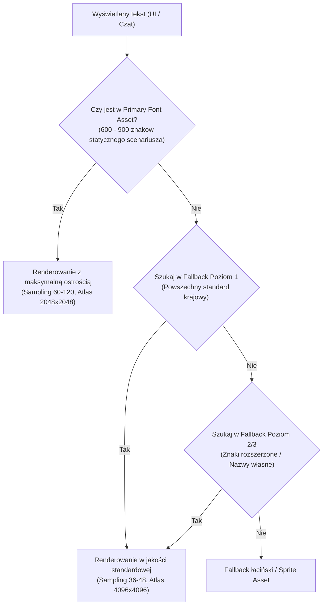

## **1. Przegląd projektu i wyzwania lokalizacji w czasie rzeczywistym**

Projekt **GilongWorld** stawia niezwykle złożone wymaganie inżynieryjne o skali globalnej: pełne wsparcie lokalizacji (*localization*) dla 15 języków docelowych. Lista obejmuje angielski, wietnamski, francuski, włoski, niemiecki, hiszpański (Hiszpania), polski, portugalski (Brazylia), portugalski (Portugalia), koreański, rosyjski, japoński, turecki, chiński uproszczony oraz chiński tradycyjny. We współczesnym tworzeniu gier na silniku Unity zarządzanie tekstem i jego renderowanie w przestrzeni graficznej w czasie rzeczywistym nie sprowadza się jedynie do podmieniania ciągów znaków. Wymaga ono kompleksowej architektury czcionek, która zapewni spójność estetyczną, ostrość obrazu przy każdej odległości kamery oraz — co najważniejsze — wysoką efektywność wykorzystania pamięci systemowej.

Standardowym i najpotężniejszym narzędziem w ekosystemie Unity do renderowania tekstu jest **TextMeshPro (TMP)**. W przeciwieństwie do tradycyjnych systemów tekstu interfejsu użytkownika (UI Text), które renderują każdy znak jako rozmytą przy powiększaniu bitmapę, TextMeshPro wymaga konwersji standardowych plików czcionek na wyspecjalizowane zasoby zwane **Font Asset**[^1]. Takie zasoby przechowują jedną lub wiele tekstur (*Atlas Texture*) wykorzystujących technologię **Signed Distance Field (SDF)**. Technologia SDF pozwala na nieskończone skalowanie tekstu bez utraty ostrości i efektu pikselizacji (*pixelation*), a jednocześnie dostarcza matematycznej podstawy dla shaderów renderujących, umożliwiając generowanie złożonych efektów graficznych — takich jak cienie, obrysy, zmiana grubości czy poświata — bezpośrednio na karcie graficznej (GPU)[^1].

Potęga SDF wiąże się jednak z nieuniknionym ograniczeniem fizycznym: **limitem pamięci**. Zapisanie wszystkich znaków dla 15 języków docelowych w jednej teksturze atlasu jest fizycznie niemożliwe[^1]. W szczególności języki z grupy CJK (*chiński, japoński, koreański*) dysponują rozbudowanymi systemami pisma ideograficznego liczącymi dziesiątki tysięcy znaków. Próba wtłoczenia całego tego zestawu do jednej tekstury Atlas Texture sprawi, że jej wymiary przekroczą maksymalny limit obsługiwany przez sprzęt — zwłaszcza urządzenia mobilne (zwykle $4096 \times 4096$ lub $8192 \times 8192$ pikseli) — prowadząc do przepełnienia pamięci VRAM lub awarii aplikacji (*crash*)[^5]. Niniejszy raport szczegółowo opisuje cały proces: od wyboru i pobrania czcionek źródłowych, analizy specyfiki systemów pisma, poprzez konfigurację wewnętrznych parametrów TextMeshPro i zarządzanie łańcuchem czcionek rezerwowych (*Fallback Chain*), aż po całkowite rozwiązanie problemu unifikacji znaków Han (*Han Unification*) przy użyciu pakietu Unity Localization.

---

## **2. Podstawy typografii i strategia pozyskiwania czcionek źródłowych**

Pierwszym i najważniejszym krokiem przy budowie wielojęzycznego systemu tekstowego jest precyzyjny dobór pliku czcionki źródłowej (*Source Font File*). Spójność wizualna w obrębie 15 języków wymaga otwartoźródłowego kroju pisma, który kompleksowo obsługuje zakresy kodów Unicode — od podstawowych po rozszerzone — oraz zachowuje jednolitą wysokość linii bazowej (*baseline*) i spójną grubość kresek (*weight*).

W branży oprogramowania za złoty standard uznaje się rodzinę czcionek **Google Noto** (skrót od *"No Tofu"* — misja mająca na celu wyeliminowanie pustych prostokątów wyświetlanych przy braku znaku, potocznie nazywanych „tofu”)[^7]. System Noto został zaprojektowany przez Google we współpracy z czołowymi pracowniami typograficznymi, dzięki czemu znaki alfabetów łacińskiego, cyrylicy i systemów CJK mogą pojawiać się obok siebie w jednym wierszu bez zaburzeń proporcji czy stylu graficznego[^8]. Płynność wyświetlania tekstów mieszających wiele języków jest kluczowa dla immersji graczy w GilongWorld.

### **Instrukcja pozyskiwania i importu danych czcionek do Unity**

Aby rozpocząć integrację, pliki źródłowe należy pobrać bezpośrednio z biblioteki **Google Fonts**. Proces pobierania i importowania do Unity powinien przebiegać według rygorystycznej procedury, aby nie dopuścić do zbędnego rozrostu rozmiaru projektu:

1. **Grupa 11 języków korzystających z alfabetu łacińskiego i cyrylicy** (*angielski, wietnamski, francuski, włoski, niemiecki, hiszpański, polski, portugalski brazylijski, portugalski europejski, rosyjski, turecki*): system wymaga wyłącznie bazowej rodziny **Noto Sans**[^8]. Zawiera ona ponad 3 700 znaków (*glyphs*) pokrywających bloki Unicode takie jak Latin Extended, Cyrillic oraz znaki diakrytyczne łączone, co w pełni zaspokaja potrzeby wymienionych języków[^8]. Pobranie pakietu ze strony Google Fonts dostarcza archiwum zawierające różne warianty grubości (np. *Thin, Regular, Medium, Bold, Black*) w formacie TrueType (`.ttf`).
2. **Grupa 4 języków CJK**: proces pobierania jest bardziej złożony. Programiści muszą sięgnąć po oddzielne warianty obejmujące **Noto Sans JP** (japoński), **Noto Sans KR** (koreański), **Noto Sans SC** (chiński uproszczony) oraz **Noto Sans TC** (chiński tradycyjny)[^7]. Te pliki CJK mają bardzo duży rozmiar — od 15 MB do 20 MB dla pojedynczej grubości — ze względu na ogromną liczbę danych graficznych. W tej grupie dominuje format OpenType (`.otf`), który obsługuje bardziej zaawansowane tabele znaków niż TrueType[^5].

Po rozpakowaniu plików z Google Fonts kolejnym krokiem jest ich zaimportowanie (*import*) do środowiska projektu Unity. Dobrą praktyką (*best practice*) w zarządzaniu zasobami jest utworzenie dedykowanej struktury katalogów, na przykład `Assets/GilongWorld_Resources/Fonts/Source_Files/`. Wybrane pliki `.ttf` i `.otf` (warto ograniczyć się do jednej podstawowej grubości, jak *Regular* lub *Medium*, aby oszczędzać pamięć, chyba że projekt UI wyraźnie wymaga osobnych wariantów pogrubionych) należy przeciągnąć i upuścić z systemu operacyjnego bezpośrednio do tego folderu w oknie Project edytora Unity[^10].

> [!NOTE]
> TextMeshPro nie używa plików `.ttf` ani `.otf` bezpośrednio do renderowania tekstu w czasie wykonywania; służą one wyłącznie jako materiał wejściowy dla narzędzia Font Asset Creator, które pobiera geometrię znaków i kompiluje ją do tekstur SDF[^1]. Trzymanie plików źródłowych w osobnym katalogu ułatwia wykluczenie ich z końcowych kompilacji (jeśli nie jest używany tryb Dynamic SDF), co zmniejsza rozmiar paczki instalacyjnej gry.

---

## **3. Analiza specyfiki systemów pisma i wymaganych zakresów Unicode**

Różnorodność 15 języków w projekcie GilongWorld wymaga dogłębnej analizy sposobu kodowania znaków w międzynarodowym standardzie Unicode. TextMeshPro korzysta z zapisu szesnastkowego (heksadecymalnego) do określania zakresów kodowych (*Unicode Ranges*), które mają zostać wyodrębnione z czcionki źródłowej[^13]. Precyzyjne zadeklarowanie tych zakresów zapewnia pełne pokrycie językowe i jednocześnie zapobiega ładowaniu niepotrzebnych symboli powiększających rozmiar tekstur Atlas.

Na podstawie morfologii pisma 15 języków podzielono na trzy główne grupy strategiczne do zarządzania zasobami.

### **Podgrupa 1: Rozszerzony alfabet łaciński i znaki diakrytyczne**

Do tej grupy należą angielski, francuski, włoski, niemiecki, hiszpański, polski, portugalski (Brazylia), portugalski (Portugalia), turecki i wietnamski. Choć dzielą podstawowy alfabet łaciński (`U+0020` do `U+007E`), w blokach rozszerzonych występują istotne różnice[^1]:

- **Europa Zachodnia i Południowa** (*francuski, hiszpański, włoski, portugalski, niemiecki*): korzystają głównie z bloku *Latin-1 Supplement* (`U+00A0` do `U+00FF`), zawierającego podstawowe litery ze znakami akcentowanymi, takie jak `á`, `é`, `í`, `ó`, `ú`, `ñ`, `ü` oraz `ç`.
- **Europa Środkowa i Turcja** (*polski, turecki*): opierają się na bloku *Latin Extended-A* (`U+0100` do `U+017F`), który przechowuje specyficzne znaki takie jak `ą`, `ł`, `ş` i `ğ`[^10].
- **Język wietnamski**: najbardziej wymagający w tej grupie. Złożony system tonów w połączeniu z samogłoskami z daszkiem (`â`, `ê`, `ô`) lub haczykiem (`ơ`, `ư`) wymaga bloku *Latin Extended Additional* (`U+1E00` do `U+1E9F`)[^14]. Piętrowe znaki diakrytyczne języka wietnamskiego tworzą glify o bardzo dużej wysokości (np. litera `Ể` wyraźnie przekracza typową wysokość wielkich liter alfabetu łacińskiego), co wymaga starannego dostrojenia interlinii (*line height*) oraz marginesów wewnętrznych (*padding*) w TextMeshPro, aby uniknąć przycinania (*clipping*) górnej części znaków.

### **Podgrupa 2: Cyrylica**

Jedynym językiem projektu z tego kręgu jest **język rosyjski**. Alfabet cyrylicy jest całkowicie niezależny od alfabetu łacińskiego pod względem kodowania i mieści się w bloku `U+0400` do `U+04FF`[^10]. Mimo odrębności kodowania cyrylica dzieli z alfabetem łacińskim zbliżoną szerokość znaków i wysokość linii bazowej, dzięki czemu można ją bez problemu połączyć w jednym Font Asset wraz z językami łacińskimi bez utraty równowagi wizualnej.

### **Podgrupa 3: Systemy CJK oraz historyczny problem unifikacji Han**

Trzecia grupa obejmuje języki **koreański, japoński, chiński uproszczony i chiński tradycyjny**. Jest to najbardziej wymagający obszar, w którym technologiczne ograniczenia TextMeshPro są nieustannie testowane. Przyczyna źródłowa nie leży wyłącznie w gigantycznej liczbie znaków, ale także w kontrowersyjnej konwencji technicznej Konsorcjum Unicode nazywanej **Han Unification** (*Unifikacja znaków Han*)[^7].

W początkowych latach rozwoju standardu Unicode, aby zmieścić systemy pisma Azji Wschodniej w 16-bitowej przestrzeni adresowej, inżynierowie połączyli ideogramy o wspólnym pochodzeniu historycznym z Chin, Japonii i Korei pod jednym punktem kodowym (*code point*)[^7]. Blok ten nosi nazwę *CJK Unified Ideographs* i obejmuje zakres od `U+4E00` do `U+9FA5`[^12].

Decyzja ta niesie poważne konsekwencje w inżynierii wyświetlania tekstu: **mimo współdzielenia jednego kodu Unicode rzeczywisty wygląd tego samego znaku (glifu) bywa rysowany inaczej w poszczególnych krajach** na skutek odmiennego rozwoju kulturowego, tradycji kaligraficznych i standardów edukacyjnych:

- Charakterystycznym przykładem jest znak oznaczający „kość”, o kodzie Unicode `U+9AA8` (骨). Układ wewnętrznych kresek w górnym prostokątnym elemencie tego znaku w czcionce dla chińskiego uproszczonego (SC) przebiega poziomo od lewej do prawej, podczas gdy w chińskim tradycyjnym (TC) i japońskim (JP) struktura tych kresek ma zupełnie inny układ[^7].
- Podobnie znaki takie jak „śnieg” (雪) czy „prosty” (直) wykazują subtelne, lecz natychmiast zauważalne dla rodzimych użytkowników różnice konstrukcyjne.

System renderowania tekstu nie potrafi samodzielnie odgadnąć kontekstu kulturowego; otrzymuje jedynie kod Unicode i pobiera odpowiedni obrazek z aktywnej czcionki. W rezultacie użycie jednej wspólnej czcionki CJK dla wszystkich języków Azji Wschodniej sprawi, że Japończycy będą czytać japońskie teksty złożone chińskimi formami znaków — lub odwrotnie[^7]. Dla rodzimego odbiorcy wywołuje to wrażenie błędu czcionki, braku profesjonalizmu albo „hybrydowego” tekstu, niszcząc immersję w świecie gry[^7]. Jedynym rozwiązaniem eliminującym to ograniczenie jest całkowite odseparowanie zasobów Font Asset dla każdego języka CJK i elastyczne zarządzanie łańcuchem czcionek rezerwowych.

---

## **4. Mechanizm działania TextMeshPro i technologia Signed Distance Field (SDF)**

Aby bezbłędnie przeprowadzić proces konfiguracji, konieczne jest zrozumienie zasady działania **Signed Distance Field (SDF)** w TextMeshPro. W przeciwieństwie do klasycznych czcionek bitmapowych przechowujących kolor pikseli, SDF zapisuje matematyczną odległość od każdego teksela do najbliższej krawędzi (konturu) znaku[^1]:
- Jeśli punkt znajduje się **wewnątrz** znaku, odległość ma wartość **dodatnią**.
- Jeśli znajduje się **na zewnątrz**, przyjmuje wartość **ujemną**.
- Jeśli leży **dokładnie na krawędzi**, odległość wynosi **zero** ($0$).

Dane o odległości kodowane są w skali szarości (*grayscale*) i przechowywane w teksturze Atlas Texture. W czasie rzeczywistym shader GPU w TextMeshPro wykonuje interpolację dwuliniową (*bilinear interpolation*) tych wartości. Dla każdego fragmentu na ekranie shader sprawdza wartość: jeśli jest $> 0$, fragment zostaje wypełniony kolorem; jeśli $< 0$, staje się przezroczysty. Ponieważ opiera się to na ciągłej interpolacji matematycznej zamiast dyskretnej siatki pikseli, tekst SDF zachowuje perfekcyjnie ostre krawędzie nawet przy maksymalnym zbliżeniu kamery[^1].

Mechanizm ten determinuje dwa kluczowe parametry podczas tworzenia Font Asset:
1. **Sampling Point Size:** określa fizyczny rozmiar znaku podczas rasteryzacji na teksturę Atlas. Im większy rozmiar, tym wyższa precyzja krzywizn konturu w danych odległości.
2. **Padding (margines wewnętrzny):** fundament możliwości efektów SDF. Dodatkowa przestrzeń wokół znaku pozwala gradientowi odległości płynnie opadać w głąb wartości ujemnych. Szerszy padding daje algorytmowi SDF wystarczającą przestrzeń do generowania grubych obrysów (*outline*), cieni (*shadow*) czy poświaty (*glow*) bez gwałtownego odcięcia krawędzi[^13].

---

## **5. Szczegółowy przewodnik konfiguracji za pomocą Font Asset Creator**

Tworzenie plików tekstur czcionek odbywa się poprzez wbudowane narzędzie Unity: **Font Asset Creator**, dostępne z paska menu:

```text
Window > TextMeshPro > Font Asset Creator
```

Na podstawie analizy z rozdziału 3 optymalną architekturą dla 15 języków w projekcie GilongWorld jest model segmentowany: **utworzenie jednego wspólnego Font Asset dla 11 języków z grupy łacińskiej/cyrylicy oraz 4 oddzielnych Font Assets dla każdego języka CJK**.

### **5.1. Konfiguracja statyczna (Static) dla systemów łacińskiego, cyrylicy i wietnamskiego**

Połączenie 11 języków (*angielski, francuski, włoski, niemiecki, hiszpański, polski, portugalski BR, portugalski PT, turecki, rosyjski, wietnamski*) w jednym **Primary Static Font Asset** jest najskuteczniejszym sposobem na ograniczenie liczby wywołań rysowania (*draw calls*) na GPU, co bezpośrednio wpływa na utrzymanie stabilnej liczby klatek na sekundę (*frame rate*)[^14].

Konfigurację w Font Asset Creator przeprowadza się z zachowaniem następujących, ścisłych parametrów[^12]:

| Właściwość konfiguracji | Zalecenie techniczne | Uzasadnienie analityczne |
| :--- | :--- | :--- |
| **Source Font File** | `NotoSans-Regular.ttf` | Przeciągnąć i upuścić plik źródłowy z folderu `Assets` w to pole. Stanowi on źródło danych geometrycznych[^1]. |
| **Sampling Point Size** | `Custom Size: 60 - 90` | Tryb Auto Sizing stara się jedynie upchnąć znaki w dostępnej przestrzeni. Sztywne ustawienie Custom Size na poziomie 60–90 gwarantuje jednolitą jakość danych SDF w całej teksturze[^1]. |
| **Padding** | `6 - 9` (proporcja ~10%) | Standardowa zasada TextMeshPro mówi, że Padding powinien wynosić ok. 10% wartości Sampling Point Size[^4]. Dla Sampling 60 idealny będzie Padding 6 (można zwiększyć do 10 przy projektach UI wymagających bardzo grubego obrysu). |
| **Packing Method** | `Optimum` | Algorytm Optimum działa znacznie wolniej niż Fast, ale wykonuje iteracje upakowania, aby jak najciaśniej rozmieścić glify i zminimalizować marnowanie pikseli[^12]. |
| **Atlas Resolution** | `2048 x 2048` | Łączna liczba znaków tych 11 języków wynosi ok. 1 500–2 000 glifów. Rozmiar $2048 \times 2048$ zapewnia wystarczająco miejsca przy Sampling Point Size 60 bez ucinania jakichkolwiek znaków[^7]. |
| **Character Set** | `Unicode Range (Hex)` | Zamiast gotowych presetów tryb ten zapewnia pełną kontrolę nad zestawem wczytywanych znaków[^2]. |

Pole **Custom Character List** należy wypełnić ciągami zakresów szesnastkowych pokrywającymi w całości potrzeby 11 języków:

```text
0020-007E, 00A0-00FF, 0100-017F, 0180-024F, 1E00-1E9F, 0300-036F, 0400-04FF, 0500-052F, 2000-206F
```

Po wprowadzeniu wszystkich parametrów:
1. Kliknąć przycisk **Generate Font Atlas**. Narzędzie obliczy pola odległości i wygeneruje teksturę (może to potrwać kilka minut zależnie od procesora).
2. Po zakończeniu i wyświetleniu podglądu tekstury kliknąć **Save**.
3. Zapisać plik pod nazwą `Global_Latin_Cyrillic_SDF.asset` w folderze docelowym projektu[^1].

### **5.2. Konfiguracja statyczna (Static) dla CJK i hierarchiczna architektura Fallback**

Obsługa 4 języków CJK wymaga zupełnie odmiennego podejścia ze względu na ogromną objętość danych. Niezbędne jest czterokrotne powtórzenie procedury osobno dla `NotoSansCJKjp`, `NotoSansCJKkr`, `NotoSansCJKsc` oraz `NotoSansCJKtc`. Jednak próba umieszczenia całych tablic CJK w jednym statycznym atlasie poprzez zakresy Unicode zakończy się niepowodzeniem z powodu przekroczenia fizycznego limitu rozmiaru tekstury[^5].

Sprawdzonym rozwiązaniem inżynieryjnym jest zastosowanie **Hierarchicznego Modelu Mapowania Znaków (Hierarchical Character Mapping)** w połączeniu z opcją **Characters from File**[^7]:

#### **1. Utworzenie Primary SDF Font Asset dla znanych znaków (Known Characters)**
- Wyodrębnić wszystkie statyczne ciągi tekstowe z tablic projektowych (**String Tables**: menu, zadania, przedmioty, dialogi, umiejętności).
- Zbiór unikalnych znaków (*unique characters*) w praktyce liczy zazwyczaj **poniżej 1 000 znaków** (przykładowo w projekcie GilongWorld to zaledwie **855 znaków** dla chińskiego uproszczonego, **870** dla chińskiego tradycyjnego, **694** dla japońskiego i **588** dla koreańskiego).
- **Maksymalizacja jakości (Maximize Sampling Size):** ponieważ znaków jest mniej niż 1 000, można ustawić **wysoki Sampling Point Size** (od `60` do `90` lub `120`) przy rozdzielczości `2048 x 2048`. Gwarantuje to krystaliczną ostrość wszystkich oficjalnych tekstów UI niezależnie od odległości kamery.

#### **2. Budowa warstw Fallback na bazie krajowych zestawów standardowych (Standard Fallbacks dla UGC/Czatu)**
Aby w pełni obsłużyć tekst wprowadzany przez graczy (nazwy postaci, opisy gildii, czat społecznościowy) bez ryzyka pojawienia się pustych kwadratów Tofu, system uzupełnia się o zasoby Fallback bazujące na **krajowych standardach znaków**:

| Język | Krajowy standardowy zestaw znaków | Liczba znaków | Instytucja wydająca i źródło otwarte |
| :--- | :--- | :---: | :--- |
| **Chiński uproszczony (zh-Hans)** | **TGSCC (通用规范汉字表)**<br/>- Poziom 1 (Powszechny): 3 500 znaków<br/>- Poziom 2 (Rozszerzony): 3 000 znaków<br/>- Poziom 3 (Nazwy własne/Miejsca): 1 605 znaków | **8 105** | Ministerstwo Edukacji ChRL<br/>*Open source:* [GitHub chinese-character-table](https://github.com/maple-leaf/chinese-character-table) |
| **Chiński tradycyjny (zh-Hant)** | **Tabela standardowych form powszechnych znaków** (*常用國字標準字體表*) | **4 808** | Ministerstwo Edukacji Tajwanu (MOE Taiwan)<br/>*Open source:* [Taiwan Open Data](https://data.gov.tw/dataset/5961) / [GitHub cjktables](https://github.com/ButTaiwan/cjktables) |
| **Japoński (ja)** | - **Jōyō Kanji** (常用漢字 - Powszechnie używane): 2 136 znaków<br/>- **Jinmeiyō Kanji** (人名用漢字 - Do imion): 863 znaki | **2 999** | Agencja ds. Kultury Japonii (文化庁)<br/>*Open source:* [KanjiAPI](https://kanjiapi.dev/) / [GitHub kanji-data](https://github.com/davidluzgouveia/kanji-data) |
| **Koreański (ko)** | **Standard KS X 1001** (2 350 najczęstszych sylab Hangul, pokrywające 99,9% komunikacji) | **2 350** | Koreańska Agencja Technologii i Standardów (KATS)<br/>*Open source:* [GitHub ksx1001](https://github.com/korean-character-sets/ksx1001) / Wyodrębnienie przez `euc-kr` |



#### **3. Niezmienna zasada: zachowanie proporcji Sampling Point Size / Padding (Ratio Consistency)**

Fundamentalna zasada działania shadera TextMeshPro stanowi: **grubość efektów Outline (obrys), Underlay / Shadow (cień) oraz Glow (poświata) jest obliczana na podstawie stosunku Sampling Point Size do Padding**[^13].

##### **Dlaczego warstwy Fallback nie potrzebują tego samego Point Size co Primary?**
- **Primary Font (~855 znaków interfejsu UI):** obecne przez 100% czasu gry $\rightarrow$ wymagają **maksymalnej jakości** (`Sampling Size = 120`, `Padding = 10`, Atlas $2048 \times 2048$).
- **Fallback Fonts (2 700–8 000 rzadkich znaków do czatu/nazw):** pojawiają się sporadycznie $\rightarrow$ **zmniejszamy jakość próbkowania** (`Sampling Size = 60` lub `48`), aby upakować tysiące znaków w tym samym rozmiarze atlasu bez nadmiernego zużycia VRAM.

##### **Dlaczego zachowanie stałej proporcji ($\text{Ratio} = \frac{\text{Sampling}}{\text{Padding}}$) jest obowiązkowe?**
Gdy w jednym zdaniu znak z Primary sąsiaduje ze znakiem z warstwy Fallback:
- **Przy rozbieżnej proporcji:** znak z Primary (Size 120, Pad 10 $\rightarrow$ Ratio 12) ma elegancki, smukły obrys, lecz znak z Fallback (Size 60, ale omyłkowo pozostawiony z Pad 10 $\rightarrow$ Ratio 6) otrzyma **obrys dwukrotnie grubszy, zdeformowany i pożerający kreski znaku**.
- **Przy zachowanej proporcji ($\text{Ratio} = 12$):** niezależnie od tego, czy znak pochodzi z Primary, czy z Fallback, **grubość obrysu i cienia pozostaje w 100% jednolita**.

| Warstwa Font Asset | Rola | Sampling Point Size *(Custom)* | Padding | Rozdzielczość Atlasu | Proporcja (Ratio) |
| :--- | :--- | :---: | :---: | :---: | :---: |
| **Primary Font** | Główny tekst UI | **120** *(lub 96)* | **10 px** *(lub 8 px)* | $2048 \times 2048$ | **12** *(Maksymalna ostrość)* |
| **Fallback Poziom 1** | ~2 725 powszechnych znaków | **60** | **5 px** | $2048 \times 2048$ | **12** *(Oszczędność VRAM)* |
| **Fallback Poziom 2** | ~2 992 rozszerzonych znaków | **60** | **5 px** | $2048 \times 2048$ | **12** *(Oszczędność VRAM)* |
| **Fallback Poziom 3** | ~1 605 rzadkich znaków/nazw | **48** | **4 px** | $2048 \times 2048$ | **12** *(Oszczędność VRAM)* |

> [!TIP]
> **Wskazówka praktyczna:** w narzędziu *Font Asset Creator* przełącz `Sampling Point Size` z *Auto Sizing* na **Custom Size**, aby na stałe zablokować rozmiar próbkowania i wartość Padding zgodnie z powyższą tabelą.

---

### **5.3. Organizacja struktury katalogów i automatyzacja w Unity**

Aby ułatwić długofalowe utrzymanie i skalowanie projektu, w GilongWorld wdrożono dedykowaną strukturę katalogów dla wszystkich źródłowych zbiorów znaków:

```text
Assets/_GilongWorld/_Project/Art/Fonts/_chars/
├── 01_Latin_Cyrillic/        # [Wspólny Primary Font] 11 języków łacińskich/cyrylicy
│   ├── vi_chars.txt          # Wietnamski
│   ├── en_chars.txt          # Angielski
│   ├── ru_chars.txt          # Rosyjski
│   └── ...                   # Francuski, niemiecki, włoski, hiszpański, polski, portugalski, turecki
│
├── 02_CJK/                   # [Primary Fonts CJK] Statyczne znaki dialogów/UI w grze
│   ├── ja_chars.txt          # Japoński (694 rzeczywiste znaki)
│   ├── ko_chars.txt          # Koreański (588 rzeczywistych znaków)
│   ├── zh_Hans_chars.txt     # Chiński uproszczony (855 rzeczywistych znaków)
│   ├── zh_Hant_chars.txt     # Chiński tradycyjny (870 rzeczywistych znaków)
│   │
│   ├── Standard_Fallbacks/   # [Źródła standardowe] 7 bazowych zestawów krajowych
│   │   ├── zh_Hans_TGSCC_Level1_3500.txt
│   │   ├── zh_Hans_TGSCC_Level2_3000.txt
│   │   ├── zh_Hans_TGSCC_Level3_1605.txt
│   │   ├── zh_Hant_Common_4808.txt
│   │   ├── ja_Joyo_Kanji_2136.txt
│   │   ├── ja_Jinmeiyo_Kanji_863.txt
│   │   └── ko_KS_X_1001_2350.txt
│   │
│   └── Subtracted_Fallbacks/ # [Zoptymalizowane Fallbacki] Odjęte znaki Primary
│       ├── zh_Hans_Fallback_Level1.txt    (TGSCC Poziom 1 minus Primary)
│       ├── zh_Hans_Fallback_Level2.txt    (TGSCC Poziom 2 minus Primary)
│       ├── zh_Hans_Fallback_Level3.txt    (TGSCC Poziom 3 minus Primary)
│       ├── zh_Hant_Fallback_Common.txt    (Standard TW 4808 minus Primary)
│       ├── ja_Fallback_Joyo.txt           (Joyo Kanji minus Primary)
│       ├── ja_Fallback_Jinmeiyo.txt       (Jinmeiyo Kanji minus Primary)
│       └── ko_Fallback_KS_X_1001.txt      (KS X 1001 minus Primary)
```

#### **Narzędzie do automatycznej ekstrakcji i odejmowania znaków Fallback (`GWCharacterExtractor.cs`)**
Aby uwolnić programistów od ręcznego eksportu plików CSV i filtrowania duplikatów, dedykowane narzędzie edytora Unity [`GWCharacterExtractor.cs`](file:///d:/Unity-Projects/GLW/Assets/_GilongWorld/_Project/Editor/Localization/GWCharacterExtractor.cs) realizuje proces 2 w 1:
- **Ścieżka menu:** `GilongWorld → Localization → Extract CJK Characters From String Tables`
- **Mechanizm 1 (Ekstrakcja Primary):** skanuje wszystkie `StringTableCollections` w Unity Localization, gromadzi używane ciągi tekstowe w strukturze `HashSet<char>` (zapewniając 100% unikalności), sortuje je rosnąco według kodów Unicode i zapisuje 4 pliki Primary w katalogu `02_CJK/`.
- **Mechanizm 2 (Automatyczne odejmowanie Fallback):** skrypt automatycznie wczytuje 7 zestawów z `Standard_Fallbacks/`, porównuje je i **usuwa wszystkie znaki obecne już w Primary Asset**, a następnie eksportuje wynik do folderu `Subtracted_Fallbacks/`. Eliminuje to całkowicie marnotrawstwo VRAM wynikające z powielania znaków między Primary Atlas a Fallback Atlas.

#### **Okno `GWSDFGeneratorWindow` i obejście ograniczeń API w Unity 6**
Aby zagwarantować ścisłe przestrzeganie zasady „Ratio Sampling / Padding = 12”, projekt udostępnia wyspecjalizowane okno Editor Window, które przyjmuje parametry i automatycznie wyświetla ostrzeżenie w razie odchylenia proporcji.
Co istotne, w Unity 6 właściwość `clearDynamicDataOnBuild` zasobu Font Asset została zablokowana poziomem dostępu `internal`, co uniemożliwia czyszczenie zbędnych danych przed kompilacją z poziomu zwykłego kodu. Narzędzie rozwiązuje ten problem za pomocą refleksji (Reflection) przez `SerializedObject`:

```csharp
var serializedObject = new SerializedObject(fontAsset);
serializedObject.FindProperty("m_ClearDynamicDataOnBuild").boolValue = true;
serializedObject.ApplyModifiedProperties();
```

Dzięki temu uszkodzony, 137-megabajtowy atlas starego systemu został całkowicie oczyszczony, redukując rozmiar paczki wynikowej do minimum.

---

## **6. Architektura zarządzania łańcuchem Fallback Chain i rozwiązanie problemu unifikacji Han**

Kluczem do płynnego działania wielojęzycznej gry jest sprawne sterowanie łańcuchem czcionek rezerwowych (*Fallback Chain*). Gdy komponent UI TextMeshPro otrzymuje tekst zawierający znak nieobecny w Primary Font Asset, uruchamia rekurencyjny algorytm przeszukiwania kolejnych list rezerwowych w celu znalezienia zastępczego glifu (*glyph*).

Algorytm przeszukiwania podlega ścisłej hierarchii:
1. `TextMeshPro Primary Font Asset`
2. `Wewnętrzna lista Fallback Font Assets przypisana do Primary Font`
3. `Wewnętrzny Sprite Asset`
4. `Globalne General Fallback Font Assets zdefiniowane w TMP_Settings`
5. `Default Sprite Asset`
6. `Default Font Asset`[^20]

> [!WARNING]
> System przeszukuje łańcuch sekwencyjnie z góry na dół i **zatrzymuje się natychmiast po znalezieniu pierwszego pasującego punktu kodowego Unicode**[^7].

Jak wykazano w rozdziale 3, zjawisko unifikacji Han sprawia, że znaki języków SC, TC i JP dzielą te same kody Unicode mimo odmiennych kształtów graficznych[^7]. Jeśli programista umieści wszystkie pliki CJK na globalnej liście General Fallback Font Assets w `TMP_Settings`, o ostatecznym wyglądzie tekstu zadecyduje kolejność na liście. Przykładowo przy kolejności `Font_CJK_JP_SDF` $\rightarrow$ `Font_CJK_SC_SDF` $\rightarrow$ `Font_CJK_TC_SDF`, wyświetlenie tekstu w języku chińskim uproszczonym spowoduje przeszukanie listy od góry, natrafienie najpierw na czcionkę japońską z pasującym kodem Unicode i natychmiastowe wyświetlenie japońskiej wersji Kanji z całkowitym pominięciem czcionki chińskiej umieszczonej niżej[^7].

### **Architektura lokalnej izolacji (Local Fallback Architecture)**

Aby całkowicie wyeliminować ten problem, strukturę Fallback należy odizolować:

> [!IMPORTANT]
> **Nigdy nie umieszczaj czcionek CJK na globalnej liście rezerwowej (Global Fallback List) w `TMP_Settings`**[^1]. Zamiast tego warstwy rezerwowe powinny być powiązane poprzez lokalną listę Fallback (*Local Fallback*) każdego zasobu i dynamicznie przełączane w czasie rzeczywistym.

Podstawowa zasada typografii mówi, że czcionki CJK mają zwykle źle wyważone lub nieproporcjonalne wbudowane znaki łacińskie i cyfry arabskie w porównaniu z dedykowanymi krojami łacińskimi[^9]. Dlatego znaki łacińskie zawsze powinny być renderowane przez `Global_Latin_Cyrillic_SDF`. Lokalną strukturę powiązań konfiguruje się następująco:
1. Otworzyć plik `Font_CJK_SC_SDF.asset`, w sekcji **Fallback Font Assets** dodać chińskie warstwy Fallback 1–3, a na końcu dopisać `Global_Latin_Cyrillic_SDF`[^1].
2. Powtórzyć identyczną procedurę dla plików TC, JP i KR.

Gwarantuje to, że podczas wyświetlania gry po chińsku wtrącone liczby czy angielskie nazwy własne płynnie przejdą przez statyczny atlas chiński (ponieważ znaki łacińskie zostały usunięte podczas ekstrakcji *Characters from File*) i zostaną przechwycone przez zasób rezerwowy wysokiej jakości dla pisma łacińskiego[^7].

---

## **7. Integracja pakietu Unity Localization do dynamicznego przełączania (Runtime Swapping)**

Aby zapewnić kulturowo poprawne wyświetlanie kształtów pisma Han oraz optymalizację pamięci VRAM, komponenty UI TextMeshPro nie mogą utrzymywać statycznej konfiguracji. Kiedy gracz zmienia język (*Locale*), podstawowa czcionka (*Primary Font Asset*) musi zostać automatycznie podmieniona (*swap*) w czasie rzeczywistym (*runtime*)[^23].

Pakiet **Unity Localization** (`com.unity.localization`) dostarcza potężnych narzędzi realizujących ten przepływ bez sztywnego kodowania (*hardcoding*) poszczególnych zdarzeń[^25], w oparciu o globalne zdarzenie zmiany języka `LocalizationSettings.SelectedLocaleChanged`[^24].

Dostępne są dwie metody wdrożenia:

### **Metoda 1: Scentralizowany menedżer czcionek (Centralized Font Manager)**

Zamiast przypisywać zdarzenia Localized Asset do tysięcy pojedynczych obiektów UI Text ręcznie (co wywiera ogromną presję na pamięć poprzez tysiące zbędnych komponentów `MonoBehaviour` i obciąża Garbage Collector), projekt GilongWorld stosuje strategię **scentralizowanego zarządzania przez Addressables**.

Skrypt `GWFontManager.cs` (oznaczony flagą `DontDestroyOnLoad`) nasłuchuje zdarzenia `LocalizationSettings.SelectedLocaleChanged`. W chwili jego wywołania menedżer wykonuje dwa precyzyjne zadania:
1. **Asynchroniczne ładowanie (Async Load):** używa `LocalizationSettings.AssetDatabase.GetLocalizedAssetAsync<TMP_FontAsset>("Fonts_Table", "PrimaryFont")` do pobrania z Addressables odpowiedniego Font Asset dla aktualnego języka.
2. **Globalne skanowanie (Global Sweep):** wywołuje `FindObjectsByType<TMP_Text>`, aby przejść przez całą scenę i przypisać nową czcionkę wszystkim komponentom tekstowym. Operacja ta zajmuje kilka milisekund czasu CPU, lecz uruchamia się wyłącznie raz podczas zmiany języka lub ładowania sceny — w zamian uwalniając pamięć RAM od tysięcy pojedynczych komponentów. Bezpośrednio po przypisaniu zasób poprzedniego języka jest zwalniany za pomocą `Addressables.Release()`.

Podejście to całkowicie eliminuje zjawisko „zakażenia krzyżowego” (*cross-pollination*) między językami CJK, ponieważ w pamięci przebywa wyłącznie atlas aktualnie wybranego języka[^7].

### **Metoda 2: Asset Tables w Unity Localization**

Najbardziej natywną metodą jest wykorzystanie **Localized Asset Tables**[^23]. Analogicznie do Localized String Tables używanych do podmiany ciągów tekstowych, Asset Tables pozwalają przypisać różne zasoby Asset do poszczególnych języków. Komponenty Localized Text w interfejsie mogą zostać skonfigurowane tak, aby automatycznie zmieniać nie tylko tekst, lecz także właściwość `FontAsset` obiektu TextMeshPro[^23].

Podejście to wymaga konfiguracji w oknie Inspector, ale zapewnia wysoką stabilność i zwalnia zespół z utrzymywania własnego kodu mapującego[^28].

---

## **8. Zarządzanie treścią dynamiczną (UGC), optymalizacja pamięci i integracja z Addressables**

Architektura statyczna (*Static Architecture*) w pełni rozwiązuje kwestię oficjalnego interfejsu gry. Jednak treści generowane przez użytkowników (**User-Generated Content - UGC**), takie jak nazwy postaci, opisy gildii czy czat społecznościowy, stanowią większe wyzwanie. Nie sposób przewidzieć, jakich znaków z 15 języków użyją gracze, a załadowanie setek tysięcy znaków świata do pamięci RAM jest niemożliwe.

### **Hybrydowe rozwiązanie SDF (Hybrid SDF System)**

Standardowy system **Dynamic SDF** w TextMeshPro zaczyna od pustej tekstury atlasu ($0 \times 0$ pikseli). Po napotkaniu nowego znaku procesor (CPU) rysuje go na bieżąco i umieszcza w teksturze w czasie rzeczywistym[^6]. Całkowite oparcie się na trybie Dynamic powoduje jednak dotkliwe zacięcia (*frame spikes*) na pierwszym ekranie gry. Z tego względu projekt GilongWorld stosuje **Architekturę Hybrydową (Hybrid)**:

1. **Płynne wstępne wypełnienie statyczne (Static Population):** przy użyciu narzędzia `GWCharacterExtractor.cs` tysiące najczęściej używanych znaków są wtłaczane do atlasu funkcją `TryAddCharacters` już na etapie edytora. W trakcie rozgrywki znaki te są już gotowe, co gwarantuje idealnie stabilną liczbę klatek na sekundę (FPS).
2. **Bezpieczny mechanizm dynamiczny (Dynamic Fallback):** Font Asset jest zapisywany w trybie Dynamic z włączoną flagą `isMultiAtlasTexturesEnabled = true`. Gdy gracz wpisze na czacie wyjątkowo rzadki znak nieobecny w pierwszym atlasie, TMP natychmiast tworzy dodatkową teksturę atlasu (`Atlas 0 1`, `Atlas 0 2`...) zamiast wyświetlać pusty kwadrat Tofu. Stanowi to optymalny kompromis.

> [!CAUTION]
> Tryb Dynamic SDF wiąże się z konkretnym kosztem zasobowym: każdy dynamiczny atlas o wymiarach $2048 \times 2048$ natychmiast rezerwuje około **4 MB** pamięci systemowej. Wygenerowanie wielu dodatkowych atlasów znacząco obciąży urządzenia mobilne[^31].

### **Ukryta pułapka Addressables i konflikt pamięci VRAM**

Współczesne duże projekty takie jak GilongWorld niemal zawsze wykorzystują system **Addressables** do ładowania zasobów. Krytycznym błędem popełnianym przez wielu programistów jest **przekonanie, że skoro nie włączyli Addressables dla czcionek, mogą bezpiecznie zostawić Font Assets w folderze `Resources`.**

W rzeczywistości pakiet **Unity Localization jest zbudowany bezpośrednio na bazie Addressables**. Nawet jeśli nie korzystasz z niego świadomie, Addressables działa w tle przy obsłudze String Tables.
Gdy prefab interfejsu UI spakowany przez Addressables odwołuje się do Font Asset znajdującego się w folderze `Resources`, menedżer zasobów Unity popełnia kosztowny błąd duplikacji (*duplicate assets*):
1. Unity tworzy pełną kopię tekstury Atlas i umieszcza ją wewnątrz paczki AssetBundle systemu Addressables[^32].
2. Po uruchomieniu gry wczytywany jest Atlas z `Resources`, a następnie kolejny Atlas z AssetBundle trafia do pamięci RAM, co prowadzi do **podwójnego i całkowicie zbędnego zużycia VRAM**[^31]. Ten problem jest niezwykle częsty i potrafi szybko doprowadzić do awarii aplikacji mobilnych rygorystycznie limitujących pamięć RAM[^33].

**Kompletne rozwiązanie:**
- Przenieść plik `TMP_Settings` oraz wszystkie Font Assets całkowicie poza folder `Resources`, do standardowej lokalizacji projektowej, np. `Assets/_GilongWorld/_Project/Art/Fonts/SDF/`.
- Zaznaczyć wszystkie pliki SDF i przypisać je do dedykowanej grupy Addressables (np. `Fonts_Addressables`), a następnie skonfigurować mapowanie w tabeli **Asset Table** (`Fonts_Table`) systemu Localization.
- **Czyszczenie czcionek dynamicznych w edytorze:** pliki Dynamic Font Asset przechowują wygenerowane dane tekstur na dysku. Przed każdą kompilacją buildu należy obowiązkowo wyczyścić dane dynamiczne (zautomatyzowane w narzędziu `GWSDFGeneratorWindow` przy użyciu wspomnianej techniki `SerializedObject`)[^30].
- **Zwalnianie pamięci w czasie wykonania (Runtime):** podczas przejść między dużymi scenami wywołać API `TMP_FontAsset.ClearFontAssetData(true)` lub `FontEngine.DestroyFontEngine()`, aby całkowicie zwolnić nieużywane już tablice tekstur dynamicznych[^35].

---

## **9. Diagnostyka na żywo i rozwiązywanie problemów technicznych (Troubleshooting)**

Podczas rzeczywistego wdrażania na zróżnicowanych platformach system lokalizacji często ujawnia powtarzalne objawy błędów. Znajomość mechanizmów diagnostycznych pozwala zespołowi technicznemu szybko zlokalizować przyczynę usterki:

### **Tekst wyświetla się jako puste kwadraty (Tofu Boxes) na buildzie mobilnym, lecz działa poprawnie w Edytorze**
- **Przyczyna:** menedżer zasobów Unity nie rozpoznaje Fallback Font Assets jako zależności (*dependencies*), jeśli są one jedynie luźno podpięte w tabeli `FallbackFontAssetTable` w czasie wykonywania zamiast bezpośredniego odwołania ze statycznego obiektu GameObject w scenie. Proces budowania Unity automatycznie usuwa (*strip*) takie zasoby w celu optymalizacji rozmiaru paczki[^1].
- **Rozwiązanie:** wykorzystać globalną listę `TMP_Settings.fallbackFontAssets`, aby Unity zachowało świadomość ich istnienia, lub upewnić się, że wszystkie potencjalne Font Assets są oznaczone do wstępnego ładowania (*pre-load*) przez manifest Addressables[^1].

### **Wyjątek: `"The variable m_AtlasTextures of TMP_FontAsset has not been assigned"`**
- **Przyczyna:** dotyczy bezpośrednio Dynamic Font Asset z włączoną opcją Multi Atlas Textures[^34]. Gdy system automatycznie tworzy kolejne tekstury dla nowych znaków, lecz proces ten zostanie przerwany lub pamięć zostanie nieprawidłowo zwolniona przy dynamicznych prefabach (*instantiated prefabs*), wewnętrzna tablica tekstur zachowuje pustą referencję (*null reference*).
- **Rozwiązanie:** przed wykonaniem kompilacji ręcznie wybrać **Reset** z menu kontekstowego zasobu Font Asset w Inspektorze, aby odbudować czystą tablicę tekstur początkowych[^34].

### **Tekst jest rozmyty (Blurry) przy dużych rozmiarach wyświetlania**
- **Przyczyna:** rozdzielczość Atlasu SDF lub wartość `Sampling Point Size` są zbyt niskie względem docelowej wysokości znaków renderowanych na ekranie[^1].
- **Rozwiązanie:** dla dużych nagłówków i banerów (Heading / Banner) należy ustawić `Sampling Point Size` na poziomie `150` lub wyższym. Jeśli większy atlas nie pomieści całego zestawu znaków przy takim parametrze, warto wydzielić konkretne znaki używane na ekranach tytułowych do osobnego Static Font Asset, zamiast współdzielić zasób z tekstem treści głównej[^1].

### **Błąd uwierzytelniania przy pobieraniu (Pull) tabel tłumaczeń z Google Sheets (`invalid_grant: Token has been expired or revoked`)**
- **Objaw:** podczas synchronizacji (*Pull*) tabel lokalizacyjnych (takich jak `RPGB_General` lub String Tables) z Google Sheets do Unity pojawia się czerwony błąd: `Pull from Google sheets: Failed - Error: "invalid_grant", Description: "Token has been expired or revoked."`
- **Przyczyna:** **rozbieżność strefy czasowej / dryf zegara systemowego (Timezone Skew / Clock Drift)**. Mechanizm uwierzytelniania Google OAuth2 wymaga bardzo dokładnego znacznika czasu (timestamp) w żądaniu. Jeśli zegar komputera lub strefa czasowa są błędne albo Edytor Unity utrzymuje nieaktualną pamięć podręczną czasu, serwer Google natychmiast odrzuca żądanie komunikatem `invalid_grant`.
- **Rozwiązanie:**
  - **Uruchomić ponownie Edytor Unity:** zamknąć i ponownie otworzyć Unity Editor, aby silnik pobrał aktualny czas z systemu operacyjnego $\rightarrow$ ponowne kliknięcie **Pull** zakończy się natychmiastowym sukcesem.

---

## **10. Końcowe rekomendacje architektoniczne**

Projekt GilongWorld w skali 15 języków wymaga architektury renderowania tekstu spełniającej najbardziej rygorystyczne normy wydajności alokacji pamięci VRAM i spójności wielokulturowej:

1. **Spójność typograficzna (Typography):** wdrożenie w całym projekcie ekosystemu Google Noto Sans oraz Noto Sans CJK w celu zachowania jednolitej linii bazowej (*baseline*) przy tekstach wielojęzycznych w jednym wierszu.
2. **Segmentacja atlasów (Atlas Segmentation):** unikanie kompresowania wszystkich języków w jednej teksturze. Utworzenie pojedynczego Primary Static Font Asset $2048 \times 2048$ obejmującego zakresy 11 języków łacińskich i cyrylicy (*angielski, wietnamski, francuski, włoski, niemiecki, hiszpański, polski, portugalski, rosyjski, turecki*).
3. **Optymalizacja dla Azji Wschodniej i hierarchiczny Fallback:** odseparowanie 4 języków CJK (*chiński uproszczony, chiński tradycyjny, japoński, koreański*) jako niezależnych zasobów Font Asset. Połączenie **Primary SDF Font Asset (< 1 000 statycznych znaków scenariusza przy wysokiej jakości Sampling Size 60–120)** z **3 warstwami Fallback (do 8 105 znaków krajowych standardów jak TGSCC)** dla potrzeb czatu i nazw graczy. Obowiązkowe utrzymanie **jednolitej proporcji Sampling Point Size / Padding** (Ratio $\approx 10-12$) między Primary i Fallback, aby efekty shaderów (Outline, Shadow, Glow) renderowały się jednolicie bez zniekształceń.
4. **Kontrola łańcucha rezerwowego (Han Unification):** kategoryczny zakaz umieszczania czcionek CJK na liście Global Fallback. Zamiast tego zastosowanie dynamicznego przełączania zasobów (*Runtime Swapping*) z pakietu Unity Localization w celu podmiany Primary Font Asset zgodnie z aktywnym Locale, co wyklucza wyświetlanie błędnych form regionalnych. Znaki łacińskie zawsze konfiguruje się jako lokalny Fallback (*Local Fallback*) w plikach CJK.
5. **Treści dynamiczne i dyscyplina pamięci (UGC & Addressables):** wykorzystanie Dynamic Font Assets z Multi Atlas Texture do obsługi nieprzewidzianych znaków z czatu graczy. Na koniec przeniesienie całej struktury poza katalog `Resources`, zarządzanie zasobami poprzez **Addressables** w celu wyeliminowania duplikacji atlasów oraz wywoływanie interfejsów API czyszczących pamięć przed buildem i między scenami podczas długich sesji gry.

---

## **Bibliografia**

[^1]: Fix: Unity TextMeshPro Font Asset Missing or Fallback | Bugnet Blog, [https://bugnet.io/blog/fix-unity-textmeshpro-font-asset-missing](https://bugnet.io/blog/fix-unity-textmeshpro-font-asset-missing)
[^2]: Fix: Unity UI TextMeshPro Falling Back to Default Font | Bugnet Blog, [https://bugnet.io/blog/fix-unity-ui-text-mesh-pro-falling-back-default-font](https://bugnet.io/blog/fix-unity-ui-text-mesh-pro-falling-back-default-font)
[^3]: textmeshpro | Skills Marketplace · LobeHub, [https://lobehub.com/de/skills/xeldaralz-helm-textmeshpro](https://lobehub.com/de/skills/xeldaralz-helm-textmeshpro)
[^4]: Chinese Traditional, Simplified and English text looks blurred, [https://discussions.unity.com/t/chinese-traditional-simplified-and-english-text-looks-blurred/723916](https://discussions.unity.com/t/chinese-traditional-simplified-and-english-text-looks-blurred/723916)
[^5]: Creating asset from font with a lot of characters - Page 2 - Unity Engine, [https://discussions.unity.com/t/creating-asset-from-font-with-a-lot-of-characters/708290?page=2](https://discussions.unity.com/t/creating-asset-from-font-with-a-lot-of-characters/708290?page=2)
[^6]: Bug where TextMeshPro dynamic font atlas exhaustion causes, [https://unity-trouble-atlas.7colorsgame.com/en/article/unity-tmp-dynamic-font-atlas-exhaustion/](https://unity-trouble-atlas.7colorsgame.com/en/article/unity-tmp-dynamic-font-atlas-exhaustion/)
[^7]: Unity Font: The 2026 Complete Guide to TextMesh Pro Font Assets, [https://www.transphere.com/unity-font-textmesh-pro-font-assets-fallbacks-and-localization/](https://www.transphere.com/unity-font-textmesh-pro-font-assets-fallbacks-and-localization/)
[^8]: Noto Sans - Google Fonts, [https://fonts.google.com/noto/specimen/Noto+Sans](https://fonts.google.com/noto/specimen/Noto+Sans)
[^9]: Force a font to use fallbacks - Unity Discussions, [https://discussions.unity.com/t/force-a-font-to-use-fallbacks/711511](https://discussions.unity.com/t/force-a-font-to-use-fallbacks/711511)
[^10]: Multiple Language Support Not Working in TextMesh Pro, [https://stackoverflow.com/questions/44922738/multiple-language-support-not-working-in-textmesh-pro](https://stackoverflow.com/questions/44922738/multiple-language-support-not-working-in-textmesh-pro)
[^11]: How to display Japanese in Unity TextMeshPro using Noto Sans CJK, [https://zenn.dev/uliboooo/articles/c3a2f489d8ee9a?locale=en](https://zenn.dev/uliboooo/articles/c3a2f489d8ee9a?locale=en)
[^12]: TextMeshPro Font Asset Creation & Packaging Guide - GitHub, [https://github.com/bbepis/XUnity.AutoTranslator/wiki/TextMeshPro-Font-Asset-Creation-&-Packaging-Guide](https://github.com/bbepis/XUnity.AutoTranslator/wiki/TextMeshPro-Font-Asset-Creation-&-Packaging-Guide)
[^13]: Font Asset Creator | TextMeshPro | 3.2.0-pre.15 - Unity - Manual, [https://docs.unity3d.com/Packages/com.unity.textmeshpro@3.2/manual/FontAssetsCreator.html](https://docs.unity3d.com/Packages/com.unity.textmeshpro@3.2/manual/FontAssetsCreator.html)
[^14]: [UNITY] Optimizing TextMesh Pro Font Atlas for language localization., [https://killertee.wordpress.com/2021/04/23/optimizing-workflow-textmesh-pro-font-atlas-for-language-localization/](https://killertee.wordpress.com/2021/04/23/optimizing-workflow-textmesh-pro-font-atlas-for-language-localization/)
[^15]: [Solved] TextMeshPro - Text(UI): Shows empty squares - Unity Engine, [https://discussions.unity.com/t/solved-textmeshpro-text-ui-shows-empty-squares/787844](https://discussions.unity.com/t/solved-textmeshpro-text-ui-shows-empty-squares/787844)
[^16]: Character set for multiple languages - Unity Discussions, [https://discussions.unity.com/t/character-set-for-multiple-languages/696758](https://discussions.unity.com/t/character-set-for-multiple-languages/696758)
[^17]: FYI: missing chinese/japanese/korean characters in Unity may not, [https://www.reddit.com/r/Unity3D/comments/1l37yfi/fyi_missing_chinesejapanesekorean_characters_in/](https://www.reddit.com/r/Unity3D/comments/1l37yfi/fyi_missing_chinesejapanesekorean_characters_in/)
[^18]: Saving / loading font atlas for TextMeshPro Font assets during runtime, [https://discussions.unity.com/t/saving-loading-font-atlas-for-textmeshpro-font-assets-during-runtime/891878](https://discussions.unity.com/t/saving-loading-font-atlas-for-textmeshpro-font-assets-during-runtime/891878)
[^19]: Having issues displaying Chinese characters using Text Mesh Pro, [https://www.reddit.com/r/Unity3D/comments/178zt0q/having_issues_displaying_chinese_characters_using/](https://www.reddit.com/r/Unity3D/comments/178zt0q/having_issues_displaying_chinese_characters_using/)
[^20]: Fallback font assets | TextMeshPro | 4.0.0-pre.2 - Unity - Manual, [https://docs.unity3d.com/Packages/com.unity.textmeshpro@4.0/manual/FontAssetsFallback.html](https://docs.unity3d.com/Packages/com.unity.textmeshpro@4.0/manual/FontAssetsFallback.html)
[^21]: Fallback font assets | TextMeshPro | 3.2.0-pre.15 - Unity - Manual, [https://docs.unity3d.com/Packages/com.unity.textmeshpro@3.2/manual/FontAssetsFallback.html](https://docs.unity3d.com/Packages/com.unity.textmeshpro@3.2/manual/FontAssetsFallback.html)
[^22]: Issue using the TMPro fallback system to render Chinese or, [https://discussions.unity.com/t/issue-using-the-tmpro-fallback-system-to-render-chinese-or-japanese-w-specific-fonts/837526](https://discussions.unity.com/t/issue-using-the-tmpro-fallback-system-to-render-chinese-or-japanese-w-specific-fonts/837526)
[^23]: Localization - Unity - Manual, [https://docs.unity3d.com/6000.5/Documentation/Manual/best-practice-guides/ui-toolkit-for-advanced-unity-developers/localization.html](https://docs.unity3d.com/6000.5/Documentation/Manual/best-practice-guides/ui-toolkit-for-advanced-unity-developers/localization.html)
[^24]: Issues with Localization and TMP Rendering in Unity, [https://discussions.unity.com/t/issues-with-localization-and-tmp-rendering-in-unity/948421](https://discussions.unity.com/t/issues-with-localization-and-tmp-rendering-in-unity/948421)
[^25]: A Comprehensive Guide to Unity Localization | Phrase, [https://phrase.com/blog/posts/localizing-unity-games-official-localization-package/](https://phrase.com/blog/posts/localizing-unity-games-official-localization-package/)
[^26]: How to Use the Unity Localization Package: A Complete Guide, [https://www.languagesunlimited.com/unity-localization-package/](https://www.languagesunlimited.com/unity-localization-package/)
[^27]: Change Locale in runtime - Unity Discussions, [https://discussions.unity.com/t/change-locale-in-runtime/812317](https://discussions.unity.com/t/change-locale-in-runtime/812317)
[^28]: TMP Font Asset and localization - Unity Discussions, [https://discussions.unity.com/t/tmp-font-asset-and-localization/936355](https://discussions.unity.com/t/tmp-font-asset-and-localization/936355)
[^29]: Localization, font switching and font material presets - Unity Engine, [https://discussions.unity.com/t/localization-font-switching-and-font-material-presets/770975](https://discussions.unity.com/t/localization-font-switching-and-font-material-presets/770975)
[^30]: Dynamic fonts assets | TextMeshPro | 3.2.0-pre.15 - Unity - Manual, [https://docs.unity3d.com/Packages/com.unity.textmeshpro@3.2/manual/FontAssetsDynamicFonts.html](https://docs.unity3d.com/Packages/com.unity.textmeshpro@3.2/manual/FontAssetsDynamicFonts.html)
[^31]: TextMesh Pro - Font atlases memory leak? - Unity Engine, [https://discussions.unity.com/t/textmesh-pro-font-atlases-memory-leak/885808](https://discussions.unity.com/t/textmesh-pro-font-atlases-memory-leak/885808)
[^32]: TextMeshPro & Addressables (Asset Bundles) - Unity Discussions, [https://discussions.unity.com/t/textmeshpro-addressables-asset-bundles/855482](https://discussions.unity.com/t/textmeshpro-addressables-asset-bundles/855482)
[^33]: TextMesh Pro Fallback Font Displays Boxes on Instantiated Objects, [https://discussions.unity.com/t/textmesh-pro-fallback-font-displays-boxes-on-instantiated-objects-unity-6-mobile-build-only-works-in-editor-and-unity-2022/1652497](https://discussions.unity.com/t/textmesh-pro-fallback-font-displays-boxes-on-instantiated-objects-unity-6-mobile-build-only-works-in-editor-and-unity-2022/1652497)
[^34]: Text Mesh Pro FallBack localization - Unity Discussions, [https://discussions.unity.com/t/text-mesh-pro-fallback-localization/797911](https://discussions.unity.com/t/text-mesh-pro-fallback-localization/797911)
[^35]: Issue with removing fonts from fallbackFontAssetTable (memory leak), [https://discussions.unity.com/t/issue-with-removing-fonts-from-fallbackfontassettable-memory-leak/826070](https://discussions.unity.com/t/issue-with-removing-fonts-from-fallbackfontassettable-memory-leak/826070)
