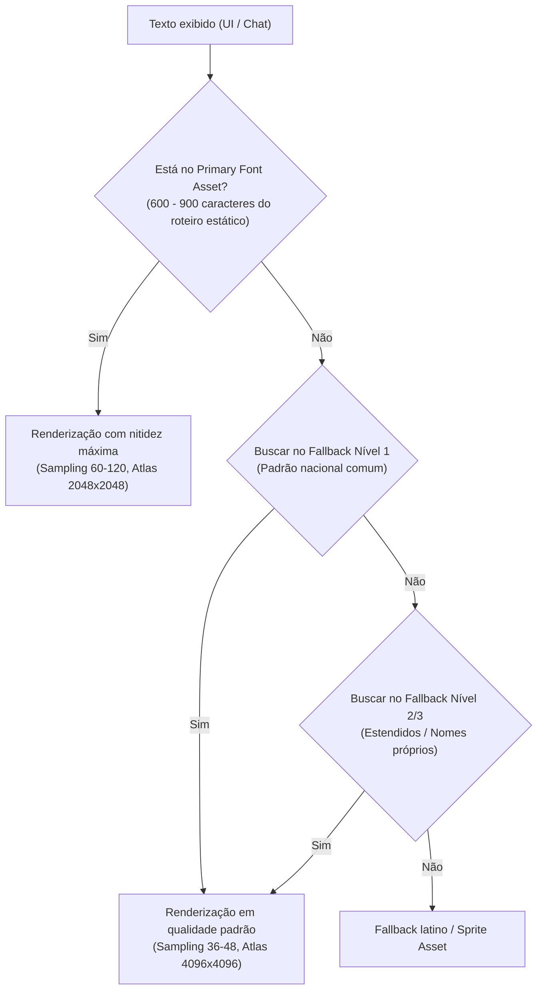

## **1. Visão geral do projeto e desafios da localização em tempo real**

O projeto **GilongWorld** impõe um requisito técnico altamente complexo e de alcance global: oferecer suporte completo à localização (*localization*) para 15 idiomas de destino. A lista inclui inglês, vietnamita, francês, italiano, alemão, espanhol (Espanha), polonês, português (Brasil), português (Portugal), coreano, russo, japonês, turco, chinês simplificado e chinês tradicional. No desenvolvimento moderno de jogos utilizando a engine Unity, gerenciar e exibir textos em um espaço gráfico em tempo real não se resume à simples substituição de strings. Exige uma arquitetura tipográfica totalmente otimizada para garantir consistência estética, nitidez visual em qualquer distância de câmera e — acima de tudo — eficiência no consumo de memória do sistema.

A ferramenta padrão e mais poderosa atualmente no ecossistema Unity para renderização de texto é o **TextMeshPro (TMP)**. Totalmente diferente dos sistemas tradicionais de texto de interface de usuário (UI Text), que renderizam cada caractere como uma imagem bitmap borrada ao ampliar, o TextMeshPro requer a conversão de arquivos de fonte padrão em recursos especializados chamados **Font Asset**[^1]. Esses Font Assets contêm uma ou mais texturas (*Atlas Texture*) baseadas na tecnologia **Signed Distance Field (SDF)**. A tecnologia SDF permite que o texto seja ampliado indefinidamente sem serrilhamento ou pixelização (*pixelation*), além de fornecer a base matemática para que o shader calcule efeitos gráficos complexos — como sombra, contorno, espessura e brilho — diretamente na GPU em tempo real[^1].

Contudo, o poder do SDF traz consigo um desafio físico inevitável: **limites de memória**. Armazenar todos os caracteres dos 15 idiomas de destino em uma única textura é fisicamente impossível[^1]. Em particular, os idiomas do grupo CJK (*chinês, japonês e coreano*) possuem sistemas ideográficos monumentais com dezenas de milhares de caracteres. Se tentarmos forçar todo esse conjunto em uma única Atlas Texture, as dimensões da textura ultrapassarão o limite máximo suportado pelo hardware — especialmente em dispositivos móveis (geralmente $4096 \times 4096$ ou $8192 \times 8192$ pixels) — resultando em estouro de memória VRAM ou travamento imediato do aplicativo (*crash*)[^5]. Este relatório detalha minuciosamente todo o fluxo de engenharia: da escolha e download das fontes originais, passando pela análise dos sistemas de escrita, até a configuração dos parâmetros internos do TextMeshPro, o gerenciamento da cadeia de fallback (*Fallback Chain*) e a solução definitiva do problema da unificação Han (*Han Unification*) por meio do pacote Unity Localization.

---

## **2. Fundamentos de caracteres e estratégia de download de fontes originais**

O primeiro e mais crucial passo na construção de um sistema de texto multilíngue é a escolha precisa do arquivo de fonte original (*Source Font File*). A consistência visual entre 15 idiomas exige uma família tipográfica de código aberto que ofereça suporte completo aos blocos Unicode básicos e estendidos, mantendo um design uniforme de linha de base (*baseline*) e espessura de traço (*weight*).

Na indústria de software, a família de fontes **Google Noto** (abreviação de *"No Tofu"* — uma missão para eliminar os quadrados vazios exibidos quando falta um caractere no dispositivo, apelidados de "tofu") é reconhecida como o padrão ouro[^7]. Desenvolvida pelo Google em parceria com grandes estúdios tipográficos, a família Noto garante que caracteres dos alfabetos latino, cirílico e CJK possam ser exibidos lado a lado na mesma linha sem discrepâncias de proporção ou estilo artístico[^8]. Essa fluidez quando textos misturam múltiplos idiomas é vital para a imersão do jogador em GilongWorld.

### **Guia de extração e importação de dados de fonte no Unity**

Para iniciar a integração, os arquivos de fonte originais devem ser baixados diretamente da biblioteca **Google Fonts**. O processo de download e importação no Unity precisa seguir um fluxo rigoroso para evitar o aumento desnecessário no tamanho do projeto:

1. **Grupo de 11 idiomas baseados nos alfabetos latino e cirílico** (*inglês, vietnamita, francês, italiano, alemão, espanhol, polonês, português do Brasil, português de Portugal, russo e turco*): o sistema necessita apenas da família base **Noto Sans**[^8]. Essa fonte contém mais de 3.700 glifos (*glyphs*), cobrindo blocos Unicode como Latin Extended, Cyrillic e sinais diacríticos combinados, atendendo plenamente às demandas dos idiomas citados[^8]. O download no Google Fonts fornece um arquivo compactado com diversas variantes de peso (como *Thin, Regular, Medium, Bold, Black*) no formato TrueType (`.ttf`).
2. **Grupo de 4 idiomas CJK**: o processo de download torna-se mais complexo. Os desenvolvedores precisam baixar separadamente as variantes **Noto Sans JP** (japonês), **Noto Sans KR** (coreano), **Noto Sans SC** (chinês simplificado) e **Noto Sans TC** (chinês tradicional)[^7]. Esses arquivos CJK são bastante pesados, variando entre 15 MB e 20 MB para cada peso tipográfico devido à enorme quantidade de dados gráficos. O formato mais comum para esse grupo é o OpenType (`.otf`), que suporta estruturas de tabelas de caracteres mais complexas do que o TrueType[^5].

Após descompactar os arquivos do Google Fonts, o próximo passo é importá-los (*import*) para o projeto Unity. Uma boa prática (*best practice*) no gerenciamento de recursos é criar uma estrutura de pastas dedicada, como `Assets/GilongWorld_Resources/Fonts/Source_Files/`. Os arquivos `.ttf` e `.otf` (convém escolher apenas um peso padrão, como *Regular* ou *Medium*, para otimizar memória, salvo se o design da UI exigir variantes em negrito específicas) devem ser arrastados e soltos diretamente do sistema operacional para essa pasta pela janela Project do Unity Editor[^10].

> [!NOTE]
> O TextMeshPro não usa diretamente esses arquivos `.ttf` ou `.otf` para renderizar texto em tempo de execução; eles atuam apenas como matéria-prima para que a ferramenta Font Asset Creator extraia a geometria e a compile em texturas SDF[^1]. Manter os arquivos originais em uma pasta separada facilita removê-los das builds finais (quando o Dynamic SDF não é utilizado), ajudando a reduzir o tamanho do instalador do jogo.

---

## **3. Análise das características dos sistemas de escrita e requisitos de blocos Unicode**

A diversidade dos 15 idiomas no projeto GilongWorld exige uma análise profunda de como os caracteres são codificados no padrão internacional Unicode. O TextMeshPro utiliza o sistema hexadecimal (base 16) para definir os intervalos de código (*Unicode Ranges*) a serem extraídos da fonte original[^13]. Declarar com exatidão esses intervalos não apenas garante cobertura linguística total, como também impede o carregamento de glifos inúteis que inflariam o tamanho da textura Atlas.

Com base na morfologia de escrita, os 15 idiomas dividem-se em três grupos estratégicos principais para o gerenciamento de recursos.

### **Subgrupo 1: Sistema latino estendido e diacríticos**

Esse grupo abrange inglês, francês, italiano, alemão, espanhol, polonês, português (Brasil), português (Portugal), turco e vietnamita. Embora compartilhem a base do alfabeto latino (`U+0020` a `U+007E`), ocorrem fortes divergências nos blocos estendidos[^1]:

- **Europa Ocidental e do Sul** (*francês, espanhol, italiano, português e alemão*): utilizam principalmente o bloco *Latin-1 Supplement* (`U+00A0` a `U+00FF`), que contém vogais acentuadas e símbolos essenciais como `á`, `é`, `í`, `ó`, `ú`, `ñ`, `ü` e `ç`.
- **Europa Central e Turquia** (*polonês e turco*): dependem do bloco *Latin Extended-A* (`U+0100` a `U+017F`) para exibir caracteres específicos como `ą`, `ł`, `ş` e `ğ`[^10].
- **Vietnamita**: o mais exigente desse grupo. Com um sistema tonal complexo combinado a vogais com circunflexo (`â`, `ê`, `ô`) ou gancho (`ơ`, `ư`), o vietnamita exige o bloco *Latin Extended Additional* (`U+1E00` a `U+1E9F`)[^14]. O empilhamento de acentos gera caracteres muito altos (por exemplo, a letra `Ể` ultrapassa significativamente a altura padrão das maiúsculas latinas), exigindo ajustes cuidadosos de altura de linha (*line height*) e margem interna (*padding*) no TextMeshPro para evitar cortes (*clipping*) no topo dos glifos.

### **Subgrupo 2: Sistema cirílico**

O único idioma do projeto pertencente a esse sistema é o **russo**. O alfabeto cirílico é totalmente independente do latino em termos de codificação, situando-se no bloco `U+0400` a `U+04FF`[^10]. Apesar dessa separação, o cirílico compartilha características morfológicas com o sistema latino em largura de caractere e altura de linha de base, permitindo agrupá-lo perfeitamente no mesmo Font Asset dos idiomas latinos sem causar desequilíbrio visual.

### **Subgrupo 3: Sistema CJK e o problema histórico da unificação Han**

O terceiro grupo reúne **coreano, japonês, chinês simplificado e chinês tradicional**. Trata-se da área mais complexa, onde os limites tecnológicos do TextMeshPro são constantemente testados. A causa raiz não está apenas na quantidade massiva de caracteres, mas também em uma convenção técnica controversa do Consórcio Unicode chamada **Han Unification** (*Unificação Han*)[^7].

Nos primeiros anos do padrão Unicode, para acomodar os idiomas do Leste Asiático dentro de um espaço de 16 bits, engenheiros de software decidiram unificar ideogramas com origem histórica compartilhada de China, Japão e Coreia em um mesmo ponto de código (*code point*)[^7]. Esse bloco recebe o nome de *CJK Unified Ideographs* e vai de `U+4E00` a `U+9FA5`[^12].

Essa decisão trouxe uma consequência grave para a renderização: **embora compartilhem exatamente o mesmo código Unicode, o desenho real do caractere (glifo) varia conforme o país** devido à evolução cultural, caligrafia e padrões educacionais distintos:

- Um exemplo clássico é o caractere para "osso", código Unicode `U+9AA8` (骨). A estrutura dos traços internos dentro do retângulo superior desse caractere na fonte de chinês simplificado (SC) é disposta horizontalmente da esquerda para a direita, enquanto no chinês tradicional (TC) e no japonês (JP) esses traços internos seguem uma estrutura completamente diferente[^7].
- Da mesma forma, caracteres comuns como "neve" (雪) ou "reto" (直) apresentam diferenças sutis, porém imediatamente perceptíveis para leitores nativos.

O sistema de renderização de texto não consegue deduzir o contexto cultural por conta própria; ele apenas recebe um código Unicode e busca a imagem correspondente na fonte ativa. Portanto, usar uma única fonte CJK para todos os idiomas do Leste Asiático fará com que jogadores japoneses leiam diálogos japoneses desenhados no estilo chinês, ou vice-versa[^7]. Para o público nativo, isso passa a sensação de texto com erro de fonte, falta de acabamento profissional ou aparência "híbrida", quebrando totalmente a imersão no universo do jogo[^7]. A única solução definitiva para contornar essa limitação é isolar Font Assets distintos para cada idioma CJK e gerenciar dinamicamente a cadeia de fallback.

---

## **4. Mecânica técnica do TextMeshPro e Signed Distance Field (SDF)**

Para executar a configuração com precisão, é indispensável compreender o funcionamento do **Signed Distance Field (SDF)** no TextMeshPro. Ao contrário das fontes bitmap tradicionais, que armazenam a cor de cada pixel, o SDF armazena a distância matemática de cada pixel até a borda mais próxima do caractere[^1]:
- Se um ponto estiver **dentro** do caractere, a distância recebe valor **positivo**.
- Se estiver **fora**, recebe valor **negativo**.
- Se estiver **exatamente sobre a borda**, a distância é **zero** ($0$).

Esses dados de distância são codificados em escala de cinza (*grayscale*) dentro de uma Atlas Texture. Em tempo de execução, o shader de GPU do TextMeshPro realiza interpolação bilinear (*bilinear interpolation*) dessas amostras. Para cada fragmento na tela, o shader avalia o valor interpolado: se for $> 0$, o fragmento recebe cor sólida; se for $< 0$, torna-se transparente. Por se basear em uma interpolação matemática contínua em vez de pixels discretos, o texto SDF exibe curvas extremamente nítidas mesmo quando a câmera se aproxima ao máximo do objeto[^1].

Esse mecanismo determina dois parâmetros essenciais na criação do Font Asset:
1. **Sampling Point Size:** define o tamanho físico do caractere ao ser rasterizado na Atlas Texture. Quanto maior o tamanho, maior a riqueza de detalhes dos dados de distância.
2. **Padding (espaçamento interno):** a chave para o poder do SDF. A margem ao redor de cada glifo permite que o gradiente de distância decaia suavemente para valores negativos mais profundos. Quanto maior o padding, mais espaço o algoritmo SDF terá para gerar contornos espessos (*outline*), sombras (*shadow*) ou brilhos (*glow*) sem cortes abruptos[^13].

---

## **5. Guia detalhado de configuração no Font Asset Creator**

A geração dos arquivos de textura de fonte é feita por meio da ferramenta nativa do Unity: **Font Asset Creator**, acessada pelo menu:

```text
Window > TextMeshPro > Font Asset Creator
```

Com base na análise da Seção 3, a arquitetura ideal para os 15 idiomas no projeto GilongWorld segue um modelo segmentado: **criar um Font Asset compartilhado para os 11 idiomas latinos/cirílicos e 4 Font Assets isolados para cada idioma CJK**.

### **5.1. Configuração estática (Static) para os sistemas latino, cirílico e vietnamita**

Consolidar os 11 idiomas (*inglês, francês, italiano, alemão, espanhol, polonês, português BR, português PT, turco, russo e vietnamita*) em um único **Primary Static Font Asset** é a forma mais eficiente de reduzir chamadas de desenho (*draw calls*) na GPU, um fator decisivo para manter a taxa de quadros (*frame rate*) estável[^14].

A configuração no Font Asset Creator deve ser realizada com os seguintes parâmetros rigorosos[^12]:

| Propriedade de configuração | Recomendação técnica | Justificativa da análise |
| :--- | :--- | :--- |
| **Source Font File** | `NotoSans-Regular.ttf` | Arrastar e soltar o arquivo original da pasta `Assets` neste campo. Ele fornece os dados geométricos[^1]. |
| **Sampling Point Size** | `Custom Size: 60 - 90` | O modo Auto Sizing apenas tenta encaixar os glifos no espaço disponível. Fixar o Custom Size entre 60 e 90 garante qualidade SDF uniforme em toda a textura[^1]. |
| **Padding** | `6 - 9` (Proporção ~10%) | A regra padrão no TextMeshPro determina que o Padding seja cerca de 10% do Sampling Point Size[^4]. Com Sampling 60, Padding 6 é o ideal (podendo chegar a 10 se o estilo da UI exigir contornos muito grossos). |
| **Packing Method** | `Optimum` | O algoritmo Optimum exige mais tempo de processamento que o Fast, mas realiza iterações para compactar os glifos ao máximo e evitar desperdício de pixels[^12]. |
| **Atlas Resolution** | `2048 x 2048` | A quantidade de glifos desses 11 idiomas gira em torno de 1.500 a 2.000 caracteres. Uma resolução de $2048 \times 2048$ acomoda o Sampling Point Size 60 com folga e sem cortes[^7]. |
| **Character Set** | `Unicode Range (Hex)` | Em vez de predefinições genéricas, esse modo oferece controle absoluto sobre quais caracteres são carregados[^2]. |

O campo **Custom Character List** deve receber a sequência de intervalos hexadecimais que cobre integralmente os 11 idiomas:

```text
0020-007E, 00A0-00FF, 0100-017F, 0180-024F, 1E00-1E9F, 0300-036F, 0400-04FF, 0500-052F, 2000-206F
```

Após preencher todos os parâmetros:
1. Clicar em **Generate Font Atlas**. A ferramenta calculará o campo de distância e renderizará a textura (pode levar alguns minutos dependendo da CPU).
2. Quando a pré-visualização da textura aparecer, clicar em **Save**.
3. Salvar o arquivo com o nome `Global_Latin_Cyrillic_SDF.asset` na pasta do projeto[^1].

### **5.2. Configuração estática (Static) para CJK e arquitetura hierárquica de Fallback**

Lidar com os 4 idiomas CJK exige uma abordagem completamente diferente devido ao volume massivo de dados. Repetir o processo quatro vezes separadamente para `NotoSansCJKjp`, `NotoSansCJKkr`, `NotoSansCJKsc` e `NotoSansCJKtc` é obrigatório. Entretanto, tentar colocar toda a tabela CJK em um único atlas estático via intervalos Unicode fará o processo falhar por exceder o limite físico da textura[^5].

A solução de engenharia recomendada é aplicar o **Modelo Hierárquico de Mapeamento de Caracteres (Hierarchical Character Mapping)** aliado à opção **Characters from File**[^7]:

#### **1. Criar o Primary SDF Font Asset para caracteres conhecidos (Known Characters)**
- Extrair todas as strings estáticas das **String Tables** do projeto (menus, missões, itens, diálogos, habilidades).
- Esse conjunto de caracteres únicos (*unique characters*) na prática costuma ficar **abaixo de 1.000 caracteres** (em GilongWorld, são exatamente **855 caracteres** para chinês simplificado, **870** para chinês tradicional, **694** para japonês e **588** para coreano).
- **Maximizar a qualidade (Maximize Sampling Size):** como há menos de 1.000 caracteres, é possível definir um **Sampling Point Size alto** (de `60` a `90` ou `120`) em um Atlas de `2048 x 2048`. Isso garante nitidez impecável em toda a UI oficial do jogo a qualquer distância de câmera.

#### **2. Construir camadas de Fallback a partir de conjuntos padrão nacionais (Standard Fallbacks para UGC/Chat)**
Para dar suporte total à entrada de texto dos jogadores (nomes de personagem, descrições de guilda, chat da comunidade) sem nunca exibir quadrados Tofu, o sistema adiciona Font Assets de Fallback baseados em **conjuntos de caracteres padrão nacionais**:

| Idioma | Conjunto padrão nacional de caracteres | Quantidade de caracteres | Órgão emissor e referência aberta |
| :--- | :--- | :---: | :--- |
| **Chinês simplificado (zh-Hans)** | **TGSCC (通用规范汉字表)**<br/>- Nível 1 (Comum): 3.500 caracteres<br/>- Nível 2 (Estendido): 3.000 caracteres<br/>- Nível 3 (Nomes próprios/Lugares): 1.605 caracteres | **8.105** | Ministério da Educação da RPC<br/>*Código aberto:* [GitHub chinese-character-table](https://github.com/maple-leaf/chinese-character-table) |
| **Chinês tradicional (zh-Hant)** | **Tabela de formas padrão de caracteres nacionais comuns** (*常用國字標準字體表*) | **4.808** | Ministério da Educação de Taiwan (MOE Taiwan)<br/>*Código aberto:* [Taiwan Open Data](https://data.gov.tw/dataset/5961) / [GitHub cjktables](https://github.com/ButTaiwan/cjktables) |
| **Japonês (ja)** | - **Jōyō Kanji** (常用漢字 - Uso cotidiano): 2.136 caracteres<br/>- **Jinmeiyō Kanji** (人名用漢字 - Nomes próprios): 863 caracteres | **2.999** | Agência para Assuntos Culturais do Japão (文化庁)<br/>*Código aberto:* [KanjiAPI](https://kanjiapi.dev/) / [GitHub kanji-data](https://github.com/davidluzgouveia/kanji-data) |
| **Coreano (ko)** | **Padrão KS X 1001** (2.350 sílabas Hangul mais comuns, cobrindo 99,9% da comunicação) | **2.350** | Agência Coreana de Tecnologia e Padrões (KATS)<br/>*Código aberto:* [GitHub ksx1001](https://github.com/korean-character-sets/ksx1001) / Extraído via `euc-kr` |



#### **3. Regra invariável: manter a proporção Sampling Point Size / Padding (Ratio Consistency)**

Um princípio gráfico fundamental do shader do TextMeshPro determina: **a espessura dos efeitos Outline (contorno), Underlay / Shadow (sombra) e Glow (brilho) é calculada com base na proporção entre Sampling Point Size e Padding**[^13].

##### **Por que os Fallbacks não precisam do mesmo Point Size do Primary?**
- **Primary Font (~855 caracteres de texto da UI):** aparecem 100% do tempo de jogo $\rightarrow$ precisam de **qualidade máxima** (`Sampling Size = 120`, `Padding = 10`, Atlas $2048 \times 2048$).
- **Fallback Fonts (2.700 – 8.000 caracteres raros para chat/nomes):** aparecem raramente $\rightarrow$ **reduzimos a amostragem** (`Sampling Size = 60` ou `48`) para compactar milhares de caracteres no mesmo tamanho de atlas sem inflar a VRAM.

##### **Por que é obrigatório manter a mesma proporção ($\text{Ratio} = \frac{\text{Sampling}}{\text{Padding}}$)?**
Quando uma mesma frase mistura um caractere do Primary e outro de um Fallback:
- **Se a proporção divergir:** o caractere do Primary (Size 120, Pad 10 $\rightarrow$ Ratio 12) exibe contorno fino e limpo, mas o caractere do Fallback (Size 60, caso deixado por engano com Pad 10 $\rightarrow$ Ratio 6) terá um **contorno com o dobro da espessura, distorcido e engolindo os traços da letra**.
- **Se mantiver a proporção ($\text{Ratio} = 12$):** venha o caractere do Primary ou de qualquer camada de Fallback, **a espessura do contorno e da sombra permanece 100% uniforme**.

| Camada do Font Asset | Papel | Sampling Point Size *(Custom)* | Padding | Resolução do Atlas | Proporção (Ratio) |
| :--- | :--- | :---: | :---: | :---: | :---: |
| **Primary Font** | Roteiro principal da UI | **120** *(ou 96)* | **10 px** *(ou 8 px)* | $2048 \times 2048$ | **12** *(Nitidez máxima)* |
| **Fallback Nível 1** | ~2.725 caracteres comuns | **60** | **5 px** | $2048 \times 2048$ | **12** *(Economia de VRAM)* |
| **Fallback Nível 2** | ~2.992 caracteres estendidos | **60** | **5 px** | $2048 \times 2048$ | **12** *(Economia de VRAM)* |
| **Fallback Nível 3** | ~1.605 caracteres raros/nomes | **48** | **4 px** | $2048 \times 2048$ | **12** *(Economia de VRAM)* |

> [!TIP]
> **Dica prática:** no *Font Asset Creator*, mude `Sampling Point Size` de *Auto Sizing* para **Custom Size** para travar o tamanho de amostragem e o Padding exatamente nas proporções da tabela acima.

---

### **5.3. Organização de pastas e automação prática no Unity**

Para facilitar a expansão e a manutenção a longo prazo, o projeto GilongWorld organiza uma estrutura de pastas dedicada para todo o conjunto de caracteres de origem:

```text
Assets/_GilongWorld/_Project/Art/Fonts/_chars/
├── 01_Latin_Cyrillic/        # [Primary Font compartilhado] 11 idiomas latinos/cirílicos
│   ├── vi_chars.txt          # Vietnamita
│   ├── en_chars.txt          # Inglês
│   ├── ru_chars.txt          # Russo
│   └── ...                   # Francês, alemão, italiano, espanhol, polonês, português, turco
│
├── 02_CJK/                   # [Primary Fonts CJK] Caracteres estáticos do roteiro do jogo
│   ├── ja_chars.txt          # Japonês (694 caracteres reais)
│   ├── ko_chars.txt          # Coreano (588 caracteres reais)
│   ├── zh_Hans_chars.txt     # Chinês simplificado (855 caracteres reais)
│   ├── zh_Hant_chars.txt     # Chinês tradicional (870 caracteres reais)
│   │
│   ├── Standard_Fallbacks/   # [Base padrão] 7 conjuntos de dados padrão nacionais
│   │   ├── zh_Hans_TGSCC_Level1_3500.txt
│   │   ├── zh_Hans_TGSCC_Level2_3000.txt
│   │   ├── zh_Hans_TGSCC_Level3_1605.txt
│   │   ├── zh_Hant_Common_4808.txt
│   │   ├── ja_Joyo_Kanji_2136.txt
│   │   ├── ja_Jinmeiyo_Kanji_863.txt
│   │   └── ko_KS_X_1001_2350.txt
│   │
│   └── Subtracted_Fallbacks/ # [Fallbacks otimizados] Sem caracteres já presentes no Primary
│       ├── zh_Hans_Fallback_Level1.txt    (TGSCC Nível 1 menos Primary)
│       ├── zh_Hans_Fallback_Level2.txt    (TGSCC Nível 2 menos Primary)
│       ├── zh_Hans_Fallback_Level3.txt    (TGSCC Nível 3 menos Primary)
│       ├── zh_Hant_Fallback_Common.txt    (Padrão TW 4808 menos Primary)
│       ├── ja_Fallback_Joyo.txt           (Joyo Kanji menos Primary)
│       ├── ja_Fallback_Jinmeiyo.txt       (Jinmeiyo Kanji menos Primary)
│       └── ko_Fallback_KS_X_1001.txt      (KS X 1001 menos Primary)
```

#### **Ferramenta automática de extração e subtração de Fallback (`GWCharacterExtractor.cs`)**
Para poupar os programadores da exportação manual de CSV e da filtragem de duplicatas, a ferramenta dedicada do Unity Editor [`GWCharacterExtractor.cs`](file:///d:/Unity-Projects/GLW/Assets/_GilongWorld/_Project/Editor/Localization/GWCharacterExtractor.cs) reúne um fluxo 2 em 1:
- **Menu de acesso:** `GilongWorld → Localization → Extract CJK Characters From String Tables`
- **Mecanismo 1 (Extração do Primary):** varre todas as `StringTableCollections` no Unity Localization, reúne todas as strings utilizadas em um `HashSet<char>` (garantindo 100% de unicidade), ordena em ordem crescente de código Unicode e grava os 4 arquivos Primary em `02_CJK/`.
- **Mecanismo 2 (Subtração automática de Fallback):** o script lê automaticamente os 7 conjuntos em `Standard_Fallbacks/`, compara e **remove todos os caracteres já existentes no Primary Asset**, salvando o resultado na pasta `Subtracted_Fallbacks/`. Isso elimina completamente o desperdício de VRAM por caracteres duplicados entre o Primary Atlas e o Fallback Atlas.

#### **Interface `GWSDFGeneratorWindow` e contorno de bloqueios de API do Unity 6**
Para assegurar o cumprimento rigoroso da regra "Proporção Sampling / Padding = 12", o projeto conta com uma janela de Editor dedicada que recebe os parâmetros e exibe alertas automáticos caso a proporção esteja incorreta.
Particularmente no Unity 6, a propriedade `clearDynamicDataOnBuild` do Font Asset foi trancada no nível de acesso `internal`, impedindo a limpeza de dados residuais antes da build via código convencional. Essa ferramenta resolve o problema aplicando reflexão (Reflection) via `SerializedObject`:

```csharp
var serializedObject = new SerializedObject(fontAsset);
serializedObject.FindProperty("m_ClearDynamicDataOnBuild").boolValue = true;
serializedObject.ApplyModifiedProperties();
```

Com isso, o atlas defeituoso de 137 MB do sistema antigo foi totalmente limpo, reduzindo o tamanho da build ao mínimo necessário.

---

## **6. Arquitetura de gerenciamento da cadeia de Fallback Chain e solução da unificação Han**

A base para o funcionamento fluido de um jogo multilíngue está no controle preciso da cadeia de fallback (*Fallback Chain*). Quando um componente UI TextMeshPro recebe uma string contendo um caractere inexistente no Primary Font Asset, o sistema executa um algoritmo de busca recursiva nas listas de fallback para encontrar um glifo (*glyph*) substituto.

O algoritmo de busca obedece a uma hierarquia rigorosa:
1. `TextMeshPro Primary Font Asset`
2. `Lista local de Fallback Font Assets do Primary Font`
3. `Sprite Asset local`
4. `General Fallback Font Assets definidos globalmente em TMP_Settings`
5. `Default Sprite Asset`
6. `Default Font Asset`[^20]

> [!WARNING]
> O sistema busca sequencialmente de cima para baixo e **interrompe imediatamente ao encontrar o primeiro ponto de código Unicode correspondente**[^7].

Conforme analisado na Seção 3, a unificação Han faz com que os idiomas SC, TC e JP compartilhem o mesmo código Unicode apesar das formas visuais distintas[^7]. Se o desenvolvedor colocar todos os arquivos CJK na lista General Fallback Font Assets de `TMP_Settings`, a ordem da lista definirá o destino visual do texto. Por exemplo, se a ordem for `Font_CJK_JP_SDF` $\rightarrow$ `Font_CJK_SC_SDF` $\rightarrow$ `Font_CJK_TC_SDF`, quando um texto em chinês simplificado for exibido, o sistema percorrerá a lista de cima para baixo, encontrará primeiro o arquivo japonês com aquele código Unicode e renderizará imediatamente o estilo Kanji japonês na tela, ignorando completamente o arquivo chinês abaixo[^7].

### **Arquitetura de roteamento local (Local Fallback Architecture)**

Para erradicar esse problema pela raiz, a estrutura de Fallback precisa ser isolada:

> [!IMPORTANT]
> **Nunca insira fontes CJK na lista de fallback global (Global Fallback List) em `TMP_Settings`**[^1]. Em vez disso, vincule a cadeia através da estrutura de Fallback local (*Local Fallback*) de cada Asset, gerenciada dinamicamente em tempo de execução.

Uma regra básica de tipografia é que fontes CJK geralmente trazem caracteres latinos e algarismos arábicos mal proporcionados em relação às fontes puramente latinas[^9]. Logo, os caracteres latinos devem ser sempre priorizados por meio do arquivo `Global_Latin_Cyrillic_SDF`. A estrutura local é montada assim:
1. Abrir o arquivo `Font_CJK_SC_SDF.asset` e, na seção **Fallback Font Assets**, adicionar as camadas de Fallback 1–3 de chinês simplificado e incluir `Global_Latin_Cyrillic_SDF`[^1].
2. Repetir o mesmo procedimento para os arquivos TC, JP e KR.

Isso garante que, quando o jogo estiver em chinês, quaisquer números ou nomes próprios em inglês intercalados passem direto pelo atlas estático chinês (pois os glifos latinos foram filtrados na extração *Characters from File*) e sejam capturados pelo arquivo de Fallback latino de alta qualidade[^7].

---

## **7. Integração do pacote Unity Localization para troca dinâmica (Runtime Swapping)**

Para garantir a renderização culturalmente fiel dos caracteres Han e otimizar a memória VRAM, os componentes UI TextMeshPro não podem manter uma configuração estática fixa. Sempre que o usuário altera o idioma (*Locale*), a fonte base (*Primary Font Asset*) deve ser trocada (*swap*) automaticamente em tempo de execução (*runtime*)[^23].

O pacote **Unity Localization** (`com.unity.localization`) oferece ferramentas robustas para orquestrar essa lógica sem código rígido (*hardcoding*) para cada troca[^25], apoiando-se no evento global `LocalizationSettings.SelectedLocaleChanged`[^24].

Há duas formas principais de implementação:

### **Abordagem 1: Gerenciador centralizado de fontes (Centralized Font Manager)**

Em vez de vincular eventos Localized Asset manualmente a milhares de componentes UI Text (gerando enorme pressão na memória com milhares de `MonoBehaviour` extras e sobrecarga no Garbage Collection), o projeto GilongWorld adota uma estratégia de **gerenciamento centralizado com Addressables**.

O script `GWFontManager.cs` (com a flag `DontDestroyOnLoad`) escuta o evento `LocalizationSettings.SelectedLocaleChanged`. Quando o evento dispara, o gerenciador executa duas tarefas essenciais:
1. **Carregamento assíncrono (Async Load):** usa `LocalizationSettings.AssetDatabase.GetLocalizedAssetAsync<TMP_FontAsset>("Fonts_Table", "PrimaryFont")` para baixar o Font Asset correto do idioma atual diretamente dos Addressables.
2. **Varredura global (Global Sweep):** utiliza `FindObjectsByType<TMP_Text>` para percorrer toda a cena e aplicar a nova fonte a todos os textos da UI. Esse comando consome apenas alguns milissegundos de CPU e roda somente na troca de idioma ou no carregamento de cena, liberando a memória RAM do peso de milhares de componentes individuais. Logo após a atribuição, a fonte do idioma anterior é descarregada via `Addressables.Release()`.

Essa abordagem elimina completamente a "contaminação cruzada" (*cross-pollination*) entre idiomas CJK, já que apenas o atlas do idioma selecionado permanece carregado[^7].

### **Abordagem 2: Asset Tables do Unity Localization**

A abordagem mais nativa é utilizar **Localized Asset Tables**[^23]. Assim como as Localized String Tables substituem strings de texto, as Asset Tables permitem mapear diferentes Font Assets para cada idioma. Os componentes Localized Text na UI podem ser configurados para atualizar automaticamente tanto o texto quanto a propriedade `FontAsset` do objeto TextMeshPro[^23].

Esse método exige configuração direta no Inspector, porém entrega alta estabilidade e dispensa a manutenção de código personalizado de mapeamento[^28].

---

## **8. Gerenciamento de conteúdo dinâmico (UGC), otimização de memória e integração com Addressables**

A arquitetura estática (*Static Architecture*) resolve perfeitamente toda a interface oficial do jogo. Contudo, o conteúdo gerado pelo usuário (**User-Generated Content - UGC**), como nomes de personagens, descrições de guildas ou chat da comunidade, traz um desafio maior. É impossível prever quais caracteres serão digitados pelos jogadores entre os 15 idiomas, e manter centenas de milhares de caracteres em RAM é inviável.

### **A solução de arquitetura híbrida (Hybrid SDF System)**

O sistema **Dynamic SDF** padrão do TextMeshPro inicia um Font Asset com um atlas vazio ($0 \times 0$ pixels). Ao detectar um novo caractere, a CPU desenha o glifo e o insere na textura em tempo de execução[^6]. Porém, depender exclusivamente do modo dinâmico causa graves travamentos (*frame spikes*) nas primeiras telas do jogo. Por isso, o GilongWorld adota uma **Arquitetura Híbrida (Hybrid)**:

1. **Preenchimento estático fluido (Static Population):** por meio de `GWCharacterExtractor.cs`, milhares de caracteres mais comuns são pré-carregados no atlas via `TryAddCharacters` ainda no Editor. Durante o jogo, esses caracteres já estão disponíveis, garantindo taxa de quadros (FPS) absolutamente estável.
2. **Fallback dinâmico seguro (Dynamic Fallback):** o Font Asset continua salvo em modo Dynamic com `isMultiAtlasTexturesEnabled = true`. Caso um jogador digite no chat um caractere raríssimo ausente no atlas inicial, o TMP gera instantaneamente uma nova textura auxiliar (`Atlas 0 1`, `Atlas 0 2`...) em vez de exibir um quadrado Tofu. Trata-se da combinação ideal.

> [!CAUTION]
> O método Dynamic SDF tem um custo de recursos concreto: cada atlas dinâmico de $2048 \times 2048$ criado em tempo real consome imediatamente cerca de **4 MB** de memória do sistema. Se muitos atlas auxiliares surgirem, a pressão sobre dispositivos móveis crescerá rapidamente[^31].

### **A armadilha oculta dos Addressables e o conflito de memória VRAM**

Projetos modernos em larga escala como GilongWorld quase sempre utilizam **Addressables** para o carregamento de recursos. Um erro fatal cometido por muitos programadores é: **presumir que não ativaram os Addressables para fontes e deixar os Font Assets tranquilamente na pasta `Resources`.**

Na prática, o pacote **Unity Localization é construído diretamente sobre os Addressables**. Mesmo sem usá-los explicitamente, os Addressables rodam em segundo plano para gerenciar as String Tables.
Quando um Prefab de UI empacotado via Addressables referencia um Font Asset armazenado em `Resources`, o empacotador do Unity comete um erro grave de duplicação (*duplicate assets*):
1. O Unity cria uma cópia completa daquela textura Atlas e a embute dentro do AssetBundle dos Addressables[^32].
2. Ao carregar o jogo, o Atlas de `Resources` já está na memória e o Atlas do AssetBundle também é carregado na RAM, resultando em **consumo dobrado de VRAM** de forma totalmente desperdiçada[^31]. Esse problema é extremamente comum e derruba facilmente aplicativos móveis que controlam rigidamente o teto de RAM[^33].

**A solução definitiva:**
- Mover completamente o arquivo `TMP_Settings` e todos os Font Assets para fora da pasta `Resources`, colocando-os em uma pasta padrão do projeto, como `Assets/_GilongWorld/_Project/Art/Fonts/SDF/`.
- Selecionar todos esses arquivos SDF e adicioná-los a um Group Addressables dedicado (por exemplo, `Fonts_Addressables`), configurando o mapeamento na **Asset Table** (`Fonts_Table`) do Localization.
- **Limpar fontes dinâmicas no Editor:** arquivos Dynamic Font Asset persistem texturas geradas em disco. É obrigatório limpar os dados dinâmicos antes de cada build (já automatizado pela ferramenta `GWSDFGeneratorWindow` com a técnica de `SerializedObject` descrita acima)[^30].
- **Limpeza de memória em runtime:** ao alternar entre cenas pesadas, chamar a API `TMP_FontAsset.ClearFontAssetData(true)` ou `FontEngine.DestroyFontEngine()` para liberar integralmente matrizes de texturas dinâmicas que não estão mais em uso[^35].

---

## **9. Diagnóstico ao vivo e resolução de problemas técnicos (Troubleshooting)**

Durante os testes reais em múltiplas plataformas, sistemas de localização costumam apresentar sintomas de falha bem definidos. Compreender os princípios de diagnóstico ajuda a equipe técnica a isolar e corrigir o problema rapidamente:

### **O texto aparece como quadrados vazios (Tofu Boxes) na build móvel, mas funciona normalmente no Editor**
- **Causa:** o gerenciador de recursos do Unity não registra os Fallback Font Assets como dependências (*dependencies*) se estiverem ligados apenas de forma solta na `FallbackFontAssetTable` em tempo de execução, sem referência direta de um GameObject estático na cena. O processo de build do Unity remove (*strip*) esses recursos automaticamente para economizar espaço[^1].
- **Solução:** utilizar `TMP_Settings.fallbackFontAssets` como referência global para que o Unity reconheça sua existência, ou garantir que todos os possíveis Font Assets estejam marcados para pré-carregamento (*pre-load*) pelo manifesto dos Addressables[^1].

### **Exceção: `"The variable m_AtlasTextures of TMP_FontAsset has not been assigned"`**
- **Causa:** está diretamente ligada ao sistema Dynamic Font Asset com Multi Atlas Textures ativado[^34]. Quando o sistema aloca novas texturas para novos caracteres, mas o processo é interrompido ou a memória é liberada de forma incorreta em prefabs instanciados (*instantiated prefabs*), a matriz interna passa a guardar uma referência nula (*null reference*).
- **Solução:** executar manualmente o comando **Reset** no recurso pelo menu de contexto do Font Asset no Inspector antes da build para restaurar a matriz inicial limpa[^34].

### **O texto fica borrado (Blurry) em tamanhos grandes de exibição**
- **Causa:** a resolução do Atlas SDF ou o `Sampling Point Size` estão baixos demais em relação ao tamanho real renderizado na tela[^1].
- **Solução:** para textos de título grandes (Heading / Banner), o `Sampling Point Size` deve ser reconfigurado para `150` ou mais. Caso não seja possível gerar um atlas maior para comportar esse valor, separe os caracteres específicos da tela de título em um Static Font Asset independente em vez de compartilhar o mesmo recurso com o texto comum[^1].

### **Erro de autenticação ao fazer Pull de tabelas de tradução do Google Sheets (`invalid_grant: Token has been expired or revoked`)**
- **Sintoma:** ao sincronizar (*Pull*) tabelas de strings de localização (como `RPGB_General` ou String Tables) do Google Sheets para o Unity, ocorre o erro em vermelho: `Pull from Google sheets: Failed - Error: "invalid_grant", Description: "Token has been expired or revoked."`
- **Causa:** **diferença de fuso horário / desvio do relógio do sistema (Timezone Skew / Clock Drift)**. A autenticação Google OAuth2 exige precisão rigorosa no timestamp enviado na requisição. Se o computador estiver com o fuso horário errado, relógio atrasado/adiantado ou se o Unity Editor estiver mantendo cache antigo de horário, o servidor do Google rejeita a requisição imediatamente com `invalid_grant`.
- **Solução:**
  - **Reiniciar o Unity Editor:** fechar e reabrir o Unity Editor para que a engine recarregue a hora exata do sistema operacional $\rightarrow$ clicar em **Pull** novamente funcionará na hora.

---

## **10. Recomendações arquiteturais finais**

O projeto GilongWorld, com sua escala de 15 idiomas, exige uma arquitetura gráfica de texto que atenda aos padrões mais rigorosos de eficiência na alocação de VRAM e fidelidade visual multicultural:

1. **Consistência tipográfica (Typography):** adotar amplamente o ecossistema Google Noto Sans e Noto Sans CJK para manter fluidez na métrica de linha de base (*baseline*) em qualquer texto com idiomas mistos.
2. **Segmentação de atlas (Atlas Segmentation):** não compactar todos os idiomas em um único atlas. Gerar um único Primary Static Font Asset de $2048 \times 2048$ contendo os intervalos de código dos 11 idiomas latinos/cirílicos (*inglês, vietnamita, francês, italiano, alemão, espanhol, polonês, português, russo, turco*).
3. **Otimização para o Leste Asiático e modelo em camadas de Fallback:** isolar os 4 idiomas CJK (*chinês simplificado, chinês tradicional, japonês, coreano*) em Font Assets separados. Combinar um **Primary SDF Font Asset (< 1.000 caracteres estáticos de roteiro com Sampling Size 60–120 em alta qualidade)** com **3 camadas de Fallback (até 8.105 caracteres do padrão nacional TGSCC)** para atender à digitação e ao chat dos jogadores. É obrigatório manter uma **proporção uniforme de Sampling Point Size / Padding** (Ratio $\approx 10-12$) entre Primary e Fallback para que os efeitos de shader (Outline, Shadow, Glow) sejam renderizados sem distorções.
4. **Controle da cadeia de fallback (Han Unification):** jamais usar a lista Global Fallback para fontes CJK. Em vez disso, aplicar a troca dinâmica em tempo de execução (*Runtime Swapping*) do pacote Unity Localization para atualizar o Primary Font Asset conforme o Locale ativo, eliminando completamente o risco de exibir formas regionais incorretas. Caracteres latinos ficam sempre configurados como Fallback local (*Local Fallback*) nos arquivos CJK.
5. **Conteúdo dinâmico e gerenciamento de memória (UGC & Addressables):** utilizar Dynamic Font Assets com Multi Atlas Texture para capturar caracteres imprevistos no chat dos jogadores. Por fim, retirar toda a arquitetura da pasta `Resources`, gerenciar os ativos via **Addressables** para erradicar a duplicação de atlas e chamar as APIs de limpeza de memória para liberar VRAM em sessões prolongadas de jogo.

---

## **Referências**

[^1]: Fix: Unity TextMeshPro Font Asset Missing or Fallback | Bugnet Blog, [https://bugnet.io/blog/fix-unity-textmeshpro-font-asset-missing](https://bugnet.io/blog/fix-unity-textmeshpro-font-asset-missing)
[^2]: Fix: Unity UI TextMeshPro Falling Back to Default Font | Bugnet Blog, [https://bugnet.io/blog/fix-unity-ui-text-mesh-pro-falling-back-default-font](https://bugnet.io/blog/fix-unity-ui-text-mesh-pro-falling-back-default-font)
[^3]: textmeshpro | Skills Marketplace · LobeHub, [https://lobehub.com/de/skills/xeldaralz-helm-textmeshpro](https://lobehub.com/de/skills/xeldaralz-helm-textmeshpro)
[^4]: Chinese Traditional, Simplified and English text looks blurred, [https://discussions.unity.com/t/chinese-traditional-simplified-and-english-text-looks-blurred/723916](https://discussions.unity.com/t/chinese-traditional-simplified-and-english-text-looks-blurred/723916)
[^5]: Creating asset from font with a lot of characters - Page 2 - Unity Engine, [https://discussions.unity.com/t/creating-asset-from-font-with-a-lot-of-characters/708290?page=2](https://discussions.unity.com/t/creating-asset-from-font-with-a-lot-of-characters/708290?page=2)
[^6]: Bug where TextMeshPro dynamic font atlas exhaustion causes, [https://unity-trouble-atlas.7colorsgame.com/en/article/unity-tmp-dynamic-font-atlas-exhaustion/](https://unity-trouble-atlas.7colorsgame.com/en/article/unity-tmp-dynamic-font-atlas-exhaustion/)
[^7]: Unity Font: The 2026 Complete Guide to TextMesh Pro Font Assets, [https://www.transphere.com/unity-font-textmesh-pro-font-assets-fallbacks-and-localization/](https://www.transphere.com/unity-font-textmesh-pro-font-assets-fallbacks-and-localization/)
[^8]: Noto Sans - Google Fonts, [https://fonts.google.com/noto/specimen/Noto+Sans](https://fonts.google.com/noto/specimen/Noto+Sans)
[^9]: Force a font to use fallbacks - Unity Discussions, [https://discussions.unity.com/t/force-a-font-to-use-fallbacks/711511](https://discussions.unity.com/t/force-a-font-to-use-fallbacks/711511)
[^10]: Multiple Language Support Not Working in TextMesh Pro, [https://stackoverflow.com/questions/44922738/multiple-language-support-not-working-in-textmesh-pro](https://stackoverflow.com/questions/44922738/multiple-language-support-not-working-in-textmesh-pro)
[^11]: How to display Japanese in Unity TextMeshPro using Noto Sans CJK, [https://zenn.dev/uliboooo/articles/c3a2f489d8ee9a?locale=en](https://zenn.dev/uliboooo/articles/c3a2f489d8ee9a?locale=en)
[^12]: TextMeshPro Font Asset Creation & Packaging Guide - GitHub, [https://github.com/bbepis/XUnity.AutoTranslator/wiki/TextMeshPro-Font-Asset-Creation-&-Packaging-Guide](https://github.com/bbepis/XUnity.AutoTranslator/wiki/TextMeshPro-Font-Asset-Creation-&-Packaging-Guide)
[^13]: Font Asset Creator | TextMeshPro | 3.2.0-pre.15 - Unity - Manual, [https://docs.unity3d.com/Packages/com.unity.textmeshpro@3.2/manual/FontAssetsCreator.html](https://docs.unity3d.com/Packages/com.unity.textmeshpro@3.2/manual/FontAssetsCreator.html)
[^14]: [UNITY] Optimizing TextMesh Pro Font Atlas for language localization., [https://killertee.wordpress.com/2021/04/23/optimizing-workflow-textmesh-pro-font-atlas-for-language-localization/](https://killertee.wordpress.com/2021/04/23/optimizing-workflow-textmesh-pro-font-atlas-for-language-localization/)
[^15]: [Solved] TextMeshPro - Text(UI): Shows empty squares - Unity Engine, [https://discussions.unity.com/t/solved-textmeshpro-text-ui-shows-empty-squares/787844](https://discussions.unity.com/t/solved-textmeshpro-text-ui-shows-empty-squares/787844)
[^16]: Character set for multiple languages - Unity Discussions, [https://discussions.unity.com/t/character-set-for-multiple-languages/696758](https://discussions.unity.com/t/character-set-for-multiple-languages/696758)
[^17]: FYI: missing chinese/japanese/korean characters in Unity may not, [https://www.reddit.com/r/Unity3D/comments/1l37yfi/fyi_missing_chinesejapanesekorean_characters_in/](https://www.reddit.com/r/Unity3D/comments/1l37yfi/fyi_missing_chinesejapanesekorean_characters_in/)
[^18]: Saving / loading font atlas for TextMeshPro Font assets during runtime, [https://discussions.unity.com/t/saving-loading-font-atlas-for-textmeshpro-font-assets-during-runtime/891878](https://discussions.unity.com/t/saving-loading-font-atlas-for-textmeshpro-font-assets-during-runtime/891878)
[^19]: Having issues displaying Chinese characters using Text Mesh Pro, [https://www.reddit.com/r/Unity3D/comments/178zt0q/having_issues_displaying_chinese_characters_using/](https://www.reddit.com/r/Unity3D/comments/178zt0q/having_issues_displaying_chinese_characters_using/)
[^20]: Fallback font assets | TextMeshPro | 4.0.0-pre.2 - Unity - Manual, [https://docs.unity3d.com/Packages/com.unity.textmeshpro@4.0/manual/FontAssetsFallback.html](https://docs.unity3d.com/Packages/com.unity.textmeshpro@4.0/manual/FontAssetsFallback.html)
[^21]: Fallback font assets | TextMeshPro | 3.2.0-pre.15 - Unity - Manual, [https://docs.unity3d.com/Packages/com.unity.textmeshpro@3.2/manual/FontAssetsFallback.html](https://docs.unity3d.com/Packages/com.unity.textmeshpro@3.2/manual/FontAssetsFallback.html)
[^22]: Issue using the TMPro fallback system to render Chinese or, [https://discussions.unity.com/t/issue-using-the-tmpro-fallback-system-to-render-chinese-or-japanese-w-specific-fonts/837526](https://discussions.unity.com/t/issue-using-the-tmpro-fallback-system-to-render-chinese-or-japanese-w-specific-fonts/837526)
[^23]: Localization - Unity - Manual, [https://docs.unity3d.com/6000.5/Documentation/Manual/best-practice-guides/ui-toolkit-for-advanced-unity-developers/localization.html](https://docs.unity3d.com/6000.5/Documentation/Manual/best-practice-guides/ui-toolkit-for-advanced-unity-developers/localization.html)
[^24]: Issues with Localization and TMP Rendering in Unity, [https://discussions.unity.com/t/issues-with-localization-and-tmp-rendering-in-unity/948421](https://discussions.unity.com/t/issues-with-localization-and-tmp-rendering-in-unity/948421)
[^25]: A Comprehensive Guide to Unity Localization | Phrase, [https://phrase.com/blog/posts/localizing-unity-games-official-localization-package/](https://phrase.com/blog/posts/localizing-unity-games-official-localization-package/)
[^26]: How to Use the Unity Localization Package: A Complete Guide, [https://www.languagesunlimited.com/unity-localization-package/](https://www.languagesunlimited.com/unity-localization-package/)
[^27]: Change Locale in runtime - Unity Discussions, [https://discussions.unity.com/t/change-locale-in-runtime/812317](https://discussions.unity.com/t/change-locale-in-runtime/812317)
[^28]: TMP Font Asset and localization - Unity Discussions, [https://discussions.unity.com/t/tmp-font-asset-and-localization/936355](https://discussions.unity.com/t/tmp-font-asset-and-localization/936355)
[^29]: Localization, font switching and font material presets - Unity Engine, [https://discussions.unity.com/t/localization-font-switching-and-font-material-presets/770975](https://discussions.unity.com/t/localization-font-switching-and-font-material-presets/770975)
[^30]: Dynamic fonts assets | TextMeshPro | 3.2.0-pre.15 - Unity - Manual, [https://docs.unity3d.com/Packages/com.unity.textmeshpro@3.2/manual/FontAssetsDynamicFonts.html](https://docs.unity3d.com/Packages/com.unity.textmeshpro@3.2/manual/FontAssetsDynamicFonts.html)
[^31]: TextMesh Pro - Font atlases memory leak? - Unity Engine, [https://discussions.unity.com/t/textmesh-pro-font-atlases-memory-leak/885808](https://discussions.unity.com/t/textmesh-pro-font-atlases-memory-leak/885808)
[^32]: TextMeshPro & Addressables (Asset Bundles) - Unity Discussions, [https://discussions.unity.com/t/textmeshpro-addressables-asset-bundles/855482](https://discussions.unity.com/t/textmeshpro-addressables-asset-bundles/855482)
[^33]: TextMesh Pro Fallback Font Displays Boxes on Instantiated Objects, [https://discussions.unity.com/t/textmesh-pro-fallback-font-displays-boxes-on-instantiated-objects-unity-6-mobile-build-only-works-in-editor-and-unity-2022/1652497](https://discussions.unity.com/t/textmesh-pro-fallback-font-displays-boxes-on-instantiated-objects-unity-6-mobile-build-only-works-in-editor-and-unity-2022/1652497)
[^34]: Text Mesh Pro FallBack localization - Unity Discussions, [https://discussions.unity.com/t/text-mesh-pro-fallback-localization/797911](https://discussions.unity.com/t/text-mesh-pro-fallback-localization/797911)
[^35]: Issue with removing fonts from fallbackFontAssetTable (memory leak), [https://discussions.unity.com/t/issue-with-removing-fonts-from-fallbackfontassettable-memory-leak/826070](https://discussions.unity.com/t/issue-with-removing-fonts-from-fallbackfontassettable-memory-leak/826070)
