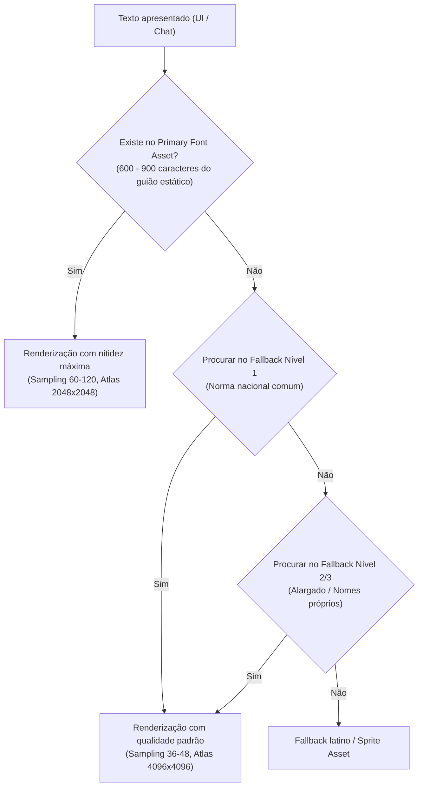

## **1. Visão geral do projeto e desafios da localização em tempo real**

O projeto **GilongWorld** impõe um requisito técnico de elevada complexidade e escala global: suportar integralmente a localização (*localization*) para 15 idiomas de destino. Esta lista inclui inglês, vietnamita, francês, italiano, alemão, espanhol (Espanha), polaco, português (Brasil), português (Portugal), coreano, russo, japonês, turco, chinês simplificado e chinês tradicional. No desenvolvimento moderno de videojogos com o motor Unity, gerir e apresentar texto num espaço gráfico em tempo real não se resume à mera substituição de cadeias de texto. Exige uma arquitetura tipográfica integralmente otimizada para assegurar coerência estética, nitidez visual a qualquer distância da câmara e, sobretudo, eficiência na utilização da memória do sistema.

A ferramenta de referência mais poderosa no ecossistema Unity para a renderização de texto é o **TextMeshPro (TMP)**. Ao contrário dos sistemas tradicionais de texto de interface de utilizador (UI Text), que renderizam cada caráter como uma imagem bitmap desfocada ao ampliar, o TextMeshPro exige a conversão de ficheiros de tipos de letra padrão em recursos especializados denominados **Font Asset**[^1]. Estes Font Assets contêm uma ou mais texturas (*Atlas Texture*) baseadas na tecnologia **Signed Distance Field (SDF)**. A tecnologia SDF permite ampliar o texto indefinidamente sem pixelização (*pixelation*), ao mesmo tempo que fornece a base matemática para o shader calcular na GPU efeitos gráficos complexos, como sombreado, contorno, espessura e brilho em tempo real[^1].

Contudo, o poder da tecnologia SDF traz consigo uma limitação física inevitável: **os limites de memória**. Acomodar a totalidade dos caracteres dos 15 idiomas de destino numa única textura atlas é fisicamente impossível[^1]. Em especial, os idiomas do grupo CJK (*chinês, japonês e coreano*) possuem sistemas de escrita ideográfica vastíssimos, com dezenas de milhares de caracteres. Se se tentar forçar todo este conjunto para dentro de uma única Atlas Texture, a dimensão da textura excederá o limite máximo suportado pelo hardware — sobretudo em dispositivos móveis (habitualmente $4096 \times 4096$ ou $8192 \times 8192$ píxeis) — provocando esgotamento de memória VRAM ou o fecho inesperado da aplicação (*crash*)[^5]. Este relatório apresenta de forma minuciosa todo o procedimento: desde a seleção e transferência dos tipos de letra de origem, passando pela análise das características dos sistemas de escrita, até à configuração dos parâmetros internos do TextMeshPro, à gestão da cadeia de recurso (*Fallback Chain*) e à resolução definitiva do problema da unificação Han (*Han Unification*) através do pacote Unity Localization.

---

## **2. Fundamentos tipográficos e estratégia de transferência de tipos de letra de origem**

O primeiro e mais determinante passo na criação de um sistema de texto multilingue é escolher com rigor o ficheiro de tipo de letra de origem (*Source Font File*). A consistência visual nos 15 idiomas exige uma família tipográfica de código aberto com cobertura abrangente dos blocos Unicode básicos e alargados, bem como um desenho uniforme na linha de base (*baseline*) e na espessura do traço (*weight*).

Na indústria de software, a família tipográfica **Google Noto** (abreviatura de *"No Tofu"* — uma missão para erradicar os quadrados vazios apresentados quando falta um caráter no dispositivo, popularmente apelidados de "tofu") é reconhecida como a solução de referência[^7]. Concebida pela Google em colaboração com grandes fundições tipográficas, a família Noto assegura que caracteres dos alfabetos latino, cirílico e CJK possam ser apresentados lado a lado na mesma linha sem desfasamentos de proporção ou estilo artístico[^8]. Esta fluidez quando o texto mistura múltiplos idiomas é essencial para a imersão do jogador em GilongWorld.

### **Guia de extração e importação de dados tipográficos para o Unity**

Para dar início à integração, os ficheiros de tipos de letra originais devem ser transferidos diretamente a partir da biblioteca **Google Fonts**. O processo de transferência e importação para o Unity tem de obedecer a uma metodologia rigorosa para evitar o aumento desnecessário da dimensão do projeto:

1. **Grupo de 11 idiomas baseados nos alfabetos latino e cirílico** (*inglês, vietnamita, francês, italiano, alemão, espanhol, polaco, português do Brasil, português de Portugal, russo e turco*): o sistema requer apenas a família base **Noto Sans**[^8]. Esta família reúne mais de 3.700 glifos (*glyphs*) que cobrem blocos Unicode como Latin Extended, Cyrillic e sinais diacríticos combinados, satisfazendo plenamente as exigências dos idiomas indicados[^8]. Ao transferir no Google Fonts, é disponibilizado um ficheiro comprimido com várias variantes de espessura (como *Thin, Regular, Medium, Bold, Black*) em formato TrueType (`.ttf`).
2. **Grupo de 4 idiomas CJK**: o processo de transferência torna-se mais exigente. Os programadores têm de descarregar separadamente as variantes **Noto Sans JP** (japonês), **Noto Sans KR** (coreano), **Noto Sans SC** (chinês simplificado) e **Noto Sans TC** (chinês tradicional)[^7]. Estes ficheiros CJK são muito volumosos, oscilando entre 15 MB e 20 MB por cada espessura devido à enorme quantidade de dados gráficos. O formato habitual para este grupo é o OpenType (`.otf`), que suporta estruturas de tabelas de caracteres mais complexas do que o formato TrueType[^5].

Depois de extrair os ficheiros transferidos do Google Fonts, o passo seguinte é importá-los (*import*) para o projeto Unity. Uma boa prática (*best practice*) na gestão de recursos consiste em criar uma estrutura de pastas dedicada, por exemplo `Assets/GilongWorld_Resources/Fonts/Source_Files/`. Os ficheiros `.ttf` e `.otf` (convém selecionar apenas uma espessura padrão, como *Regular* ou *Medium*, para otimizar a memória, salvo se o desenho da UI exigir variantes a negrito específicas) são arrastados e largados diretamente do sistema operativo para essa pasta através da janela Project do Unity Editor[^10].

> [!NOTE]
> O TextMeshPro não utiliza diretamente estes ficheiros `.ttf` ou `.otf` para renderizar texto em tempo de execução; servem exclusivamente como matéria-prima para a ferramenta Font Asset Creator extrair os dados geométricos e compilá-los em texturas SDF[^1]. Manter os ficheiros de origem numa pasta separada facilita a sua remoção das compilações finais (quando não se recorre ao modo Dynamic SDF), contribuindo para reduzir a dimensão do pacote de instalação do jogo.

---

## **3. Análise das características dos sistemas de escrita e requisitos de blocos Unicode**

A diversidade dos 15 idiomas no projeto GilongWorld exige uma análise aprofundada sobre o modo como os caracteres são codificados na norma internacional Unicode. O TextMeshPro utiliza o sistema hexadecimal (base 16) para especificar os intervalos de código (*Unicode Ranges*) a extrair do ficheiro de tipo de letra de origem[^13]. Declarar com exatidão estes intervalos garante uma cobertura linguística total e impede o carregamento de caracteres supérfluos que aumentariam inutilmente a textura Atlas.

Com base na morfologia dos sistemas de escrita, os 15 idiomas repartem-se por três grupos estratégicos principais para efeitos de gestão de recursos.

### **Subgrupo 1: Sistema latino alargado e diacríticos**

Este grupo inclui inglês, francês, italiano, alemão, espanhol, polaco, português (Brasil), português (Portugal), turco e vietnamita. Embora partilhem a base do alfabeto latino (`U+0020` a `U+007E`), verificam-se diferenças acentuadas nos blocos alargados[^1]:

- **Europa Ocidental e do Sul** (*francês, espanhol, italiano, português e alemão*): utilizam sobretudo o bloco *Latin-1 Supplement* (`U+00A0` a `U+00FF`), que contém vogais acentuadas e caracteres essenciais como `á`, `é`, `í`, `ó`, `ú`, `ñ`, `ü` e `ç`.
- **Europa Central e Turquia** (*polaco e turco*): dependem do bloco *Latin Extended-A* (`U+0100` a `U+017F`) para apresentar caracteres específicos como `ą`, `ł`, `ş` e `ğ`[^10].
- **Vietnamita**: o caso mais exigente deste grupo. Com um sistema tonal complexo combinado com vogais com acento circunflexo (`â`, `ê`, `ô`) ou com gancho (`ơ`, `ư`), o vietnamita requer o bloco *Latin Extended Additional* (`U+1E00` a `U+1E9F`)[^14]. A sobreposição de diacríticos origina estruturas de caracteres muito altas (por exemplo, a letra `Ể` ultrapassa consideravelmente a altura habitual das maiúsculas latinas), exigindo um ajuste rigoroso da altura de linha (*line height*) e da margem interna (*padding*) no TextMeshPro para evitar cortes (*clipping*) no topo dos caracteres.

### **Subgrupo 2: Sistema cirílico**

O único idioma do projeto pertencente a este sistema é o **russo**. O alfabeto cirílico é totalmente independente do latino em termos de codificação, situando-se no bloco `U+0400` a `U+04FF`[^10]. Apesar dessa independência de codificação, o cirílico partilha características morfológicas com o sistema latino na largura dos caracteres e na linha de base, o que permite integrá-lo perfeitamente no mesmo Font Asset do grupo latino sem provocar desequilíbrio visual.

### **Subgrupo 3: Sistema CJK e o fenómeno histórico da unificação Han**

O terceiro grupo engloba **coreano, japonês, chinês simplificado e chinês tradicional**. Trata-se da área mais complexa, onde os limites tecnológicos do TextMeshPro são constantemente postos à prova. A causa principal não reside apenas no número colossal de caracteres, mas também numa convenção técnica controversa do Consórcio Unicode designada por **Han Unification** (*Unificação Han*)[^7].

Nos primeiros anos de desenvolvimento da norma Unicode, para acomodar os sistemas de escrita da Ásia Oriental num espaço de 16 bits, os engenheiros de software optaram por agrupar ideogramas com origem histórica comum da China, do Japão e da Coreia num único ponto de código (*code point*)[^7]. Este bloco denomina-se *CJK Unified Ideographs* e estende-se de `U+4E00` a `U+9FA5`[^12].

Esta decisão acarreta uma consequência grave na renderização: **embora partilhem exatamente o mesmo código Unicode, o desenho real do caráter (glifo) varia de país para país** devido à evolução cultural, à caligrafia e às normas educativas divergentes:

- Um exemplo típico é o caráter para "osso", com código Unicode `U+9AA8` (骨). A estrutura dos traços interiores no retângulo superior deste caráter no tipo de letra de chinês simplificado (SC) dispõe-se horizontalmente da esquerda para a direita, ao passo que em chinês tradicional (TC) e em japonês (JP) esses traços assumem uma estrutura distinta[^7].
- Da mesma forma, caracteres comuns como "neve" (雪) ou "direito" (直) apresentam diferenças subtis, mas imediatamente percetíveis para um leitor nativo.

O motor de renderização de texto não consegue deduzir o contexto cultural por si só; recebe apenas um código Unicode e procura a respetiva imagem no tipo de letra ativo. Consequentemente, partilhar um único tipo de letra CJK por todos os idiomas da Ásia Oriental levará a que jogadores japoneses leiam texto japonês desenhado ao estilo chinês, ou vice-versa[^7]. Para o utilizador nativo, isto transmite a sensação de texto com erro tipográfico, falta de rigor profissional ou aspeto "híbrido", quebrando por completo a imersão no mundo do jogo[^7]. A única solução eficaz para ultrapassar esta limitação passa por separar inteiramente os Font Assets de cada idioma CJK e gerir dinamicamente a cadeia de recurso.

---

## **4. Mecanismo técnico do TextMeshPro e Signed Distance Field (SDF)**

Para executar a configuração com rigor, é indispensável compreender o funcionamento do **Signed Distance Field (SDF)** no TextMeshPro. Ao contrário dos tipos de letra bitmap tradicionais, que guardam a cor de cada píxel, o SDF armazena a distância matemática desde um ponto até à aresta mais próxima do caráter[^1]:
- Se um ponto se encontrar **dentro** do caráter, a distância assume valor **positivo**.
- Se se encontrar **fora**, assume valor **negativo**.
- Se estiver **exatamente sobre a aresta**, a distância é **zero** ($0$).

Estes dados de distância são codificados em escala de cinzentos (*grayscale*) e guardados numa Atlas Texture. Em tempo de execução, o shader de GPU do TextMeshPro efetua uma interpolação bilinear (*bilinear interpolation*) dessas amostras de distância. Para cada fragmento no ecrã, o shader avalia o valor interpolado: se for $> 0$, o fragmento recebe cor; se for $< 0$, torna-se transparente. Por assentar numa interpolação matemática contínua em vez de depender de píxeis discretos, o texto SDF apresenta contornos extremamente nítidos mesmo quando a câmara se aproxima ao máximo do objeto[^1].

Este mecanismo determina dois parâmetros fundamentais na criação do Font Asset:
1. **Sampling Point Size:** define a dimensão física do caráter ao ser rasterizado na Atlas Texture. Quanto maior o valor, maior o detalhe dos dados de distância.
2. **Padding (margem interna):** a peça-chave do poder do SDF. O espaço envolvente de cada glifo permite que o gradiente de distância decaia gradualmente para valores negativos mais profundos. Quanto maior for o padding, mais margem terá o algoritmo SDF para gerar contornos espessos (*outline*), sombras (*shadow*) ou brilhos (*glow*) sem cortes abruptos[^13].

---

## **5. Guia detalhado de configuração através do Font Asset Creator**

A geração dos ficheiros de textura tipográfica realiza-se através da ferramenta integrada do Unity: **Font Asset Creator**, acessível através da barra de menus:

```text
Window > TextMeshPro > Font Asset Creator
```

De acordo com a análise da Secção 3, a estrutura ideal para os 15 idiomas no projeto GilongWorld segue um modelo segmentado: **criar um Font Asset comum para os 11 idiomas latinos/cirílicos e 4 Font Assets independentes para cada idioma CJK**.

### **5.1. Configuração estática (Static) para os sistemas latino, cirílico e vietnamita**

Agrupar os 11 idiomas (*inglês, francês, italiano, alemão, espanhol, polaco, português BR, português PT, turco, russo e vietnamita*) num único **Primary Static Font Asset** é o método mais eficaz para reduzir o número de chamadas de desenho (*draw calls*) na GPU, fator determinante para manter a taxa de fotogramas (*frame rate*) estável[^14].

A configuração no Font Asset Creator efetua-se com os seguintes parâmetros rigorosos[^12]:

| Propriedade de configuração | Recomendação técnica | Fundamentação da análise |
| :--- | :--- | :--- |
| **Source Font File** | `NotoSans-Regular.ttf` | Arrastar e largar o ficheiro de origem da pasta `Assets` para este campo. Fornece os dados geométricos[^1]. |
| **Sampling Point Size** | `Custom Size: 60 - 90` | O modo Auto Sizing apenas tenta encaixar os glifos no espaço disponível. Fixar Custom Size entre 60 e 90 assegura qualidade SDF uniforme em toda a textura[^1]. |
| **Padding** | `6 - 9` (Proporção ~10%) | A regra padrão no TextMeshPro estipula que o Padding corresponda a cerca de 10% do Sampling Point Size[^4]. Com Sampling 60, Padding 6 é o ideal (podendo subir para 10 se a UI exigir contornos muito grossos). |
| **Packing Method** | `Optimum` | O algoritmo Optimum consome bastante mais tempo de processamento do que o Fast, mas realiza iterações para compactar ao máximo os glifos e minimizar o desperdício de píxeis[^12]. |
| **Atlas Resolution** | `2048 x 2048` | O total de caracteres destes 11 idiomas situa-se entre 1.500 e 2.000 glifos. A dimensão $2048 \times 2048$ oferece espaço suficiente para manter Sampling Point Size 60 sem omitir nenhum caráter[^7]. |
| **Character Set** | `Unicode Range (Hex)` | Em vez de escolher conjuntos predefinidos, este modo concede controlo absoluto sobre os caracteres carregados[^2]. |

O campo **Custom Character List** é preenchido com a cadeia de intervalos hexadecimais que cobre integralmente os 11 idiomas:

```text
0020-007E, 00A0-00FF, 0100-017F, 0180-024F, 1E00-1E9F, 0300-036F, 0400-04FF, 0500-052F, 2000-206F
```

Concluído o preenchimento dos parâmetros:
1. Clicar em **Generate Font Atlas**. A ferramenta calcula as distâncias e gera a textura (pode demorar alguns minutos consoante o processador).
2. Quando concluir e a pré-visualização da textura surgir, clicar em **Save**.
3. Guardar o ficheiro com o nome `Global_Latin_Cyrillic_SDF.asset` na pasta do projeto[^1].

### **5.2. Configuração estática (Static) para CJK e arquitetura hierárquica de Fallback**

Tratar os 4 idiomas CJK exige uma abordagem inteiramente distinta devido ao volume massivo de dados. Repetir o processo quatro vezes separadamente para `NotoSansCJKjp`, `NotoSansCJKkr`, `NotoSansCJKsc` e `NotoSansCJKtc` é obrigatório. Porém, tentar incluir toda a tabela CJK num único atlas estático através de intervalos Unicode falhará por exceder os limites físicos da textura[^5].

A solução técnica recomendada consiste em aplicar o **Modelo Hierárquico de Mapeamento de Caracteres (Hierarchical Character Mapping)** em conjunto com a opção **Characters from File**[^7]:

#### **1. Criar o Primary SDF Font Asset para caracteres conhecidos (Known Characters)**
- Extrair todas as cadeias de texto estáticas das **String Tables** do projeto (menus, missões, itens, diálogos, habilidades).
- Este conjunto de caracteres únicos (*unique characters*) situa-se normalmente **abaixo de 1.000 caracteres** (em GilongWorld, ocupa apenas **855 caracteres** em chinês simplificado, **870** em chinês tradicional, **694** em japonês e **588** em coreano).
- **Maximizar a qualidade (Maximize Sampling Size):** como existem menos de 1.000 caracteres, pode definir-se um **Sampling Point Size elevado** (de `60` a `90` ou `120`) num Atlas de `2048 x 2048`. Isto assegura nitidez máxima em todo o texto oficial de UI a qualquer distância da câmara.

#### **2. Construir camadas de Fallback a partir de conjuntos padrão nacionais (Standard Fallbacks para UGC/Chat)**
Para suportar integralmente o texto introduzido pelos jogadores (nomes de personagem, descrições de clã, chat da comunidade) sem nunca surgirem quadrados Tofu, o sistema acrescenta Font Assets de Fallback derivados de **conjuntos de caracteres padrão nacionais**:

| Idioma | Conjunto padrão nacional de caracteres | Quantidade de caracteres | Entidade emissora e referência aberta |
| :--- | :--- | :---: | :--- |
| **Chinês simplificado (zh-Hans)** | **TGSCC (通用规范汉字表)**<br/>- Nível 1 (Comum): 3.500 caracteres<br/>- Nível 2 (Alargado): 3.000 caracteres<br/>- Nível 3 (Nomes próprios/Locais): 1.605 caracteres | **8.105** | Ministério da Educação da RPC<br/>*Código aberto:* [GitHub chinese-character-table](https://github.com/maple-leaf/chinese-character-table) |
| **Chinês tradicional (zh-Hant)** | **Tabela de formas padrão de caracteres nacionais comuns** (*常用國字標準字體表*) | **4.808** | Ministério da Educação de Taiwan (MOE Taiwan)<br/>*Código aberto:* [Taiwan Open Data](https://data.gov.tw/dataset/5961) / [GitHub cjktables](https://github.com/ButTaiwan/cjktables) |
| **Japonês (ja)** | - **Jōyō Kanji** (常用漢字 - Uso corrente): 2.136 caracteres<br/>- **Jinmeiyō Kanji** (人名用漢字 - Nomes próprios): 863 caracteres | **2.999** | Agência para os Assuntos Culturais do Japão (文化庁)<br/>*Código aberto:* [KanjiAPI](https://kanjiapi.dev/) / [GitHub kanji-data](https://github.com/davidluzgouveia/kanji-data) |
| **Coreano (ko)** | **Norma KS X 1001** (2.350 sílabas Hangul mais comuns, cobrindo 99,9% da comunicação) | **2.350** | Agência Coreana de Tecnologia e Normas (KATS)<br/>*Código aberto:* [GitHub ksx1001](https://github.com/korean-character-sets/ksx1001) / Extraído via `euc-kr` |



#### **3. Regra invariável: manter a proporção Sampling Point Size / Padding (Ratio Consistency)**

Um princípio gráfico essencial no shader do TextMeshPro é que **a espessura dos efeitos Outline (contorno), Underlay / Shadow (sombra) e Glow (brilho) é calculada a partir da proporção entre Sampling Point Size e Padding**[^13].

##### **Por que razão os Fallbacks não precisam do mesmo Point Size do Primary?**
- **Primary Font (~855 caracteres do guião de UI):** visíveis 100% do tempo de jogo $\rightarrow$ exigem **qualidade máxima** (`Sampling Size = 120`, `Padding = 10`, Atlas $2048 \times 2048$).
- **Fallback Fonts (2.700 – 8.000 caracteres raros para chat/nomes):** surgem com pouca frequência $\rightarrow$ **reduz-se a amostragem** (`Sampling Size = 60` ou `48`) para comprimir milhares de caracteres no mesmo tamanho de atlas sem sobrecarregar a VRAM.

##### **Por que razão é obrigatório manter a mesma proporção ($\text{Ratio} = \frac{\text{Sampling}}{\text{Padding}}$)?**
Se numa mesma frase um caráter do Primary estiver junto de um caráter de Fallback:
- **Se a proporção divergir:** o caráter do Primary (Size 120, Pad 10 $\rightarrow$ Ratio 12) apresenta um contorno fino e equilibrado, mas o caráter do Fallback (Size 60, caso tenha ficado por lapso com Pad 10 $\rightarrow$ Ratio 6) apresentará um **contorno com o dobro da espessura, distorcido e a engolir os traços da letra**.
- **Se se mantiver a proporção ($\text{Ratio} = 12$):** quer o caráter venha do Primary quer desça para o Fallback, **a espessura do contorno e da sombra mantém-se 100% uniforme**.

| Camada do Font Asset | Função | Sampling Point Size *(Custom)* | Padding | Resolução do Atlas | Proporção (Ratio) |
| :--- | :--- | :---: | :---: | :---: | :---: |
| **Primary Font** | Guião principal de UI | **120** *(ou 96)* | **10 px** *(ou 8 px)* | $2048 \times 2048$ | **12** *(Nitidez máxima)* |
| **Fallback Nível 1** | ~2.725 caracteres comuns | **60** | **5 px** | $2048 \times 2048$ | **12** *(Poupança de VRAM)* |
| **Fallback Nível 2** | ~2.992 caracteres alargados | **60** | **5 px** | $2048 \times 2048$ | **12** *(Poupança de VRAM)* |
| **Fallback Nível 3** | ~1.605 caracteres raros/nomes | **48** | **4 px** | $2048 \times 2048$ | **12** *(Poupança de VRAM)* |

> [!TIP]
> **Dica prática:** no *Font Asset Creator*, altere `Sampling Point Size` de *Auto Sizing* para **Custom Size** para fixar o tamanho de amostragem e o Padding de acordo com as proporções da tabela anterior.

---

### **5.3. Organização de pastas e automatização prática no Unity**

Para facilitar a escalabilidade e a manutenção a longo prazo, o projeto GilongWorld estabelece uma estrutura de pastas dedicada para todos os dados de caracteres de origem:

```text
Assets/_GilongWorld/_Project/Art/Fonts/_chars/
├── 01_Latin_Cyrillic/        # [Primary Font partilhado] 11 idiomas latinos/cirílicos
│   ├── vi_chars.txt          # Vietnamita
│   ├── en_chars.txt          # Inglês
│   ├── ru_chars.txt          # Russo
│   └── ...                   # Francês, alemão, italiano, espanhol, polaco, português, turco
│
├── 02_CJK/                   # [Primary Fonts CJK] Caracteres estáticos do guião do jogo
│   ├── ja_chars.txt          # Japonês (694 caracteres reais)
│   ├── ko_chars.txt          # Coreano (588 caracteres reais)
│   ├── zh_Hans_chars.txt     # Chinês simplificado (855 caracteres reais)
│   ├── zh_Hant_chars.txt     # Chinês tradicional (870 caracteres reais)
│   │
│   ├── Standard_Fallbacks/   # [Base padrão] 7 conjuntos de dados padrão nacionais
│   │   ├── zh_Hans_TGSCC_Level1_3500.txt
│   │   ├── zh_Hans_TGSCC_Level2_3000.txt
│   │   ├── zh_Hans_TGSCC_Level3_1605.txt
│   │   ├── zh_Hant_Common_4808.txt
│   │   ├── ja_Joyo_Kanji_2136.txt
│   │   ├── ja_Jinmeiyo_Kanji_863.txt
│   │   └── ko_KS_X_1001_2350.txt
│   │
│   └── Subtracted_Fallbacks/ # [Fallbacks otimizados] Sem caracteres repetidos do Primary
│       ├── zh_Hans_Fallback_Level1.txt    (TGSCC Nível 1 menos Primary)
│       ├── zh_Hans_Fallback_Level2.txt    (TGSCC Nível 2 menos Primary)
│       ├── zh_Hans_Fallback_Level3.txt    (TGSCC Nível 3 menos Primary)
│       ├── zh_Hant_Fallback_Common.txt    (Norma TW 4808 menos Primary)
│       ├── ja_Fallback_Joyo.txt           (Joyo Kanji menos Primary)
│       ├── ja_Fallback_Jinmeiyo.txt       (Jinmeiyo Kanji menos Primary)
│       └── ko_Fallback_KS_X_1001.txt      (KS X 1001 menos Primary)
```

#### **Ferramenta automática de extração e subtração de Fallback (`GWCharacterExtractor.cs`)**
Para libertar os programadores da exportação manual de CSV e da filtragem de caracteres duplicados, a ferramenta dedicada do Unity Editor [`GWCharacterExtractor.cs`](file:///d:/Unity-Projects/GLW/Assets/_GilongWorld/_Project/Editor/Localization/GWCharacterExtractor.cs) integra um fluxo 2 em 1:
- **Menu de acesso:** `GilongWorld → Localization → Extract CJK Characters From String Tables`
- **Mecanismo 1 (Extração do Primary):** analisa todas as `StringTableCollections` no Unity Localization, recolhe todas as cadeias de texto em uso numa estrutura `HashSet<char>` (assegurando 100% de unicidade), ordena-as por código Unicode crescente e grava os 4 ficheiros Primary em `02_CJK/`.
- **Mecanismo 2 (Subtração automática de Fallback):** o script lê automaticamente os 7 conjuntos de `Standard_Fallbacks/`, compara-os e **remove todos os caracteres já existentes no Primary Asset**, exportando o resultado para `Subtracted_Fallbacks/`. Isto elimina na totalidade o desperdício de VRAM causado por caracteres duplicados entre o Primary Atlas e o Fallback Atlas.

#### **Interface `GWSDFGeneratorWindow` e contorno aos bloqueios da API do Unity 6**
Para assegurar o cumprimento rigoroso da regra "Proporção Sampling / Padding = 12", o projeto disponibiliza uma janela de Editor dedicada que permite introduzir parâmetros e emite avisos automáticos caso a proporção divirja.
Em particular, no Unity 6, a propriedade `clearDynamicDataOnBuild` do Font Asset foi restringida ao nível de acesso `internal`, impedindo a limpeza de dados residuais antes da compilação através de código normal. Esta ferramenta resolve definitivamente o problema recorrendo a reflexão (Reflection) via `SerializedObject`:

```csharp
var serializedObject = new SerializedObject(fontAsset);
serializedObject.FindProperty("m_ClearDynamicDataOnBuild").boolValue = true;
serializedObject.ApplyModifiedProperties();
```

Graças a isto, o atlas corrompido de 137 MB do sistema antigo ficou integralmente limpo, reduzindo a dimensão da build ao mínimo indispensável.

---

## **6. Arquitetura de gestão da cadeia de recurso (Fallback Chain) e solução da unificação Han**

A base para o funcionamento fluido de um jogo multilingue reside na capacidade de orientar a cadeia de recurso (*Fallback Chain*). Quando um componente UI TextMeshPro recebe uma cadeia de texto que contém um caráter ausente no Primary Font Asset, o sistema executa um algoritmo de pesquisa recursiva nas listas de recurso para encontrar um glifo (*glyph*) substituto.

O algoritmo de pesquisa respeita uma hierarquia rigorosa:
1. `TextMeshPro Primary Font Asset`
2. `Lista local de Fallback Font Assets do Primary Font`
3. `Sprite Asset local`
4. `General Fallback Font Assets definidos globalmente em TMP_Settings`
5. `Default Sprite Asset`
6. `Default Font Asset`[^20]

> [!WARNING]
> O sistema pesquisa sequencialmente de cima para baixo e **pára imediatamente ao encontrar o primeiro ponto de código Unicode correspondente**[^7].

Como analisado na Secção 3, o fenómeno da unificação Han faz com que os idiomas SC, TC e JP partilhem o mesmo código Unicode apesar das formas distintas[^7]. Se o programador colocar todos os ficheiros CJK na lista General Fallback Font Assets de `TMP_Settings`, a ordem da lista determinará o aspeto do texto. Por exemplo, se a lista estiver ordenada como `Font_CJK_JP_SDF` $\rightarrow$ `Font_CJK_SC_SDF` $\rightarrow$ `Font_CJK_TC_SDF`, quando surgir um texto em chinês simplificado, o sistema percorrerá a lista de cima para baixo, encontrará primeiro o ficheiro japonês com aquele código Unicode e aplicará imediatamente o estilo Kanji japonês no ecrã, ignorando por completo o ficheiro chinês colocado mais abaixo[^7].

### **Arquitetura de isolamento local (Local Fallback Architecture)**

Para erradicar este problema de raiz, a estrutura de Fallback tem de ser isolada:

> [!IMPORTANT]
> **Nunca inclua tipos de letra CJK na lista de recurso global (Global Fallback List) em `TMP_Settings`**[^1]. Em alternativa, a arquitetura é ligada através da estrutura de Fallback local (*Local Fallback*) de cada Asset e gerida dinamicamente em tempo de execução.

Uma regra básica da tipografia é que os tipos de letra CJK apresentam frequentemente caracteres latinos e algarismos árabes com desenho pouco harmonioso ou proporções desajustadas face a tipos de letra puramente latinos[^9]. Por conseguinte, os caracteres latinos devem ser sempre renderizados prioritariamente através do ficheiro `Global_Latin_Cyrillic_SDF`. A estrutura local constrói-se assim:
1. Abrir o ficheiro `Font_CJK_SC_SDF.asset` e, na secção **Fallback Font Assets**, adicionar as camadas de Fallback 1–3 de chinês simplificado e incluir o ficheiro `Global_Latin_Cyrillic_SDF`[^1].
2. Repetir o mesmo procedimento para os ficheiros TC, JP e KR.

Isto garante que, quando o jogo apresenta texto em chinês, caso existam números ou nomes próprios em inglês intercalados, estes atravessem sem bloqueios o atlas estático chinês (por terem sido excluídos na extração *Characters from File*) e sejam capturados pelo ficheiro de Fallback latino de elevada qualidade[^7].

---

## **7. Integração do pacote Unity Localization para troca dinâmica (Runtime Swapping)**

Para assegurar a apresentação culturalmente exata das formas Han e otimizar a memória VRAM, os componentes UI TextMeshPro não podem manter uma configuração estática fixa. Quando o utilizador muda de idioma (*Locale*), o tipo de letra base (*Primary Font Asset*) tem de ser trocado (*swap*) automaticamente em tempo de execução (*runtime*)[^23].

O pacote **Unity Localization** (`com.unity.localization`) fornece ferramentas poderosas para executar este fluxo lógico sem codificação rígida (*hardcoding*) de cada transição[^25], assentando na monitorização do evento global de mudança de idioma `LocalizationSettings.SelectedLocaleChanged`[^24].

Existem duas abordagens de implementação:

### **Abordagem 1: Gestor centralizado de tipos de letra (Centralized Font Manager)**

Em vez de atribuir manualmente eventos Localized Asset a milhares de componentes UI Text (o que gera enorme pressão na memória devido a milhares de objetos `MonoBehaviour` supérfluos e ao Garbage Collection), o projeto GilongWorld adota uma estratégia de **gestão centralizada com Addressables**.

O script `GWFontManager.cs` (com a flag `DontDestroyOnLoad`) escuta o evento `LocalizationSettings.SelectedLocaleChanged`. Quando este evento é ativado, o gestor executa duas tarefas essenciais:
1. **Carregamento assíncrono (Async Load):** recorre a `LocalizationSettings.AssetDatabase.GetLocalizedAssetAsync<TMP_FontAsset>("Fonts_Table", "PrimaryFont")` para carregar o Font Asset adequado ao idioma atual a partir dos Addressables.
2. **Varrimento global (Global Sweep):** utiliza `FindObjectsByType<TMP_Text>` para percorrer toda a cena e aplicar o novo tipo de letra a todos os textos da UI. Este comando consome alguns milissegundos de CPU, mas corre apenas uma única vez na troca de idioma ou ao carregar a cena, libertando a memória RAM de milhares de componentes individuais. Logo após a atribuição, o recurso do idioma anterior é libertado com `Addressables.Release()`.

Esta abordagem elimina por completo o fenómeno de "contaminação cruzada" (*cross-pollination*) entre idiomas CJK, visto que o sistema mantém em memória apenas o atlas do idioma selecionado[^7].

### **Abordagem 2: Asset Tables do Unity Localization**

A abordagem mais nativa consiste em utilizar as **Localized Asset Tables**[^23]. À semelhança das Localized String Tables usadas para substituir cadeias de texto, as Asset Tables permitem atribuir diferentes ficheiros Asset aos vários idiomas. Os componentes Localized Text na interface de utilizador podem ser configurados para atualizar automaticamente não só a string de texto, mas também a propriedade `FontAsset` do objeto TextMeshPro[^23].

Esta abordagem exige configuração no Inspector, mas oferece elevada estabilidade e poupa a equipa à manutenção de código personalizado de mapeamento[^28].

---

## **8. Gestão de conteúdo dinâmico (UGC), otimização de memória e integração com Addressables**

A arquitetura estática (*Static Architecture*) resolve por completo a interface oficial do sistema. Contudo, o conteúdo gerado pelos utilizadores (**User-Generated Content - UGC**), como nomes de personagem, descrições de clãs ou chat da comunidade, coloca um desafio maior. É impossível prever que caracteres os utilizadores irão introduzir entre os 15 idiomas, sendo inviável carregar centenas de milhares de caracteres para a RAM.

### **A solução de arquitetura híbrida (Hybrid SDF System)**

O sistema **Dynamic SDF** padrão do TextMeshPro inicia um Font Asset com um atlas vazio ($0 \times 0$ píxeis). Ao detetar um novo caráter, recorre à CPU para o desenhar e inserir na textura em tempo de execução[^6]. Porém, abusar do modo puramente dinâmico provoca quebras acentuadas de fluidez (*frame spikes*) logo no primeiro ecrã. Por isso, o projeto GilongWorld aplica uma **Arquitetura Híbrida (Hybrid)**:

1. **Preenchimento estático fluido (Static Population):** através da ferramenta `GWCharacterExtractor.cs`, milhares de caracteres mais frequentes são pré-carregados no atlas com a função `TryAddCharacters` ainda no Editor. Durante o jogo, estes caracteres já se encontram residentes, garantindo uma taxa de fotogramas (FPS) absolutamente estável.
2. **Mecanismo dinâmico seguro (Dynamic Fallback):** o Font Asset mantém-se guardado em modo Dynamic com a flag `isMultiAtlasTexturesEnabled = true`. Se um jogador escrever no chat um caráter raríssimo ausente no primeiro atlas, o TMP cria de imediato uma nova textura auxiliar (`Atlas 0 1`, `Atlas 0 2`...) em vez de mostrar um quadrado Tofu. Trata-se da combinação ideal.

> [!CAUTION]
> O método Dynamic SDF acarreta um custo real de recursos: cada atlas dinâmico de $2048 \times 2048$ gerado consome de imediato cerca de **4 MB** de memória do sistema. Se surgirem vários atlas auxiliares, a pressão sobre dispositivos móveis aumentará rapidamente[^31].

### **A armadilha oculta dos Addressables e o conflito de memória VRAM**

Projetos modernos de grande escala como GilongWorld utilizam quase sempre o sistema **Addressables** para carregar recursos. Um erro grave cometido por muitos programadores é: **presumir que não ativaram os Addressables e deixar os Font Assets tranquilamente na pasta `Resources`.**

Na realidade, o pacote **Unity Localization é construído diretamente sobre os Addressables**. Mesmo sem o utilizar conscientemente, o sistema Addressables está a correr em segundo plano para gerir as String Tables.
Quando um Prefab de UI empacotado via Addressables referencia um Font Asset guardado na pasta `Resources`, o empacotador do Unity comete um erro dispendioso de duplicação de dados (*duplicate assets*):
1. O Unity cria uma cópia integral dessa textura Atlas e coloca-a dentro do AssetBundle dos Addressables[^32].
2. Quando o jogo carrega, o Atlas de `Resources` já foi carregado e o Atlas do AssetBundle volta a ser carregado para a RAM, levando a um **consumo duplicado de VRAM** de forma totalmente desperdiçada[^31]. Esta falha é extremamente comum e pode facilmente provocar o fecho inesperado de aplicações móveis com limites rigorosos de RAM[^33].

**A solução definitiva:**
- Mover integralmente o ficheiro `TMP_Settings` e todos os Font Assets para fora da pasta `Resources`, colocando-os numa pasta padrão do projeto como `Assets/_GilongWorld/_Project/Art/Fonts/SDF/`.
- Selecionar todos estes ficheiros SDF e adicioná-los a um Group Addressables dedicado (por exemplo, `Fonts_Addressables`), configurando o respetivo mapeamento na **Asset Table** (`Fonts_Table`) do Localization.
- **Limpar fontes dinâmicas no Editor:** os ficheiros Dynamic Font Asset mantêm em disco as texturas geradas. É obrigatório limpar os dados dinâmicos antes de cada compilação (processo já automatizado na ferramenta `GWSDFGeneratorWindow` com a técnica `SerializedObject` descrita anteriormente)[^30].
- **Limpeza de memória em runtime:** ao transitar entre cenas grandes, invocar a API `TMP_FontAsset.ClearFontAssetData(true)` ou `FontEngine.DestroyFontEngine()` para libertar completamente as matrizes de texturas dinâmicas que já não estão a ser utilizadas[^35].

---

## **9. Diagnóstico em tempo real e resolução de problemas técnicos (Troubleshooting)**

Durante os testes práticos em diversas plataformas, o sistema de localização tende a revelar sintomas de erro bem característicos. Dominar os princípios de diagnóstico permite à equipa técnica isolar e resolver incidentes com rapidez:

### **O texto aparece como quadrados vazios (Tofu Boxes) na build móvel, mas funciona normalmente no Editor**
- **Causa:** o gestor de recursos do Unity não regista os Fallback Font Assets como dependências (*dependencies*) se estiverem associados apenas de forma solta na `FallbackFontAssetTable` em tempo de execução, em vez de serem referenciados diretamente por um GameObject estático na cena. O processo de compilação do Unity remove (*strip*) automaticamente esses recursos para poupar espaço[^1].
- **Solução:** utilizar a opção `TMP_Settings.fallbackFontAssets` como referência global para que o Unity reconheça a sua existência, ou garantir que todos os eventuais Font Assets estão marcados para pré-carregamento (*pre-load*) através do manifesto dos Addressables[^1].

### **Exceção: `"The variable m_AtlasTextures of TMP_FontAsset has not been assigned"`**
- **Causa:** diretamente ligada ao sistema Dynamic Font Asset quando configurado com Multi Atlas Textures[^34]. Quando o sistema cria automaticamente matrizes de texturas adicionais para novos caracteres, mas o processo é interrompido ou a memória é libertada incorretamente em prefabs instanciados (*instantiated prefabs*), esta variável passa a guardar uma referência nula (*null reference*).
- **Solução:** executar manualmente o comando **Reset** no recurso através do menu de contexto do Font Asset no Inspector antes da build para reconstruir a matriz de texturas inicial limpa[^34].

### **O texto surge desfocado (Blurry) em tamanhos grandes de apresentação**
- **Causa:** a resolução do Atlas SDF ou o `Sampling Point Size` estão demasiado baixos face à dimensão real de renderização no ecrã[^1].
- **Solução:** para texto de títulos grandes (Heading / Banner), o `Sampling Point Size` tem de ser reconfigurado para `150` ou superior. Caso não seja possível criar um atlas maior para suportar este valor, separe os caracteres específicos utilizados no ecrã de título num Static Font Asset independente em vez de partilhar o recurso com o texto normal[^1].

### **Erro de autenticação ao efetuar Pull de tabelas de tradução a partir do Google Sheets (`invalid_grant: Token has been expired or revoked`)**
- **Sintoma:** ao sincronizar (*Pull*) tabelas de strings de localização (como `RPGB_General` ou String Tables) do Google Sheets para o Unity, o sistema apresenta o erro a vermelho: `Pull from Google sheets: Failed - Error: "invalid_grant", Description: "Token has been expired or revoked."`
- **Causa:** **desvio de fuso horário / desacerto do relógio do sistema (Timezone Skew / Clock Drift)**. O mecanismo de autenticação Google OAuth2 exige elevada precisão temporal no timestamp enviado no pedido. Se o computador estiver com o fuso horário errado, com o relógio do sistema desfasado ou se o Unity Editor estiver a reter uma cache temporal desatualizada, o servidor da Google rejeita de imediato o pedido com `invalid_grant`.
- **Solução:**
  - **Reiniciar o Unity Editor:** fechar e voltar a abrir o Unity Editor para que o motor recarregue a hora exata do sistema operativo $\rightarrow$ ao premir novamente **Pull**, o processo será concluído com êxito imediato.

---

## **10. Recomendações arquiteturais finais**

O projeto GilongWorld, à escala de 15 idiomas, exige uma arquitetura gráfica de texto que cumpra as normas mais exigentes de eficiência na alocação de memória VRAM e fidelidade visual multicultural:

1. **Coerência tipográfica (Typography):** aplicar amplamente o ecossistema Google Noto Sans e Noto Sans CJK para manter fluidez na métrica da linha de base (*baseline*) em qualquer formato de texto que misture idiomas.
2. **Segmentação de atlas (Atlas Segmentation):** não comprimir todos os idiomas num único atlas. Criar um único Primary Static Font Asset de $2048 \times 2048$ com os intervalos de código dos 11 idiomas latinos/cirílicos (*inglês, vietnamita, francês, italiano, alemão, espanhol, polaco, português, russo, turco*).
3. **Otimização para a Ásia Oriental e modelo em camadas de Fallback:** separar os 4 idiomas CJK (*chinês simplificado, chinês tradicional, japonês, coreano*) em Font Assets distintos. Combinar o modelo **Primary SDF Font Asset (< 1.000 caracteres estáticos de guião com Sampling Size 60–120 de alta qualidade)** com **3 camadas de Fallback (até 8.105 caracteres da norma nacional TGSCC)** para servir a introdução de texto e o chat dos jogadores. É obrigatório manter uma **proporção uniforme de Sampling Point Size / Padding** (Ratio $\approx 10-12$) entre Primary e Fallback para que os efeitos de shader (Outline, Shadow, Glow) sejam apresentados de forma contínua e sem distorções.
4. **Controlo da cadeia de recurso (Han Unification):** não utilizar em caso algum a lista Global Fallback para o sistema CJK. Em vez disso, aplicar a troca dinâmica em tempo de execução (*Runtime Swapping*) do pacote Unity Localization para atualizar o Primary Font Asset consoante o Locale ativo, eliminando totalmente o risco de apresentar formas regionais incorretas. Os caracteres latinos são sempre configurados como Fallback local (*Local Fallback*) nos ficheiros CJK.
5. **Conteúdo dinâmico e gestão de memória (UGC & Addressables):** utilizar a estrutura Dynamic Font Assets combinada com Multi Atlas Texture para captar caracteres imprevistos do chat dos jogadores. Por último, retirar toda a arquitetura da pasta `Resources`, gerir os recursos através do sistema **Addressables** para erradicar a duplicação de atlas e invocar as API de limpeza de memória para libertar VRAM em sessões de jogo prolongadas.

---

## **Referências**

[^1]: Fix: Unity TextMeshPro Font Asset Missing or Fallback | Bugnet Blog, [https://bugnet.io/blog/fix-unity-textmeshpro-font-asset-missing](https://bugnet.io/blog/fix-unity-textmeshpro-font-asset-missing)
[^2]: Fix: Unity UI TextMeshPro Falling Back to Default Font | Bugnet Blog, [https://bugnet.io/blog/fix-unity-ui-text-mesh-pro-falling-back-default-font](https://bugnet.io/blog/fix-unity-ui-text-mesh-pro-falling-back-default-font)
[^3]: textmeshpro | Skills Marketplace · LobeHub, [https://lobehub.com/de/skills/xeldaralz-helm-textmeshpro](https://lobehub.com/de/skills/xeldaralz-helm-textmeshpro)
[^4]: Chinese Traditional, Simplified and English text looks blurred, [https://discussions.unity.com/t/chinese-traditional-simplified-and-english-text-looks-blurred/723916](https://discussions.unity.com/t/chinese-traditional-simplified-and-english-text-looks-blurred/723916)
[^5]: Creating asset from font with a lot of characters - Page 2 - Unity Engine, [https://discussions.unity.com/t/creating-asset-from-font-with-a-lot-of-characters/708290?page=2](https://discussions.unity.com/t/creating-asset-from-font-with-a-lot-of-characters/708290?page=2)
[^6]: Bug where TextMeshPro dynamic font atlas exhaustion causes, [https://unity-trouble-atlas.7colorsgame.com/en/article/unity-tmp-dynamic-font-atlas-exhaustion/](https://unity-trouble-atlas.7colorsgame.com/en/article/unity-tmp-dynamic-font-atlas-exhaustion/)
[^7]: Unity Font: The 2026 Complete Guide to TextMesh Pro Font Assets, [https://www.transphere.com/unity-font-textmesh-pro-font-assets-fallbacks-and-localization/](https://www.transphere.com/unity-font-textmesh-pro-font-assets-fallbacks-and-localization/)
[^8]: Noto Sans - Google Fonts, [https://fonts.google.com/noto/specimen/Noto+Sans](https://fonts.google.com/noto/specimen/Noto+Sans)
[^9]: Force a font to use fallbacks - Unity Discussions, [https://discussions.unity.com/t/force-a-font-to-use-fallbacks/711511](https://discussions.unity.com/t/force-a-font-to-use-fallbacks/711511)
[^10]: Multiple Language Support Not Working in TextMesh Pro, [https://stackoverflow.com/questions/44922738/multiple-language-support-not-working-in-textmesh-pro](https://stackoverflow.com/questions/44922738/multiple-language-support-not-working-in-textmesh-pro)
[^11]: How to display Japanese in Unity TextMeshPro using Noto Sans CJK, [https://zenn.dev/uliboooo/articles/c3a2f489d8ee9a?locale=en](https://zenn.dev/uliboooo/articles/c3a2f489d8ee9a?locale=en)
[^12]: TextMeshPro Font Asset Creation & Packaging Guide - GitHub, [https://github.com/bbepis/XUnity.AutoTranslator/wiki/TextMeshPro-Font-Asset-Creation-&-Packaging-Guide](https://github.com/bbepis/XUnity.AutoTranslator/wiki/TextMeshPro-Font-Asset-Creation-&-Packaging-Guide)
[^13]: Font Asset Creator | TextMeshPro | 3.2.0-pre.15 - Unity - Manual, [https://docs.unity3d.com/Packages/com.unity.textmeshpro@3.2/manual/FontAssetsCreator.html](https://docs.unity3d.com/Packages/com.unity.textmeshpro@3.2/manual/FontAssetsCreator.html)
[^14]: [UNITY] Optimizing TextMesh Pro Font Atlas for language localization., [https://killertee.wordpress.com/2021/04/23/optimizing-workflow-textmesh-pro-font-atlas-for-language-localization/](https://killertee.wordpress.com/2021/04/23/optimizing-workflow-textmesh-pro-font-atlas-for-language-localization/)
[^15]: [Solved] TextMeshPro - Text(UI): Shows empty squares - Unity Engine, [https://discussions.unity.com/t/solved-textmeshpro-text-ui-shows-empty-squares/787844](https://discussions.unity.com/t/solved-textmeshpro-text-ui-shows-empty-squares/787844)
[^16]: Character set for multiple languages - Unity Discussions, [https://discussions.unity.com/t/character-set-for-multiple-languages/696758](https://discussions.unity.com/t/character-set-for-multiple-languages/696758)
[^17]: FYI: missing chinese/japanese/korean characters in Unity may not, [https://www.reddit.com/r/Unity3D/comments/1l37yfi/fyi_missing_chinesejapanesekorean_characters_in/](https://www.reddit.com/r/Unity3D/comments/1l37yfi/fyi_missing_chinesejapanesekorean_characters_in/)
[^18]: Saving / loading font atlas for TextMeshPro Font assets during runtime, [https://discussions.unity.com/t/saving-loading-font-atlas-for-textmeshpro-font-assets-during-runtime/891878](https://discussions.unity.com/t/saving-loading-font-atlas-for-textmeshpro-font-assets-during-runtime/891878)
[^19]: Having issues displaying Chinese characters using Text Mesh Pro, [https://www.reddit.com/r/Unity3D/comments/178zt0q/having_issues_displaying_chinese_characters_using/](https://www.reddit.com/r/Unity3D/comments/178zt0q/having_issues_displaying_chinese_characters_using/)
[^20]: Fallback font assets | TextMeshPro | 4.0.0-pre.2 - Unity - Manual, [https://docs.unity3d.com/Packages/com.unity.textmeshpro@4.0/manual/FontAssetsFallback.html](https://docs.unity3d.com/Packages/com.unity.textmeshpro@4.0/manual/FontAssetsFallback.html)
[^21]: Fallback font assets | TextMeshPro | 3.2.0-pre.15 - Unity - Manual, [https://docs.unity3d.com/Packages/com.unity.textmeshpro@3.2/manual/FontAssetsFallback.html](https://docs.unity3d.com/Packages/com.unity.textmeshpro@3.2/manual/FontAssetsFallback.html)
[^22]: Issue using the TMPro fallback system to render Chinese or, [https://discussions.unity.com/t/issue-using-the-tmpro-fallback-system-to-render-chinese-or-japanese-w-specific-fonts/837526](https://discussions.unity.com/t/issue-using-the-tmpro-fallback-system-to-render-chinese-or-japanese-w-specific-fonts/837526)
[^23]: Localization - Unity - Manual, [https://docs.unity3d.com/6000.5/Documentation/Manual/best-practice-guides/ui-toolkit-for-advanced-unity-developers/localization.html](https://docs.unity3d.com/6000.5/Documentation/Manual/best-practice-guides/ui-toolkit-for-advanced-unity-developers/localization.html)
[^24]: Issues with Localization and TMP Rendering in Unity, [https://discussions.unity.com/t/issues-with-localization-and-tmp-rendering-in-unity/948421](https://discussions.unity.com/t/issues-with-localization-and-tmp-rendering-in-unity/948421)
[^25]: A Comprehensive Guide to Unity Localization | Phrase, [https://phrase.com/blog/posts/localizing-unity-games-official-localization-package/](https://phrase.com/blog/posts/localizing-unity-games-official-localization-package/)
[^26]: How to Use the Unity Localization Package: A Complete Guide, [https://www.languagesunlimited.com/unity-localization-package/](https://www.languagesunlimited.com/unity-localization-package/)
[^27]: Change Locale in runtime - Unity Discussions, [https://discussions.unity.com/t/change-locale-in-runtime/812317](https://discussions.unity.com/t/change-locale-in-runtime/812317)
[^28]: TMP Font Asset and localization - Unity Discussions, [https://discussions.unity.com/t/tmp-font-asset-and-localization/936355](https://discussions.unity.com/t/tmp-font-asset-and-localization/936355)
[^29]: Localization, font switching and font material presets - Unity Engine, [https://discussions.unity.com/t/localization-font-switching-and-font-material-presets/770975](https://discussions.unity.com/t/localization-font-switching-and-font-material-presets/770975)
[^30]: Dynamic fonts assets | TextMeshPro | 3.2.0-pre.15 - Unity - Manual, [https://docs.unity3d.com/Packages/com.unity.textmeshpro@3.2/manual/FontAssetsDynamicFonts.html](https://docs.unity3d.com/Packages/com.unity.textmeshpro@3.2/manual/FontAssetsDynamicFonts.html)
[^31]: TextMesh Pro - Font atlases memory leak? - Unity Engine, [https://discussions.unity.com/t/textmesh-pro-font-atlases-memory-leak/885808](https://discussions.unity.com/t/textmesh-pro-font-atlases-memory-leak/885808)
[^32]: TextMeshPro & Addressables (Asset Bundles) - Unity Discussions, [https://discussions.unity.com/t/textmeshpro-addressables-asset-bundles/855482](https://discussions.unity.com/t/textmeshpro-addressables-asset-bundles/855482)
[^33]: TextMesh Pro Fallback Font Displays Boxes on Instantiated Objects, [https://discussions.unity.com/t/textmesh-pro-fallback-font-displays-boxes-on-instantiated-objects-unity-6-mobile-build-only-works-in-editor-and-unity-2022/1652497](https://discussions.unity.com/t/textmesh-pro-fallback-font-displays-boxes-on-instantiated-objects-unity-6-mobile-build-only-works-in-editor-and-unity-2022/1652497)
[^34]: Text Mesh Pro FallBack localization - Unity Discussions, [https://discussions.unity.com/t/text-mesh-pro-fallback-localization/797911](https://discussions.unity.com/t/text-mesh-pro-fallback-localization/797911)
[^35]: Issue with removing fonts from fallbackFontAssetTable (memory leak), [https://discussions.unity.com/t/issue-with-removing-fonts-from-fallbackfontassettable-memory-leak/826070](https://discussions.unity.com/t/issue-with-removing-fonts-from-fallbackfontassettable-memory-leak/826070)
