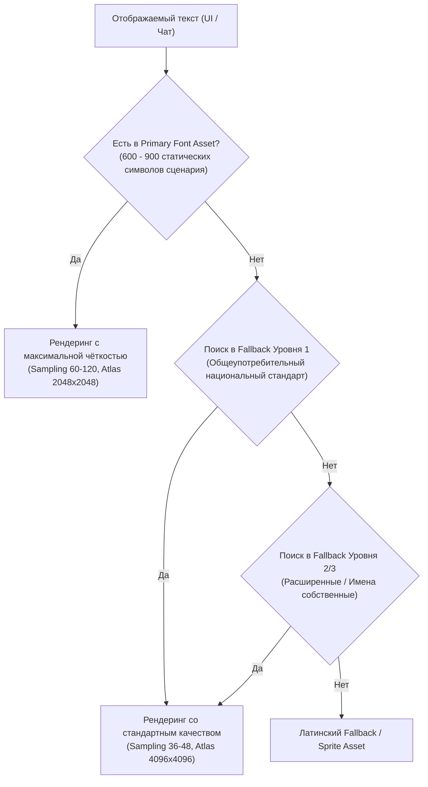

## **1. Обзор проекта и вызовы локализации в реальном времени**

Проект **GilongWorld** ставит чрезвычайно сложную инженерную задачу глобального масштаба: обеспечить полноценную локализацию (*localization*) для 15 целевых языков. В этот список входят English, Vietnamese, French, Italian, German, Spanish (Spain), Polish, Portuguese (Brazil), Portuguese (Portugal), Korean, Russian, Japanese, Turkish, Simplified Chinese и Traditional Chinese. В современной разработке игр на движке Unity управление и отображение текста в графическом пространстве реального времени не сводится к простой замене текстовых строк. Оно требует комплексной оптимизации шрифтовой архитектуры для обеспечения эстетики, чёткости изображения на любом расстоянии камеры и, что самое важное, эффективного использования системной памяти.

Стандартным и самым мощным инструментом для рендеринга текста в экосистеме Unity сегодня является **TextMeshPro (TMP)**. В отличие от традиционных систем UI-текста (UI Text), которые растеризуют каждый символ в виде растрового изображения, размывающегося при увеличении, TextMeshPro требует преобразования стандартных файлов шрифтов в специализированные ресурсы, называемые **Font Asset**[^1]. Эти Font Asset содержат одну или несколько текстур (*Atlas Texture*), использующих технологию **Signed Distance Field (SDF)**. Технология SDF позволяет масштабировать текст до бесконечности без пикселизации (*pixelation*), а также обеспечивает математическую базу, позволяющую шейдеру напрямую на GPU создавать сложные графические эффекты, такие как тени, контуры, регулировка толщины и свечение[^1].

Однако мощь SDF сопряжена с неизбежным физическим ограничением: **лимитом памяти**. Поместить все символы 15 целевых языков в одну текстуру-атлас невозможно[^1]. В частности, языки группы CJK (*Chinese, Japanese, Korean*) обладают колоссальными системами иероглифического письма, насчитывающими десятки тысяч знаков. Попытка уместить всю эту систему в один Atlas Texture приведёт к превышению максимального размера текстуры, который способно обработать аппаратное обеспечение — особенно мобильное (обычно $4096 \times 4096$ или $8192 \times 8192$ пикселей), что вызовет переполнение видеопамяти VRAM или аварийное завершение приложения (*crash*)[^5]. В этом отчёте подробно изложен весь процесс: от выбора и загрузки исходных шрифтов, анализа особенностей письменностей и настройки внутренних параметров TextMeshPro до управления цепочкой резервных шрифтов (*Fallback Chain*) и окончательного решения проблемы унификации ханьцзы (*Han Unification*) с помощью пакета Unity Localization.

---

## **2. Основы типографики и стратегия загрузки исходных шрифтов**

Первый и самый важный шаг при построении многоязычной текстовой системы — выбор правильного исходного файла шрифта (*Source Font File*). Визуальная согласованность во всех 15 языках требует семейства шрифтов с открытым исходным кодом, полной поддержкой диапазонов Unicode от базовых до расширенных, а также единообразного дизайна высоты базовой линии (*baseline*) и толщины штрихов (*weight*).

В индустрии программного обеспечения семейство шрифтов **Google Noto** (сокращение от *"No Tofu"* — миссия по устранению пустых прямоугольников, отображаемых при отсутствии символа на устройстве, которые в просторечии называют «тофу») признано золотым стандартом[^7]. Система Noto разработана компанией Google в сотрудничестве с ведущими типографскими студиями и гарантирует, что символы латиницы, кириллицы и письменностей CJK могут отображаться рядом в одной строке текста без расхождений в пропорциях или художественном стиле[^8]. Плавность отображения при смешении нескольких языков в одном тексте критически важна для пользовательского опыта в GilongWorld.

### **Руководство по извлечению и импорту шрифтовых данных в Unity**

Чтобы начать интеграцию, исходные файлы шрифтов необходимо загрузить напрямую из библиотеки **Google Fonts**. Процесс загрузки и импорта в Unity должен строго соблюдать регламент, чтобы избежать ненужного раздувания объёма проекта:

1. **Группа из 11 языков на базе латиницы и кириллицы** (*English, Vietnamese, French, Italian, German, Spanish, Polish, Portuguese - Brazil, Portuguese - Portugal, Russian, Turkish*): системе требуется только базовый шрифт **Noto Sans**[^8]. Этот шрифт содержит более 3 700 глифов (*glyphs*), охватывающих блоки Unicode, такие как Latin Extended, Cyrillic и комбинируемые диакритические знаки, полностью покрывая потребности перечисленных языков[^8]. На сайте Google Fonts при скачивании предоставляется архив с несколькими вариантами начертания по толщине (например, *Thin, Regular, Medium, Bold, Black*) в формате TrueType (`.ttf`).
2. **Группа из 4 языков CJK**: процедура загрузки становится сложнее. Разработчикам необходимо получить отдельные региональные варианты: **Noto Sans JP** (японский), **Noto Sans KR** (корейский), **Noto Sans SC** (упрощённый китайский) и **Noto Sans TC** (традиционный китайский)[^7]. Эти CJK-файлы обычно имеют очень большой размер — от 15 МБ до 20 МБ на каждое начертание из-за огромного объёма графических данных. Для этой группы, как правило, используется формат OpenType (`.otf`), поддерживающий более сложные структуры таблиц символов по сравнению с TrueType[^5].

После распаковки файлов из Google Fonts следующим шагом является их импорт (*import*) в проект Unity. Хорошей практикой (*best practice*) управления ресурсами считается создание специализированной структуры папок, например `Assets/GilongWorld_Resources/Fonts/Source_Files/`. Файлы `.ttf` и `.otf` (для оптимизации памяти следует выбирать только одно стандартное начертание, например *Regular* или *Medium*, если UI-дизайн явно не требует отдельных жирных вариантов) перетаскиваются напрямую из операционной системы в эту папку через окно Project редактора Unity Editor[^10].

> [!NOTE]
> TextMeshPro не использует файлы `.ttf` или `.otf` напрямую для рендеринга текста во время выполнения; они служат лишь исходным сырьём, из которого инструмент Font Asset Creator извлекает данные и компилирует их в текстуру SDF[^1]. Хранение исходных файлов в отдельной папке упрощает их исключение из финальных сборок (если не используется функция Dynamic SDF), что помогает уменьшить размер установочного пакета игры.

---

## **3. Анализ особенностей письменностей и требований к диапазонам Unicode**

Разнообразие 15 языков в проекте GilongWorld требует глубокого анализа того, как символы кодируются в международном стандарте Unicode. TextMeshPro использует шестнадцатеричную систему счисления (Hexadecimal) для определения диапазонов кодов (*Unicode Ranges*), которые нужно извлечь из исходного файла шрифта[^13]. Точное указание этих диапазонов не только гарантирует абсолютное языковое покрытие, но и предотвращает загрузку бесполезных символов, раздувающих размер текстуры Atlas.

На основе морфологической структуры 15 языков делятся на три основные стратегические группы для управления ресурсами.

### **Подгруппа 1: Расширенная латиница и диакритические знаки (Diacritics)**

Эта группа включает English, French, Italian, German, Spanish, Polish, Portuguese (Brazil), Portuguese (Portugal), Turkish и Vietnamese. Несмотря на общую основу базового латинского алфавита (`U+0020` – `U+007E`), в расширенных блоках происходит заметное расхождение[^1]:

- **Западная и Южная Европа** (*French, Spanish, Italian, Portuguese, German*): преимущественно используют блок *Latin-1 Supplement* (`U+00A0` – `U+00FF`), содержащий базовые гласные с диакритическими знаками и символы вроде `á`, `é`, `í`, `ó`, `ú`, `ñ`, `ü` и `ç`.
- **Центральная Европа и Турция** (*Polish, Turkish*): зависят от блока *Latin Extended-A* (`U+0100` – `U+017F`) для отображения специфических символов, таких как `ą`, `ł`, `ş` и `ğ`[^10].
- **Вьетнамский язык**: самый требовательный в этой группе. Благодаря сложной системе тонов в сочетании с гласными с циркумфлексом (`â`, `ê`, `ô`) или рожком (`ơ`, `ư`), вьетнамский язык требует блока *Latin Extended Additional* (`U+1E00` – `U+1E9F`)[^14]. Система диакритических знаков вьетнамского языка образует глифы очень большой высоты (например, буква `Ể` может выходить за пределы обычной высоты прописных букв латиницы), поэтому межстрочный интервал (*line height*) и отступы (*padding*) в TextMeshPro необходимо тщательно настроить во избежание обрезания (*clipping*) верхней части символов.

### **Подгруппа 2: Кириллица**

Единственным языком проекта из этой системы является **Russian (русский)**. Кириллический алфавит полностью независим от латиницы с точки зрения кодирования и целиком размещается в блоке `U+0400` – `U+04FF`[^10]. Несмотря на независимость кодировки, кириллица разделяет с латиницей многие морфологические характеристики ширины знаков и высоты базовой линии, что позволяет идеально объединить её в один общий Font Asset с латинской группой без какого-либо визуального дисбаланса.

### **Подгруппа 3: Система CJK и историческая проблема Han Unification**

Третья группа объединяет **Korean, Japanese, Simplified Chinese и Traditional Chinese**. Это самая сложная область, где технологические ограничения TextMeshPro постоянно подвергаются испытанию. Первопричина кроется не только в колоссальном количестве символов, но и в спорном техническом соглашении Консорциума Unicode, известном как **Han Unification** (*унификация ханьцзы*)[^7].

На ранних этапах разработки стандарта Unicode, чтобы уместить кодирование в рамки 16-битного пространства, инженеры решили объединить иероглифы общего исторического происхождения из Китая, Японии и Кореи под одними и теми же кодовыми позициями (*code points*)[^7]. Этот блок получил название *CJK Unified Ideographs* и охватывает диапазон от `U+4E00` до `U+9FA5`[^12].

Такое решение привело к серьёзным последствиям в технологии отображения текста: **несмотря на общий код Unicode, фактическое начертание одного и того же символа (глифа) рисуется в разных странах по-разному** из-за расхождения культурного развития, каллиграфических традиций и образовательных стандартов:

- Показательный пример — иероглиф «кость» с кодом Unicode `U+9AA8` (骨). Структура штрихов внутри верхнего прямоугольного элемента в шрифте Simplified Chinese (SC) ориентирована горизонтально слева направо, тогда как в Traditional Chinese (TC) и Japanese (JP) этот внутренний элемент выстроен совершенно иначе[^7].
- Аналогично, иероглифы «снег» (雪) или «прямой» (直) также несут тонкие, но мгновенно заметные для носителей языка отличия.

Система рендеринга текста не способна самостоятельно угадать морфологическое намерение; она лишь получает код Unicode и берёт соответствующее изображение из активного шрифта. Поэтому использование одного общего CJK-шрифта для всех восточноазиатских языков приводит к тому, что японским игрокам приходится читать японский текст, набранный в китайском стиле начертания, или наоборот[^7]. Для носителей языка это выглядит как сломанный шрифт, проявление непрофессионализма или «гибридный» брак, полностью разрушая погружение в игровой мир[^7]. Единственный способ преодолеть это ограничение — полностью разделить Font Asset для каждого языка CJK и гибко управлять цепочкой резервных шрифтов.

---

## **4. Технический механизм TextMeshPro и Signed Distance Field (SDF)**

Для точного выполнения настройки необходимо понимать принцип работы **Signed Distance Field (SDF)** в TextMeshPro. В отличие от традиционных растровых (Bitmap) шрифтов, хранящих цвет пикселей, SDF хранит математическое расстояние от каждого пикселя до ближайшей границы (края) символа[^1]:
- Если пиксель находится **внутри** символа, расстояние имеет **положительное** значение.
- Если **снаружи** — значение **отрицательное**.
- Если **точно на границе** — расстояние равно **нулю** ($0$).

Эти данные о расстояниях кодируются в оттенках серого (*grayscale*) и сохраняются в текстуре Atlas Texture. Во время выполнения GPU-шейдер TextMeshPro выполняет билинейную интерполяцию (*bilinear interpolation*) этих значений. Шейдер проверяет значение каждого фрагмента (*fragment*) на экране: если значение $> 0$, фрагмент закрашивается; если $< 0$, он становится прозрачным. Благодаря тому, что в основе лежит непрерывная математическая интерполяция, а не дискретные пиксели сетки, текст SDF сохраняет исключительно чёткие контуры даже при максимальном приближении камеры к объекту[^1].

Этот механизм определяет два ключевых параметра при создании Font Asset:
1. **Sampling Point Size:** задаёт физический размер символа при его отрисовке на Atlas Texture. Чем больше размер, тем выше детализация данных о расстояниях.
2. **Padding (Отступ):** ключ к возможностям SDF. Буферное пространство вокруг символа позволяет градиенту расстояния плавно спадать к более глубоким отрицательным значениям. Чем шире отступ, тем больше у алгоритма SDF «пространства» для создания толстых эффектов контура (*outline*), тени (*shadow*) или свечения (*glow*) без резкого обрезания краёв[^13].

---

## **5. Подробное руководство по настройке через Font Asset Creator**

Создание файлов шрифтовых текстур выполняется с помощью встроенного инструмента Unity — **Font Asset Creator**, доступного через меню:

```text
Window > TextMeshPro > Font Asset Creator
```

На основании анализа из Раздела 3 оптимальной структурой для 15 языков проекта GilongWorld является сегментированная модель: **создать один общий Font Asset для 11 языков на базе латиницы и кириллицы и 4 отдельных Font Asset для каждого языка CJK**.

### **5.1. Статическая настройка (Static) для латиницы, кириллицы и вьетнамского**

Объединение 11 языков (*English, French, Italian, German, Spanish, Polish, Portuguese BR, Portuguese PT, Turkish, Russian, Vietnamese*) в единый **Primary Static Font Asset** — самый эффективный способ сократить количество вызовов отрисовки (*draw call*) на GPU, что играет решающую роль в поддержании стабильной частоты кадров (*frame rate*)[^14].

Настройка в Font Asset Creator выполняется со следующими строгими параметрами[^12]:

| Свойство конфигурации | Техническая рекомендация | Инженерное обоснование |
| :--- | :--- | :--- |
| **Source Font File** | `NotoSans-Regular.ttf` | Перетащите исходный файл из папки `Assets` в это поле. Это источник геометрических данных[^1]. |
| **Sampling Point Size** | `Custom Size: 60 - 90` | Режим Auto Sizing лишь пытается втиснуть символы в доступное пространство. Жёсткая фиксация Custom Size на уровне от 60 до 90 гарантирует стабильное качество SDF по всей поверхности текстуры[^1]. |
| **Padding** | `6 - 9` (соотношение ~10%) | Стандартное правило в TextMeshPro гласит, что Padding должен составлять около 10% от Sampling Point Size[^4]. При Sampling 60 идеальным значением будет Padding 6. Если UI-дизайн проекта требует очень толстой обводки текста, это значение можно увеличить до 10. |
| **Packing Method** | `Optimum` | Алгоритм Optimum требует значительно больше времени на обработку, чем Fast, но выполняет итерации для максимально плотной упаковки глифов в пространстве, минимизируя потери пикселей[^12]. |
| **Atlas Resolution** | `2048 x 2048` | Количество символов для этих 11 языков составляет примерно от 1 500 до 2 000 глифов. Разрешения $2048 \times 2048$ достаточно, чтобы сохранить Sampling Point Size 60 без потери каких-либо символов[^7]. |
| **Character Set** | `Unicode Range (Hex)` | Вместо выбора готовых пресетов этот режим обеспечивает полный контроль над загружаемыми символами[^2]. |

В поле **Custom Character List** вводится строка шестнадцатеричных диапазонов, полностью покрывающая потребности 11 языков:

```text
0020-007E, 00A0-00FF, 0100-017F, 0180-024F, 1E00-1E9F, 0300-036F, 0400-04FF, 0500-052F, 2000-206F
```

После заполнения всех параметров:
1. Нажмите кнопку **Generate Font Atlas**. Инструмент выполнит расчёт полей расстояний и запечёт текстуру (в зависимости от CPU это может занять несколько минут).
2. После завершения и появления предпросмотра текстуры нажмите **Save**.
3. Сохраните файл под именем `Global_Latin_Cyrillic_SDF.asset` в папке проекта[^1].

### **5.2. Статическая настройка (Static) для CJK и иерархическая архитектура Fallback**

Обработка 4 языков CJK требует принципиально иного подхода из-за колоссального объёма данных. Повторить описанный выше процесс четыре раза для `NotoSansCJKjp`, `NotoSansCJKkr`, `NotoSansCJKsc` и `NotoSansCJKtc` обязательно. Однако попытка поместить всю таблицу CJK в единый статический атлас через диапазон Unicode закончится неудачей из-за превышения физических ограничений размера текстуры[^5].

Стандартным инженерным решением является **иерархическая модель сопоставления символов (Hierarchical Character Mapping)** в сочетании с опцией **Characters from File**[^7]:

#### **1. Создание Primary SDF Font Asset для известных символов (Known Characters)**
- Извлеките все статические текстовые строки из таблиц строк проекта (*String Tables*: меню, квесты, предметы, диалоги, навыки).
- Это множество уникальных символов (*unique characters*) на практике обычно составляет **менее 1 000 знаков** (в частности, в проекте GilongWorld это всего **855 символов** для упрощённого китайского, **870** для традиционного китайского, **694** для японского и **588** для корейского).
- **Максимизация качества (Maximize Sampling Size):** поскольку символов меньше 1 000, можно задать **высокий Sampling Point Size** (от `60` до `90` или `120`) при Atlas Resolution `2048 x 2048`. Это гарантирует идеальную чёткость всего официального UI-текста на любой дистанции камеры.

#### **2. Построение уровней Fallback на основе национальных стандартных наборов символов (Standard Fallbacks для UGC/Чата)**
Чтобы полностью поддерживать пользовательский ввод (имена персонажей, описания гильдий, общий чат) без появления квадратиков «тофу», система дополняется резервными Font Asset, унаследованными от **национальных стандартных корпусов символов**:

| Язык | Национальный стандартный набор символов | Количество символов | Орган стандартизации и открытый источник |
| :--- | :--- | :---: | :--- |
| **Simplified Chinese (zh-Hans)** | **TGSCC (通用规范汉字表)**<br/>- Уровень 1 (общеупотребительные): 3 500 знаков<br/>- Уровень 2 (расширенные): 3 000 знаков<br/>- Уровень 3 (имена/топонимы): 1 605 знаков | **8 105** | Министерство образования КНР<br/>*Открытый источник:* [GitHub chinese-character-table](https://github.com/maple-leaf/chinese-character-table) |
| **Traditional Chinese (zh-Hant)** | **Таблица стандартных форм общеупотребительных иероглифов** (*常用國字標準字體表*) | **4 808** | Министерство образования Тайваня (MOE Taiwan)<br/>*Открытый источник:* [Портал открытых данных Тайваня](https://data.gov.tw/dataset/5961) / [GitHub cjktables](https://github.com/ButTaiwan/cjktables) |
| **Japanese (ja)** | - **Jōyō Kanji** (常用漢字 — общеупотребительные): 2 136 знаков<br/>- **Jinmeiyō Kanji** (人名用漢字 — для имён): 863 знака | **2 999** | Агентство по делам культуры Японии (文化庁)<br/>*Открытый источник:* [KanjiAPI](https://kanjiapi.dev/) / [GitHub kanji-data](https://github.com/davidluzgouveia/kanji-data) |
| **Korean (ko)** | **Стандарт KS X 1001** (2 350 наиболее частых слогов хангыля, покрывающих 99,9% общения) | **2 350** | Корейское агентство по технологиям и стандартам (KATS)<br/>*Открытый источник:* [GitHub ksx1001](https://github.com/korean-character-sets/ksx1001) / Извлечение через `euc-kr` |



#### **3. Незыблемое правило: сохранение единого соотношения Sampling Point Size / Padding (Ratio Consistency)**

Фундаментальный графический принцип в шейдере TextMeshPro заключается в том, что **толщина эффектов Outline (контур), Underlay / Shadow (тень) и Glow (свечение) вычисляется на основе соотношения между Sampling Point Size и Padding**[^13].

##### **Почему для Fallback не нужен такой же Point Size, как для Primary?**
- **Primary Font (~855 символов UI-сценария):** присутствует на экране 100% игрового времени $\rightarrow$ требуется **максимальное качество** (`Sampling Size = 120`, `Padding = 10`, Atlas $2048 \times 2048$).
- **Fallback Fonts (2 700 – 8 000 редких символов для чата/имён):** появляются крайне редко $\rightarrow$ **снижаем разрешение выборки** (`Sampling Size = 60` или `48`), чтобы уместить тысячи символов в тот же размер атласа без раздувания VRAM.

##### **Почему обязательно сохранять одинаковое соотношение ($\text{Ratio} = \frac{\text{Sampling}}{\text{Padding}}$)?**
Если в одном предложении символ из Primary стоит рядом с символом из Fallback:
- **При нарушении пропорции:** символ Primary (Size 120, Pad 10 $\rightarrow$ Ratio 12) имеет аккуратный тонкий контур, а символ Fallback (Size 60, но по ошибке оставлен Pad 10 $\rightarrow$ Ratio 6) получит **вдвое более толстый контур, который искажается и буквально поглощает штрихи знака**.
- **При сохранении пропорции ($\text{Ratio} = 12$):** независимо от того, взят ли символ из Primary или провалился в Fallback, **толщина обводки и тени остаётся на 100% единообразной**.

| Уровень Font Asset | Роль | Sampling Point Size *(Custom)* | Padding | Atlas Resolution | Соотношение (Ratio) |
| :--- | :--- | :---: | :---: | :---: | :---: |
| **Primary Font** | Основной текст UI | **120** *(или 96)* | **10 px** *(или 8 px)* | $2048 \times 2048$ | **12** *(Максимальная чёткость)* |
| **Fallback Уровень 1** | ~2 725 частых символов | **60** | **5 px** | $2048 \times 2048$ | **12** *(Экономия VRAM)* |
| **Fallback Уровень 2** | ~2 992 расширенных символов | **60** | **5 px** | $2048 \times 2048$ | **12** *(Экономия VRAM)* |
| **Fallback Уровень 3** | ~1 605 редких/именных символов | **48** | **4 px** | $2048 \times 2048$ | **12** *(Экономия VRAM)* |

> [!TIP]
> **Практическое действие:** в *Font Asset Creator* переключите `Sampling Point Size` с *Auto Sizing* на **Custom Size**, чтобы зафиксировать размер выборки и Padding строго в соответствии с пропорциями из таблицы выше.

---

### **5.3. Организация структуры папок и практическая автоматизация в Unity**

Для удобства масштабирования и долгосрочной поддержки в проекте GilongWorld создана сгруппированная структура каталогов для всех исходных наборов символов:

```text
Assets/_GilongWorld/_Project/Art/Fonts/_chars/
├── 01_Latin_Cyrillic/        # [Общий Primary Font] 11 языков латиницы/кириллицы
│   ├── vi_chars.txt          # Вьетнамский
│   ├── en_chars.txt          # Английский
│   ├── ru_chars.txt          # Русский
│   └── ...                   # Французский, немецкий, итальянский, испанский, польский, португальский, турецкий
│
├── 02_CJK/                   # [Primary Fonts CJK] Статические игровые символы сценария
│   ├── ja_chars.txt          # Японский (694 фактических символа)
│   ├── ko_chars.txt          # Корейский (588 фактических символов)
│   ├── zh_Hans_chars.txt     # Упрощённый китайский (855 фактических символов)
│   ├── zh_Hant_chars.txt     # Традиционный китайский (870 фактических символов)
│   │
│   ├── Standard_Fallbacks/   # [Исходные эталоны] 7 оригинальных национальных стандартов
│   │   ├── zh_Hans_TGSCC_Level1_3500.txt
│   │   ├── zh_Hans_TGSCC_Level2_3000.txt
│   │   ├── zh_Hans_TGSCC_Level3_1605.txt
│   │   ├── zh_Hant_Common_4808.txt
│   │   ├── ja_Joyo_Kanji_2136.txt
│   │   ├── ja_Jinmeiyo_Kanji_863.txt
│   │   └── ko_KS_X_1001_2350.txt
│   │
│   └── Subtracted_Fallbacks/ # [Оптимизированные Fallback] За вычетом символов Primary
│       ├── zh_Hans_Fallback_Level1.txt    (TGSCC Уровень 1 минус Primary)
│       ├── zh_Hans_Fallback_Level2.txt    (TGSCC Уровень 2 минус Primary)
│       ├── zh_Hans_Fallback_Level3.txt    (TGSCC Уровень 3 минус Primary)
│       ├── zh_Hant_Fallback_Common.txt    (Стандарт Тайваня 4808 минус Primary)
│       ├── ja_Fallback_Joyo.txt           (Joyo Kanji минус Primary)
│       ├── ja_Fallback_Jinmeiyo.txt       (Jinmeiyo Kanji минус Primary)
│       └── ko_Fallback_KS_X_1001.txt      (KS X 1001 минус Primary)
```

#### **Инструмент автоматического извлечения и вычитания символов Fallback (`GWCharacterExtractor.cs`)**
Чтобы избавить программистов от ручного экспорта CSV и отсеивания дубликатов, в специализированный инструмент Unity Editor [`GWCharacterExtractor.cs`](file:///d:/Unity-Projects/GLW/Assets/_GilongWorld/_Project/Editor/Localization/GWCharacterExtractor.cs) встроен конвейер «2 в 1»:
- **Путь в меню:** `GilongWorld → Localization → Extract CJK Characters From String Tables`
- **Механизм 1 (Извлечение Primary):** сканирует все `StringTableCollections` в Unity Localization, собирает все используемые текстовые строки в структуру `HashSet<char>` (гарантируя 100% уникальность), сортирует по возрастанию кода Unicode и записывает 4 файла Primary в `02_CJK/`.
- **Механизм 2 (Автоматическое вычитание для Fallback):** скрипт автоматически считывает 7 наборов данных из `Standard_Fallbacks/`, сопоставляет и **удаляет все символы, уже присутствующие в Primary Asset**, после чего сохраняет результат в папку `Subtracted_Fallbacks/`. Это полностью устраняет перерасход VRAM из-за дублирования символов между Primary Atlas и Fallback Atlas.

#### **Окно GWSDFGeneratorWindow и обход ограничений API в Unity 6**
Чтобы гарантировать абсолютное соблюдение правила «соотношение Sampling / Padding = 12», проект предоставляет специализированное окно Editor Window, позволяющее вводить параметры и автоматически выводящее предупреждение при отклонении пропорции.
В частности, в Unity 6 свойство `clearDynamicDataOnBuild` у Font Asset было закрыто на уровне доступа `internal`, что не позволяло очищать мусорные данные перед сборкой обычным кодом. Этот инструмент решает проблему полностью, применяя рефлексию (Reflection) через `SerializedObject`:

```csharp
var serializedObject = new SerializedObject(fontAsset);
serializedObject.FindProperty("m_ClearDynamicDataOnBuild").boolValue = true;
serializedObject.ApplyModifiedProperties();
```

Благодаря этому сбойный атлас размером 137 МБ из старой системы был полностью очищен, а размер сборки сведён к минимуму.

---

## **6. Архитектура управления цепочкой резервных шрифтов (Fallback Chain) и решение Han Unification**

Основа плавной работы многоязычной игры заключается в способности управлять цепочкой резервных шрифтов (*Fallback Chain*). Когда UI-компонент TextMeshPro получает строку с символом, отсутствующим в Primary Font Asset, система запускает рекурсивный алгоритм поиска по спискам резервных шрифтов для нахождения замещающего начертания символа (*glyph*).

Алгоритм поиска строго следует иерархии:
1. `TextMeshPro Primary Font Asset`
2. `Внутренний список Fallback Font Assets у Primary Font`
3. `Локальный Sprite Asset`
4. `Глобальные General Fallback Font Assets, заданные в TMP_Settings`
5. `Default Sprite Asset`
6. `Default Font Asset`[^20]

> [!WARNING]
> Система выполняет поиск строго сверху вниз и **немедленно останавливается при первом же совпадении кодовой позиции Unicode**[^7].

Как было показано в Разделе 3, феномен Han Unification приводит к тому, что символы языков SC, TC и JP имеют одинаковые коды Unicode, но различаются по форме[^7]. Если разработчик поместит все CJK-файлы в глобальный список General Fallback Font Assets в `TMP_Settings`, порядок расположения определит судьбу отображения текста. Например, если список выстроен в порядке: `Font_CJK_JP_SDF` $\rightarrow$ `Font_CJK_SC_SDF` $\rightarrow$ `Font_CJK_TC_SDF`. При передаче строки на упрощённом китайском система пойдёт сверху вниз, первым встретит японский файл, найдёт соответствующий код Unicode и мгновенно выведет на экран японское начертание кандзи, полностью проигнорировав китайский шрифт ниже по списку[^7].

### **Архитектура локальной изоляции (Local Fallback Architecture)**

Чтобы окончательно искоренить эту проблему, структуру Fallback необходимо изолировать:

> [!IMPORTANT]
> **Категорически запрещается добавлять CJK-шрифты в глобальный список резервных шрифтов (Global Fallback List) в `TMP_Settings`**[^1]. Вместо этого архитектура связывается через локальный Fallback (*Local Fallback*) каждого конкретного файла Asset и управляется динамически во время выполнения.

Базовое правило типографики гласит, что шрифты CJK обычно имеют крайне неудачный дизайн встроенных латинских букв и арабских цифр или несогласованные пропорции по сравнению со специализированными латинскими шрифтами[^9]. Следовательно, латиница всегда должна приоритетно отрисовываться через файл `Global_Latin_Cyrillic_SDF`. Локальная цепочка выстраивается так:
1. Откройте файл `Font_CJK_SC_SDF.asset`, в разделе **Fallback Font Assets** добавьте китайские уровни Fallback 1–3, а затем добавьте файл `Global_Latin_Cyrillic_SDF`[^1].
2. Повторите ту же процедуру для файлов TC, JP и KR.

Это гарантирует, что если в китайском тексте игры встретятся числа или английские имена собственные, они свободно пройдут мимо китайского статического атласа (так как латинские символы были исключены при извлечении *Characters from File*) и будут перехвачены резервным файлом с качественной латиницей[^7].

---

## **7. Интеграция пакета Unity Localization для динамической смены шрифтов (Runtime Swapping)**

Чтобы обеспечить точное отображение культурных вариантов иероглифов и оптимизировать видеопамять VRAM, UI-компонент TextMeshPro не может сохранять статическую конфигурацию. При смене языка пользователем (*Locale*) базовый шрифт (*Primary Font Asset*) должен автоматически заменяться (*swap*) во время выполнения (*runtime*)[^23].

Пакет **Unity Localization** (`com.unity.localization`) предоставляет мощные инструменты для реализации такой логики без жёсткого кодирования (*hardcoding*) каждого переключения[^25]. Архитектура интеграции основана на отслеживании глобального события смены языка через `LocalizationSettings.SelectedLocaleChanged`[^24].

Возможны два подхода к реализации:

### **Подход 1: Программирование централизованного менеджера шрифтов (Centralized Font Manager)**

Вместо ручной привязки событий Localized Asset к тысячам отдельных UI-текстов (что создаёт огромную нагрузку на память из-за множества лишних объектов `MonoBehaviour` и работы Garbage Collection), проект GilongWorld применяет стратегию **централизованного управления через Addressables**.

Скрипт `GWFontManager.cs` (с флагом `DontDestroyOnLoad`) подписывается на событие `LocalizationSettings.SelectedLocaleChanged`. При срабатывании события менеджер выполняет две чёткие операции:
1. **Асинхронная загрузка (Async Load):** использует `LocalizationSettings.AssetDatabase.GetLocalizedAssetAsync<TMP_FontAsset>("Fonts_Table", "PrimaryFont")` для подгрузки нужного Font Asset текущей локали из Addressables.
2. **Глобальный проход (Global Sweep):** применяет `FindObjectsByType<TMP_Text>` для обхода всей сцены и принудительно назначает новый шрифт всем UI-текстам. Этот вызов занимает пару миллисекунд CPU, но срабатывает лишь один раз при смене языка или загрузке сцены, полностью освобождая RAM от удержания тысяч разрозненных компонентов. Сразу после назначения шрифт предыдущего языка выгружается командой `Addressables.Release()`.

Этот метод полностью исключает «перекрёстное загрязнение» (*cross-pollination*) между языками CJK, поскольку в памяти находится только атлас выбранного в данный момент языка[^7].

### **Подход 2: Asset Tables в Unity Localization**

Самый нативный (*native*) способ интеграции — использование **Localized Asset Tables**[^23]. Подобно тому как Localized String Tables заменяют текстовые строки, Asset Tables позволяют сопоставлять разные файлы Asset с разными языками. Компоненты Localized Text в пользовательском интерфейсе можно настроить так, чтобы они меняли не только строку String, но и автоматически обновляли свойство `FontAsset` у объекта TextMeshPro[^23].

Этот подход требует настройки в Inspector, но обеспечивает высокую стабильность и освобождает программистов от поддержки собственного кода сопоставления[^28].

---

## **8. Управление динамическим контентом (UGC), оптимизация памяти и интеграция Addressables**

Статическая архитектура (*Static Architecture*) безупречно решила задачу системного интерфейса. Однако пользовательский контент (**User-Generated Content — UGC**), такой как имена персонажей, описания гильдий или общий игровой чат, ставит более сложную задачу. Невозможно заранее предугадать, какие именно символы из 15 языков введёт игрок, а загрузить все сотни тысяч существующих символов в RAM физически невозможно.

### **Гибридная архитектура (Hybrid SDF System)**

Обычный режим **Dynamic SDF** в TextMeshPro позволяет Font Asset стартовать с пустой текстурой атласа ($0 \times 0$ пикселей). При обнаружении нового символа он с помощью CPU растеризует его и вставляет в текстуру на лету[^6].
Однако если полагаться исключительно на Dynamic-режим, игра будет испытывать жёсткие подвисания (frame spike) на первом же экране. Поэтому проект GilongWorld применяет **гибридную архитектуру (Hybrid)**:

1. **Плавное статическое предзаполнение (Static Population):** с помощью инструмента `GWCharacterExtractor.cs` тысячи наиболее частых символов заранее запекаются в атлас через функцию `TryAddCharacters` ещё в редакторе. При запуске игры эти символы уже готовы к работе, гарантируя абсолютно стабильный FPS.
2. **Безопасный динамический резерв (Dynamic Fallback):** Font Asset при этом сохраняется в режиме Dynamic с флагом `isMultiAtlasTexturesEnabled = true`. Если игрок напишет в чат сверхредкий символ, которого не было в первом атласе, TMP мгновенно «родит» дополнительную текстуру (`Atlas 0 1`, `Atlas 0 2`...) и поместит символ туда вместо показа квадрата «тофу». Это идеальное сочетание обоих подходов.

> [!CAUTION]
> Метод Dynamic SDF сопряжён с затратами ресурсов: каждый динамический атлас размером $2048 \times 2048$ мгновенно потребляет около **4 МБ** системной памяти. Если сгенерируется много дополнительных атласов, нагрузка на мобильные устройства резко возрастёт[^31].

### **Скрытая ловушка Addressables и конфликт видеопамяти VRAM**

Современные крупные проекты вроде GilongWorld почти наверняка используют систему **Addressables** для загрузки ресурсов. Смертельная ошибка, которую совершают многие разработчики: **полагать, что раз они не включали Addressables явно, то шрифты можно спокойно оставлять в папке `Resources`.**

В реальности **пакет Unity Localization построен непосредственно поверх Addressables**. Даже если вы не пользуетесь ими напрямую, Addressables уже работают в фоне для управления String Tables.
Когда UI-префаб, упакованный через Addressables, ссылается на Font Asset из папки `Resources`, менеджер ресурсов Unity допускает дорогостоящую ошибку дублирования данных (*duplicate assets*):
1. Unity создаёт полную копию этой текстуры Atlas и упаковывает её внутрь AssetBundle системы Addressables[^32].
2. При загрузке игры уже загружается Atlas из `Resources`, а затем в RAM дополнительно подгружается копия из AssetBundle — в результате **VRAM оказывается занята в двойном размере** впустую[^31]. Эта проблема крайне распространена и способна легко вызвать сбой на мобильных устройствах со строгим лимитом оперативной памяти[^33].

**Радикальное решение:**
- Полностью перенести файл `TMP_Settings` и все Font Asset из папки `Resources` в стандартный каталог проекта, например `Assets/_GilongWorld/_Project/Art/Fonts/SDF/`.
- Выделить все эти SDF-файлы, поместить их в отдельную группу Addressables (например, `Fonts_Addressables`) и настроить привязку в таблице **Asset Table** (`Fonts_Table`) пакета Localization.
- **Очистка Dynamic Font в редакторе:** файлы Dynamic Font Asset сохраняют сгенерированные данные на диск. Перед каждой компиляцией билда необходимо принудительно очищать динамические данные (в нашем конвейере это автоматизировано через `GWSDFGeneratorWindow` с использованием `SerializedObject`)[^30].
- **Очистка памяти во время выполнения:** при переходах между крупными сценами вызывайте API `TMP_FontAsset.ClearFontAssetData(true)` или `FontEngine.DestroyFontEngine()`, чтобы полностью освободить неиспользуемые динамические массивы текстур[^35].

---

## **9. Диагностика и устранение неполадок на практике (Troubleshooting)**

В ходе реального тестирования на различных платформах система локализации нередко проявляет характерные внешние симптомы ошибок. Понимание принципов диагностики позволяет технической команде быстро локализовать проблему:

### **Текст отображается в виде пустых квадратов (Tofu Boxes) в мобильной сборке, но нормально работает в Editor**
- **Причина:** менеджер ресурсов Unity не распознаёт Fallback Font Assets как зависимости (*dependencies*), если они связаны лишь косвенно во время выполнения через таблицу `FallbackFontAssetTable`, а не привязаны напрямую к статическому GameObject на сцене. Процесс сборки Unity автоматически вырезает (*strip*) эти ресурсы для экономии размера пакета[^1].
- **Решение:** используйте `TMP_Settings.fallbackFontAssets` как глобальную точку привязки, чтобы Unity отслеживал их наличие, либо убедитесь, что все потенциально нужные Font Asset помечены для предзагрузки (*pre-load*) через манифест Addressables[^1].

### **Исключение: `"The variable m_AtlasTextures of TMP_FontAsset has not been assigned"`**
- **Причина:** напрямую связано с системой Dynamic Font Asset при включённой опции Multi Atlas Textures[^34]. Когда система автоматически создаёт дополнительные текстуры для новых символов, но процесс прерывается или память освобождается некорректно при работе с динамически создаваемыми префабами (*instantiated prefabs*), в массиве остаётся пустая ссылка (*null reference*).
- **Решение:** перед сборкой выполните ручной **Reset** ресурса через контекстное меню Font Asset, чтобы восстановить чистый исходный массив текстур[^34].

### **Текст выглядит размытым (Blurry) при больших размерах отображения**
- **Причина:** разрешение SDF Atlas или `Sampling Point Size` слишком малы по сравнению с фактическим размером отрисовки на экране[^1].
- **Решение:** для крупных заголовков (Heading / Banner) параметр `Sampling Point Size` необходимо увеличить до `150` и выше. Если невозможно создать достаточно большой атлас для такого размера, следует вынести используемые в заголовках символы в отдельный независимый Static Font Asset ради максимальной чёткости вместо использования общего ресурса с обычным текстом[^1].

### **Ошибка авторизации при загрузке таблиц перевода из Google Sheets (`invalid_grant: Token has been expired or revoked`)**
- **Симптом:** при синхронизации (*Pull*) таблиц строк локализации (например, `RPGB_General` или String Tables) из Google Sheets в Unity возникает красная ошибка: `Pull from Google sheets: Failed - Error: "invalid_grant", Description: "Token has been expired or revoked."`
- **Причина:** **Смещение часового пояса / рассинхронизация системных часов (Timezone Skew / Clock Drift)**. Механизм аутентификации Google OAuth2 предъявляет строгие требования к точности временных меток (timestamp) в запросах. Если на компьютере сбит часовой пояс, отстают или спешат системные часы либо Unity Editor удерживает устаревший кэш времени, сервер Google немедленно отклоняет запрос с ошибкой `invalid_grant`.
- **Решение:**
  - **Перезапустите Unity Editor:** закройте и снова откройте Unity Editor, чтобы движок считал актуальное системное время ОС $\rightarrow$ повторный запуск **Pull** пройдёт успешно сразу же.

---

## **10. Итоговые архитектурные рекомендации**

Масштаб проекта GilongWorld с поддержкой 15 языков требует графической архитектуры текста, отвечающей строжайшим стандартам эффективности распределения VRAM и визуального качества для разных культур:

1. **Типографическое единообразие (Typography):** используйте единую экосистему Google Noto Sans и Noto Sans CJK, чтобы сохранить плавность метрик базовой линии (*baseline*) при смешивании различных языков в одном тексте.
2. **Сегментация текстур (Atlas Segmentation):** не сжимайте все языки в один атлас. Создайте единый Primary Static Font Asset $2048 \times 2048$, содержащий диапазоны 11 языков латиницы и кириллицы (*English, Vietnamese, French, Italian, German, Spanish, Polish, Portuguese, Russian, Turkish*).
3. **Оптимизация восточноазиатских языков и многоуровневый Fallback:** разделите 4 языка CJK (*Simplified Chinese, Traditional Chinese, Japanese, Korean*) на независимые Font Asset. Сочетайте **Primary SDF Font Asset (< 1 000 статических символов сценария с высоким Sampling Size 60–120)** и **3 уровня Fallback (до 8 105 символов национального стандарта вроде TGSCC)** для пользовательского ввода и чата. Обязательно поддерживайте **единое соотношение Sampling Point Size / Padding** (Ratio $\approx 10-12$) между Primary и Fallback, чтобы шейдерные эффекты (Outline, Shadow, Glow) отображались равномерно и без искажений.
4. **Контроль цепочки Fallback (Han Unification Control):** категорически не используйте глобальный список Global Fallback для CJK. Вместо этого применяйте динамическую подмену ресурсов (*Runtime Swapping*) через Unity Localization для обновления Primary Font Asset под активную локаль, полностью исключая риск отображения символов чужого региона. Латиница всегда подключается как локальный Fallback (*Local Fallback*) к каждому файлу CJK.
5. **Динамический контент и управление памятью (UGC & Memory Handling):** применяйте Dynamic Font Assets в связке с Multi Atlas Texture для обработки непредвиденных символов из чата игроков. Наконец, вынесите всю систему за пределы папки `Resources`, управляйте ресурсами через Addressables для исключения дублирования атласов и вызывайте специализированные API очистки памяти, чтобы стабильно освобождать VRAM в ходе длительных игровых сессий.

---

## **Список литературы**

[^1]: Fix: Unity TextMeshPro Font Asset Missing or Fallback | Bugnet Blog, [https://bugnet.io/blog/fix-unity-textmeshpro-font-asset-missing](https://bugnet.io/blog/fix-unity-textmeshpro-font-asset-missing)
[^2]: Fix: Unity UI TextMeshPro Falling Back to Default Font | Bugnet Blog, [https://bugnet.io/blog/fix-unity-ui-text-mesh-pro-falling-back-default-font](https://bugnet.io/blog/fix-unity-ui-text-mesh-pro-falling-back-default-font)
[^3]: textmeshpro | Skills Marketplace · LobeHub, [https://lobehub.com/de/skills/xeldaralz-helm-textmeshpro](https://lobehub.com/de/skills/xeldaralz-helm-textmeshpro)
[^4]: Chinese Traditional, Simplified and English text looks blurred, [https://discussions.unity.com/t/chinese-traditional-simplified-and-english-text-looks-blurred/723916](https://discussions.unity.com/t/chinese-traditional-simplified-and-english-text-looks-blurred/723916)
[^5]: Creating asset from font with a lot of characters - Page 2 - Unity Engine, [https://discussions.unity.com/t/creating-asset-from-font-with-a-lot-of-characters/708290?page=2](https://discussions.unity.com/t/creating-asset-from-font-with-a-lot-of-characters/708290?page=2)
[^6]: Bug where TextMeshPro dynamic font atlas exhaustion causes, [https://unity-trouble-atlas.7colorsgame.com/en/article/unity-tmp-dynamic-font-atlas-exhaustion/](https://unity-trouble-atlas.7colorsgame.com/en/article/unity-tmp-dynamic-font-atlas-exhaustion/)
[^7]: Unity Font: The 2026 Complete Guide to TextMesh Pro Font Assets, [https://www.transphere.com/unity-font-textmesh-pro-font-assets-fallbacks-and-localization/](https://www.transphere.com/unity-font-textmesh-pro-font-assets-fallbacks-and-localization/)
[^8]: Noto Sans - Google Fonts, [https://fonts.google.com/noto/specimen/Noto+Sans](https://fonts.google.com/noto/specimen/Noto+Sans)
[^9]: Force a font to use fallbacks - Unity Discussions, [https://discussions.unity.com/t/force-a-font-to-use-fallbacks/711511](https://discussions.unity.com/t/force-a-font-to-use-fallbacks/711511)
[^10]: Multiple Language Support Not Working in TextMesh Pro, [https://stackoverflow.com/questions/44922738/multiple-language-support-not-working-in-textmesh-pro](https://stackoverflow.com/questions/44922738/multiple-language-support-not-working-in-textmesh-pro)
[^11]: How to display Japanese in Unity TextMeshPro using Noto Sans CJK, [https://zenn.dev/uliboooo/articles/c3a2f489d8ee9a?locale=en](https://zenn.dev/uliboooo/articles/c3a2f489d8ee9a?locale=en)
[^12]: TextMeshPro Font Asset Creation & Packaging Guide - GitHub, [https://github.com/bbepis/XUnity.AutoTranslator/wiki/TextMeshPro-Font-Asset-Creation-&-Packaging-Guide](https://github.com/bbepis/XUnity.AutoTranslator/wiki/TextMeshPro-Font-Asset-Creation-&-Packaging-Guide)
[^13]: Font Asset Creator | TextMeshPro | 3.2.0-pre.15 - Unity - Manual, [https://docs.unity3d.com/Packages/com.unity.textmeshpro@3.2/manual/FontAssetsCreator.html](https://docs.unity3d.com/Packages/com.unity.textmeshpro@3.2/manual/FontAssetsCreator.html)
[^14]: [UNITY] Optimizing TextMesh Pro Font Atlas for language localization., [https://killertee.wordpress.com/2021/04/23/optimizing-workflow-textmesh-pro-font-atlas-for-language-localization/](https://killertee.wordpress.com/2021/04/23/optimizing-workflow-textmesh-pro-font-atlas-for-language-localization/)
[^15]: [Solved] TextMeshPro - Text(UI): Shows empty squares - Unity Engine, [https://discussions.unity.com/t/solved-textmeshpro-text-ui-shows-empty-squares/787844](https://discussions.unity.com/t/solved-textmeshpro-text-ui-shows-empty-squares/787844)
[^16]: Character set for multiple languages - Unity Discussions, [https://discussions.unity.com/t/character-set-for-multiple-languages/696758](https://discussions.unity.com/t/character-set-for-multiple-languages/696758)
[^17]: FYI: missing chinese/japanese/korean characters in Unity may not, [https://www.reddit.com/r/Unity3D/comments/1l37yfi/fyi_missing_chinesejapanesekorean_characters_in/](https://www.reddit.com/r/Unity3D/comments/1l37yfi/fyi_missing_chinesejapanesekorean_characters_in/)
[^18]: Saving / loading font atlas for TextMeshPro Font assets during runtime, [https://discussions.unity.com/t/saving-loading-font-atlas-for-textmeshpro-font-assets-during-runtime/891878](https://discussions.unity.com/t/saving-loading-font-atlas-for-textmeshpro-font-assets-during-runtime/891878)
[^19]: Having issues displaying Chinese characters using Text Mesh Pro, [https://www.reddit.com/r/Unity3D/comments/178zt0q/having_issues_displaying_chinese_characters_using/](https://www.reddit.com/r/Unity3D/comments/178zt0q/having_issues_displaying_chinese_characters_using/)
[^20]: Fallback font assets | TextMeshPro | 4.0.0-pre.2 - Unity - Manual, [https://docs.unity3d.com/Packages/com.unity.textmeshpro@4.0/manual/FontAssetsFallback.html](https://docs.unity3d.com/Packages/com.unity.textmeshpro@4.0/manual/FontAssetsFallback.html)
[^21]: Fallback font assets | TextMeshPro | 3.2.0-pre.15 - Unity - Manual, [https://docs.unity3d.com/Packages/com.unity.textmeshpro@3.2/manual/FontAssetsFallback.html](https://docs.unity3d.com/Packages/com.unity.textmeshpro@3.2/manual/FontAssetsFallback.html)
[^22]: Issue using the TMPro fallback system to render Chinese or, [https://discussions.unity.com/t/issue-using-the-tmpro-fallback-system-to-render-chinese-or-japanese-w-specific-fonts/837526](https://discussions.unity.com/t/issue-using-the-tmpro-fallback-system-to-render-chinese-or-japanese-w-specific-fonts/837526)
[^23]: Localization - Unity - Manual, [https://docs.unity3d.com/6000.5/Documentation/Manual/best-practice-guides/ui-toolkit-for-advanced-unity-developers/localization.html](https://docs.unity3d.com/6000.5/Documentation/Manual/best-practice-guides/ui-toolkit-for-advanced-unity-developers/localization.html)
[^24]: Issues with Localization and TMP Rendering in Unity, [https://discussions.unity.com/t/issues-with-localization-and-tmp-rendering-in-unity/948421](https://discussions.unity.com/t/issues-with-localization-and-tmp-rendering-in-unity/948421)
[^25]: A Comprehensive Guide to Unity Localization | Phrase, [https://phrase.com/blog/posts/localizing-unity-games-official-localization-package/](https://phrase.com/blog/posts/localizing-unity-games-official-localization-package/)
[^26]: How to Use the Unity Localization Package: A Complete Guide, [https://www.languagesunlimited.com/unity-localization-package/](https://www.languagesunlimited.com/unity-localization-package/)
[^27]: Change Locale in runtime - Unity Discussions, [https://discussions.unity.com/t/change-locale-in-runtime/812317](https://discussions.unity.com/t/change-locale-in-runtime/812317)
[^28]: TMP Font Asset and localization - Unity Discussions, [https://discussions.unity.com/t/tmp-font-asset-and-localization/936355](https://discussions.unity.com/t/tmp-font-asset-and-localization/936355)
[^29]: Localization, font switching and font material presets - Unity Engine, [https://discussions.unity.com/t/localization-font-switching-and-font-material-presets/770975](https://discussions.unity.com/t/localization-font-switching-and-font-material-presets/770975)
[^30]: Dynamic fonts assets | TextMeshPro | 3.2.0-pre.15 - Unity - Manual, [https://docs.unity3d.com/Packages/com.unity.textmeshpro@3.2/manual/FontAssetsDynamicFonts.html](https://docs.unity3d.com/Packages/com.unity.textmeshpro@3.2/manual/FontAssetsDynamicFonts.html)
[^31]: TextMesh Pro - Font atlases memory leak? - Unity Engine, [https://discussions.unity.com/t/textmesh-pro-font-atlases-memory-leak/885808](https://discussions.unity.com/t/textmesh-pro-font-atlases-memory-leak/885808)
[^32]: TextMeshPro & Addressables (Asset Bundles) - Unity Discussions, [https://discussions.unity.com/t/textmeshpro-addressables-asset-bundles/855482](https://discussions.unity.com/t/textmeshpro-addressables-asset-bundles/855482)
[^33]: TextMesh Pro Fallback Font Displays Boxes on Instantiated Objects, [https://discussions.unity.com/t/textmesh-pro-fallback-font-displays-boxes-on-instantiated-objects-unity-6-mobile-build-only-works-in-editor-and-unity-2022/1652497](https://discussions.unity.com/t/textmesh-pro-fallback-font-displays-boxes-on-instantiated-objects-unity-6-mobile-build-only-works-in-editor-and-unity-2022/1652497)
[^34]: Text Mesh Pro FallBack localization - Unity Discussions, [https://discussions.unity.com/t/text-mesh-pro-fallback-localization/797911](https://discussions.unity.com/t/text-mesh-pro-fallback-localization/797911)
[^35]: Issue with removing fonts from fallbackFontAssetTable (memory leak), [https://discussions.unity.com/t/issue-with-removing-fonts-from-fallbackfontassettable-memory-leak/826070](https://discussions.unity.com/t/issue-with-removing-fonts-from-fallbackfontassettable-memory-leak/826070)
