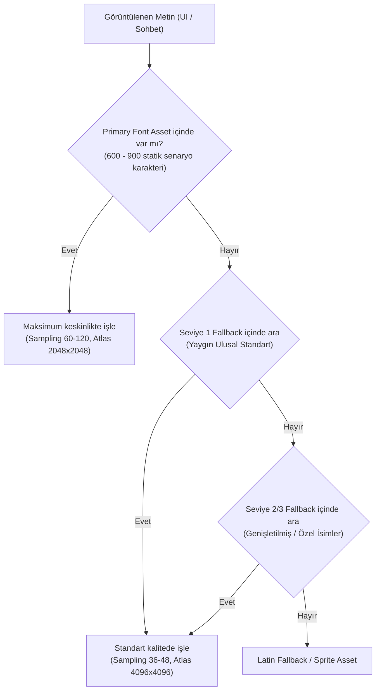

## **1. Projeye Genel Bakış ve Gerçek Zamanlı Yerelleştirme Zorlukları**

**GilongWorld** projesi, son derece karmaşık ve küresel ölçekli bir teknik gereksinim ortaya koymaktadır: **15 hedef dil** için kapsamlı yerelleştirme (*localization*) desteği. Bu liste İngilizce (English), Vietnamca (Vietnamese), Fransızca (French), İtalyanca (Italian), Almanca (German), İspanyolca - İspanya (Spanish - Spain), Lehçe (Polish), Portekizce - Brezilya (Portuguese - Brazil), Portekizce - Portekiz (Portuguese - Portugal), Korece (Korean), Rusça (Russian), Japonca (Japanese), Türkçe (Turkish), Basitleştirilmiş Çince (Simplified Chinese) ve Geleneksel Çince (Traditional Chinese) dillerini kapsamaktadır. Unity oyun motorunu kullanan modern oyun geliştirme süreçlerinde, gerçek zamanlı grafik alanında metin yönetimi ve görüntüleme yalnızca metin dizelerini değiştirmekten ibaret değildir. Her kamera mesafesinde estetik görünümü ve görüntü keskinliğini koruyan, en önemlisi ise sistem belleği kullanımında yüksek verimlilik sağlayan bütüncül bir yazı tipi mimarisi gerektirir.

Unity ekosisteminde metin görüntülemek için günümüzün en güçlü ve standart aracı **TextMeshPro (TMP)** bileşenidir. Büyütüldüğünde bulanık bitmap görseller olarak işlenen geleneksel kullanıcı arayüzü metin (UI Text) sistemlerinden tamamen farklı olarak TextMeshPro, standart yazı tipi dosyalarının **Font Asset** adı verilen özel varlıklara dönüştürülmesini gerektirir[^1]. Bu Font Asset'ler, **Signed Distance Field (SDF)** teknolojisini uygulayan bir veya birden fazla doku görseli (*Atlas Texture*) içerir. SDF teknolojisi, metnin piksel bozulması (*pixelation*) olmadan sonsuza kadar büyütülebilmesini sağlarken, gölgelendiricinin (shader) gölge, dış çizgi, kalınlık/incelik ve parlama gibi karmaşık grafik efektlerini doğrudan GPU üzerinde oluşturması için matematiksel bir temel sunar[^1].

Ancak SDF'nin gücü kaçınılmaz bir fiziksel zorluğu da beraberinde getirir: **bellek sınırları**. 15 hedef dilin tüm karakterlerini tek bir doku atlasına sığdırmak fiziksel olarak imkânsızdır[^1]. Özellikle CJK (*Chinese, Japanese, Korean*) grubundaki diller, on binlerce karakterden oluşan devasa bir ideografik yazı sistemine sahiptir. Bu sistemin tamamını tek bir Atlas Texture içine zorla sığdırmaya çalışmak, doku boyutunun donanım aygıtlarının — özellikle mobil donanımların — işleyebileceği azami sınırı (genellikle $4096 \times 4096$ veya $8192 \times 8192$ piksel) aşmasına yol açar; bu da VRAM taşmasına veya uygulamanın çökmesine (*crash*) neden olur[^5]. Bu rapor; kaynak yazı tiplerinin seçilmesi ve indirilmesinden, yazı sistemlerinin analizine, TextMeshPro'nun dahili parametrelerinin yapılandırılmasına, yedek zinciri (*Fallback Chain*) yönetimine ve Unity Localization paketi aracılığıyla Han karakterlerinin birleştirilmesi (*Han Unification*) sorununun kökten çözümüne kadar tüm süreci ayrıntılı olarak sunmaktadır.

---

## **2. Karakter Bilimi Temelleri ve Kaynak Yazı Tipi İndirme Stratejisi**

Çok dilli bir metin sisteminin kurulmasındaki ilk ve en önemli adım, doğru kaynak yazı tipi dosyasının (*Source Font File*) seçilmesidir. 15 dilde görsel tutarlılığı korumak; temel düzeyden genişletilmiş Unicode aralıklarına kadar eksiksiz destek sunan, taban çizgisi (*baseline*) yüksekliği ve çizgi kalınlığı (*weight*) tutarlı olan açık kaynaklı bir yazı tipi ailesini gerektirir.

Yazılım endüstrisinde **Google Noto** yazı tipi ailesi (*"No Tofu"* ifadesinin kısaltmasıdır — cihazda görüntülenecek karakter eksik olduğunda ortaya çıkan ve halk arasında "tofu" olarak adlandırılan boş kutucukları ortadan kaldırma misyonunu ifade eder) altın standart çözüm olarak kabul edilmektedir[^7]. Google tarafından önde gelen tipografi ortaklarıyla iş birliği içinde tasarlanan Noto sistemi, Latin, Kiril ve CJK yazı sistemlerine ait karakterlerin aynı metin satırında boyut orantısızlığı veya sanatsal üslup farkı yaratmadan yan yana görüntülenebilmesini garanti eder[^8]. Birden fazla dilin iç içe geçtiği metinlerde sağlanan bu akıcılık, GilongWorld'deki kullanıcı deneyimi için hayati öneme sahiptir.

### **Yazı Tipi Verilerini Çıkarma ve Unity'ye Aktarma Rehberi**

Entegrasyon sürecine başlamak için kaynak yazı tipi dosyalarının doğrudan **Google Fonts** kütüphanesinden indirilmesi gerekir. Projede gereksiz boyut şişmesini önlemek adına indirme ve Unity'ye aktarma sürecinde katı bir prosedür izlenmelidir:

1. **Latin ve Kiril alfabesini kullanan 11 dil grubu** (*İngilizce, Vietnamca, Fransızca, İtalyanca, Almanca, İspanyolca, Lehçe, Portekizce - Brezilya, Portekizce - Portekiz, Rusça, Türkçe*): Sistem yalnızca temel **Noto Sans** yazı tipi ailesini gerektirir[^8]. Bu yazı tipi ailesi; Latin Extended, Kiril ve birleşen diyakritik işaretler gibi Unicode bloklarını kapsayan 3.700'den fazla karakter şekli (*glyph*) barındırarak yukarıdaki dillerin tüm ihtiyaçlarını eksiksiz karşılar[^8]. Google Fonts ana sayfasından indirildiğinde, TrueType (`.ttf`) formatında farklı kalınlık varyantlarını (*Thin, Regular, Medium, Bold, Black* gibi) içeren bir sıkıştırılmış arşiv elde edilir.
2. **4 CJK dili grubu**: İndirme süreci daha karmaşıktır. Geliştiricilerin **Noto Sans JP** (Japonca), **Noto Sans KR** (Korece), **Noto Sans SC** (Basitleştirilmiş Çince) ve **Noto Sans TC** (Geleneksel Çince) olmak üzere dört ayrı bölgesel varyanta erişmesi gerekir[^7]. Bu CJK dosyaları, barındırdıkları devasa grafik verisi nedeniyle genellikle her kalınlık için 15 MB ile 20 MB arasında değişen çok büyük dosya boyutlarına sahiptir. Bu grup için yaygın olarak kullanılan format, TrueType'a kıyasla daha karmaşık karakter tablosu yapılarını destekleyen OpenType (`.otf`) formatıdır[^5].

Google Fonts'tan indirilen dosyalar arşivden çıkarıldıktan sonraki adım, bunları Unity proje ortamına aktarmaktır (*import*). Varlık yönetiminde iyi bir uygulama (*best practice*), örneğin `Assets/GilongWorld_Resources/Fonts/Source_Files/` gibi özel bir klasör yapısı oluşturmaktır. `.ttf` ve `.otf` dosyaları (kullanıcı arayüzü tasarımı özellikle kalın varyantları gerektirmediği sürece belleği optimize etmek için yalnızca *Regular* veya *Medium* gibi tek bir standart kalınlık seçilmelidir), işletim sisteminden Unity Editor'ın Project penceresi üzerinden doğrudan bu klasöre sürüklenip bırakılır[^10].

> [!NOTE]
> TextMeshPro, çalışma zamanında metin işlemek için bu `.ttf` veya `.otf` dosyalarını doğrudan kullanmaz; bunlar yalnızca Font Asset Creator aracının dizi verilerini çıkarıp SDF dokusuna derlemesi için ham girdi görevi görür[^1]. Kaynak dosyaların ayrı bir klasörde yönetilmesi, (Dynamic SDF özelliği kullanılmıyorsa) son derlemelerden (build) bunların çıkarılmasını kolaylaştırarak oyunun kurulum paketi boyutunu küçültmeye yardımcı olur.

---

## **3. Yazı Sistemlerinin Analizi ve Unicode Aralık Gereksinimleri**

GilongWorld projesindeki 15 dilin çeşitliliği, karakterlerin uluslararası Unicode standardında nasıl kodlandığına dair derinlemesine bir analiz gerektirir. TextMeshPro, kaynak yazı tipi dosyasından çıkarılacak kod aralıklarını (*Unicode Ranges*) belirlemek için onaltılık (Hexadecimal) sayı sistemini kullanır[^13]. Bu aralıkların doğru bildirilmesi yalnızca mutlak dil kapsamını garantilemekle kalmaz, aynı zamanda Atlas dokusunun boyutunu şişiren gereksiz karakterlerin yüklenmesini de engeller.

Morfolojik yapılarına göre 15 dil, kaynak yönetimi açısından üç ana stratejik gruba ayrılır.

### **Alt Grup 1: Genişletilmiş Latin Sistemi ve Diyakritik İşaretler**

Bu grup İngilizce, Fransızca, İtalyanca, Almanca, İspanyolca, Lehçe, Portekizce (Brezilya), Portekizce (Portekiz), Türkçe ve Vietnamca dillerini kapsar. Temel Latin alfabesi zeminini (`U+0020` - `U+007E`) paylaşsalar da, genişletilmiş kod bloklarında keskin bir şekilde ayrışırlar[^1]:

- **Batı ve Güney Avrupa** (*Fransızca, İspanyolca, İtalyanca, Portekizce, Almanca*): Ağırlıklı olarak `á`, `é`, `í`, `ó`, `ú`, `ñ`, `ü` ve `ç` gibi temel aksanlı ünlüleri içeren *Latin-1 Supplement* (`U+00A0` - `U+00FF`) bloğunu kullanır.
- **Orta Avrupa ve Türkçe** (*Lehçe, Türkçe*): `ą`, `ł`, `ş` ve `ğ` gibi dile özgü karakterleri görüntülemek için *Latin Extended-A* (`U+0100` - `U+017F`) bloğuna dayanır[^10].
- **Vietnamca**: Bu gruptaki en dikkat çekici dildir. Şapkalı (`â`, `ê`, `ô`) veya kancalı (`ơ`, `ư`) ünlülerle birleşen karmaşık ton işaretleri sistemi nedeniyle Vietnamca, *Latin Extended Additional* (`U+1E00` - `U+1E9F`) kod bloğunu gerektirir[^14]. Vietnamca diyakritik sistemi, çok yüksek yapıya sahip karakterler oluşturur (örneğin `Ể` harfi standart Latin büyük harf yüksekliğini aşabilir); bu durum, karakterlerin üst kısmının kırpılmasını (*clipping*) önlemek için TextMeshPro'da satır yüksekliğinin (*line height*) ve dolgu boşluğunun (*padding*) dikkatle ayarlanmasını gerektirir.

### **Alt Grup 2: Kiril Sistemi**

Projede bu sisteme ait tek dil **Rusça (Russian)**dır. Kiril alfabesi kodlama açısından Latin sisteminden tamamen bağımsızdır ve `U+0400` - `U+04FF` kod bloğu içinde yer alır[^10]. Kodlama bakımından bağımsız olmasına rağmen Kiril alfabesi, karakter genişliği ve taban çizgisi yüksekliği açısından Latin sistemiyle pek çok morfolojik özelliği paylaşır; bu da görsel bir dengesizlik yaratmadan Latin grubuyla aynı Font Asset içinde kusursuzca birleştirilmesine olanak tanır.

### **Alt Grup 3: CJK Sistemi ve Han Unification Tarihi Sorunu**

Üçüncü grup **Korece, Japonca, Basitleştirilmiş Çince ve Geleneksel Çince** dillerini içerir. Burası, TextMeshPro'nun teknik sınırlarının en sık sınandığı en karmaşık alandır. Temel neden yalnızca devasa karakter sayısı değil, aynı zamanda Unicode Konsorsiyumu'nun **Han Unification** (*Han Karakterlerinin Birleştirilmesi*) olarak bilinen tartışmalı teknik kuralıdır[^7].

Unicode standardının geliştirildiği ilk yıllarda, kodlama alanını 16-bit sınırları içinde tutmak amacıyla yazılım mühendisleri, Çin, Japonya ve Kore'den gelen ve aynı tarihsel kökene sahip ideografik karakterleri tek bir ortak kod noktasında (*code point*) birleştirme kararı almışlardır[^7]. *CJK Unified Ideographs* olarak adlandırılan bu kod bloğu `U+4E00` ile `U+9FA5` aralığında yer alır[^12].

Bu karar, görüntüleme tekniği açısından ciddi bir yan etki doğurmuştur: **aynı Unicode kodunu paylaşmalarına rağmen, aynı karakterin (glyph) gerçek görsel biçimi**, kültürel gelişim, hat sanatı ve eğitim standartlarındaki farklılaşma nedeniyle **ülkelere göre farklı çizilmektedir**:

- Bunun tipik bir örneği `U+9AA8` Unicode koduna sahip "Kemik" (`骨`) karakteridir. Bu karakterin üst kısmındaki dikdörtgenin içindeki çizgi yapısı, Basitleştirilmiş Çince (SC) yazı tipinde yatay olarak soldan sağa düzenlenirken, Geleneksel Çince (TC) ve Japonca (JP) yazı tiplerinde tamamen farklı bir çizim yapısına sahiptir[^7].
- Benzer şekilde, "Kar" (`雪`) veya "Düz/Doğru" (`直`) karakterleri de ana dili konuşanlar tarafından son derece kolay fark edilen ince fakat belirgin yapısal farklılıklar taşır.

Metin işleme sistemi morfolojik niyeti kendi başına tahmin edemez; yalnızca bir Unicode kodu alır ve karşılık gelen görseli geçerli yazı tipi setinden çeker. Dolayısıyla, tüm Doğu Asya dilleri için ortak bir CJK yazı tipi kullanmak, Japon oyuncuların Çin üslubuyla çizilmiş Japonca metinleri okumasına — veya tam tersine — yol açar[^7]. Ana dili konuşanlar için bu durum, yazı tipi hatası, profesyonellikten uzaklık veya "melez" görünüm hissi uyandırarak oyunun atmosferine duyulan bağlılığı tamamen bozar[^7]. Bu kısıtlamayı aşmanın tek yolu, her CJK dili için Font Asset'leri tamamen ayırmak ve yedek zincirini dinamik olarak yönetmektir.

---

## **4. TextMeshPro ve Signed Distance Field (SDF) Teknik Mekanizması**

Doğru bir kurulum sürecini yürütmek için **Signed Distance Field (SDF)** mekanizmasının TextMeshPro içinde nasıl çalıştığını anlamak şarttır. Piksellerin renk değerlerini saklayan geleneksel Bitmap yazı tiplerinin aksine SDF, bir pikselden karakterin en yakın kenarına (sınırına) olan matematiksel mesafeyi saklar[^1]:
- Bir piksel karakterin **içinde** yer alıyorsa, mesafe **pozitif** değer alır.
- **Dışında** yer alıyorsa, **negatif** değer alır.
- **Tam olarak kenar üzerinde** yer alıyorsa, mesafe **sıfıra** ($0$) eşittir.

Bu mesafe verisi, bir Atlas Texture içinde gri tonlama (*grayscale*) olarak kodlanır. Çalışma zamanında TextMeshPro'nun GPU gölgelendiricisi bu mesafe değerleri üzerinde çift doğrusal enterpolasyon (*bilinear interpolation*) uygular. Gölgelendirici ekrandaki her parçacığın (*fragment*) değerini kontrol eder: değer $> 0$ ise o parçacık renklendirilir; $< 0$ ise şeffaf hâle getirilir. Ayrı piksellere bağımlı olmak yerine sürekli matematiksel enterpolasyona dayandığı için SDF metinler, kamera nesneye çok yaklaştığında bile son derece keskin eğrilerle görüntülenir[^1].

Bu mekanizma, Font Asset oluştururken iki temel parametreyi belirler:
1. **Sampling Point Size:** Karakterin Atlas Texture üzerine çizilirken sahip olacağı fiziksel piksel çözünürlüğünü belirler. Boyut ne kadar büyük olursa, mesafe verisinin ayrıntı düzeyi o kadar yüksek olur.
2. **Padding (Dolgu Boşluğu):** SDF'nin gücünün anahtarıdır. Karakterin etrafındaki dolgu alanı, mesafe gradyanının daha derin negatif değerlere doğru yumuşakça azalmasına imkân tanır. Dolgu boşluğu ne kadar geniş olursa, SDF algoritmasının ani kesilmeler olmadan kalın dış çizgi (*outline*), gölge (*shadow*) veya parlama (*glow*) efektleri oluşturmak için o kadar fazla "alanı" olur[^13].

---

## **5. Font Asset Creator ile Adım Adım Kurulum Rehberi**

Yazı tipi doku dosyalarının oluşturulması Unity'nin dahili aracı olan **Font Asset Creator** üzerinden, şu menü yolu izlenerek gerçekleştirilir:

```text
Window > TextMeshPro > Font Asset Creator
```

Bölüm 3'teki analiz doğrultusunda GilongWorld projesi için 15 dile yönelik en uygun yapı bölümlendirilmiş bir modeldir: **11 Latin/Kiril dili için tek bir ortak Font Asset ve 4 CJK dili için ayrı ayrı Font Asset'ler oluşturmak**.

### **5.1. Latin, Kiril ve Vietnamca İçin Statik (Static) Yapı Kurulumu**

11 dili (*İngilizce, Fransızca, İtalyanca, Almanca, İspanyolca, Lehçe, Brezilya Portekizcesi, Portekiz Portekizcesi, Türkçe, Rusça, Vietnamca*) tek bir **Primary Static Font Asset** altında birleştirmek, kararlı bir kare hızını (*frame rate*) korumada kilit rol oynayan GPU çizim çağrısı (*draw call*) sayısını en aza indirmenin en etkili yoludur[^14].

Font Asset Creator içindeki yapılandırma aşağıdaki katı parametrelerle gerçekleştirilir[^12]:

| Yapılandırma Özelliği | Teknik Öneri | Analitik Gerekçe |
| :--- | :--- | :--- |
| **Source Font File** | `NotoSans-Regular.ttf` | Kaynak dosyayı `Assets` klasöründen bu alana sürükleyip bırakın. Bu, geometrik veri kaynağıdır[^1]. |
| **Sampling Point Size** | `Custom Size: 60 - 90` | Auto Sizing modu yalnızca karakterleri mevcut alana sığdırmaya çalışır. Custom Size'ı 60 ile 90 arasına sabitleyerek tüm doku yüzeyinde tutarlı SDF kalitesi garanti edilir[^1]. |
| **Padding** | `6 - 9` (~%10 Oranı) | TextMeshPro'daki standart kural, Padding değerinin Sampling Point Size'ın yaklaşık %10'u olmasıdır[^4]. Sampling 60 için Padding 6 idealdir. Projedeki kullanıcı arayüzü stilleri çok kalın metin dış çizgileri gerektiriyorsa bu değer 10'a çıkarılabilir. |
| **Packing Method** | `Optimum` | Optimum algoritması Fast yöntemine göre belirgin şekilde daha fazla işlem süresi gerektirir; ancak karakter şekillerini (glyph) alana en sıkı şekilde yerleştirmek için yinelemeler yaparak piksel israfını en aza indirir[^12]. |
| **Atlas Resolution** | `2048 x 2048` | Bu 11 dilin toplam karakter sayısı yaklaşık 1.500 ile 2.000 glyph arasındadır. $2048 \times 2048$ boyutu, hiçbir karakter kesilmeden Sampling Point Size 60 değerini korumak için yeterli alana sahiptir[^7]. |
| **Character Set** | `Unicode Range (Hex)` | Önceden tanımlanmış setleri seçmek yerine bu mod, yüklenecek karakterler üzerinde mutlak denetim sağlar[^2]. |

**Custom Character List** alanı, 11 dilin tüm ihtiyaçlarını eksiksiz kapsayan onaltılık kod aralığı dizisiyle doldurulacaktır:

```text
0020-007E, 00A0-00FF, 0100-017F, 0180-024F, 1E00-1E9F, 0300-036F, 0400-04FF, 0500-052F, 2000-206F
```

Tüm parametreler doldurulduktan sonra:
1. **Generate Font Atlas** düğmesine tıklayın. Araç mesafeleri hesaplayacak ve dokuyu oluşturacaktır (CPU'ya bağlı olarak birkaç dakika sürebilir).
2. İşlem tamamlanıp doku önizlemesi göründüğünde **Save** düğmesine tıklayın.
3. Dosyayı proje klasörüne `Global_Latin_Cyrillic_SDF.asset` adıyla kaydedin[^1].

### **5.2. CJK Sistemi İçin Statik Yapı Kurulumu ve Hiyerarşik Yedek Mimarisi**

4 CJK dilini işlemek, devasa veri hacmi nedeniyle tamamen farklı bir yaklaşım gerektirir. Yukarıdaki işlemin `NotoSansCJKjp`, `NotoSansCJKkr`, `NotoSansCJKsc` ve `NotoSansCJKtc` için dört kez tekrarlanması zorunludur. Ancak tüm CJK tablosunu Unicode aralıkları üzerinden tek bir statik Atlas'a yerleştirmeye çalışmak, dokunun fiziksel boyut sınırını aşacağı için başarısız olur[^5].

Standart teknik çözüm, **Characters from File** seçeneğiyle birleştirilmiş **Hiyerarşik Karakter Eşleme Modeli (Hierarchical Character Mapping)** uygulamaktır[^7]:

#### **1. Bilinen Karakterler (Known Characters) İçin Primary SDF Font Asset Oluşturma**
- Projenin dize tablolarından (*String Tables*) tüm statik metin dizelerini çıkarın (Menü, Görev, Eşya, Diyaloglar, Yetenekler).
- Bu benzersiz karakter (*unique characters*) kümesi pratikte genellikle **1.000 karakterin altındadır** (örneğin GilongWorld projesinde Basitleştirilmiş Çince için yalnızca **855 karakter**, Geleneksel Çince için **870 karakter**, Japonca için **694 karakter** ve Korece için **588 karakter** yer almaktadır).
- **Kaliteyi En Üst Düzeye Çıkarma (Maximize Sampling Size):** Karakter sayısı 1.000'in altında olduğu için $2048 \times 2048$ Atlas çözünürlüğü ile **yüksek bir Sampling Point Size** (`60` ile `90` veya `120` arası) ayarlanabilir. Bu, tüm resmi kullanıcı arayüzü metinlerinin her kamera mesafesinde kusursuz keskinliğe ulaşmasını sağlar.

#### **2. Ulusal Standart Karakter Setlerinden Türetilen Yedek Katmanları İnşa Etme (UGC/Sohbet İçin Standart Fallback'ler)**
Oyuncuların karakter adı belirleme veya topluluk sohbeti gibi metin girişlerinde hiçbir zaman Tofu kutucuğuyla karşılaşmaması için sistem, **ulusal standart karakter veri setlerinden** türetilen Fallback Font Asset katmanlarını ekler:

| Dil | Ulusal Standart Karakter Seti | Karakter Sayısı | Yayınlayan Kurum ve Kaynak Referansı |
| :--- | :--- | :---: | :--- |
| **Simplified Chinese (zh-Hans)** | **TGSCC (通用规范汉字表)**<br/>- Seviye 1 (Yaygın): 3.500 karakter<br/>- Seviye 2 (Genişletilmiş): 3.000 karakter<br/>- Seviye 3 (Özel İsimler/Yerler): 1.605 karakter | **8.105** | Çin Halk Cumhuriyeti Eğitim Bakanlığı<br/>*Açık kaynak:* [GitHub chinese-character-table](https://github.com/maple-leaf/chinese-character-table) |
| **Traditional Chinese (zh-Hant)** | **Yaygın Kullanılan Standart Çince Karakterler Tablosu** (*常用國字標準字體表*) | **4.808** | Tayvan Eğitim Bakanlığı (MOE Taiwan)<br/>*Açık kaynak:* [Tayvan Açık Veri Portalı](https://data.gov.tw/dataset/5961) / [GitHub cjktables](https://github.com/ButTaiwan/cjktables) |
| **Japanese (ja)** | - **Jōyō Kanji** (常用漢字 - Yaygın Kullanım): 2.136 karakter<br/>- **Jinmeiyō Kanji** (人名用漢字 - Kişi Adları): 863 karakter | **2.999** | Japonya Kültür İşleri Ajansı (文化庁)<br/>*Açık kaynak:* [KanjiAPI](https://kanjiapi.dev/) / [GitHub kanji-data](https://github.com/davidluzgouveia/kanji-data) |
| **Korean (ko)** | **KS X 1001 Standardı** (İletişimin %99,9'unu kapsayan en yaygın 2.350 Hangul hecesi) | **2.350** | Kore Teknoloji ve Standartlar Ajansı (KATS)<br/>*Açık kaynak:* [GitHub ksx1001](https://github.com/korean-character-sets/ksx1001) / `euc-kr` üzerinden çıkarılmıştır |



#### **3. Değişmez Kural: Sampling Point Size / Padding Oran Tutarlılığını Koruma (Ratio Consistency)**

TextMeshPro Shader içindeki temel bir grafik ilkesi şudur: **Outline (Metin Dış Çizgisi), Underlay / Shadow (Gölge) ve Glow (Parlama) efektlerinin kalınlığı, Sampling Point Size ile Padding arasındaki orana göre hesaplanır**[^13].

##### **Fallback Neden Primary ile Aynı Point Size'a İhtiyaç Duymaz?**
- **Primary Font (~855 UI senaryo karakteri):** Oyun süresinin %100'ünde görünür $\rightarrow$ **Kaliteyi en üst düzeye çıkarmak gerekir** (`Sampling Size = 120`, `Padding = 10`, Atlas $2048 \times 2048$).
- **Fallback Fonts (Sohbet/İsim için 2.700 – 8.000 nadir karakter):** Çok seyrek görünür $\rightarrow$ VRAM'i şişirmeden aynı Atlas boyutuna binlerce karakter sığdırmak için **örnekleme kalitesini düşürün** (`Sampling Size = 60` veya `48`).

##### **Neden Aynı Oranı ($\text{Ratio} = \frac{\text{Sampling}}{\text{Padding}}$) Korumak Zorunludur?**
Tek bir cümlede Primary'den gelen karakter ile Fallback'ten gelen karakter yan yana bulunduğunda:
- **Oran saparsa:** Primary karakter (Size 120, Pad 10 $\rightarrow$ Ratio 12) zarif ve ince bir dış çizgiye sahip olur; ancak Fallback karakter (Size 60 iken yanlışlıkla Pad 10 bırakılırsa $\rightarrow$ Ratio 6), **iki kat kalınlaşmış, bozulmuş ve harf çizgilerini yutan bir dış çizgiye** sahip olur.
- **Aynı oran korunursa ($\text{Ratio} = 12$):** Karakter ister Primary'den alınsın ister Fallback'e düşsün, **dış çizgi kalınlığı ve gölge yayılımı her zaman %100 tutarlı kalır**.

| Font Asset Katmanı | Görev | Sampling Point Size *(Custom)* | Padding | Atlas Resolution | Oran (Ratio) |
| :--- | :--- | :---: | :---: | :---: | :---: |
| **Primary Font** | Ana UI senaryosu | **120** *(veya 96)* | **10 px** *(veya 8 px)* | $2048 \times 2048$ | **12** *(Maksimum keskinlik)* |
| **Fallback Seviye 1** | ~2.725 yaygın karakter | **60** | **5 px** | $2048 \times 2048$ | **12** *(VRAM tasarrufu)* |
| **Fallback Seviye 2** | ~2.992 genişletilmiş karakter | **60** | **5 px** | $2048 \times 2048$ | **12** *(VRAM tasarrufu)* |
| **Fallback Seviye 3** | ~1.605 nadir/isim karakteri | **48** | **4 px** | $2048 \times 2048$ | **12** *(VRAM tasarrufu)* |

> [!TIP]
> **Pratik uygulama:** *Font Asset Creator* içinde `Sampling Point Size` ayarını *Auto Sizing*'den **Custom Size** seçeneğine geçirerek örnekleme boyutunu ve Padding değerini yukarıdaki tablodaki orana göre sabitleyin.

---

### **5.3. Unity'de Klasör Düzenleme ve Pratik Otomasyon Süreci**

Uzun vadede kolayca genişletilebilmesi ve bakımının yapılabilmesi için GilongWorld projesi, tüm kaynak karakter verileri için gruplandırılmış özel bir klasör yapısı oluşturmuştur:

```text
Assets/_GilongWorld/_Project/Art/Fonts/_chars/
├── 01_Latin_Cyrillic/        # [Ortak Primary Font] 11 Latin/Kiril dili
│   ├── vi_chars.txt          # Vietnamca
│   ├── en_chars.txt          # İngilizce
│   ├── ru_chars.txt          # Rusça
│   └── ...                   # Fransızca, Almanca, İtalyanca, İspanyolca, Lehçe, Portekizce, Türkçe
│
├── 02_CJK/                   # [CJK Primary Fonts] Oyundaki statik senaryo karakterleri
│   ├── ja_chars.txt          # Japonca (694 gerçek karakter)
│   ├── ko_chars.txt          # Korece (588 gerçek karakter)
│   ├── zh_Hans_chars.txt     # Basitleştirilmiş Çince (855 gerçek karakter)
│   ├── zh_Hant_chars.txt     # Geleneksel Çince (870 gerçek karakter)
│   │
│   ├── Standard_Fallbacks/   # [Standart Kaynak Katmanı] 7 orijinal ulusal standart veri seti
│   │   ├── zh_Hans_TGSCC_Level1_3500.txt
│   │   ├── zh_Hans_TGSCC_Level2_3000.txt
│   │   ├── zh_Hans_TGSCC_Level3_1605.txt
│   │   ├── zh_Hant_Common_4808.txt
│   │   ├── ja_Joyo_Kanji_2136.txt
│   │   ├── ja_Jinmeiyo_Kanji_863.txt
│   │   └── ko_KS_X_1001_2350.txt
│   │
│   └── Subtracted_Fallbacks/ # [Optimize Edilmiş Fallback Katmanı] Primary karakterler çıkarılmış
│       ├── zh_Hans_Fallback_Level1.txt    (TGSCC Seviye 1 eksi Primary)
│       ├── zh_Hans_Fallback_Level2.txt    (TGSCC Seviye 2 eksi Primary)
│       ├── zh_Hans_Fallback_Level3.txt    (TGSCC Seviye 3 eksi Primary)
│       ├── zh_Hant_Fallback_Common.txt    (TW 4808 eksi Primary)
│       ├── ja_Fallback_Joyo.txt           (Joyo Kanji eksi Primary)
│       ├── ja_Fallback_Jinmeiyo.txt       (Jinmeiyo Kanji eksi Primary)
│       └── ko_Fallback_KS_X_1001.txt      (KS X 1001 eksi Primary)
```

#### **Otomatik Karakter Çıkarma ve Fallback Çıkarma Aracı (`GWCharacterExtractor.cs`)**
Geliştiricileri CSV dışa aktarma ve yinelenen karakterleri elle filtreleme yükünden kurtarmak için özel Unity Editor aracı [`GWCharacterExtractor.cs`](file:///d:/Unity-Projects/GLW/Assets/_GilongWorld/_Project/Editor/Localization/GWCharacterExtractor.cs) ikisi bir arada bir iş akışı sunar:
- **Erişim menüsü:** `GilongWorld → Localization → Extract CJK Characters From String Tables`
- **Mekanizma 1 (Primary Çıkarma):** Unity Localization içindeki tüm `StringTableCollections` öğelerini tarar, kullanılan tüm metin dizelerini `HashSet<char>` yapısında toplar (%100 benzersizlik sağlar), artan Unicode koduna göre sıralar ve `02_CJK/` içindeki 4 Primary dosyasına yazar.
- **Mekanizma 2 (Otomatik Fallback Çıkarma):** Betik `Standard_Fallbacks/` içindeki 7 veri setini otomatik olarak okur, bunları karşılaştırarak **Primary Asset içinde zaten bulunan tüm karakterleri çıkarır** ve ardından `Subtracted_Fallbacks/` klasörüne aktarır. Bu sayede Primary Atlas ile Fallback Atlas arasındaki karakter yinelenmesinden kaynaklanan VRAM israfı tamamen ortadan kaldırılır.

#### **GWSDFGeneratorWindow Arayüzü ve Unity 6 API Kısıtlamasını Aşma**
"Sampling / Padding Oranı = 12" kuralına kesinlikle uyulmasını sağlamak amacıyla proje, parametre girilmesine imkân tanıyan ve oran saptığında otomatik olarak uyarı hesaplayan özel bir Editor Window sunar.
Özellikle Unity 6'da, Font Asset'in `clearDynamicDataOnBuild` özelliği `internal` erişim düzeyinde kilitlendiği için derleme (build) öncesinde gereksiz verilerin normal kodla temizlenmesi engellenmiştir. Bu araç, `SerializedObject` üzerinden Yansıma (Reflection) tekniğini uygulayarak sorunu kökten çözer:

```csharp
var serializedObject = new SerializedObject(fontAsset);
serializedObject.FindProperty("m_ClearDynamicDataOnBuild").boolValue = true;
serializedObject.ApplyModifiedProperties();
```
Bunun sonucunda eski sistemin hatalı 137 MB'lık Atlas'ı tamamen temizlenmiş ve derleme (build) boyutu en düşük düzeye indirilmiştir.

---

## **6. Yedek Zinciri (Fallback Chain) Yönetim Mimarisi ve Han Unification Çözümü**

Çok dilli bir oyunu sorunsuz çalıştırmanın özü, Yedek Zincirini (*Fallback Chain*) yönetebilme kabiliyetinde yatar. Bir TextMeshPro UI bileşeni, Primary Font Asset içinde bulunmayan bir karakter içeren metin dizisi aldığında, sistem yedek bir karakter şekli (*glyph*) bulmak için yedek listeleri üzerinde özyinelemeli bir arama algoritması çalıştırır.

Arama algoritması katı bir hiyerarşi izler:
1. `TextMeshPro Primary Font Asset`
2. `Primary Font'un dahili Fallback Font Assets listesi`
3. `Dahili Sprite Asset`
4. `TMP_Settings içinde genel olarak tanımlanan General Fallback Font Assets`
5. `Default Sprite Asset`
6. `Default Font Asset`[^20]

> [!WARNING]
> Sistem yukarıdan aşağıya doğru sıralı biçimde arama yapar ve **ilk eşleşen Unicode kod noktasını bulduğu anda aramayı derhal durdurur**[^7].

Bölüm 3'te analiz edildiği üzere Han Unification olgusu, SC, TC ve JP dillerinin farklı morfolojik biçimlere sahip olmasına rağmen aynı Unicode kodunu paylaşmasına neden olur[^7]. Geliştirici tüm CJK dosyalarını `TMP_Settings` içindeki General Fallback Font Assets listesine eklerse, sıralama düzeni metnin kaderini belirleyecektir. Örneğin liste `Font_CJK_JP_SDF` $\rightarrow$ `Font_CJK_SC_SDF` $\rightarrow$ `Font_CJK_TC_SDF` sırasıyla düzenlenmişse, Basitleştirilmiş Çince bir metin girildiğinde sistem yukarıdan aşağı tarama yapar, ilk olarak Japonca dosyasına rastlar, karşılık gelen Unicode kodunu bulur ve alttaki Çince dosyasını tamamen yok sayarak ekrana derhal Japon Kanji üslubunu basar[^7].

### **Yerel Yönlendirmeli Yedek Mimarisi (Local Fallback Architecture)**

Bu sorunu kökten ortadan kaldırmak için Fallback yapısının izole edilmesi gerekir:

> [!IMPORTANT]
> **CJK yazı tiplerini kesinlikle `TMP_Settings` içindeki Genel Yedek Listesine (Global Fallback List) eklemeyin**[^1]. Bunun yerine mimari, her Asset dosyasının kendi yerel yedek (*Local Fallback*) yapısı üzerinden bağlanacak ve çalışma zamanında dinamik olarak yönetilecektir.

Temel bir tipografi kuralına göre CJK yazı tipleri, saf Latin yazı tiplerine kıyasla oldukça kötü veya orantısız tasarlanmış Latin harfleri ve Arap rakamları içerir[^9]. Bu nedenle Latin karakterlerin her zaman `Global_Latin_Cyrillic_SDF` dosyası tarafından işlenmesine öncelik verilmelidir. Yerel bağlantı yapısı şu şekilde oluşturulur:
1. `Font_CJK_SC_SDF.asset` dosyasını açın, **Fallback Font Assets** bölümüne Çincenin 1-3 numaralı Fallback katmanlarını ekleyin ve `Global_Latin_Cyrillic_SDF` dosyasını da ilave edin[^1].
2. Aynı işlemi TC, JP ve KR dosyaları için de tekrarlayın.

Bu sayede oyun Çince dilinde görüntülenirken araya sayılar veya İngilizce özel isimler girdiğinde, bunlar (çünkü *Characters from File* çıkarma aşamasında Latin karakterler elenmiştir) Çince statik Atlas'tan geçerek yüksek kaliteli Latin yazı sistemini barındıran Fallback dosyası tarafından yakalanır[^7].

---

## **7. Dinamik Değişim (Runtime Swapping) İçin Unity Localization Paketi Entegrasyonu**

Han karakterlerinin kültürel biçiminin doğru işlenmesini sağlamak ve VRAM belleğini optimize etmek için TextMeshPro UI bileşeni statik bir yapılandırmayı koruyamaz. Kullanıcı dili (*Locale*) değiştirdiğinde, temel yazı tipi (*Primary Font Asset*) çalışma zamanında (*runtime*) otomatik olarak değiştirilmelidir (*swap*)[^23].

**Unity Localization** paketi (`com.unity.localization`), her geçiş olayını sabit kodlamak (*hardcoding*) yerine bu mantıksal akışı yürütmek için güçlü araçlar sunar[^25]. Entegrasyon mimarisi, `LocalizationSettings.SelectedLocaleChanged` aracılığıyla küresel dil değişikliği olayını izleme mekanizmasına dayanır[^24].

İki uygulama yöntemi bulunmaktadır:

### **Yöntem 1: Merkezi Yönetim Programlaması (Centralized Font Manager)**

Binlerce UI Text bileşenine elle Localized Asset olayı atamak yerine (bu durum çok sayıda gereksiz `MonoBehaviour` nesnesi ve Garbage Collection süreci nedeniyle bellek üzerinde muazzam bir baskı oluşturur), GilongWorld projesi **Addressables ile Merkezi Yönetim** stratejisini uygular.

`GWFontManager.cs` betiği (`DontDestroyOnLoad` bayrağı taşır) `LocalizationSettings.SelectedLocaleChanged` olayını dinler. Bu olay tetiklendiğinde Manager iki hassas görev yürütür:
1. **Eşzamansız Yükleme (Async Load):** Geçerli dilin standart Font Asset'ini Addressables üzerinden çekmek için `LocalizationSettings.AssetDatabase.GetLocalizedAssetAsync<TMP_FontAsset>("Fonts_Table", "PrimaryFont")` çağrısını kullanır.
2. **Küresel Tarama (Global Sweep):** Tüm Scene'i taramak ve yeni yazı tipini bütün UI Text bileşenlerine atamak için `FindObjectsByType<TMP_Text>` komutunu kullanır. Bu komut birkaç milisaniye CPU süresi harcar ancak yalnızca dil değiştirildiğinde veya Scene yüklendiğinde bir kez çalışır; karşılığında ise RAM belleğini binlerce dağınık bileşenin yükünden tamamen kurtarır. Atama tamamlandıktan hemen sonra eski dilin yazı tipi `Addressables.Release()` komutuyla temizlenir.

Bu yöntem, Fallback sisteminin yalnızca seçili olan dilin Atlas'ını yüklemesi nedeniyle CJK dilleri arasındaki "çapraz kirlenme" (*cross-pollination*) olgusunu tamamen ortadan kaldırır[^7].

### **Yöntem 2: Unity Localization'ın Asset Tables Özelliği**

En doğal (*native*) entegrasyon yöntemi **Localized Asset Tables** kullanmaktır[^23]. Metin dizelerini değiştirmek için kullanılan Localized String Tables'a benzer şekilde Asset Tables, farklı diller için farklı Asset dosyaları atamaya olanak tanır. Kullanıcı arayüzündeki Localized Text bileşenleri, yalnızca String dizesini değil aynı zamanda TextMeshPro nesnesinin `FontAsset` değişkenini de otomatik olarak değiştirecek şekilde yapılandırılabilir[^23].

Bu yaklaşım Inspector üzerinde yapılandırma gerektirir; ancak yüksek kararlılık sunar ve geliştiricileri özel kod eşleme sistemlerinin bakımını yapma yükünden kurtarır[^28].

---

## **8. Dinamik İçerik Yönetimi (UGC), Bellek Optimizasyonu ve Addressables Entegrasyonu**

Statik mimari (*Static Architecture*), sistem arayüzü sorununu kusursuz biçimde çözmüştür. Ancak karakter adları, lonca açıklamaları veya topluluk sohbet penceresi gibi kullanıcı tarafından oluşturulan içerikler (**User-Generated Content - UGC**) daha büyük bir zorluk ortaya çıkarır. Kullanıcıların 15 dil tablosundan hangi karakterleri gireceğini öngörmek mümkün değildir ve dünyadaki yüz binlerce karakterin tamamını RAM'e gömmek imkânsızdır.

### **Hibrit Mimari Çözümü (Hybrid SDF System)**

TextMeshPro'nun normal **Dynamic SDF** sistemi, bir Font Asset'in boş bir doku Atlas'ı ($0 \times 0$ piksel) ile başlamasına olanak tanır. Yeni bir karakter algılandığında CPU kullanarak o karakteri çizer ve çalışma zamanında dokuya ekler[^6].
Ancak tamamen Dynamic kullanımına aşırı yüklenilirse oyun ilk ekranda şiddetli takılmalar (frame spike) yaşar. Bu nedenle GilongWorld projesi **Hibrit Mimari (Hybrid)** uygular:

1. **Akıcı Statik Doldurma (Static Population):** `GWCharacterExtractor.cs` aracı aracılığıyla en yaygın binlerce karakter, henüz Editor içindeyken `TryAddCharacters` fonksiyonuyla Atlas'a önceden işlenir. Oyuna girildiğinde bu karakterler halihazırda mevcuttur ve kare hızının (FPS) mutlak kararlılıkta kalmasını sağlar.
2. **Güvenli Dinamik Mekanizma (Dynamic Fallback):** Font Asset, `isMultiAtlasTexturesEnabled = true` bayrağı ile Dynamic modda kaydedilmeye devam eder. Bir oyuncu ilk Atlas'ta hiç bulunmayan çok nadir bir karakter yazarsa, TMP Tofu kutucuğu göstermek yerine anında yeni bir Atlas Texture (`Atlas 0 1`, `Atlas 0 2`...) oluşturarak bu karakteri içine yerleştirir. Bu, mümkün olan en ideal birleşimdir.

> [!CAUTION]
> Dynamic SDF yöntemi beraberinde bir kaynak maliyeti getirir: $2048 \times 2048$ boyutundaki her dinamik Atlas, sistem belleğinden anında yaklaşık **4 MB** tüketir. Çok sayıda ek Atlas oluşursa, mobil cihazlar üzerindeki bellek baskısı hızla artacaktır[^31].

### **Gizli Addressables Tuzağı ve VRAM Bellek Çakışması**

GilongWorld gibi modern büyük ölçekli projeler varlık yükleme için neredeyse kesin olarak **Addressables** sistemini kullanır. Birçok geliştiricinin düştüğü ölümcül bir hata şudur: **Henüz Addressables'ı etkinleştirmediğini varsayarak Font dosyalarını rahatça `Resources` klasöründe bırakmak.**

Gerçekte ise **Unity Localization paketi doğrudan Addressables altyapısı üzerine inşa edilmiştir**. Aktif olarak kullanmasanız bile Addressables, String Tables'ı yönetmek için arka planda çalışmaya devam eder.
Addressables üzerinden paketlenmiş bir UI Prefab'ı, `Resources` klasöründe bulunan bir Font Asset'e referans verdiğinde, Unity'nin varlık yöneticisi veri çoğaltma (*duplicate assets*) hatasına düşer:
1. Unity o Atlas dokusunun tam bir kopyasını oluşturur ve bunu Addressables AssetBundle'ının içine yerleştirir[^32].
2. Oyun yüklendiğinde `Resources` içindeki Atlas zaten önceden yüklenmiştir; ardından AssetBundle içindeki Atlas da RAM'e yüklenmeye devam eder ve bu durum **VRAM'in gereksiz yere iki kat tüketilmesine** yol açar[^31]. Bu sorun son derece yaygındır ve azami RAM miktarını sıkı biçimde denetleyen mobil uygulamaları kolayca çökertebilir[^33].

**Kökten Çözüm:**
- `TMP_Settings` dosyasını ve tüm Font Asset'leri `Resources` klasöründen tamamen çıkarıp standart `Assets/_GilongWorld/_Project/Art/Fonts/SDF/` klasörüne taşıyın.
- Tüm bu SDF dosyalarını seçip özel bir Addressables Group'a (örneğin `Fonts_Addressables`) yerleştirin ve aynı zamanda Localization'ın **Asset Table** (`Fonts_Table`) tablosundaki eşlemeyi yapılandırın.
- **Editor'da Dynamic Font Temizliği:** Dynamic Font Asset dosyaları kalıcı veri özelliği taşır. Her derleme (build) öncesinde Dynamic verilerin silinmesi işlemi mutlaka gerçekleştirilmelidir (yukarıda bahsedilen `SerializedObject` tekniğini kullanan `GWSDFGeneratorWindow` aracı üzerinden otomatikleştirilmiştir)[^30].
- **Çalışma Zamanı Bellek Temizliği:** Büyük Scene'ler arasında geçiş yaparken, artık kullanılmayan dinamik doku dizilerini tamamen serbest bırakmak için `TMP_FontAsset.ClearFontAssetData(true)` veya `FontEngine.DestroyFontEngine()` API'lerini çağırın[^35].

---

## **9. Canlı Tanılama ve Teknik Sorun Giderme (Troubleshooting)**

Farklı platformlarda yapılan gerçek dağıtım süreçlerinde yerelleştirme sistemi genellikle yüzeysel hata belirtileri gösterir. Tanılama ilkelerini iyi bilmek, teknik ekibin sorunları hızla izole etmesine yardımcı olur:

### **Metinler Mobil Derlemede (Build) Boş Kutucuklar (Tofu Boxes) Olarak Görünüyor Ancak Editor'da Normal Çalışıyor**
- **Neden:** Fallback Font Asset'ler, Scene içindeki statik bir GameObject tarafından doğrudan referans verilmek yerine yalnızca çalışma zamanında `FallbackFontAssetTable` içinde gevşek biçimde bağlanmışsa, Unity'nin varlık yöneticisi bunları bağımlılık (*dependencies*) olarak kaydetmez. Unity derleme süreci, paket boyutunu optimize etmek için bu varlıkları otomatik olarak çıkarır (*strip*)[^1].
- **Çözüm:** Unity'nin bunların varlığından haberdar olması için genel referans olarak `TMP_Settings.fallbackFontAssets` seçeneğini kullanın veya olası tüm Font Asset'lerin Addressables Manifest tablosu aracılığıyla önceden yüklenmek (*pre-load*) üzere işaretlendiğinden emin olun[^1].

### **İstisna Hatası: "The variable m_AtlasTextures of TMP_FontAsset has not been assigned"**
- **Neden:** Multi Atlas Textures yapılandırıldığında Dynamic Font Asset sistemiyle doğrudan ilişkilidir[^34]. Sistem yeni karakterleri barındırmak için otomatik olarak ek doku dizileri başlattığında, ancak bu işlem kesintiye uğradığında veya dinamik Prefab (*instantiated prefabs*) yapısı nedeniyle bellek hatalı biçimde serbest bırakıldığında, bu dizi değişkeni boş bir referans (*null reference*) tutar.
- **Çözüm:** Başlangıçtaki boş doku dizisini yeniden kurmak için derleme (Build) öncesinde Font Asset'in bağlam menüsü üzerinden varlığa elle **Reset** işlemi uygulayın[^34].

### **Büyük Görüntüleme Boyutlarında Metinlerin Bulanık (Blurry) Görünmesi**
- **Neden:** SDF Atlas çözünürlüğü veya `Sampling Point Size`, ekrandaki gerçek işleme boyutuna kıyasla çok düşüktür[^1].
- **Çözüm:** Büyük başlık metinleri (Heading / Banner) için `Sampling Point Size` değerinin `150` ve üzerine yeniden yapılandırılması gerekir. Bu parametreyi barındıracak daha büyük bir Atlas oluşturmak mümkün değilse, normal içerik metinleriyle aynı kaynağı paylaşmak yerine keskinliği en üst düzeye çıkarmak için başlık ekranında kullanılan belirli karakterler bağımsız bir Static Font Asset'e ayrılmalıdır[^1].

### **Google Sheets'ten Çeviri Tablosu Çekerken (Pull) Kimlik Doğrulama Hatası (`invalid_grant: Token has been expired or revoked`)**
- **Belirti:** Google Sheets'ten Unity'ye yerelleştirme dize tablolarını (örneğin `RPGB_General` veya String Tables) senkronize (*Pull*) ederken sistem kırmızı hata verir: `Pull from Google sheets: Failed - Error: "invalid_grant", Description: "Token has been expired or revoked."`
- **Neden:** **Saat Dilimi Kayması / Sistem Saati Sapması (Timezone Skew / Clock Drift)**. Google OAuth2 kimlik doğrulama mekanizması, istekte gönderilen zaman damgası (timestamp) için çok katı bir zaman doğruluğu gerektirir. Bilgisayarın saat dilimi kaymışsa, sistem saati sapmışsa veya Unity Editor güncellenmemiş eski bir zaman önbelleği tutuyorsa, Google sunucusu isteği derhal reddeder ve geçersiz ya da süresi dolmuş belirteç (`invalid_grant`) hatası döndürür.
- **Çözüm:**
  - **Unity Editor'ı Yeniden Başlatın:** Motorun işletim sisteminin doğru gerçek zaman saatini yeniden yüklemesi için Unity Editor'ı kapatıp açın $\rightarrow$ tekrar **Pull** tuşuna bastığınızda işlem anında başarılı olacaktır.

---

## **10. Nihai Mimari Önerilerin Özeti**

15 dil ölçeğine sahip GilongWorld projesi, VRAM bellek ayırma performansı ve kültürlerarası görsel deneyim açısından en katı standartları karşılayan bir metin grafik mimarisi gerektirir:

1. **Biçimsel Tutarlılık (Tipografi):** Dillerin iç içe geçtiği tüm metin formatlarında taban çizgisi (*baseline*) metriklerinin akıcılığını korumak için Google Noto Sans ve Noto Sans CJK ekosistemini kapsamlı biçimde uygulayın.
2. **Doku Bölümlendirme Modeli (Atlas Segmentation):** Tüm dilleri tek bir Atlas içine sıkıştırmayın. 11 Latin/Kiril dilinin (*İngilizce, Vietnamca, Fransızca, İtalyanca, Almanca, İspanyolca, Lehçe, Portekizce, Rusça, Türkçe*) kod aralıklarını içeren tek bir $2048 \times 2048$ Primary Static Font Asset oluşturun.
3. **Doğu Asya Dilleri Optimizasyonu ve Hiyerarşik Fallback Modeli:** 4 CJK dilini (*Basitleştirilmiş Çince, Geleneksel Çince, Japonca, Korece*) ayrı Font Asset'lere bölün. Oyuncuların metin girişi/sohbet özelliklerine hizmet etmek için **Primary SDF Font Asset (< 1.000 statik senaryo karakteri, yüksek kaliteli Sampling Size 60–120)** ile **3 Fallback Katmanını (8.105 ulusal standart TGSCC karakteri)** birleştiren modeli uygulayın. Shader efektlerinin (Outline, Shadow, Glow) bozulmadan kesintisiz görüntülenmesini sağlamak için Primary ile Fallback arasında **tutarlı bir Sampling Point Size / Padding oranının** (Ratio $\approx 10-12$) korunması zorunludur.
4. **Yedek Zinciri Denetimi (Han Unification Kontrolü):** CJK sistemi için kesinlikle Global Fallback listesini kullanmayın. Bunun yerine, geçerli Locale'e karşılık gelen Primary Font Asset'i güncellemek amacıyla Unity Localization paketinin çalışma zamanında dinamik kaynak değiştirme (*Runtime Swapping*) çözümünü uygulayın ve yanlış bölgesel yazı karakteri biçimi gösterme riskini tamamen ortadan kaldırın. Latin karakterler, CJK dosyaları için her zaman Yerel Yedek (*Local Fallback*) olarak ayarlanmalıdır.
5. **Dinamik İçerik Entegrasyonu ve Bellek Yönetimi (UGC ve Bellek İşleme):** Oyuncu sohbet penceresinden gelen tanımsız karakterleri yakalamak için Multi Atlas Texture ile birleştirilmiş Dynamic Font Assets yapısını kullanın. Son olarak, tüm mimariyi `Resources` klasöründen çıkarın, Atlas çoğaltma olgusunu ortadan kaldırmak için varlıkları Addressables sistemiyle yönetin ve uzun süreli oyun oturumlarında VRAM'i serbest bırakmak için özel bellek temizleme API'lerini kullanın.

---

## **Kaynakça**

[^1]: Fix: Unity TextMeshPro Font Asset Missing or Fallback | Bugnet Blog, [https://bugnet.io/blog/fix-unity-textmeshpro-font-asset-missing](https://bugnet.io/blog/fix-unity-textmeshpro-font-asset-missing)
[^2]: Fix: Unity UI TextMeshPro Falling Back to Default Font | Bugnet Blog, [https://bugnet.io/blog/fix-unity-ui-text-mesh-pro-falling-back-default-font](https://bugnet.io/blog/fix-unity-ui-text-mesh-pro-falling-back-default-font)
[^3]: textmeshpro | Skills Marketplace · LobeHub, [https://lobehub.com/de/skills/xeldaralz-helm-textmeshpro](https://lobehub.com/de/skills/xeldaralz-helm-textmeshpro)
[^4]: Chinese Traditional, Simplified and English text looks blurred, [https://discussions.unity.com/t/chinese-traditional-simplified-and-english-text-looks-blurred/723916](https://discussions.unity.com/t/chinese-traditional-simplified-and-english-text-looks-blurred/723916)
[^5]: Creating asset from font with a lot of characters - Page 2 - Unity Engine, [https://discussions.unity.com/t/creating-asset-from-font-with-a-lot-of-characters/708290?page=2](https://discussions.unity.com/t/creating-asset-from-font-with-a-lot-of-characters/708290?page=2)
[^6]: Bug where TextMeshPro dynamic font atlas exhaustion causes, [https://unity-trouble-atlas.7colorsgame.com/en/article/unity-tmp-dynamic-font-atlas-exhaustion/](https://unity-trouble-atlas.7colorsgame.com/en/article/unity-tmp-dynamic-font-atlas-exhaustion/)
[^7]: Unity Font: The 2026 Complete Guide to TextMesh Pro Font Assets, [https://www.transphere.com/unity-font-textmesh-pro-font-assets-fallbacks-and-localization/](https://www.transphere.com/unity-font-textmesh-pro-font-assets-fallbacks-and-localization/)
[^8]: Noto Sans - Google Fonts, [https://fonts.google.com/noto/specimen/Noto+Sans](https://fonts.google.com/noto/specimen/Noto+Sans)
[^9]: Force a font to use fallbacks - Unity Discussions, [https://discussions.unity.com/t/force-a-font-to-use-fallbacks/711511](https://discussions.unity.com/t/force-a-font-to-use-fallbacks/711511)
[^10]: Multiple Language Support Not Working in TextMesh Pro, [https://stackoverflow.com/questions/44922738/multiple-language-support-not-working-in-textmesh-pro](https://stackoverflow.com/questions/44922738/multiple-language-support-not-working-in-textmesh-pro)
[^11]: How to display Japanese in Unity TextMeshPro using Noto Sans CJK, [https://zenn.dev/uliboooo/articles/c3a2f489d8ee9a?locale=en](https://zenn.dev/uliboooo/articles/c3a2f489d8ee9a?locale=en)
[^12]: TextMeshPro Font Asset Creation & Packaging Guide - GitHub, [https://github.com/bbepis/XUnity.AutoTranslator/wiki/TextMeshPro-Font-Asset-Creation-&-Packaging-Guide](https://github.com/bbepis/XUnity.AutoTranslator/wiki/TextMeshPro-Font-Asset-Creation-&-Packaging-Guide)
[^13]: Font Asset Creator | TextMeshPro | 3.2.0-pre.15 - Unity - Manual, [https://docs.unity3d.com/Packages/com.unity.textmeshpro@3.2/manual/FontAssetsCreator.html](https://docs.unity3d.com/Packages/com.unity.textmeshpro@3.2/manual/FontAssetsCreator.html)
[^14]: [UNITY] Optimizing TextMesh Pro Font Atlas for language localization., [https://killertee.wordpress.com/2021/04/23/optimizing-workflow-textmesh-pro-font-atlas-for-language-localization/](https://killertee.wordpress.com/2021/04/23/optimizing-workflow-textmesh-pro-font-atlas-for-language-localization/)
[^15]: [Solved] TextMeshPro - Text(UI): Shows empty squares - Unity Engine, [https://discussions.unity.com/t/solved-textmeshpro-text-ui-shows-empty-squares/787844](https://discussions.unity.com/t/solved-textmeshpro-text-ui-shows-empty-squares/787844)
[^16]: Character set for multiple languages - Unity Discussions, [https://discussions.unity.com/t/character-set-for-multiple-languages/696758](https://discussions.unity.com/t/character-set-for-multiple-languages/696758)
[^17]: FYI: missing chinese/japanese/korean characters in Unity may not, [https://www.reddit.com/r/Unity3D/comments/1l37yfi/fyi_missing_chinesejapanesekorean_characters_in/](https://www.reddit.com/r/Unity3D/comments/1l37yfi/fyi_missing_chinesejapanesekorean_characters_in/)
[^18]: Saving / loading font atlas for TextMeshPro Font assets during runtime, [https://discussions.unity.com/t/saving-loading-font-atlas-for-textmeshpro-font-assets-during-runtime/891878](https://discussions.unity.com/t/saving-loading-font-atlas-for-textmeshpro-font-assets-during-runtime/891878)
[^19]: Having issues displaying Chinese characters using Text Mesh Pro, [https://www.reddit.com/r/Unity3D/comments/178zt0q/having_issues_displaying_chinese_characters_using/](https://www.reddit.com/r/Unity3D/comments/178zt0q/having_issues_displaying_chinese_characters_using/)
[^20]: Fallback font assets | TextMeshPro | 4.0.0-pre.2 - Unity - Manual, [https://docs.unity3d.com/Packages/com.unity.textmeshpro@4.0/manual/FontAssetsFallback.html](https://docs.unity3d.com/Packages/com.unity.textmeshpro@4.0/manual/FontAssetsFallback.html)
[^21]: Fallback font assets | TextMeshPro | 3.2.0-pre.15 - Unity - Manual, [https://docs.unity3d.com/Packages/com.unity.textmeshpro@3.2/manual/FontAssetsFallback.html](https://docs.unity3d.com/Packages/com.unity.textmeshpro@3.2/manual/FontAssetsFallback.html)
[^22]: Issue using the TMPro fallback system to render Chinese or, [https://discussions.unity.com/t/issue-using-the-tmpro-fallback-system-to-render-chinese-or-japanese-w-specific-fonts/837526](https://discussions.unity.com/t/issue-using-the-tmpro-fallback-system-to-render-chinese-or-japanese-w-specific-fonts/837526)
[^23]: Localization - Unity - Manual, [https://docs.unity3d.com/6000.5/Documentation/Manual/best-practice-guides/ui-toolkit-for-advanced-unity-developers/localization.html](https://docs.unity3d.com/6000.5/Documentation/Manual/best-practice-guides/ui-toolkit-for-advanced-unity-developers/localization.html)
[^24]: Issues with Localization and TMP Rendering in Unity, [https://discussions.unity.com/t/issues-with-localization-and-tmp-rendering-in-unity/948421](https://discussions.unity.com/t/issues-with-localization-and-tmp-rendering-in-unity/948421)
[^25]: A Comprehensive Guide to Unity Localization | Phrase, [https://phrase.com/blog/posts/localizing-unity-games-official-localization-package/](https://phrase.com/blog/posts/localizing-unity-games-official-localization-package/)
[^26]: How to Use the Unity Localization Package: A Complete Guide, [https://www.languagesunlimited.com/unity-localization-package/](https://www.languagesunlimited.com/unity-localization-package/)
[^27]: Change Locale in runtime - Unity Discussions, [https://discussions.unity.com/t/change-locale-in-runtime/812317](https://discussions.unity.com/t/change-locale-in-runtime/812317)
[^28]: TMP Font Asset and localization - Unity Discussions, [https://discussions.unity.com/t/tmp-font-asset-and-localization/936355](https://discussions.unity.com/t/tmp-font-asset-and-localization/936355)
[^29]: Localization, font switching and font material presets - Unity Engine, [https://discussions.unity.com/t/localization-font-switching-and-font-material-presets/770975](https://discussions.unity.com/t/localization-font-switching-and-font-material-presets/770975)
[^30]: Dynamic fonts assets | TextMeshPro | 3.2.0-pre.15 - Unity - Manual, [https://docs.unity3d.com/Packages/com.unity.textmeshpro@3.2/manual/FontAssetsDynamicFonts.html](https://docs.unity3d.com/Packages/com.unity.textmeshpro@3.2/manual/FontAssetsDynamicFonts.html)
[^31]: TextMesh Pro - Font atlases memory leak? - Unity Engine, [https://discussions.unity.com/t/textmesh-pro-font-atlases-memory-leak/885808](https://discussions.unity.com/t/textmesh-pro-font-atlases-memory-leak/885808)
[^32]: TextMeshPro & Addressables (Asset Bundles) - Unity Discussions, [https://discussions.unity.com/t/textmeshpro-addressables-asset-bundles/855482](https://discussions.unity.com/t/textmeshpro-addressables-asset-bundles/855482)
[^33]: TextMesh Pro Fallback Font Displays Boxes on Instantiated Objects, [https://discussions.unity.com/t/textmesh-pro-fallback-font-displays-boxes-on-instantiated-objects-unity-6-mobile-build-only-works-in-editor-and-unity-2022/1652497](https://discussions.unity.com/t/textmesh-pro-fallback-font-displays-boxes-on-instantiated-objects-unity-6-mobile-build-only-works-in-editor-and-unity-2022/1652497)
[^34]: Text Mesh Pro FallBack localization - Unity Discussions, [https://discussions.unity.com/t/text-mesh-pro-fallback-localization/797911](https://discussions.unity.com/t/text-mesh-pro-fallback-localization/797911)
[^35]: Issue with removing fonts from fallbackFontAssetTable (memory leak), [https://discussions.unity.com/t/issue-with-removing-fonts-from-fallbackfontassettable-memory-leak/826070](https://discussions.unity.com/t/issue-with-removing-fonts-from-fallbackfontassettable-memory-leak/826070)
