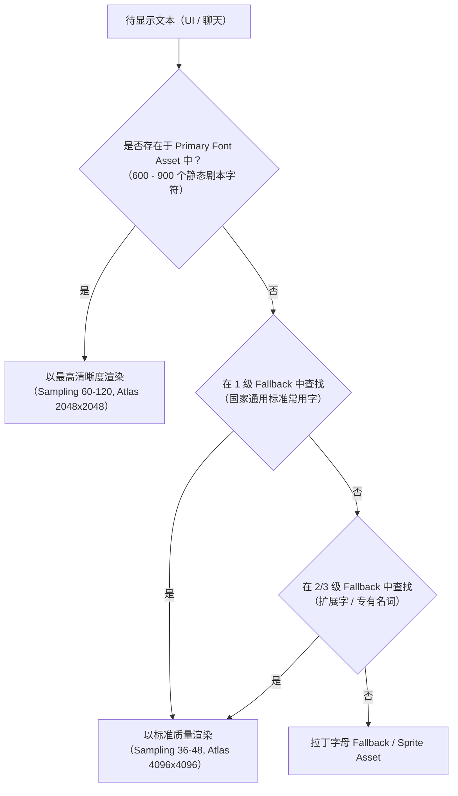

## **1. 项目概述与实时本地化挑战**

**GilongWorld** 项目提出了一项极具复杂性与全球化规模的技术需求：为 15 种目标语言提供全面的本地化（*localization*）支持。具体列表涵盖：英语、越南语、法语、意大利语、德语、西班牙语（西班牙）、波兰语、葡萄牙语（巴西）、葡萄牙语（葡萄牙）、韩语、俄语、日语、土耳其语、简体中文与繁体中文。在采用 Unity 引擎的现代游戏开发中，在实时图形渲染环境下管理和显示文本，绝不仅仅是简单的字符串替换。它要求一套全面优化的字体架构，以确保版面美观、任意摄像机距离下的清晰度，以及最为关键的系统内存使用效率。

目前 Unity 生态系统中最标准、最强大的文本渲染工具是 **TextMeshPro（TMP）**。与传统 UI 文本系统（UI Text）在放大时将每个字符渲染为模糊位图图像的方式截然不同，TextMeshPro 要求将标准字体文件转换为被称为 **Font Asset** 的专用资源[^1]。这些 Font Asset 包含一张或多张采用 **Signed Distance Field（SDF，有向距离场）** 技术的纹理图集（*Atlas Texture*）。SDF 技术不仅能使文本无限放大而不产生像素化失真（*pixelation*），还为缩放着色器（shader）直接在 GPU 上实时生成描边、阴影、字重粗细以及发光等复杂图形效果提供了数学基础[^1]。

然而，SDF 的强大渲染能力也伴随着无法回避的物理限制：**内存上限**。将 15 种目标语言的全部字符塞入同一张纹理图集是不可能实现的[^1]。尤其是属于 CJK（*Chinese, Japanese, Korean*，中日韩）语系的语言，拥有数以万计字符的庞大象形文字体系。若试图将整套 CJK 字符集强行压入单一 Atlas Texture，纹理尺寸将超出硬件设备（尤其是移动设备）的处理上限（通常为 $4096 \times 4096$ 或 $8192 \times 8192$ 像素），从而导致显存（VRAM）溢出或应用崩溃（*crash*）[^5]。本报告将详尽阐述从源字体选型与下载、文字体系特性分析，到 TextMeshPro 内部参数配置、回退链（*Fallback Chain*）管理，以及借助 Unity Localization 包彻底解决汉字统一（*Han Unification*）难题的全套工程流程。

---

## **2. 文字学基础与源字体获取策略**

构建多语言文本系统的首要且最关键的一步，是选择精准的源字体文件（*Source Font File*）。要在 15 种语言间保持视觉一致性，就需要一套开源、完整覆盖从基础到扩展 Unicode 码位范围、且在基线高度（*baseline*）与笔画粗细（*weight*）上保持高度统一的字体家族。

在软件行业中，**Google Noto** 字体家族（源自 *"No Tofu"* 的缩写——旨在彻底消除设备因缺字而显示俗称“豆腐块”的空白方框的现象）被公认为黄金标准解决方案[^7]。Noto 字体由 Google 联合顶尖字体设计伙伴共同打造，确保拉丁字母、西里尔字母及 CJK 字符能够在同一行文本中并排显示，而不会产生比例失调或艺术风格割裂的问题[^8]。多语种混排时文本的平滑视觉衔接，对 GilongWorld 的玩家沉浸感至关重要。

### **提取并导入字体数据至 Unity**

要启动集成流程，需直接从 **Google Fonts** 字体库下载原始字体文件。下载并导入 Unity 的过程必须遵循严格规范，以避免项目体积发生不必要的膨胀：

1. **采用拉丁字母与西里尔字母的 11 种语言组**（*英语、越南语、法语、意大利语、德语、西班牙语、波兰语、葡萄牙语-巴西、葡萄牙语-葡萄牙、俄语、土耳其语*）：系统仅需基础字体集 **Noto Sans**[^8]。该字体包含超过 3,700 个字形（*glyphs*），覆盖 Latin Extended、西里尔字母及组合附加符号等 Unicode 区块，完全满足上述语言需求[^8]。在 Google Fonts 主页下载压缩包后，可获得 TrueType（`.ttf`）格式的多种字重变体（如 *Thin、Regular、Medium、Bold、Black*）。
2. **4 种 CJK 语言组**：下载流程则更为复杂。开发人员需分别获取四个独立的区域变体：**Noto Sans JP**（日语）、**Noto Sans KR**（韩语）、**Noto Sans SC**（简体中文）和 **Noto Sans TC**（繁体中文）[^7]。由于包含海量字形图形数据，这些 CJK 字体文件体积通常极其庞大，单一字重便高达 15MB 至 20MB。该语组常见格式为 OpenType（`.otf`），相比 TrueType，它支持更为复杂的字形映射表结构[^5]。

解压来自 Google Fonts 的压缩包后，下一步是将其导入（*import*）Unity 项目环境。资源管理的一项最佳实践（*best practice*）是建立专用目录结构，例如 `Assets/GilongWorld_Resources/Fonts/Source_Files/`。将所需的 `.ttf` 和 `.otf` 文件（除非 UI 设计明确要求使用粗体变体，否则为优化内存仅应选取 *Regular* 或 *Medium* 等单一标准字重）直接从操作系统拖拽至 Unity Editor 的 Project 窗口中的该目录下[^10]。

> [!NOTE]
> TextMeshPro 在运行时并不会直接使用这些 `.ttf` 或 `.otf` 文件来渲染文本；它们仅作为原材料，供 Font Asset Creator 工具提取字形轮廓数据并烘焙为 SDF 纹理[^1]。将源文件隔离存放在独立目录中，有助于在最终构建（如未启用 Dynamic SDF 功能）时轻松将其从包体中剔除，从而有效缩减游戏安装包体积。

---

## **3. 语系特征分析与 Unicode 码位范围要求**

GilongWorld 项目涵盖 15 种语言的复杂多样性，要求工程师深入剖析字符在国际标准 Unicode 中的编码方式。TextMeshPro 使用十六进制（Hexadecimal）来指定需要从源字体文件中提取的编码范围（*Unicode Ranges*）[^13]。精准声明这些码位范围不仅能确保 100% 的语言覆盖率，还能防止载入无用字符而使 Atlas 纹理尺寸膨胀。

基于形态学结构，15 种语言被划分为三大核心策略组进行资源管理。

### **第 1 分组：扩展拉丁字母体系与附加符号（Diacritics）**

该分组涵盖英语、法语、意大利语、德语、西班牙语、波兰语、葡萄牙语（巴西）、葡萄牙语（葡萄牙）、土耳其语及越南语。尽管它们共享基础拉丁字母表（`U+0020` 至 `U+007E`），但在扩展编码区块上存在显著分化[^1]：

- **西欧与南欧语言**（*法语、西班牙语、意大利语、葡萄牙语、德语*）：主要依赖 *Latin-1 Supplement*（`U+00A0` 至 `U+00FF`）区块，其中包含 `á`、`é`、`í`、`ó`、`ú`、`ñ`、`ü` 和 `ç` 等基础重音元音及字符。
- **中欧与土耳其语**（*波兰语、土耳其语*）：依赖 *Latin Extended-A*（`U+0100` 至 `U+017F`）区块，以显示 `ą`、`ł`、`ş` 和 `ğ` 等特定字符[^10]。
- **越南语**：该分组中最具特殊性。由于复杂的声调系统叠加在带帽元音（`â`、`ê`、`ô`）或带钩元音（`ơ`、`ư`）之上，越南语必须包含 *Latin Extended Additional*（`U+1E00` 至 `U+1E9F`）区块[^14]。越南语的叠音符号使字符具有极高的垂直高度（例如 `Ể` 字母可能超出常规拉丁大写字母高度上限），因此必须在 TextMeshPro 中精细调整行高（*line height*）与内边距（*padding*），以避免字符顶部出现裁切（*clipping*）现象。

### **第 2 分组：西里尔字母体系（Cyrillic）**

项目中唯一属于该体系的语言是 **俄语（Russian）**。西里尔字母在编码上完全独立于拉丁体系，完整位于 `U+0400` 至 `U+04FF` 编码区块内[^10]。尽管编码独立，但西里尔字母在字符宽度与基线高度等形态特征上与拉丁字母高度一致，使其能够毫无违和感地合并到拉丁语组的同一个 Font Asset 中，而不会造成任何视觉失衡。

### **第 3 分组：CJK 体系与历史遗留的汉字统一（Han Unification）问题**

第三分组包含 **韩语、日语、简体中文和繁体中文**。这是最为复杂的领域，也是 TextMeshPro 技术极限最常面临挑战的地方。根本原因不仅在于庞大的字符基数，还源于 Unicode 联盟一项备受争议的技术规范——**汉字统一（Han Unification）**[^7]。

在 Unicode 标准制定初期，为了将编码空间限制在 16 位范围内，软件工程师决定将源自中国、日本和韩国、具有相同历史渊源的象形文字合并到同一个唯一**码点（code point）**中[^7]。这一编码区块被称为 *CJK Unified Ideographs*（中日韩统一表意文字），范围从 `U+4E00` 延伸至 `U+9FA5`[^12]。

这一决策在显示技术上带来了严重后果：**尽管共享同一个 Unicode 码点，但同一字符（glyph）的实际字形外观在不同国家/地区却存在差异**，这是由各自文化演变、书法传统及教育规范分歧所导致的：

- 典型例子是汉字“骨”，其 Unicode 码点为 `U+9AA8`（`骨`）。该字上部矩形框内的笔画结构在简体中文（SC）字体中采用从左到右的横向排布，而在繁体中文（TC）和日语（JP）字体中，其内部笔画结构则完全不同[^7]。
- 同理，“雪”（`雪`）与“直”（`直`）等常见汉字也存在细微却极易被母语者察觉的字形结构差异。

文本渲染系统无法自行推断文字的地域形态；它仅接收一个 Unicode 编码，并从当前激活的字体集中抓取对应字形。因此，对所有东亚语言共用同一个 CJK 字体，将导致日本玩家在屏幕上看到用中文写法渲染出的日语台词，反之亦然[^7]。对于母语玩家而言，这会产生字体错乱、缺乏专业性甚至“异体混杂”的观感，彻底破坏游戏世界的沉浸体验[^7]。突破这一限制的唯一解决方案，是为每种 CJK 语言完全隔离出独立的 Font Asset，并动态管理回退链路由。

---

## **4. TextMeshPro 与有向距离场（SDF）技术机制**

为了精确执行配置流程，理解 **Signed Distance Field（SDF）** 在 TextMeshPro 中的工作原理是必不可少的。与存储像素颜色信息的传统位图（Bitmap）字体不同，SDF 纹理存储的是每个纹素到字符最近边缘（轮廓线）的数学距离[^1]：
- 若像素位于字符轮廓**内部**，距离为**正值**。
- 若位于字符**外部**，距离为**负值**。
- 若**恰好位于边缘上**，距离等于**零**（$0$）。

这些距离数据以灰度图（*grayscale*）形式编码并存储在 Atlas Texture 中。在运行时，TextMeshPro 的 GPU 着色器会对这些距离样本进行双线性插值（*bilinear interpolation*）。着色器会逐个检测屏幕片元（*fragment*）的数值：若值 $> 0$，则该片元被着色；若 $< 0$，则置为透明。由于渲染基于连续的数学插值而非离散的像素网格，即使摄像机极度贴近物体，SDF 文本依然能呈现极其锐利的曲线边缘[^1]。

这一机制决定了生成 Font Asset 时的两个核心参数：
1. **Sampling Point Size（采样点大小）：** 决定字符光栅化绘制到 Atlas Texture 上时的物理像素尺寸。尺寸越大，距离场数据的细节精度越高。
2. **Padding（边距/内边距）：** SDF 强大效果的关键所在。字符周围的缓冲留白允许距离梯度向更深的负值平滑衰减。边距越宽，SDF 算法就拥有越充足的“空间”来生成较粗的描边（*outline*）、投影（*shadow*）或发光（*glow*）效果，而不会发生突兀的边缘截断[^13]。

---

## **5. 使用 Font Asset Creator 的详细配置指南**

所有字体纹理资产均通过 Unity 内置工具 **Font Asset Creator** 生成，访问菜单路径如下：

```text
Window > TextMeshPro > Font Asset Creator
```

根据第 3 节的分析，GilongWorld 项目对 15 种语言采用分段式最优结构：**为 11 种拉丁/西里尔语言创建一个共享 Font Asset，同时为 4 种 CJK 语言分别创建各自独立的 Font Asset**。

### **5.1. 为拉丁语系、西里尔语系及越南语配置静态（Static）结构**

将 11 种语言（*英语、法语、意大利语、德语、西班牙语、波兰语、巴西葡萄牙语、葡萄牙葡萄牙语、土耳其语、俄语、越南语*）整合进单一的 **Primary Static Font Asset**，是减少 GPU 绘制调用（*draw call*）最有效的方法，这对在复杂 UI 界面下维持稳定的帧率（*frame rate*）起着决定性作用[^14]。

在 Font Asset Creator 中需严格按照以下参数进行配置[^12]：

| 配置属性 | 技术推荐值 | 分析与原理 |
| :--- | :--- | :--- |
| **Source Font File** | `NotoSans-Regular.ttf` | 将源文件从 `Assets` 目录拖拽至该字段。它是字体几何轮廓的数据源[^1]。 |
| **Sampling Point Size** | `Custom Size: 60 - 90` | Auto Sizing 模式仅会尽力将字符塞入可用空间。通过将 Custom Size 锁定在 60 到 90 之间，可确保整张纹理表面的 SDF 质量高度一致[^1]。 |
| **Padding** | `6 - 9`（比例 ~10%） | TextMeshPro 的标准经验法则是 Padding 应占 Sampling Point Size 的约 10%[^4]。当 Sampling 为 60 时，Padding 设为 6 最为理想。若项目的 UI 风格需要极粗的文字描边，该数值可提升至 10。 |
| **Packing Method** | `Optimum` | Optimum 算法比 Fast 耗时明显更长，但它会执行迭代装箱计算，将字形最紧密地排列在空间内，最大限度减少纹理像素浪费[^12]。 |
| **Atlas Resolution** | `2048 x 2048` | 这 11 种语言的字符总数约在 1,500 至 2,000 个字形之间。$2048 \times 2048$ 的分辨率足以在维持 60 采样尺寸的同时容纳全部字符而不发生丢字[^7]。 |
| **Character Set** | `Unicode Range (Hex)` | 相比选择预设字符集，该模式能对载入的字符提供绝对精准的掌控[^2]。 |

在 **Custom Character List** 字段中填入完整覆盖上述 11 种语言需求的十六进制码位范围字符串：

```text
0020-007E, 00A0-00FF, 0100-017F, 0180-024F, 1E00-1E9F, 0300-036F, 0400-04FF, 0500-052F, 2000-206F
```

参数全部填写完毕后：
1. 点击 **Generate Font Atlas** 按钮。工具将开始计算距离场并生成纹理（视 CPU 性能可能需要数分钟）。
2. 完成且预览图显示正常后，点击 **Save**。
3. 将生成的资产命名为 `Global_Latin_Cyrillic_SDF.asset` 并保存至项目字体目录[^1]。

### **5.2. 为 CJK 语系配置静态（Static）结构与分层回退架构**

由于数据体量过于庞大，处理 4 种 CJK 语言需要截然不同的策略。必须分别为 `NotoSansCJKjp`、`NotoSansCJKkr`、`NotoSansCJKsc` 和 `NotoSansCJKtc` 重复执行四次资产生成流程。然而，若试图通过 Unicode 范围将整张 CJK 字符表烘焙进单个静态 Atlas，必定会因超出物理纹理尺寸限制而失败[^5]。

标准的工程解决方案是结合 **Characters from File** 选项，实施**分层字符映射模型（Hierarchical Character Mapping）**[^7]：

#### **1. 为已知脚本字符（Known Characters）创建主 SDF Font Asset**
- 从项目的字符串表（*String Tables*）中提取所有静态文本字符串（菜单、任务、道具、对话、技能）。
- 这组唯一字符（*unique characters*）在实际项目中通常**少于 1,000 个字符**（例如在 GilongWorld 项目中，简体中文仅占 **855 个字符**，繁体中文 **870 个字符**，日语 **694 个字符**，韩语 **588 个字符**）。
- **最大化采样质量（Maximize Sampling Size）：** 由于字符数量不到 1,000，在 $2048 \times 2048$ 的 Atlas 分辨率下可将 **Sampling Point Size 设高**（`60` 至 `90` 或 `120`）。这确保了游戏中所有官方 UI 文本在任意摄像机距离下都能达到极致的锐利度。

#### **2. 基于国家标准字符集构建分层回退资产（面向 UGC/聊天的标准 Fallback）**
为全面支持玩家的自由输入（角色命名、公会聊天），确保绝不出现豆腐块（Tofu），系统需配套构建继承自**各国官方标准字符数据集**的 Fallback Font Asset 层级：

| 语言 | 国家标准字符集 | 字符数量 | 发布机构与参考来源 |
| :--- | :--- | :---: | :--- |
| **简体中文 (zh-Hans)** | **《通用规范汉字表》（TGSCC）**<br/>- 一级（常用）：3,500 字<br/>- 二级（扩展）：3,000 字<br/>- 三级（人名/地名）：1,605 字 | **8,105** | 中华人民共和国教育部<br/>*开源地址：* [GitHub chinese-character-table](https://github.com/maple-leaf/chinese-character-table) |
| **繁体中文 (zh-Hant)** | **《常用国字标准字体表》**（*常用國字標準字體表*） | **4,808** | 台湾地区教育部门（MOE Taiwan）<br/>*开源地址：* [台湾开放数据平台](https://data.gov.tw/dataset/5961) / [GitHub cjktables](https://github.com/ButTaiwan/cjktables) |
| **日语 (ja)** | - **常用汉字（Jōyō Kanji）**：2,136 字<br/>- **人名用汉字（Jinmeiyō Kanji）**：863 字 | **2,999** | 日本文化厅（文化庁）<br/>*开源地址：* [KanjiAPI](https://kanjiapi.dev/) / [GitHub kanji-data](https://github.com/davidluzgouveia/kanji-data) |
| **韩语 (ko)** | **KS X 1001 标准**（覆盖 99.9% 日常交流的 2,350 个最常用谚文音节） | **2,350** | 韩国技术标准局（KATS）<br/>*开源地址：* [GitHub ksx1001](https://github.com/korean-character-sets/ksx1001) / 通过 `euc-kr` 提取 |



#### **3. 黄金不变法则：保持 Sampling Point Size / Padding 比例一致性（Ratio Consistency）**

TextMeshPro 着色器的一项核心图形学原理是：**描边（Outline）、底衬/阴影（Underlay / Shadow）和发光（Glow）等效果的粗细，直接由 Sampling Point Size 与 Padding 之间的比值决定**[^13]。

##### **为什么 Fallback 不需要与 Primary 相同的采样字号？**
- **Primary Font（约 855 个 UI 剧本字符）：** 在游戏过程中 100% 出现 $\rightarrow$ 需要**最大化画质**（`Sampling Size = 120`，`Padding = 10`，Atlas $2048 \times 2048$）。
- **Fallback Fonts（用于聊天/命名的 2,700 – 8,000 个生僻字）：** 出现频率极低 $\rightarrow$ **降低采样质量**（`Sampling Size = 60` 或 `48`），以便在不膨胀显存的前提下将数千个字符压缩进同等尺寸的 Atlas 中。

##### **为什么必须严格保持相同的比值（$\text{Ratio} = \frac{\text{Sampling}}{\text{Padding}}$）？**
若在同一句话中同时出现了来自 Primary 的字符与来自 Fallback 的字符：
- **如果比值失调：** Primary 字符（Size 120，Pad 10 $\rightarrow$ Ratio 12）描边纤细美观；而 Fallback 字符（Size 60，若误留 Pad 10 $\rightarrow$ Ratio 6）就会出现**描边暴涨至两倍粗、严重畸变甚至吞噬笔画**的问题。
- **如果保持相同比值（$\text{Ratio} = 12$）：** 无论字符来自 Primary 还是回退至 Fallback，**描边粗细与阴影扩散范围都将始终保持 100% 一致**。

| Font Asset 层级 | 职责定位 | Sampling Point Size *(Custom)* | Padding | Atlas Resolution | 比值 (Ratio) |
| :--- | :--- | :---: | :---: | :---: | :---: |
| **Primary Font** | 核心 UI 剧本 | **120** *（或 96）* | **10 px** *（或 8 px）* | $2048 \times 2048$ | **12** *（极致锐利）* |
| **1 级 Fallback** | 约 2,725 个常用字 | **60** | **5 px** | $2048 \times 2048$ | **12** *（节省显存）* |
| **2 级 Fallback** | 约 2,992 个扩展字 | **60** | **5 px** | $2048 \times 2048$ | **12** *（节省显存）* |
| **3 级 Fallback** | 约 1,605 个生僻/人名字 | **48** | **4 px** | $2048 \times 2048$ | **12** *（节省显存）* |

> [!TIP]
> **实操建议：** 在 *Font Asset Creator* 中，将 `Sampling Point Size` 从 *Auto Sizing* 切换为 **Custom Size**，以便严格按照上表比例锁定采样尺寸与 Padding。

---

### **5.3. Unity 中的目录组织与实战自动化流程**

为了便于长期扩展与维护，GilongWorld 项目为所有源字符数据建立了专门的分组目录结构：

```text
Assets/_GilongWorld/_Project/Art/Fonts/_chars/
├── 01_Latin_Cyrillic/        # [共享 Primary Font] 11 种拉丁/西里尔语言
│   ├── vi_chars.txt          # 越南语
│   ├── en_chars.txt          # 英语
│   ├── ru_chars.txt          # 俄语
│   └── ...                   # 法语、德语、意大利语、西班牙语、波兰语、葡萄牙语、土耳其语
│
├── 02_CJK/                   # [CJK Primary Fonts] 游戏内静态剧本字符
│   ├── ja_chars.txt          # 日语（实际 694 个字符）
│   ├── ko_chars.txt          # 韩语（实际 588 个字符）
│   ├── zh_Hans_chars.txt     # 简体中文（实际 855 个字符）
│   ├── zh_Hant_chars.txt     # 繁体中文（实际 870 个字符）
│   │
│   ├── Standard_Fallbacks/   # [标准源数据层] 7 套原始国家标准数据集
│   │   ├── zh_Hans_TGSCC_Level1_3500.txt
│   │   ├── zh_Hans_TGSCC_Level2_3000.txt
│   │   ├── zh_Hans_TGSCC_Level3_1605.txt
│   │   ├── zh_Hant_Common_4808.txt
│   │   ├── ja_Joyo_Kanji_2136.txt
│   │   ├── ja_Jinmeiyo_Kanji_863.txt
│   │   └── ko_KS_X_1001_2350.txt
│   │
│   └── Subtracted_Fallbacks/ # [优化后的 Fallback 层] 已彻底剔除 Primary 字符
│       ├── zh_Hans_Fallback_Level1.txt    (TGSCC 一级减去 Primary)
│       ├── zh_Hans_Fallback_Level2.txt    (TGSCC 二级减去 Primary)
│       ├── zh_Hans_Fallback_Level3.txt    (TGSCC 三级减去 Primary)
│       ├── zh_Hant_Fallback_Common.txt    (台湾标准 4808 减去 Primary)
│       ├── ja_Fallback_Joyo.txt           (常用汉字减去 Primary)
│       ├── ja_Fallback_Jinmeiyo.txt       (人名用汉字减去 Primary)
│       └── ko_Fallback_KS_X_1001.txt      (KS X 1001 减去 Primary)
```

#### **自动化字符提取与 Fallback 差集计算工具（`GWCharacterExtractor.cs`）**
为了将程序员从繁琐的 CSV 导出和手动去重中解放出来，项目集成了专用 Unity Editor 工具 [`GWCharacterExtractor.cs`](file:///d:/Unity-Projects/GLW/Assets/_GilongWorld/_Project/Editor/Localization/GWCharacterExtractor.cs)，实现了二合一自动化流程：
- **访问菜单：** `GilongWorld → Localization → Extract CJK Characters From String Tables`
- **机制 1（Primary 提取）：** 扫描 Unity Localization 中的所有 `StringTableCollections`，将当前使用的所有字符串汇入 `HashSet<char>` 结构（确保 100% 唯一性），按 Unicode 码位升序排列后分别写入 `02_CJK/` 下的 4 个 Primary 文件。
- **机制 2（自动计算 Fallback 差集）：** 脚本自动读取 `Standard_Fallbacks/` 下的 7 个数据集，比对并**剔除所有已存在于 Primary Asset 中的字符**，随后输出至 `Subtracted_Fallbacks/` 目录。此举彻底消除了 Primary Atlas 与 Fallback Atlas 之间因字符重复而造成的显存浪费。

#### **GWSDFGeneratorWindow 界面与突破 Unity 6 API 封装限制**
为确保“Sampling / Padding 比值 = 12”的铁律得到严格执行，项目提供了专用 Editor Window，支持参数录入并在比值偏离时自动计算发出警告。
特别值得注意的是，在 Unity 6 中，Font Asset 的 `clearDynamicDataOnBuild` 属性被限制为 `internal` 访问级别，阻断了通过常规代码在构建前清理冗余数据的途径。该工具通过 `SerializedObject` 运用反射（Reflection）技术彻底解决了这一限制：

```csharp
var serializedObject = new SerializedObject(fontAsset);
serializedObject.FindProperty("m_ClearDynamicDataOnBuild").boolValue = true;
serializedObject.ApplyModifiedProperties();
```
凭借这一机制，旧系统遗留的 137MB 异常 Atlas 被彻底清理干净，使构建包体大小回归精简状态。

---

## **6. 回退链（Fallback Chain）管理架构与 Han Unification 解决方案**

多语言游戏流畅运行的核心在于对回退链（*Fallback Chain*）的精准调度。当 TextMeshPro UI 组件接收到一个包含 Primary Font Asset 中不存在的字符的字符串时，系统会沿各级回退列表执行递归查找算法，以寻找替代字形（*glyph*）。

查找算法遵循严格的优先级层级：
1. `TextMeshPro Primary Font Asset`
2. `Primary Font 内部配置的 Fallback Font Assets 列表`
3. `内部 Sprite Asset`
4. `TMP_Settings 中全局定义的 General Fallback Font Assets`
5. `Default Sprite Asset`
6. `Default Font Asset`[^20]

> [!WARNING]
> 系统严格按照自上而下的顺序进行搜索，并在**匹配到第一个符合的 Unicode 码点时立即停止查找**[^7]。

正如第 3 节所分析的，Han Unification 现象导致简体中文（SC）、繁体中文（TC）和日语（JP）在形态迥异的情况下共享了同一 Unicode 码点[^7]。如果开发者将所有 CJK 字体文件一股脑塞入 `TMP_Settings` 的 General Fallback Font Assets 列表中，列表的排列顺序将直接主宰文本的显示命运。例如，若列表顺序为：`Font_CJK_JP_SDF` $\rightarrow$ `Font_CJK_SC_SDF` $\rightarrow$ `Font_CJK_TC_SDF`。当输入一段简体中文文本时，系统自上而下扫描，首先命中日语字体，找到对应 Unicode 码点并立即采用日文汉字字形将其渲染至屏幕，完全忽略排在后面的中文字体[^7]。

### **局部分流回退架构（Local Fallback Architecture）**

为了彻底根除这一难题，必须对 Fallback 结构实施物理隔离：

> [!IMPORTANT]
> **绝对不要将 CJK 字体放入 `TMP_Settings` 的全局回退列表（Global Fallback List）中**[^1]。取而代之的是，通过每个 Asset 文件自身的局部回退（*Local Fallback*）结构进行绑定，并在运行时进行动态管理。

一项基本的排版规律是：与纯拉丁字体相比，CJK 字体内置的拉丁字母和阿拉伯数字往往设计粗糙或比例失调[^9]。因此，拉丁字符必须始终优先交由 `Global_Latin_Cyrillic_SDF` 进行渲染。局部关联结构按如下方式构建：
1. 打开 `Font_CJK_SC_SDF.asset` 文件，在 **Fallback Font Assets** 中添加简体中文的 1-3 级 Fallback，并追加 `Global_Latin_Cyrillic_SDF` 文件[^1]。
2. 对繁体中文（TC）、日语（JP）和韩语（KR）文件执行完全相同的操作。

这保证了当游戏以中文显示时，若文本中夹杂了数字或英文专有名词，它们会顺利穿透中文静态 Atlas（因在 *Characters from File* 提取时已滤除拉丁字符），并被包含高品质拉丁字体的 Fallback 文件精准承接[^7]。

---

## **7. 集成 Unity Localization 实现运行时动态切换（Runtime Swapping）**

为确保文化字形渲染的准确性并优化显存占用，TextMeshPro UI 组件不能长期维持静态绑定配置。当玩家切换语言（*Locale*）时，基础字体（*Primary Font Asset*）必须在运行时（*runtime*）自动完成热切换（*swap*）[^23]。

**Unity Localization** 工具包（`com.unity.localization`）提供了强大机制来驱动这一逻辑流，而无需对每个切换事件进行硬编码（*hardcoding*）[^25]。其集成架构基于通过 `LocalizationSettings.SelectedLocaleChanged` 监听全局语言切换事件的机制[^24]。

共有两种实现方案可供选择：

### **方案 1：集中式脚本管理（Centralized Font Manager）**

GilongWorld 项目没有为成千上万个 UI 文本组件逐一手动挂载 Localized Asset 事件（那会产生大量冗余 `MonoBehaviour` 对象并引发严重的垃圾回收 GC 压力），而是采用了 **基于 Addressables 的集中式管理策略**。

挂载 `DontDestroyOnLoad` 标记的 `GWFontManager.cs` 脚本负责监听 `LocalizationSettings.SelectedLocaleChanged` 事件。当该事件触发时，Manager 会执行两项精细操作：
1. **异步加载（Async Load）：** 调用 `LocalizationSettings.AssetDatabase.GetLocalizedAssetAsync<TMP_FontAsset>("Fonts_Table", "PrimaryFont")`，从 Addressables 中拉取当前语言对应的标准 Font Asset。
2. **全局扫描替换（Global Sweep）：** 调用 `FindObjectsByType<TMP_Text>` 遍历整个场景，将新字体强制赋值给所有 UI 文本组件。该指令虽耗时几毫秒 CPU 时间，但仅在切换语言或加载场景时运行一次，作为回报，它彻底解放了内存，使其免受成千上万个零散组件监听器的拖累。赋值完成后，旧语言的字体资源会立即通过 `Addressables.Release()` 释放。

由于回退系统在内存中仅加载了当前指定语言的唯一 Atlas，该方案彻底杜绝了 CJK 语言间的“交叉污染”（*cross-pollination*）现象[^7]。

### **方案 2：Unity Localization 的 Asset Tables**

最原生（*native*）的集成方案是使用 **Localized Asset Tables**[^23]。与用于替换文本字符串的 Localized String Tables 类似，Asset Tables 允许为不同语言绑定不同的资产文件。UI 上的 Localized Text 组件可以配置为不仅自动切换 String 字符串，还能同步更改 TextMeshPro 对象的 `FontAsset` 属性[^23]。

该方法需要在 Inspector 面板中进行配置，但稳定性极高，并能使开发者摆脱维护自定义代码映射系统的负担[^28]。

---

## **8. 动态内容管理（UGC）、内存优化与 Addressables 集成**

静态架构（*Static Architecture*）完美解决了系统 UI 界面的渲染问题。然而，用户生成内容（**User-Generated Content - UGC**），例如角色名称、公会简介或公共聊天框，带来了更大的挑战。我们无法预知用户会从 15 种语言字符集中输入哪些字符，且将全球数十万个字符全部预载入内存是不切实际的。

### **混合架构解决方案（Hybrid SDF System）**

TextMeshPro 常规的 **Dynamic SDF** 系统允许 Font Asset 以一张空白纹理 Atlas（$0 \times 0$ 像素）起步。当检测到新字符时，它利用 CPU 现场绘制该字符并在运行时将其写入纹理[^6]。
然而，如果完全滥用纯动态模式，游戏在首屏加载时会出现剧烈的卡顿（frame spike）。因此，GilongWorld 项目采用了**混合架构（Hybrid）**：

1. **平滑静态预填充（Static Population）：** 借助 `GWCharacterExtractor.cs` 工具，在 Editor 阶段即通过 `TryAddCharacters` 函数将数千个最常用字符预先烘焙进 Atlas。玩家进入游戏时这些字符已处于就绪状态，从而保障帧率（FPS）绝对稳定。
2. **安全的动态兜底机制（Dynamic Fallback）：** Font Asset 仍以 Dynamic 模式保存，并开启 `isMultiAtlasTexturesEnabled = true` 标志。若玩家在聊天中输入了一个初始 Atlas 中从未收录的极生僻字，TMP 会立即动态“派生”出一张新的 Atlas Texture（`Atlas 0 1`、`Atlas 0 2`...）以容纳该字符，而非显示豆腐块（Tofu）。这是目前最理想的组合方案。

> [!CAUTION]
> Dynamic SDF 方案伴随着实打实的资源开销：每生成一张 $2048 \times 2048$ 的动态 Atlas，就会立即占用约 **4MB** 系统内存。若不断派生出过多子 Atlas，移动设备承受的内存压力将急剧攀升[^31]。

### **隐蔽的 Addressables 陷阱与显存（VRAM）重复占用**

像 GilongWorld 这样的现代大型项目几乎必然采用 **Addressables** 系统来加载资源。然而许多开发者极易陷入一个致命误区：**误以为自己尚未启用 Addressables，便放心地将字体文件留在 `Resources` 文件夹中。**

事实上，**Unity Localization 工具包本身就是直接构建在 Addressables 底座之上的**。即便你没有显式使用它，Addressables 依然在后台静默运行以管理 String Tables。
当一个通过 Addressables 打包的 UI 预制体（Prefab）引用了位于 `Resources` 目录下的 Font Asset 时，Unity 的资源管理器便会犯下数据重复打包（*duplicate assets*）的严重错误：
1. Unity 会将那张 Atlas 纹理完整复制一份，直接打入 Addressables 的 AssetBundle 包体内部[^32]。
2. 游戏运行加载时，`Resources` 中的 Atlas 已被预先载入内存，而来自 AssetBundle 的另一份 Atlas 又会继续被加载进 RAM，导致**同一份图集浪费性地占用双倍显存（VRAM）**[^31]。这一问题极为常见，且极易导致对最大 RAM 严格受限的移动应用直接崩溃[^33]。

**彻底解决方案：**
- 将 `TMP_Settings` 文件与所有 Font Asset 彻底移出 `Resources` 文件夹，迁移至标准目录 `Assets/_GilongWorld/_Project/Art/Fonts/SDF/`。
- 选中全部 SDF 资产文件并将其划入专用的 Addressables Group（例如 `Fonts_Addressables`），同时在 Localization 的 **Asset Table**（`Fonts_Table`）中配置好映射关系。
- **在 Editor 中清理动态字体数据：** Dynamic Font Asset 文件具有持久化保存纹理数据的特性。每次构建发布包之前，必须执行动态数据清理操作（已通过前文所述的基于 `SerializedObject` 技术的 `GWSDFGeneratorWindow` 工具实现自动化）[^30]。
- **运行时内存清理：** 在大型场景切换期间，调用 `TMP_FontAsset.ClearFontAssetData(true)` 或 `FontEngine.DestroyFontEngine()` API，彻底释放不再使用的动态纹理数组[^35]。

---

## **9. 实时诊断与技术故障排查（Troubleshooting）**

在多平台实际部署测试过程中，本地化系统常会暴露出一些表层故障症状。掌握诊断原理有助于技术团队迅速定位并隔离问题：

### **移动端构建包中文本显示为空白方框（Tofu Boxes），但在 Editor 中显示正常**
- **原因：** 如果 Fallback Font Assets 仅在运行时通过 `FallbackFontAssetTable` 进行松散关联，而未被场景中的某个静态 GameObject 直接引用，Unity 的资源管理器便无法将其识别为构建依赖项（*dependencies*）。Unity 的打包流程为了优化包体大小，会自动将这些资源剔除（*strip*）[^1]。
- **解决方法：** 将 `TMP_Settings.fallbackFontAssets` 作为全局引用注册项，使 Unity 感知到它们的存在；或者确保所有潜在使用的 Font Asset 均已在 Addressables Manifest 中被标记为预加载（*pre-load*）[^1]。

### **异常报错："The variable m_AtlasTextures of TMP_FontAsset has not been assigned"**
- **原因：** 直接与开启了 Multi Atlas Textures 配置的 Dynamic Font Asset 系统有关[^34]。当系统自动新建纹理数组以容纳新字符，但该过程被意外中断，或因动态实例化的预制体（*instantiated prefabs*）导致内存被错误释放时，该数组变量就会残留一个空引用（*null reference*）。
- **解决方法：** 在构建打包之前，通过 Font Asset 右键上下文菜单手动执行 **Reset** 操作，以重建初始的空纹理数组[^34]。

### **大字号显示下文本出现模糊（Blurry）**
- **原因：** 相对于屏幕上的实际渲染尺寸而言，SDF Atlas 的分辨率或 `Sampling Point Size` 设置过低[^1]。
- **解决方法：** 对于大型标题文本（Heading / Banner），必须将 `Sampling Point Size` 重新配置为 `150` 或更高。若无法生成更大的 Atlas 来容纳该参数，则应将标题界面专用的特定字符拆分出来，制作成独立的 Static Font Asset，以最大化清晰度，而非与普通正文文本共用同一套字体资产[^1]。

### **从 Google Sheets 拉取（Pull）翻译表时触发身份验证错误（`invalid_grant: Token has been expired or revoked`）**
- **症状：** 从 Google Sheets 向 Unity 同步（*Pull*）本地化字符串表（如 `RPGB_General` 或 String Tables）时，系统报红错：`Pull from Google sheets: Failed - Error: "invalid_grant", Description: "Token has been expired or revoked."`
- **原因：** **时区偏差 / 系统时钟漂移（Timezone Skew / Clock Drift）**。Google OAuth2 身份验证机制对请求中附带的时间戳精度要求极其严苛。若本机存在时区偏差、系统时钟走时不准，或者 Unity Editor 缓存了未及时刷新的旧时间偏移量，Google 服务器将立即拒绝请求并返回令牌无效或已过期（`invalid_grant`）错误。
- **解决方法：**
  - **重启 Unity Editor：** 关闭并重新打开 Unity Editor，让引擎重新读取操作系统的当前准确系统时间 $\rightarrow$ 再次点击 **Pull** 即可立即成功。

---

## **10. 最终架构建议汇总**

面向 15 种语言规模的 GilongWorld 项目，要求文本图形渲染架构在显存（VRAM）分配性能与跨文化视觉体验方面满足最严苛的标准：

1. **字形视觉一致性（排版美学）：** 全面采用 Google Noto Sans 与 Noto Sans CJK 字体生态，确保在多语言混排的任意文本格式中维持基线（*baseline*）与笔画粗细的平滑统一。
2. **纹理分段模型（Atlas Segmentation）：** 切勿将全部语言强行压入单张 Atlas。仅构建一个 $2048 \times 2048$ 的 Primary Static Font Asset，囊括 11 种拉丁/西里尔语系语言（*英语、越南语、法语、意大利语、德语、西班牙语、波兰语、葡萄牙语、俄语、土耳其语*）的编码范围。
3. **东亚语系优化与分层回退模型：** 将 4 种 CJK 语言（*简体中文、繁体中文、日语、韩语*）拆分为完全独立的 Font Asset。采用 **Primary SDF Font Asset（少于 1,000 个静态剧本字符，配合 Sampling Size 60–120 的高质量采样）** 结合 **3 级 Fallback（最高涵盖 8,105 个 TGSCC 国家标准汉字）** 的架构，服务于玩家输入与聊天功能。必须严格维持 Primary 与 Fallback 之间**一致的 Sampling Point Size / Padding 比值**（Ratio $\approx 10-12$），以确保描边、阴影和发光等 Shader 效果平滑呈现而无畸变。
4. **回退链管控（Han Unification 控制）：** 绝对禁止对 CJK 语系使用全局回退列表（Global Fallback）。取而代之的是利用 Unity Localization 工具包的运行时动态切换（*Runtime Swapping*）机制，随当前激活的 Locale 动态更新 Primary Font Asset，从而彻底消除区域字形错乱显示的风险。同时，始终将拉丁字母资产设为各 CJK 文件的局部回退（*Local Fallback*）。
5. **动态内容集成与内存治理（UGC & Memory Handling）：** 采用结合 Multi Atlas Texture 的 Dynamic Font Assets 结构，以承接玩家聊天框中产生的未知生僻字符。最后，将整套字体架构彻底移出 `Resources` 目录，交由 Addressables 系统统一调度以杜绝双倍 Atlas 副本占用，并调用深度内存清理 API 在长时间游玩过程中持续释放显存。

---

## **参考文献**

[^1]: Fix: Unity TextMeshPro Font Asset Missing or Fallback | Bugnet Blog, [https://bugnet.io/blog/fix-unity-textmeshpro-font-asset-missing](https://bugnet.io/blog/fix-unity-textmeshpro-font-asset-missing)
[^2]: Fix: Unity UI TextMeshPro Falling Back to Default Font | Bugnet Blog, [https://bugnet.io/blog/fix-unity-ui-text-mesh-pro-falling-back-default-font](https://bugnet.io/blog/fix-unity-ui-text-mesh-pro-falling-back-default-font)
[^3]: textmeshpro | Skills Marketplace · LobeHub, [https://lobehub.com/de/skills/xeldaralz-helm-textmeshpro](https://lobehub.com/de/skills/xeldaralz-helm-textmeshpro)
[^4]: Chinese Traditional, Simplified and English text looks blurred, [https://discussions.unity.com/t/chinese-traditional-simplified-and-english-text-looks-blurred/723916](https://discussions.unity.com/t/chinese-traditional-simplified-and-english-text-looks-blurred/723916)
[^5]: Creating asset from font with a lot of characters - Page 2 - Unity Engine, [https://discussions.unity.com/t/creating-asset-from-font-with-a-lot-of-characters/708290?page=2](https://discussions.unity.com/t/creating-asset-from-font-with-a-lot-of-characters/708290?page=2)
[^6]: Bug where TextMeshPro dynamic font atlas exhaustion causes, [https://unity-trouble-atlas.7colorsgame.com/en/article/unity-tmp-dynamic-font-atlas-exhaustion/](https://unity-trouble-atlas.7colorsgame.com/en/article/unity-tmp-dynamic-font-atlas-exhaustion/)
[^7]: Unity Font: The 2026 Complete Guide to TextMesh Pro Font Assets, [https://www.transphere.com/unity-font-textmesh-pro-font-assets-fallbacks-and-localization/](https://www.transphere.com/unity-font-textmesh-pro-font-assets-fallbacks-and-localization/)
[^8]: Noto Sans - Google Fonts, [https://fonts.google.com/noto/specimen/Noto+Sans](https://fonts.google.com/noto/specimen/Noto+Sans)
[^9]: Force a font to use fallbacks - Unity Discussions, [https://discussions.unity.com/t/force-a-font-to-use-fallbacks/711511](https://discussions.unity.com/t/force-a-font-to-use-fallbacks/711511)
[^10]: Multiple Language Support Not Working in TextMesh Pro, [https://stackoverflow.com/questions/44922738/multiple-language-support-not-working-in-textmesh-pro](https://stackoverflow.com/questions/44922738/multiple-language-support-not-working-in-textmesh-pro)
[^11]: How to display Japanese in Unity TextMeshPro using Noto Sans CJK, [https://zenn.dev/uliboooo/articles/c3a2f489d8ee9a?locale=en](https://zenn.dev/uliboooo/articles/c3a2f489d8ee9a?locale=en)
[^12]: TextMeshPro Font Asset Creation & Packaging Guide - GitHub, [https://github.com/bbepis/XUnity.AutoTranslator/wiki/TextMeshPro-Font-Asset-Creation-&-Packaging-Guide](https://github.com/bbepis/XUnity.AutoTranslator/wiki/TextMeshPro-Font-Asset-Creation-&-Packaging-Guide)
[^13]: Font Asset Creator | TextMeshPro | 3.2.0-pre.15 - Unity - Manual, [https://docs.unity3d.com/Packages/com.unity.textmeshpro@3.2/manual/FontAssetsCreator.html](https://docs.unity3d.com/Packages/com.unity.textmeshpro@3.2/manual/FontAssetsCreator.html)
[^14]: [UNITY] Optimizing TextMesh Pro Font Atlas for language localization., [https://killertee.wordpress.com/2021/04/23/optimizing-workflow-textmesh-pro-font-atlas-for-language-localization/](https://killertee.wordpress.com/2021/04/23/optimizing-workflow-textmesh-pro-font-atlas-for-language-localization/)
[^15]: [Solved] TextMeshPro - Text(UI): Shows empty squares - Unity Engine, [https://discussions.unity.com/t/solved-textmeshpro-text-ui-shows-empty-squares/787844](https://discussions.unity.com/t/solved-textmeshpro-text-ui-shows-empty-squares/787844)
[^16]: Character set for multiple languages - Unity Discussions, [https://discussions.unity.com/t/character-set-for-multiple-languages/696758](https://discussions.unity.com/t/character-set-for-multiple-languages/696758)
[^17]: FYI: missing chinese/japanese/korean characters in Unity may not, [https://www.reddit.com/r/Unity3D/comments/1l37yfi/fyi_missing_chinesejapanesekorean_characters_in/](https://www.reddit.com/r/Unity3D/comments/1l37yfi/fyi_missing_chinesejapanesekorean_characters_in/)
[^18]: Saving / loading font atlas for TextMeshPro Font assets during runtime, [https://discussions.unity.com/t/saving-loading-font-atlas-for-textmeshpro-font-assets-during-runtime/891878](https://discussions.unity.com/t/saving-loading-font-atlas-for-textmeshpro-font-assets-during-runtime/891878)
[^19]: Having issues displaying Chinese characters using Text Mesh Pro, [https://www.reddit.com/r/Unity3D/comments/178zt0q/having_issues_displaying_chinese_characters_using/](https://www.reddit.com/r/Unity3D/comments/178zt0q/having_issues_displaying_chinese_characters_using/)
[^20]: Fallback font assets | TextMeshPro | 4.0.0-pre.2 - Unity - Manual, [https://docs.unity3d.com/Packages/com.unity.textmeshpro@4.0/manual/FontAssetsFallback.html](https://docs.unity3d.com/Packages/com.unity.textmeshpro@4.0/manual/FontAssetsFallback.html)
[^21]: Fallback font assets | TextMeshPro | 3.2.0-pre.15 - Unity - Manual, [https://docs.unity3d.com/Packages/com.unity.textmeshpro@3.2/manual/FontAssetsFallback.html](https://docs.unity3d.com/Packages/com.unity.textmeshpro@3.2/manual/FontAssetsFallback.html)
[^22]: Issue using the TMPro fallback system to render Chinese or, [https://discussions.unity.com/t/issue-using-the-tmpro-fallback-system-to-render-chinese-or-japanese-w-specific-fonts/837526](https://discussions.unity.com/t/issue-using-the-tmpro-fallback-system-to-render-chinese-or-japanese-w-specific-fonts/837526)
[^23]: Localization - Unity - Manual, [https://docs.unity3d.com/6000.5/Documentation/Manual/best-practice-guides/ui-toolkit-for-advanced-unity-developers/localization.html](https://docs.unity3d.com/6000.5/Documentation/Manual/best-practice-guides/ui-toolkit-for-advanced-unity-developers/localization.html)
[^24]: Issues with Localization and TMP Rendering in Unity, [https://discussions.unity.com/t/issues-with-localization-and-tmp-rendering-in-unity/948421](https://discussions.unity.com/t/issues-with-localization-and-tmp-rendering-in-unity/948421)
[^25]: A Comprehensive Guide to Unity Localization | Phrase, [https://phrase.com/blog/posts/localizing-unity-games-official-localization-package/](https://phrase.com/blog/posts/localizing-unity-games-official-localization-package/)
[^26]: How to Use the Unity Localization Package: A Complete Guide, [https://www.languagesunlimited.com/unity-localization-package/](https://www.languagesunlimited.com/unity-localization-package/)
[^27]: Change Locale in runtime - Unity Discussions, [https://discussions.unity.com/t/change-locale-in-runtime/812317](https://discussions.unity.com/t/change-locale-in-runtime/812317)
[^28]: TMP Font Asset and localization - Unity Discussions, [https://discussions.unity.com/t/tmp-font-asset-and-localization/936355](https://discussions.unity.com/t/tmp-font-asset-and-localization/936355)
[^29]: Localization, font switching and font material presets - Unity Engine, [https://discussions.unity.com/t/localization-font-switching-and-font-material-presets/770975](https://discussions.unity.com/t/localization-font-switching-and-font-material-presets/770975)
[^30]: Dynamic fonts assets | TextMeshPro | 3.2.0-pre.15 - Unity - Manual, [https://docs.unity3d.com/Packages/com.unity.textmeshpro@3.2/manual/FontAssetsDynamicFonts.html](https://docs.unity3d.com/Packages/com.unity.textmeshpro@3.2/manual/FontAssetsDynamicFonts.html)
[^31]: TextMesh Pro - Font atlases memory leak? - Unity Engine, [https://discussions.unity.com/t/textmesh-pro-font-atlases-memory-leak/885808](https://discussions.unity.com/t/textmesh-pro-font-atlases-memory-leak/885808)
[^32]: TextMeshPro & Addressables (Asset Bundles) - Unity Discussions, [https://discussions.unity.com/t/textmeshpro-addressables-asset-bundles/855482](https://discussions.unity.com/t/textmeshpro-addressables-asset-bundles/855482)
[^33]: TextMesh Pro Fallback Font Displays Boxes on Instantiated Objects, [https://discussions.unity.com/t/textmesh-pro-fallback-font-displays-boxes-on-instantiated-objects-unity-6-mobile-build-only-works-in-editor-and-unity-2022/1652497](https://discussions.unity.com/t/textmesh-pro-fallback-font-displays-boxes-on-instantiated-objects-unity-6-mobile-build-only-works-in-editor-and-unity-2022/1652497)
[^34]: Text Mesh Pro FallBack localization - Unity Discussions, [https://discussions.unity.com/t/text-mesh-pro-fallback-localization/797911](https://discussions.unity.com/t/text-mesh-pro-fallback-localization/797911)
[^35]: Issue with removing fonts from fallbackFontAssetTable (memory leak), [https://discussions.unity.com/t/issue-with-removing-fonts-from-fallbackfontassettable-memory-leak/826070](https://discussions.unity.com/t/issue-with-removing-fonts-from-fallbackfontassettable-memory-leak/826070)
