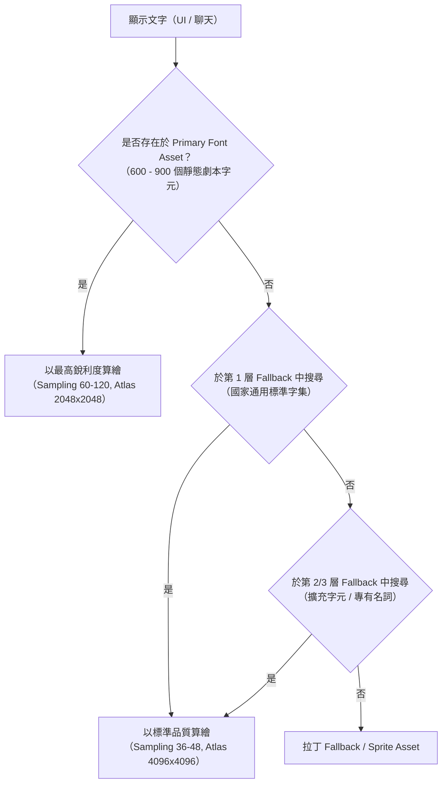

## **1. 專案總覽與即時在地化挑戰**

**GilongWorld** 專案提出了一項極為複雜且具備全球規模的技術需求：為 15 種目標語言提供全面性的在地化（*localization*）支援。具體語言清單包含：英語、越南語、法語、義大利語、德語、西班牙語（西班牙）、波蘭語、葡萄牙語（巴西）、葡萄牙語（葡萄牙）、韓語、俄語、日語、土耳其語、簡體中文與繁體中文。在使用 Unity 引擎的現代遊戲開發環境中，於即時圖形空間管理並顯示文字，絕不僅止於替換文字字串。它需要一套全方位的最佳化字型架構，以確保版面美感、任何攝影機距離下的清晰銳利度，以及最重要的系統記憶體使用效率。

目前 Unity 生態系中最標準且功能最強大的文字算繪工具是 **TextMeshPro（TMP）**。與傳統使用者介面文字系統（UI Text）在放大時將每個字元算繪為模糊點陣圖影像截然不同，TextMeshPro 要求將標準字型檔案轉換為稱為 **Font Asset** 的專屬資源[^1]。這些 Font Asset 包含一張或多張套用 **Signed Distance Field（SDF，有向距離場）** 技術的紋理圖集（*Atlas Texture*）。SDF 技術可讓文字無限放大而不產生像素化鋸齒（*pixelation*），同時為縮放著色器（shader）直接在 GPU 上產生陰影、外框、筆畫粗細與發光等複雜圖形特效提供數學基礎[^1]。

然而，SDF 的強大能力伴隨著無法避免的物理限制：**記憶體上限**。將 15 種目標語言的全部字元納入單一紋理圖集是不可能的[^1]。特別是屬於 CJK（*Chinese, Japanese, Korean*，中日韓）語系的語言，擁有包含數萬個字元的龐大象形文字系統。若強行將整套系統塞進單一 Atlas Texture，紋理尺寸將會超過硬體裝置（尤其是行動裝置硬體）所能處理的最大上限（通常為 $4096 \times 4096$ 或 $8192 \times 8192$ 像素），進而導致視訊記憶體（VRAM）溢位或應用程式閃退（*crash*）[^5]。本報告將詳盡闡述從來源字型的挑選與下載、語系特性分析，到 TextMeshPro 內部參數設定、備援鏈（*Fallback Chain*）管理，以及透過 Unity Localization 套件徹底解決漢字統一（*Han Unification*）難題的完整工程流程。

---

## **2. 字元學基礎與來源字型取得策略**

建置多語系文字系統的首要且最關鍵步驟，是選擇精準的來源字型檔案（*Source Font File*）。要在 15 種語言之間維持視覺一致性，需要一套開放原始碼、完整支援從基礎到擴充 Unicode 編碼區間，且在基線高度（*baseline*）與筆畫粗細（*weight*）上具備一致設計的字型家族。

在軟體產業中，**Google Noto** 字型家族（源自 *"No Tofu"* 的縮寫——旨在消除裝置缺少字型顯示時俗稱「豆腐塊」的空白方框）被公認為黃金標準解決方案[^7]。Noto 系統由 Google 攜手頂尖字體設計夥伴共同開發，確保拉丁字母、西里爾字母與 CJK 書寫系統的字元能在同一行文字中並排顯示，而不會產生比例落差或藝術風格不協調的情況[^8]。多語系混排時文字呈現的流暢度，對 GilongWorld 的玩家體驗至關重要。

### **擷取並匯入字型資料至 Unity**

要展開整合流程，需直接從 **Google Fonts** 字型庫下載原始字型檔案。下載並匯入至 Unity 的過程必須遵循嚴格規範，以免專案容量不必要地膨脹：

1. **使用拉丁字母與西里爾字母的 11 種語言組**（*英語、越南語、法語、義大利語、德語、西班牙語、波蘭語、葡萄牙語-巴西、葡萄牙語-葡萄牙、俄語、土耳其語*）：系統僅需基礎字型集 **Noto Sans**[^8]。此字型集內含超過 3,700 個字形（*glyphs*），涵蓋 Latin Extended、西里爾字母及組合附加符號等 Unicode 區塊，完全滿足上述語言的需求[^8]。在 Google Fonts 官網下載壓縮檔後，即可取得 TrueType（`.ttf`）格式的多種字重變體（例如 *Thin、Regular、Medium、Bold、Black*）。
2. **4 種 CJK 語言組**：下載流程更為複雜。開發人員必須分別取得四種區域變體，包含 **Noto Sans JP**（日語）、**Noto Sans KR**（韓語）、**Noto Sans SC**（簡體中文）與 **Noto Sans TC**（繁體中文）[^7]。由於內含極為龐大的圖形資料，這些 CJK 檔案容量通常非常巨大，單一字重便高達 15MB 至 20MB。此語組常見格式為 OpenType（`.otf`），相較於 TrueType，它支援更複雜的字元對應表結構[^5]。

解壓縮來自 Google Fonts 的檔案後，下一步是將其匯入（*import*）Unity 專案環境。資源管理的最佳實務（*best practice*）是建立專屬目錄結構，例如 `Assets/GilongWorld_Resources/Fonts/Source_Files/`。將 `.ttf` 與 `.otf` 檔案（除非 UI 設計明確需要粗體變體，否則為最佳化記憶體應僅挑選 *Regular* 或 *Medium* 等單一標準字重）從作業系統直接拖放至 Unity Editor 的 Project 視窗中之該資料夾內[^10]。

> [!NOTE]
> TextMeshPro 在執行階段並不會直接使用這些 `.ttf` 或 `.otf` 檔案來算繪文字；它們僅作為原料，供 Font Asset Creator 工具擷取陣列資料並編譯成 SDF 紋理[^1]。將來源檔案管理於獨立資料夾中，能讓（未啟用 Dynamic SDF 功能時）在最終建置中將其剔除的作業變得更加輕鬆，有助於縮減遊戲安裝檔容量。

---

## **3. 語系特性分析與 Unicode 編碼區間需求**

GilongWorld 專案中 15 種語言的多樣性，需要對字元在國際標準 Unicode 中的編碼方式進行深入剖析。TextMeshPro 使用十六進位（Hexadecimal）來定義需從來源字型檔案中擷取的編碼區間（*Unicode Ranges*）[^13]。正確宣告這些區間不僅能確保絕對的語言涵蓋率，還能防止載入無用字元而導致 Atlas 紋理尺寸過度膨脹。

根據形態學結構，15 種語言被劃分為三大主要策略群組以進行資源管理。

### **子群組 1：擴充拉丁字母系統與附加符號（Diacritics）**

此群組包含英語、法語、義大利語、德語、西班牙語、波蘭語、葡萄牙語（巴西）、葡萄牙語（葡萄牙）、土耳其語及越南語。雖然共同享有基礎拉丁字母表（`U+0020` 至 `U+007E`），但在擴充編碼區塊上產生了顯著分化[^1]：

- **西歐與南歐**（*法語、西班牙語、義大利語、葡萄牙語、德語*）：主要使用 *Latin-1 Supplement*（`U+00A0` 至 `U+00FF`）區塊，內含 `á`、`é`、`í`、`ó`、`ú`、`ñ`、`ü` 與 `ç` 等基本重音母音及字元。
- **中歐與土耳其語**（*波蘭語、土耳其語*）：仰賴 *Latin Extended-A*（`U+0100` 至 `U+017F`）區塊以顯示 `ą`、`ł`、`ş` 與 `ğ` 等專屬字元[^10]。
- **越南語**：此群組中最具代表性。由於複雜的聲調系統結合了戴帽母音（`â`、`ê`、`ô`）或帶鉤母音（`ơ`、`ư`），越南語必須涵蓋 *Latin Extended Additional*（`U+1E00` 至 `U+1E9F`）編碼區塊[^14]。越南語的附加符號系統會產生高度極大的字元結構（例如 `Ể` 字可能超出拉丁字母一般高度上限），因此必須謹慎微調 TextMeshPro 中的行高（*line height*）與內邊距（*padding*），以避免字元頂部遭到裁切（*clipping*）。

### **子群組 2：西里爾字母系統（Cyrillic）**

專案中唯一屬於此系統的語言為 **俄語（Russian）**。西里爾字母在編碼上完全獨立於拉丁系統，完整座落於 `U+0400` 至 `U+04FF` 編碼區塊內[^10]。儘管編碼獨立，但西里爾字母在字元寬度與基線高度等形態特徵上與拉丁系統相近，使其能完美合併至拉丁群組的同一個 Font Asset 中，而不會造成視覺上的不協調。

### **子群組 3：CJK 系統與歷史問題 Han Unification（漢字統一）**

第三群組包含 **韓語、日語、簡體中文與繁體中文**。這是最為複雜的區域，也是 TextMeshPro 技術極限最常受到考驗的環節。根本原因不僅在於龐大的字元數量，還涉及 Unicode 協會一項引發爭議的技術規範——稱為 **Han Unification**（*漢字統一*）[^7]。

在 Unicode 標準發展初期，為了將編碼空間限制在 16 位元範圍內，軟體工程師決定將來自中國、日本與韓國、具有相同歷史淵源的象形文字合併到同一個單一**碼位（code point）**中[^7]。此編碼區塊稱為 *CJK Unified Ideographs*（中日韓統一表意文字），範圍從 `U+4E00` 延伸至 `U+9FA5`[^12]。

這項決策在顯示技術上帶來了嚴重後果：**儘管共用相同的 Unicode 編碼，但同一個字元（glyph）的實際視覺字形在不同國家/地區卻繪製得各不相同**，這是文化演變、書法藝術與教育標準分歧的結果：

- 最具代表性的例子是「骨」字，其 Unicode 編碼為 `U+9AA8`（`骨`）。此字上方矩形框內的筆畫結構，在簡體中文（SC）字型中呈左右橫向排列，而在繁體中文（TC）與日語（JP）字型中，其內部筆畫則採用截然不同的結構[^7]。
- 同理，「雪」（`雪`）與「直」（`直`）等常見字元也帶著細微但極易被母語人士辨識出來的結構差異。

文字算繪系統無法自行判斷形態學意圖；它僅接收一個 Unicode 編碼，並從目前的字型集中抓取對應的影像。因此，對所有東亞語言共用單一 CJK 字型，將導致日本玩家必須閱讀以中文風格繪製的日語文字，反之亦然[^7]。對母語人士而言，這會產生字型出錯、缺乏專業度或「混雜」的感受，徹底破壞對遊戲世界的沉浸感[^7]。克服這項限制的唯一解法，是為每種 CJK 語言完全分離出獨立的 Font Asset，並靈活管理備援鏈。

---

## **4. TextMeshPro 與有向距離場（SDF）技術機制**

為了精準執行設定流程，透徹理解 **Signed Distance Field（SDF）** 在 TextMeshPro 中的運作機制是不可或缺的。與儲存像素色彩的傳統點陣圖字型不同，SDF 儲存的是從像素到字元最近邊緣（輪廓）的數學距離[^1]：
- 若像素位於字元**內部**，距離為**正值**。
- 若位於**外部**，則為**負值**。
- 若**恰好位於邊緣上**，距離等於**零**（$0$）。

這份距離資料會以灰階（*grayscale*）格式編碼並儲存於 Atlas Texture 中。在執行階段，TextMeshPro 的 GPU 著色器會對這些距離數值進行雙線性內插（*bilinear interpolation*）。著色器會檢查畫面上每個片段（*fragment*）的數值：若數值 $> 0$，該片段便會著色；若 $< 0$，則設為透明。由於採用連續的數學內插運算而非依賴離散像素，即使攝影機極度靠近物件，SDF 文字依然能呈現極度銳利的曲線[^1]。

此機制決定了建立 Font Asset 時的兩項核心參數：
1. **Sampling Point Size（取樣點大小）：** 決定字元繪製到 Atlas Texture 上時的物理尺寸。尺寸越大，距離資料的細節度就越高。
2. **Padding（內邊距／留白）：** SDF 強大威力的關鍵。字元周圍的留白空間讓距離梯度能夠平滑地遞減至更深的負值。留白越寬，SDF 演算法就擁有越充足的「空間」來產生較粗的外框（*outline*）、陰影（*shadow*）或發光（*glow*）特效，而不會突然遭到切斷[^13]。

---

## **5. 透過 Font Asset Creator 進行詳細設定指南**

字型紋理檔案的建立是透過 Unity 內建工具 **Font Asset Creator** 完成，可由以下選單路徑開啟：

```text
Window > TextMeshPro > Font Asset Creator
```

根據第 3 節的分析，GilongWorld 專案針對 15 種語言的最佳架構為分段式模型：**為 11 種拉丁／西里爾語系語言建立一個共用的 Font Asset，並為 4 種 CJK 語言各自建立獨立的 Font Asset**。

### **5.1. 為拉丁語系、西里爾語系與越南語設定靜態（Static）架構**

將 11 種語言（*英語、法語、義大利語、德語、西班牙語、波蘭語、巴西葡萄牙語、葡萄牙葡萄牙語、土耳其語、俄語、越南語*）整合進單一的 **Primary Static Font Asset**，是降低 GPU 繪製呼叫（*draw call*）數量最有效率的方法，這對於維持穩定的影格率（*frame rate*）至關重要[^14]。

在 Font Asset Creator 中的設定需遵循以下嚴謹參數[^12]：

| 設定屬性 | 技術建議 | 分析論據 |
| :--- | :--- | :--- |
| **Source Font File** | `NotoSans-Regular.ttf` | 將來源檔案從 `Assets` 資料夾拖放至此欄位。此為幾何輪廓資料來源[^1]。 |
| **Sampling Point Size** | `Custom Size: 60 - 90` | Auto Sizing 模式只會盡力將字元塞入可用空間。透過將 Custom Size 固定在 60 至 90 之間，可確保整張紋理表面的 SDF 品質一致[^1]。 |
| **Padding** | `6 - 9`（比例 ~10%） | TextMeshPro 的標準原則為 Padding 應佔 Sampling Point Size 的約 10%[^4]。當 Sampling 為 60 時，Padding 設為 6 最為理想。若專案的 UI 風格需要非常粗的文字外框，可將此數值調高至 10。 |
| **Packing Method** | `Optimum` | Optimum 演算法比 Fast 耗費明顯更多的處理時間，但它會執行反覆運算以最緊密地塞入字形，盡可能減少像素浪費[^12]。 |
| **Atlas Resolution** | `2048 x 2048` | 這 11 種語言的字元總數約落在 1,500 至 2,000 個字形之間。$2048 \times 2048$ 的尺寸具備足夠空間，能在維持 Sampling Point Size 60 的同時不遺漏任何字元[^7]。 |
| **Character Set** | `Unicode Range (Hex)` | 相較於選擇預設集合，此模式提供對載入字元的絕對控制權[^2]。 |

**Custom Character List** 欄位將填入完整涵蓋 11 種語言需求的十六進位編碼區間字串：

```text
0020-007E, 00A0-00FF, 0100-017F, 0180-024F, 1E00-1E9F, 0300-036F, 0400-04FF, 0500-052F, 2000-206F
```

所有參數填寫完成後：
1. 點擊 **Generate Font Atlas** 按鈕。工具將會計算距離並算繪影像（視 CPU 效能可能需要幾分鐘）。
2. 完成並顯示紋理預覽後，點擊 **Save**。
3. 將檔案命名為 `Global_Latin_Cyrillic_SDF.asset` 並儲存至專案資料夾[^1]。

### **5.2. 為 CJK 系統設定靜態（Static）架構與分層備援架構**

處理 4 種 CJK 語言因龐大的資料量而需要截然不同的策略。必須針對 `NotoSansCJKjp`、`NotoSansCJKkr`、`NotoSansCJKsc` 與 `NotoSansCJKtc` 重複執行四次上述流程。然而，若嘗試透過 Unicode 區間將整份 CJK 字表塞入單一靜態 Atlas，系統將會因超過紋理的物理尺寸限制而失敗[^5]。

標準技術解法是採用結合 **Characters from File** 選項的**分層字元對應模型（Hierarchical Character Mapping）**[^7]：

#### **1. 為已知字元（Known Characters）建立主 SDF Font Asset**
- 從專案的字串表（*String Tables*）中擷取所有靜態文字字串（選單、任務、道具、對話、技能）。
- 這組不重複字元（*unique characters*）在實務上通常**低於 1,000 字**（例如 GilongWorld 專案中，簡體中文僅佔 **855 字**、繁體中文 **870 字**、日語 **694 字**、韓語 **588 字**）。
- **最大化品質（Maximize Sampling Size）：** 由於字元數不到 1,000，搭配 Atlas Resolution `2048 x 2048` 可設定**較高的 Sampling Point Size**（`60` 至 `90` 或 `120`）。這能確保所有官方 UI 文字在任何攝影機距離下都具備絕佳的銳利度。

#### **2. 建置繼承自國家標準字元集的備援層級（UGC／聊天的標準 Fallback）**
為了全面支援玩家輸入（角色命名、公會聊天）且永遠不會遇到豆腐塊（Tofu），系統補齊了繼承自**國家標準字元資料集**的 Fallback Font Asset：

| 語言 | 國家標準字元集 | 字元數量 | 頒布機構與參考來源 |
| :--- | :--- | :---: | :--- |
| **簡體中文 (zh-Hans)** | **《通用規範漢字表》（TGSCC）**<br/>- 第一級（常用）：3,500 字<br/>- 第二級（擴充）：3,000 字<br/>- 第三級（人名／地名）：1,605 字 | **8,105** | 中華人民共和國教育部<br/>*開源參考：* [GitHub chinese-character-table](https://github.com/maple-leaf/chinese-character-table) |
| **繁體中文 (zh-Hant)** | **《常用國字標準字體表》** | **4,808** | 台灣教育部（MOE Taiwan）<br/>*開源參考：* [政府資料開放平臺](https://data.gov.tw/dataset/5961) / [GitHub cjktables](https://github.com/ButTaiwan/cjktables) |
| **日語 (ja)** | - **常用漢字（Jōyō Kanji）**：2,136 字<br/>- **人名用漢字（Jinmeiyō Kanji）**：863 字 | **2,999** | 日本文化廳（文化庁）<br/>*開源參考：* [KanjiAPI](https://kanjiapi.dev/) / [GitHub kanji-data](https://github.com/davidluzgouveia/kanji-data) |
| **韓語 (ko)** | **KS X 1001 標準**（涵蓋 99.9% 溝通需求的 2,350 個最常用諺文音節） | **2,350** | 韓國技術標準院（KATS）<br/>*開源參考：* [GitHub ksx1001](https://github.com/korean-character-sets/ksx1001) / 透過 `euc-kr` 擷取 |



#### **3. 不變法則：維持 Sampling Point Size / Padding 比例一致性（Ratio Consistency）**

TextMeshPro Shader 中的一項核心圖形原理是：**Outline（文字外框）、Underlay / Shadow（陰影）與 Glow（發光）特效的粗細，是依據 Sampling Point Size 與 Padding 之間的比例來計算的**[^13]。

##### **為何 Fallback 不需要與 Primary 相同的 Point Size？**
- **Primary Font（約 855 個 UI 劇本字元）：** 遊戲期間 100% 出現 $\rightarrow$ 需要**最大化品質**（`Sampling Size = 120`、`Padding = 10`、Atlas $2048 \times 2048$）。
- **Fallback Fonts（用於聊天／命名的 2,700 – 8,000 個罕見字）：** 極少出現 $\rightarrow$ **降低取樣品質**（`Sampling Size = 60` 或 `48`），以便在不使 VRAM 膨脹的情況下將數千字壓縮進相同尺寸的 Atlas。

##### **為何必須強制維持相同的比例（$\text{Ratio} = \frac{\text{Sampling}}{\text{Padding}}$）？**
若在同一個句子中，來自 Primary 的字元與來自 Fallback 的字元相鄰排列：
- **若比例失衡：** Primary 字元（Size 120、Pad 10 $\rightarrow$ Ratio 12）擁有纖細美觀的外框，但 Fallback 字元（Size 60 卻誤設為 Pad 10 $\rightarrow$ Ratio 6）的外框將會**加倍粗厚、變形並吞噬字元筆畫**。
- **若維持相同比例（$\text{Ratio} = 12$）：** 無論字元取自 Primary 還是落入 Fallback，**外框粗細與陰影擴散程度始終保持 100% 一致**。

| Font Asset 層級 | 角色 | Sampling Point Size *(Custom)* | Padding | Atlas Resolution | 比例 (Ratio) |
| :--- | :--- | :---: | :---: | :---: | :---: |
| **Primary Font** | 主要 UI 劇本 | **120** *（或 96）* | **10 px** *（或 8 px）* | $2048 \times 2048$ | **12** *（最高銳利度）* |
| **Fallback 第 1 層** | 約 2,725 個常用字 | **60** | **5 px** | $2048 \times 2048$ | **12** *（節省 VRAM）* |
| **Fallback 第 2 層** | 約 2,992 個擴充字 | **60** | **5 px** | $2048 \times 2048$ | **12** *（節省 VRAM）* |
| **Fallback 第 3 層** | 約 1,605 個罕見／人名字 | **48** | **4 px** | $2048 \times 2048$ | **12** *（節省 VRAM）* |

> [!TIP]
> **實務操作：** 在 *Font Asset Creator* 中，將 `Sampling Point Size` 從 *Auto Sizing* 切換為 **Custom Size**，以依據上表正確比例鎖定取樣尺寸與 Padding。

---

### **5.3. Unity 中的資料夾組織與實務自動化流程**

為了方便長期擴充與維護，GilongWorld 專案為全部來源字元資料建立了專屬的分組資料夾結構：

```text
Assets/_GilongWorld/_Project/Art/Fonts/_chars/
├── 01_Latin_Cyrillic/        # [共用 Primary Font] 11 種拉丁／西里爾語言
│   ├── vi_chars.txt          # 越南語
│   ├── en_chars.txt          # 英語
│   ├── ru_chars.txt          # 俄語
│   └── ...                   # 法語、德語、義大利語、西班牙語、波蘭語、葡萄牙語、土耳其語
│
├── 02_CJK/                   # [CJK Primary Fonts] 遊戲內靜態劇本字元
│   ├── ja_chars.txt          # 日語（實際 694 字元）
│   ├── ko_chars.txt          # 韓語（實際 588 字元）
│   ├── zh_Hans_chars.txt     # 簡體中文（實際 855 字元）
│   ├── zh_Hant_chars.txt     # 繁體中文（實際 870 字元）
│   │
│   ├── Standard_Fallbacks/   # [標準來源層] 7 套原始國家標準資料集
│   │   ├── zh_Hans_TGSCC_Level1_3500.txt
│   │   ├── zh_Hans_TGSCC_Level2_3000.txt
│   │   ├── zh_Hans_TGSCC_Level3_1605.txt
│   │   ├── zh_Hant_Common_4808.txt
│   │   ├── ja_Joyo_Kanji_2136.txt
│   │   ├── ja_Jinmeiyo_Kanji_863.txt
│   │   └── ko_KS_X_1001_2350.txt
│   │
│   └── Subtracted_Fallbacks/ # [最佳化 Fallback 層] 已徹底扣除 Primary 字元
│       ├── zh_Hans_Fallback_Level1.txt    (TGSCC 第一級扣除 Primary)
│       ├── zh_Hans_Fallback_Level2.txt    (TGSCC 第二級扣除 Primary)
│       ├── zh_Hans_Fallback_Level3.txt    (TGSCC 第三級扣除 Primary)
│       ├── zh_Hant_Fallback_Common.txt    (台灣標準 4808 扣除 Primary)
│       ├── ja_Fallback_Joyo.txt           (常用漢字扣除 Primary)
│       ├── ja_Fallback_Jinmeiyo.txt       (人名用漢字扣除 Primary)
│       └── ko_Fallback_KS_X_1001.txt      (KS X 1001 扣除 Primary)
```

#### **自動擷取與 Fallback 字元扣除工具（`GWCharacterExtractor.cs`）**
為了讓程式設計師免於手動匯出 CSV 與篩選重複字元，專屬 Unity Editor 工具 [`GWCharacterExtractor.cs`](file:///d:/Unity-Projects/GLW/Assets/_GilongWorld/_Project/Editor/Localization/GWCharacterExtractor.cs) 整合了二合一流程：
- **存取選單：** `GilongWorld → Localization → Extract CJK Characters From String Tables`
- **機制 1（擷取 Primary）：** 掃描 Unity Localization 中的所有 `StringTableCollections`，將使用中的所有文字字串彙集至 `HashSet<char>` 結構（確保 100% 不重複），依 Unicode 編碼遞增排序並寫入 `02_CJK/` 中的 4 個 Primary 檔案。
- **機制 2（自動扣除 Fallback 字元）：** 腳本自動讀取 `Standard_Fallbacks/` 中的 7 套資料集，比對並**移除所有已存在於 Primary Asset 的字元**，隨後輸出至 `Subtracted_Fallbacks/` 資料夾。這徹底消除了 Primary Atlas 與 Fallback Atlas 之間因字元重複造成的 VRAM 浪費。

#### **GWSDFGeneratorWindow 介面與突破 Unity 6 API 限制**
為確保「Sampling / Padding 比例 = 12」的規則獲得絕對遵守，專案提供了一個專屬的 Editor Window，可輸入參數並在比例發生偏差時自動計算警告。
特別是在 Unity 6 中，Font Asset 的 `clearDynamicDataOnBuild` 屬性被鎖定在 `internal` 存取層級，阻礙了透過一般程式碼在建置前清除垃圾資料。此工具透過 `SerializedObject` 運用反射（Reflection）技術徹底解決了這個問題：

```csharp
var serializedObject = new SerializedObject(fontAsset);
serializedObject.FindProperty("m_ClearDynamicDataOnBuild").boolValue = true;
serializedObject.ApplyModifiedProperties();
```
藉此，舊系統異常的 137MB Atlas 獲得徹底清理，將建置容量降至最低水準。

---

## **6. 備援鏈（Fallback Chain）管理架構與 Han Unification 解決方案**

流暢運作多語系遊戲的核心，在於調度備援鏈（*Fallback Chain*）的能力。當 TextMeshPro UI 元件接收到包含 Primary Font Asset 中不存在之字元的字串時，系統會透過備援清單進行遞迴搜尋演算法，以尋找替代的字元形狀（*glyph*）。

搜尋演算法遵循嚴格的階層順序：
1. `TextMeshPro Primary Font Asset`
2. `Primary Font 的內部 Fallback Font Assets 清單`
3. `內部 Sprite Asset`
4. `於 TMP_Settings 全域定義的 General Fallback Font Assets`
5. `Default Sprite Asset`
6. `Default Font Asset`[^20]

> [!WARNING]
> 系統由上而下循序搜尋，並於**找到第一個相符的 Unicode 碼位時立即停止**[^7]。

如同第 3 節的分析，Han Unification 現象使 SC、TC 與 JP 語言共用相同的 Unicode 編碼，卻擁有不同的形態[^7]。若開發者將所有 CJK 檔案都加入 `TMP_Settings` 的 General Fallback Font Assets 清單中，排序順位將決定文字的命運。例如，若清單依序排列為：`Font_CJK_JP_SDF` $\rightarrow$ `Font_CJK_SC_SDF` $\rightarrow$ `Font_CJK_TC_SDF`。當傳入一段簡體中文文字時，系統由上往下掃描，最先碰到日語檔案，找到對應的 Unicode 編碼後便立刻取用日文漢字風格顯示於螢幕上，完全忽略位於下方的中文檔案[^7]。

### **區域分流備援架構（Local Fallback Architecture）**

為了徹底根治這個難題，必須將 Fallback 結構加以隔離：

> [!IMPORTANT]
> **絕對不要將 CJK 字型放入 `TMP_Settings` 的全域備援清單（Global Fallback List）中**[^1]。取而代之的是，架構將透過各個 Asset 檔案的區域備援（*Local Fallback*）結構進行串聯，並於執行階段進行動態管理。

一項基本的排版原則是：相較於純拉丁字型，CJK 字型所附帶的拉丁字母與阿拉伯數字設計通常極不美觀或比例錯誤[^9]。因此，拉丁字元永遠必須優先由 `Global_Latin_Cyrillic_SDF` 檔案算繪。區域串聯結構的建置方式如下：
1. 開啟 `Font_CJK_SC_SDF.asset` 檔案，在 **Fallback Font Assets** 區塊中加入簡體中文的 1-3 層 Fallback，並加入 `Global_Latin_Cyrillic_SDF` 檔案[^1]。
2. 對繁體中文（TC）、日語（JP）與韓語（KR）檔案執行相同操作。

這確保了遊戲在顯示中文語言時，若夾雜數字或英文專有名詞，它們會穿透中文靜態 Atlas（因在 *Characters from File* 擷取時已過濾掉拉丁字元），並由包含高品質拉丁字母系統的 Fallback 檔案承接[^7]。

---

## **7. 整合 Unity Localization 套件實現動態切換（Runtime Swapping）**

為了確保文化漢字形態的正確算繪並最佳化 VRAM 記憶體，TextMeshPro UI 元件無法維持靜態設定。當使用者切換語言（*Locale*）時，基礎字型（*Primary Font Asset*）必須於執行階段（*runtime*）自動進行替換（*swap*）[^23]。

**Unity Localization** 套件（`com.unity.localization`）提供了強大的工具來執行這套邏輯流程，無須針對每個切換事件進行硬編碼（*hardcoding*）[^25]。整合架構是基於透過 `LocalizationSettings.SelectedLocaleChanged` 追蹤全域語言變更事件的機制來運作[^24]。

共有兩種實作方式：

### **方式 1：集中式程式管理（Centralized Font Manager）**

GilongWorld 專案不為數千個 UI 文字元件手動指派 Localized Asset 事件（那會因大量垃圾 `MonoBehaviour` 物件與垃圾回收機制造成龐大的記憶體壓力），而是採用**以 Addressables 進行集中管理的策略**。

`GWFontManager.cs` 腳本（帶有 `DontDestroyOnLoad` 旗標）會監聽 `LocalizationSettings.SelectedLocaleChanged` 事件。當此事件觸發時，Manager 會執行兩項精巧的任務：
1. **非同步載入（Async Load）：** 使用 `LocalizationSettings.AssetDatabase.GetLocalizedAssetAsync<TMP_FontAsset>("Fonts_Table", "PrimaryFont")` 從 Addressables 取得目前語言的標準 Font Asset。
2. **全域掃描（Global Sweep）：** 使用 `FindObjectsByType<TMP_Text>` 指令掃描整個場景，並將新字型強制套用至所有 UI 文字元件。此指令會耗費幾毫秒的 CPU 時間，但僅於切換語言或載入場景時執行一次，換來的是徹底釋放記憶體，擺脫數千個零散元件的牽絆。指派完成後，舊語言的字型將立即透過 `Addressables.Release()` 指令清除。

此方法徹底消除了 CJK 語言之間的「交叉污染」（*cross-pollination*）現象，因為 Fallback 系統僅會載入目前指定語言的單一 Atlas[^7]。

### **方式 2：Unity Localization 的 Asset Tables**

最原生（*native*）的整合方法是使用 **Localized Asset Tables**[^23]。類似於用來替換文字字串的 Localized String Tables，Asset Tables 允許為不同語言指派不同的 Asset 檔案。使用者介面上的 Localized Text 元件可以設定為不僅改變 String 字串，同時自動切換 TextMeshPro 物件的 `FontAsset` 變數[^23]。

這種作法需要在屬性檢視器（Inspector）上進行設定，但具備高穩定性，並能讓程式設計師免於維護自訂程式碼對應系統[^28]。

---

## **8. 動態內容管理（UGC）、記憶體最佳化與 Addressables 整合**

靜態架構（*Static Architecture*）已經完美解決了系統介面的問題。然而，由使用者產生的內容（**User-Generated Content - UGC**），例如角色名稱、公會簡介或社群聊天視窗，卻帶來了更大的挑戰。我們無法預測使用者會從 15 種語言表中輸入哪些字元，而且將全世界數十萬個字元全部嵌入 RAM 是不可能的。

### **混合架構解決方案（Hybrid SDF System）**

TextMeshPro 一般的 **Dynamic SDF** 系統允許 Font Asset 從一張空白的紋理 Atlas（$0 \times 0$ 像素）開始運作。偵測到新字元時，它會利用 CPU 繪製該字元並在執行階段插入紋理中[^6]。
不過，若過度濫用純 Dynamic 模式，遊戲會在第一個畫面發生嚴重卡頓（frame spike）。因此，GilongWorld 專案採用**混合架構（Hybrid）**：

1. **流暢靜態載入（Static Population）：** 透過 `GWCharacterExtractor.cs` 工具，在 Editor 中即運用 `TryAddCharacters` 函式將數千個最常用字元預先寫入 Atlas。進入遊戲時這些字元已準備就緒，確保影格率（FPS）維持絕對穩定。
2. **安全動態機制（Dynamic Fallback）：** Font Asset 仍以 Dynamic 模式儲存並啟用 `isMultiAtlasTexturesEnabled = true` 旗標。若玩家聊天輸入了一個最初 Atlas 從未收錄的極罕見字，TMP 會立即「產生」一張新的 Atlas Texture（`Atlas 0 1`、`Atlas 0 2`...）將該字塞入，而不是顯示豆腐塊。這是最理想的組合。

> [!CAUTION]
> Dynamic SDF 方法伴隨著資源成本：每張 $2048 \times 2048$ 尺寸的動態 Atlas 將會立即消耗約 **4MB** 系統記憶體。若產生許多輔助 Atlas，行動裝置承受的壓力將會迅速升高[^31]。

### **隱藏的 Addressables 陷阱與 VRAM 記憶體衝突**

像 GilongWorld 這樣現代化的大型專案幾乎肯定會採用 **Addressables** 系統來載入資源。許多程式設計師常犯的一個致命錯誤是：**以為自己尚未啟用 Addressables，便放心地將字型直接留在 `Resources` 資料夾中。**

事實上，**Unity Localization 套件是直接建構在 Addressables 的基礎之上的**。即使您沒有主動使用，Addressables 依然在背景運作以管理 String Tables。
當一個透過 Addressables 封裝的 UI 預製件（Prefab）參考了位於 `Resources` 資料夾中的 Font Asset 時，Unity 的資源管理員便會犯下複製資料（*duplicate assets*）的錯誤：
1. Unity 會建立該 Atlas 紋理的完整複本，並將其塞入 Addressables 的 AssetBundle 內部[^32]。
2. 當遊戲載入時，來自 `Resources` 的 Atlas 已經預先載入，而來自 AssetBundle 的 Atlas 又會繼續被載入 RAM，導致 **VRAM 被無謂地佔用了雙倍空間**[^31]。這個問題極為常見，且極易讓嚴格管控最大 RAM 容量的行動應用程式閃退[^33]。

**徹底解決方案：**
- 將 `TMP_Settings` 檔案與所有 Font Asset 徹底移出 `Resources` 資料夾，移至標準目錄 `Assets/_GilongWorld/_Project/Art/Fonts/SDF/`。
- 選取全部 SDF 檔案並將其放入專屬的 Addressables Group（例如 `Fonts_Addressables`），同時在 Localization 的 **Asset Table**（`Fonts_Table`）中設定好對應關係。
- **在 Editor 中清理 Dynamic 字型：** Dynamic Font Asset 檔案具有持久保存資料的特性。每次編譯建置檔之前，務必執行清除 Dynamic 資料的操作（已透過前述使用 `SerializedObject` 技術的 `GWSDFGeneratorWindow` 工具自動化處理）[^30]。
- **執行階段記憶體清理：** 在大型場景之間切換時，呼叫 `TMP_FontAsset.ClearFontAssetData(true)` 或 `FontEngine.DestroyFontEngine()` API，徹底釋放不再使用的動態紋理陣列[^35]。

---

## **9. 即時診斷與技術疑難排解（Troubleshooting）**

在跨多種平台的實際部署過程中，在地化系統經常會顯露出表面的錯誤症狀。掌握診斷原則能協助技術團隊迅速鎖定問題範圍：

### **文字在行動裝置建置檔（Build）中顯示為空白方框（Tofu Boxes），但在 Editor 中正常**
- **原因：** 若 Fallback Font Assets 在執行階段僅透過 `FallbackFontAssetTable` 鬆散關聯，而非由場景中的某個靜態 GameObject 直接參考，Unity 的資源管理員便不會將其記錄為相依性元件（*dependencies*）。Unity 的建置流程為了最佳化檔案容量，已自動將這些資源剔除（*strip*）[^1]。
- **解決方法：** 使用 `TMP_Settings.fallbackFontAssets` 選項作為整體參考，讓 Unity 感知其存在，或者確保所有潛在的 Font Asset 都透過 Addressables 的 Manifest 表標記為預先載入（*pre-load*）[^1]。

### **例外錯誤："The variable m_AtlasTextures of TMP_FontAsset has not been assigned"**
- **原因：** 直接與設定 Multi Atlas Textures 時的 Dynamic Font Asset 系統相關[^34]。當系統自動建立額外的紋理陣列以容納新字元，但此程序遭到中斷，或因動態實例化預制件（*instantiated prefabs*）結構導致記憶體釋放不當時，此陣列變數便會保留一個空參考（*null reference*）。
- **解決方法：** 在建置（Build）前透過 Font Asset 的右鍵選單手動對資源執行 **Reset**，以重建初始的空紋理陣列[^34]。

### **文字在大尺寸顯示下變得模糊（Blurry）**
- **原因：** 相對於螢幕上的實際算繪尺寸，SDF Atlas 的解析度或 `Sampling Point Size` 過低[^1]。
- **解決方法：** 針對大型標題文字（Heading / Banner），`Sampling Point Size` 必須重新設定在 `150` 以上。若無法建立更大的 Atlas 來容納此參數，則應將標題畫面專用的特定字元拆分為獨立的 Static Font Asset，以最佳化銳利度，而非與一般內文共用同一份資源[^1]。

### **從 Google Sheets 拉取（Pull）翻譯表時發生驗證錯誤（`invalid_grant: Token has been expired or revoked`）**
- **症狀：** 將在地化字串表（例如 `RPGB_General` 或 String Tables）從 Google Sheets 同步（*Pull*）至 Unity 時，系統跳出紅色錯誤訊息：`Pull from Google sheets: Failed - Error: "invalid_grant", Description: "Token has been expired or revoked."`
- **原因：** **時區偏差／系統時鐘飄移（Timezone Skew / Clock Drift）**。Google OAuth2 驗證機制對請求中所傳送的時間戳記（timestamp）精確度要求非常嚴格。若電腦發生時區偏差、系統時鐘不準，或 Unity Editor 保留了尚未更新的舊時間快取，Google 伺服器將會立即拒絕請求並回報權杖無效或已過期（`invalid_grant`）。
- **解決方法：**
  - **重新啟動 Unity Editor：** 關閉並重新開啟 Unity Editor，讓引擎重新載入作業系統的正確即時時間 $\rightarrow$ 再次點擊 **Pull** 即可立即成功。

---

## **10. 最終架構建議彙整**

擁有 15 種語言規模的 GilongWorld 專案，需要一套在 VRAM 記憶體配置效能與跨文化視覺體驗上皆符合最嚴格標準的文字圖形架構設計：

1. **字形一致性（排版設計）：** 全面採用 Google Noto Sans 與 Noto Sans CJK 生態系，在所有混排語言文字格式中維持基線（*baseline*）指標的流暢度。
2. **紋理分段模型（Atlas Segmentation）：** 切勿將所有語言壓縮至單一 Atlas 中。建立單一 $2048 \times 2048$ 的 Primary Static Font Asset，涵蓋 11 種拉丁／西里爾語系語言（*英語、越南語、法語、義大利語、德語、西班牙語、波蘭語、葡萄牙語、俄語、土耳其語*）的編碼區間。
3. **東亞語系最佳化與分層 Fallback 模型：** 將 4 種 CJK 語言（*簡體中文、繁體中文、日語、韓語*）拆分為各自獨立的 Font Asset。套用 **Primary SDF Font Asset（少於 1,000 個靜態劇本字元，搭配高畫質 Sampling Size 60–120）** 結合 **3 層 Fallback（8,105 個 TGSCC 國家標準字元）** 的模型，以支援玩家輸入／聊天功能。必須強制在 Primary 與 Fallback 之間維持**一致的 Sampling Point Size / Padding 比例**（Ratio $\approx 10-12$），以確保 Shader 特效（Outline、Shadow、Glow）流暢顯示而不發生變形。
4. **備援鏈控制（Han Unification 控制）：** 絕對禁止對 CJK 系統使用 Global Fallback 清單。取而代之的是採用 Unity Localization 套件的執行階段動態資源替換（*Runtime Swapping*）方案，依據目前的 Locale 更新對應的 Primary Font Asset，徹底杜絕顯示錯誤區域文字形態的風險。拉丁字元始終應設定為各 CJK 檔案的區域備援（*Local Fallback*）。
5. **動態內容整合與記憶體管理（UGC 與記憶體處理）：** 採用結合 Multi Atlas Texture 的 Dynamic Font Assets 結構，以承接玩家聊天視窗產生的未定義字元。最後，將整套架構徹底移出 `Resources` 資料夾，透過 Addressables 系統調度資源以消除 Atlas 重複複製的現象，並使用深度記憶體清理 API 在長時間遊玩過程中釋放 VRAM。

---

## **參考文獻**

[^1]: Fix: Unity TextMeshPro Font Asset Missing or Fallback | Bugnet Blog, [https://bugnet.io/blog/fix-unity-textmeshpro-font-asset-missing](https://bugnet.io/blog/fix-unity-textmeshpro-font-asset-missing)
[^2]: Fix: Unity UI TextMeshPro Falling Back to Default Font | Bugnet Blog, [https://bugnet.io/blog/fix-unity-ui-text-mesh-pro-falling-back-default-font](https://bugnet.io/blog/fix-unity-ui-text-mesh-pro-falling-back-default-font)
[^3]: textmeshpro | Skills Marketplace · LobeHub, [https://lobehub.com/de/skills/xeldaralz-helm-textmeshpro](https://lobehub.com/de/skills/xeldaralz-helm-textmeshpro)
[^4]: Chinese Traditional, Simplified and English text looks blurred, [https://discussions.unity.com/t/chinese-traditional-simplified-and-english-text-looks-blurred/723916](https://discussions.unity.com/t/chinese-traditional-simplified-and-english-text-looks-blurred/723916)
[^5]: Creating asset from font with a lot of characters - Page 2 - Unity Engine, [https://discussions.unity.com/t/creating-asset-from-font-with-a-lot-of-characters/708290?page=2](https://discussions.unity.com/t/creating-asset-from-font-with-a-lot-of-characters/708290?page=2)
[^6]: Bug where TextMeshPro dynamic font atlas exhaustion causes, [https://unity-trouble-atlas.7colorsgame.com/en/article/unity-tmp-dynamic-font-atlas-exhaustion/](https://unity-trouble-atlas.7colorsgame.com/en/article/unity-tmp-dynamic-font-atlas-exhaustion/)
[^7]: Unity Font: The 2026 Complete Guide to TextMesh Pro Font Assets, [https://www.transphere.com/unity-font-textmesh-pro-font-assets-fallbacks-and-localization/](https://www.transphere.com/unity-font-textmesh-pro-font-assets-fallbacks-and-localization/)
[^8]: Noto Sans - Google Fonts, [https://fonts.google.com/noto/specimen/Noto+Sans](https://fonts.google.com/noto/specimen/Noto+Sans)
[^9]: Force a font to use fallbacks - Unity Discussions, [https://discussions.unity.com/t/force-a-font-to-use-fallbacks/711511](https://discussions.unity.com/t/force-a-font-to-use-fallbacks/711511)
[^10]: Multiple Language Support Not Working in TextMesh Pro, [https://stackoverflow.com/questions/44922738/multiple-language-support-not-working-in-textmesh-pro](https://stackoverflow.com/questions/44922738/multiple-language-support-not-working-in-textmesh-pro)
[^11]: How to display Japanese in Unity TextMeshPro using Noto Sans CJK, [https://zenn.dev/uliboooo/articles/c3a2f489d8ee9a?locale=en](https://zenn.dev/uliboooo/articles/c3a2f489d8ee9a?locale=en)
[^12]: TextMeshPro Font Asset Creation & Packaging Guide - GitHub, [https://github.com/bbepis/XUnity.AutoTranslator/wiki/TextMeshPro-Font-Asset-Creation-&-Packaging-Guide](https://github.com/bbepis/XUnity.AutoTranslator/wiki/TextMeshPro-Font-Asset-Creation-&-Packaging-Guide)
[^13]: Font Asset Creator | TextMeshPro | 3.2.0-pre.15 - Unity - Manual, [https://docs.unity3d.com/Packages/com.unity.textmeshpro@3.2/manual/FontAssetsCreator.html](https://docs.unity3d.com/Packages/com.unity.textmeshpro@3.2/manual/FontAssetsCreator.html)
[^14]: [UNITY] Optimizing TextMesh Pro Font Atlas for language localization., [https://killertee.wordpress.com/2021/04/23/optimizing-workflow-textmesh-pro-font-atlas-for-language-localization/](https://killertee.wordpress.com/2021/04/23/optimizing-workflow-textmesh-pro-font-atlas-for-language-localization/)
[^15]: [Solved] TextMeshPro - Text(UI): Shows empty squares - Unity Engine, [https://discussions.unity.com/t/solved-textmeshpro-text-ui-shows-empty-squares/787844](https://discussions.unity.com/t/solved-textmeshpro-text-ui-shows-empty-squares/787844)
[^16]: Character set for multiple languages - Unity Discussions, [https://discussions.unity.com/t/character-set-for-multiple-languages/696758](https://discussions.unity.com/t/character-set-for-multiple-languages/696758)
[^17]: FYI: missing chinese/japanese/korean characters in Unity may not, [https://www.reddit.com/r/Unity3D/comments/1l37yfi/fyi_missing_chinesejapanesekorean_characters_in/](https://www.reddit.com/r/Unity3D/comments/1l37yfi/fyi_missing_chinesejapanesekorean_characters_in/)
[^18]: Saving / loading font atlas for TextMeshPro Font assets during runtime, [https://discussions.unity.com/t/saving-loading-font-atlas-for-textmeshpro-font-assets-during-runtime/891878](https://discussions.unity.com/t/saving-loading-font-atlas-for-textmeshpro-font-assets-during-runtime/891878)
[^19]: Having issues displaying Chinese characters using Text Mesh Pro, [https://www.reddit.com/r/Unity3D/comments/178zt0q/having_issues_displaying_chinese_characters_using/](https://www.reddit.com/r/Unity3D/comments/178zt0q/having_issues_displaying_chinese_characters_using/)
[^20]: Fallback font assets | TextMeshPro | 4.0.0-pre.2 - Unity - Manual, [https://docs.unity3d.com/Packages/com.unity.textmeshpro@4.0/manual/FontAssetsFallback.html](https://docs.unity3d.com/Packages/com.unity.textmeshpro@4.0/manual/FontAssetsFallback.html)
[^21]: Fallback font assets | TextMeshPro | 3.2.0-pre.15 - Unity - Manual, [https://docs.unity3d.com/Packages/com.unity.textmeshpro@3.2/manual/FontAssetsFallback.html](https://docs.unity3d.com/Packages/com.unity.textmeshpro@3.2/manual/FontAssetsFallback.html)
[^22]: Issue using the TMPro fallback system to render Chinese or, [https://discussions.unity.com/t/issue-using-the-tmpro-fallback-system-to-render-chinese-or-japanese-w-specific-fonts/837526](https://discussions.unity.com/t/issue-using-the-tmpro-fallback-system-to-render-chinese-or-japanese-w-specific-fonts/837526)
[^23]: Localization - Unity - Manual, [https://docs.unity3d.com/6000.5/Documentation/Manual/best-practice-guides/ui-toolkit-for-advanced-unity-developers/localization.html](https://docs.unity3d.com/6000.5/Documentation/Manual/best-practice-guides/ui-toolkit-for-advanced-unity-developers/localization.html)
[^24]: Issues with Localization and TMP Rendering in Unity, [https://discussions.unity.com/t/issues-with-localization-and-tmp-rendering-in-unity/948421](https://discussions.unity.com/t/issues-with-localization-and-tmp-rendering-in-unity/948421)
[^25]: A Comprehensive Guide to Unity Localization | Phrase, [https://phrase.com/blog/posts/localizing-unity-games-official-localization-package/](https://phrase.com/blog/posts/localizing-unity-games-official-localization-package/)
[^26]: How to Use the Unity Localization Package: A Complete Guide, [https://www.languagesunlimited.com/unity-localization-package/](https://www.languagesunlimited.com/unity-localization-package/)
[^27]: Change Locale in runtime - Unity Discussions, [https://discussions.unity.com/t/change-locale-in-runtime/812317](https://discussions.unity.com/t/change-locale-in-runtime/812317)
[^28]: TMP Font Asset and localization - Unity Discussions, [https://discussions.unity.com/t/tmp-font-asset-and-localization/936355](https://discussions.unity.com/t/tmp-font-asset-and-localization/936355)
[^29]: Localization, font switching and font material presets - Unity Engine, [https://discussions.unity.com/t/localization-font-switching-and-font-material-presets/770975](https://discussions.unity.com/t/localization-font-switching-and-font-material-presets/770975)
[^30]: Dynamic fonts assets | TextMeshPro | 3.2.0-pre.15 - Unity - Manual, [https://docs.unity3d.com/Packages/com.unity.textmeshpro@3.2/manual/FontAssetsDynamicFonts.html](https://docs.unity3d.com/Packages/com.unity.textmeshpro@3.2/manual/FontAssetsDynamicFonts.html)
[^31]: TextMesh Pro - Font atlases memory leak? - Unity Engine, [https://discussions.unity.com/t/textmesh-pro-font-atlases-memory-leak/885808](https://discussions.unity.com/t/textmesh-pro-font-atlases-memory-leak/885808)
[^32]: TextMeshPro & Addressables (Asset Bundles) - Unity Discussions, [https://discussions.unity.com/t/textmeshpro-addressables-asset-bundles/855482](https://discussions.unity.com/t/textmeshpro-addressables-asset-bundles/855482)
[^33]: TextMesh Pro Fallback Font Displays Boxes on Instantiated Objects, [https://discussions.unity.com/t/textmesh-pro-fallback-font-displays-boxes-on-instantiated-objects-unity-6-mobile-build-only-works-in-editor-and-unity-2022/1652497](https://discussions.unity.com/t/textmesh-pro-fallback-font-displays-boxes-on-instantiated-objects-unity-6-mobile-build-only-works-in-editor-and-unity-2022/1652497)
[^34]: Text Mesh Pro FallBack localization - Unity Discussions, [https://discussions.unity.com/t/text-mesh-pro-fallback-localization/797911](https://discussions.unity.com/t/text-mesh-pro-fallback-localization/797911)
[^35]: Issue with removing fonts from fallbackFontAssetTable (memory leak), [https://discussions.unity.com/t/issue-with-removing-fonts-from-fallbackfontassettable-memory-leak/826070](https://discussions.unity.com/t/issue-with-removing-fonts-from-fallbackfontassettable-memory-leak/826070)
