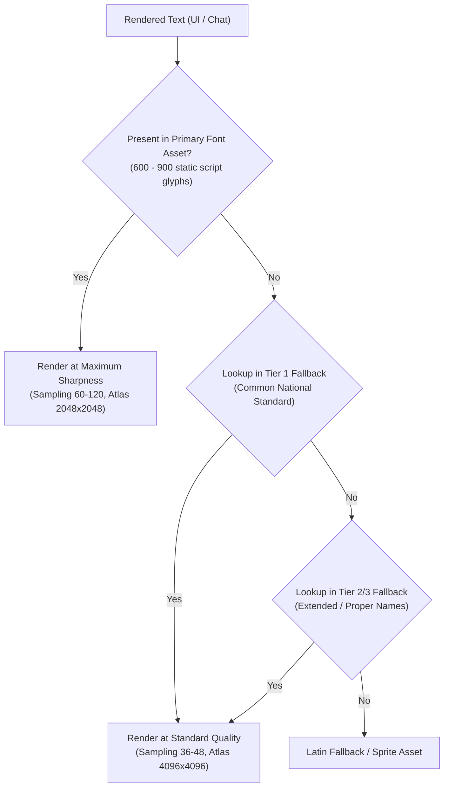

## **1. Project Overview and Real-Time Localization Challenges**

**GilongWorld** imposes a demanding, global-scale engineering requirement: full localization support across **15 target languages**—English, Vietnamese, French, Italian, German, Spanish (Spain), Polish, Portuguese (Brazil), Portuguese (Portugal), Korean, Russian, Japanese, Turkish, Simplified Chinese, and Traditional Chinese. In modern Unity game development, rendering multilingual text in real time goes far beyond swapping string tables. It requires a unified font architecture that preserves typographic consistency, razor-sharp legibility at every camera distance, and—above all—strict discipline over system memory consumption.

The industry-standard text rendering solution in Unity is **TextMeshPro (TMP)**. Unlike legacy UI Text, which rasterizes glyphs into bitmap textures that blur when scaled up, TextMeshPro compiles standard font files into specialized **Font Assets**[^1]. Each Font Asset stores one or more **Atlas Textures** encoded using **Signed Distance Field (SDF)** rendering. SDF allows text to scale indefinitely without pixelation while empowering GPU shaders to compute crisp outlines, drop shadows, dilation, and glow effects in real time[^1].

Yet SDF's visual power comes with an unavoidable physical constraint: **memory limits**. Packing every glyph required by 15 languages into a single atlas texture is physically impossible[^1]. CJK scripts (*Chinese, Japanese, Korean*) alone contain tens of thousands of ideographs. Attempting to cram an entire CJK character set into one Atlas Texture pushes texture dimensions past hardware limits—especially on mobile GPUs (typically capped at $4096 \times 4096$ or $8192 \times 8192$ pixels)—causing VRAM exhaustion or immediate application crashes[^5]. This report details our end-to-end engineering pipeline: from selecting and importing source fonts and analyzing script Unicode ranges, to tuning TextMeshPro SDF ratios, structuring fallback chains, resolving **Han Unification** conflicts via Unity Localization, and eliminating VRAM duplication under Addressables.

---

## **2. Typography Foundations and Source Font Acquisition Strategy**

The first and most critical step in building a multilingual text pipeline is selecting the right **Source Font File**. Maintaining visual harmony across 15 scripts requires open-source typography with comprehensive Unicode coverage, consistent baseline metrics, and matched stroke weights.

Across the software industry, the **Google Noto** font family (short for *"No Tofu"*—named after its mission to eliminate empty placeholder boxes when glyphs are missing) stands as the gold standard[^7]. Designed by Google in partnership with leading type foundries, Noto ensures that Latin, Cyrillic, and CJK glyphs sit harmoniously on the same line without jarring shifts in proportion or visual weight[^8]. Seamless visual continuity when mixed-script strings appear together is vital for player immersion in GilongWorld.

### **Extracting and Importing Source Fonts into Unity**

To begin integration, download the source font families directly from **Google Fonts**. Following a strict import discipline prevents unnecessary bloat in your repository and build sizes:

1. **The 11 Latin and Cyrillic Languages** (*English, Vietnamese, French, Italian, German, Spanish, Polish, Portuguese - Brazil, Portuguese - Portugal, Russian, Turkish*): A single base family—**Noto Sans**—covers all eleven[^8]. Containing over 3,700 glyphs spanning Latin Extended, Cyrillic, and combining diacritics, Noto Sans fulfills every typographic requirement for these locales[^8]. Google Fonts distributes multiple weights (*Thin, Regular, Medium, Bold, Black*) in TrueType (`.ttf`) format.
2. **The 4 CJK Languages**: Acquisition requires four distinct regional families: **Noto Sans JP** (Japanese), **Noto Sans KR** (Korean), **Noto Sans SC** (Simplified Chinese), and **Noto Sans TC** (Traditional Chinese)[^7]. CJK font files are massive—typically 15 MB to 20 MB per weight—due to their vast glyph tables, and are commonly distributed in OpenType (`.otf`) format to accommodate complex glyph mapping tables[^5].

After extracting the archives, import the source files into a dedicated directory in Unity, such as `Assets/GilongWorld_Resources/Fonts/Source_Files/`. Drag and drop only the required `.ttf` and `.otf` weights (sticking to a single baseline weight such as *Regular* or *Medium* unless UI design explicitly demands distinct bold assets) into the Unity Project window[^10].

> [!NOTE]
> TextMeshPro does not use `.ttf` or `.otf` files directly to render text at runtime; they serve strictly as raw input for the **Font Asset Creator** to sample and bake into SDF Atlas Textures[^1]. Isolating source font files inside their own folder makes it trivial to strip them from final player builds (when Dynamic SDF is not required), keeping installer sizes lean.

---

## **3. Script Morphology and Unicode Range Analysis**

Supporting 15 distinct languages in GilongWorld requires a precise breakdown of how characters are encoded in the Unicode standard. TextMeshPro uses hexadecimal **Unicode Ranges** to select which glyphs to extract from source fonts[^13]. Declaring exact ranges guarantees 100% linguistic coverage while preventing unused symbols from wasting precious Atlas space.

Based on script morphology and encoding rules, the 15 languages divide cleanly into three strategic groups.

### **Group 1: Extended Latin and Diacritics**

This group spans English, French, Italian, German, Spanish, Polish, Portuguese (Brazil), Portuguese (Portugal), Turkish, and Vietnamese. While they share Basic Latin (`U+0020` to `U+007E`), their requirements diverge sharply across extended blocks[^1]:

- **Western and Southern Europe** (*French, Spanish, Italian, Portuguese, German*): Rely primarily on *Latin-1 Supplement* (`U+00A0` to `U+00FF`), covering accented vowels and characters such as `á`, `é`, `í`, `ó`, `ú`, `ñ`, `ü`, and `ç`.
- **Central Europe and Turkish** (*Polish, Turkish*): Depend on *Latin Extended-A* (`U+0100` to `U+017F`) for glyphs like `ą`, `ł`, `ş`, and `ğ`[^10].
- **Vietnamese**: The most demanding Latin locale. With stacked tonal marks layered atop circumflexed (`â`, `ê`, `ô`) and horned (`ơ`, `ư`) vowels, Vietnamese requires the *Latin Extended Additional* block (`U+1E00` to `U+1E9F`)[^14]. Stacked Vietnamese diacritics produce unusually tall bounding boxes (for example, `Ể` rises significantly above standard Latin cap height), demanding careful tuning of line height and SDF padding in TextMeshPro to avoid clipping glyph tops.

### **Group 2: Cyrillic**

The sole Cyrillic language in the project is **Russian**. Although completely independent from Latin encoding—residing within `U+0400` to `U+04FF`[^10]—Cyrillic shares compatible stroke widths and baseline metrics with Noto Sans Latin. That lets us pack Russian seamlessly into the same Font Asset alongside the 10 Latin languages without visual imbalance.

### **Group 3: CJK Scripts and the Han Unification Problem**

The third group comprises **Korean, Japanese, Simplified Chinese, and Traditional Chinese**—by far the most technically demanding segment. Beyond sheer glyph volume, engineers must confront a longstanding Unicode design convention known as **Han Unification**[^7].

In the early days of Unicode, to fit East Asian scripts within a 16-bit code space, the Unicode Consortium merged Chinese, Japanese, and Korean ideographs sharing historical etymology into single shared **code points**[^7]. This block—*CJK Unified Ideographs*—spans `U+4E00` to `U+9FA5`[^12].

The consequence for game UI rendering is severe: **even when sharing an identical Unicode code point, the actual visual glyph shape differs distinctly across regions** due to centuries of divergent calligraphy and national orthographic standards:

- Consider the character for "bone" (`U+9AA8`, 骨). Inside the upper rectangular radical, Simplified Chinese (SC) arranges the inner strokes horizontally left-to-right, whereas Traditional Chinese (TC) and Japanese (JP) draw that internal stroke structure differently[^7].
- Likewise, common characters like "snow" (雪) and "straight" (直) carry subtle structural differences immediately noticeable to native readers.

A text renderer cannot infer regional intent from a raw Unicode scalar; it simply looks up the code point in the active Font Asset. Sharing a single pan-CJK font across all East Asian locales forces Japanese players to read Japanese dialogue rendered in Chinese glyph forms—or vice versa[^7]. To native players, text looks broken, foreign, or amateurish, shattering immersion[^7]. The only robust engineering fix is isolating separate Font Assets per CJK locale and managing fallback routing dynamically.

---

## **4. Inside TextMeshPro and Signed Distance Field (SDF) Mechanics**

Configuring Font Assets accurately requires understanding how **Signed Distance Fields (SDF)** work inside TextMeshPro. Unlike bitmap fonts that store pixel color values, SDF textures encode the mathematical distance from each texel to the nearest glyph contour[^1]:
- Texels **inside** a glyph hold **positive** distance values.
- Texels **outside** a glyph hold **negative** values.
- Texels sitting **exactly on the edge** hold a value of **zero** ($0$).

This distance field is baked as a grayscale Atlas Texture. At runtime, TextMeshPro's GPU shader performs bilinear interpolation across those distance samples. For every screen fragment, the shader tests the interpolated value: fragments $> 0$ are shaded solid, while fragments $< 0$ become transparent. Because rendering relies on continuous mathematical interpolation rather than discrete pixel grids, SDF edges remain crisp even under extreme camera zoom[^1].

Two Font Asset Creator parameters directly govern SDF quality:
1. **Sampling Point Size:** Controls the physical texel resolution at which each glyph is rasterized onto the Atlas Texture. Higher values capture finer contour fidelity.
2. **Padding:** The cornerstone of SDF effects. Extra margin surrounding each glyph gives the distance gradient room to decay smoothly into deeper negative values. Wider padding gives the shader ample headroom to render thick outlines, drop shadows, and glows without hard clipping artifacts[^13].

---

## **5. Step-by-Step Configuration with Font Asset Creator**

All SDF Font Assets are generated through Unity's built-in tool:

```text
Window > TextMeshPro > Font Asset Creator
```

Following the analysis in Section 3, GilongWorld adopts a segmented architecture: **one shared Font Asset for all 11 Latin/Cyrillic languages, and four isolated Font Assets for the CJK locales**.

### **5.1. Static Atlas Setup for Latin, Cyrillic, and Vietnamese**

Consolidating all 11 languages (*English, French, Italian, German, Spanish, Polish, Portuguese BR, Portuguese PT, Turkish, Russian, Vietnamese*) into a single **Primary Static Font Asset** minimizes GPU draw calls—a major win for maintaining stable frame rates across UI-heavy screens[^14].

Configure the Font Asset Creator with these exact settings[^12]:

| Configuration Property | Technical Recommendation | Engineering Rationale |
| :--- | :--- | :--- |
| **Source Font File** | `NotoSans-Regular.ttf` | Drag the source font from `Assets` into this slot as the geometric input[^1]. |
| **Sampling Point Size** | `Custom Size: 60 - 90` | Auto Sizing merely squeezes glyphs to fit available space. Locking a Custom Size between 60 and 90 guarantees uniform SDF precision across the entire atlas[^1]. |
| **Padding** | `6 - 9` (~10% Ratio) | TMP's standard rule sets Padding to ~10% of Sampling Point Size[^4]. At Sampling 60, Padding 6 is ideal (bump up to 10 if UI designs require extra-thick outlines). |
| **Packing Method** | `Optimum` | Significantly slower to bake than Fast, but performs iterative bin-packing to pack glyphs tightly and minimize wasted atlas space[^12]. |
| **Atlas Resolution** | `2048 x 2048` | These 11 languages total roughly 1,500–2,000 glyphs. A $2048 \times 2048$ atlas comfortably fits Sampling Point Size 60 without dropping characters[^7]. |
| **Character Set** | `Unicode Range (Hex)` | Grants explicit, deterministic control over included glyphs rather than relying on broad presets[^2]. |

Populate **Custom Character List** with the following hex ranges covering all 11 languages:

```text
0020-007E, 00A0-00FF, 0100-017F, 0180-024F, 1E00-1E9F, 0300-036F, 0400-04FF, 0500-052F, 2000-206F
```

Once configured:
1. Click **Generate Font Atlas** and wait for the SDF distance pass to finish (this may take a few minutes depending on CPU speed).
2. Inspect the texture preview, then click **Save**.
3. Save the resulting asset as `Global_Latin_Cyrillic_SDF.asset` inside your project font directory[^1].

### **5.2. Static Setup for CJK and Hierarchical Fallback Architecture**

Handling the four CJK scripts demands a fundamentally different strategy due to sheer character count. You must repeat asset generation separately for `NotoSansCJKjp`, `NotoSansCJKkr`, `NotoSansCJKsc`, and `NotoSansCJKtc`. However, attempting to bake full CJK Unicode ranges into a single static atlas fails immediately because it exceeds maximum texture limits[^5].

The proven engineering pattern is **Hierarchical Character Mapping** powered by **Characters from File**[^7]:

#### **1. Build a Primary SDF Font Asset for Known Script Characters**
- Extract all static text strings from the project's **String Tables** (Menus, Quests, Items, Dialogues, Skills).
- In practice, the unique character count across game copy is typically **under 1,000 characters** (in GilongWorld specifically: **855** characters for Simplified Chinese, **870** for Traditional Chinese, **694** for Japanese, and **588** for Korean).
- **Maximize Sampling Quality:** Because fewer than 1,000 glyphs are packed, you can push **Sampling Point Size high** (`60` to `90` or `120`) inside a $2048 \times 2048$ atlas—ensuring all official game UI text renders with razor-sharp clarity at any distance.

#### **2. Construct Tiered Fallbacks from National Standard Character Sets (UGC/Chat)**
To support arbitrary player input (character names, guild descriptions, community chat) without ever showing Tofu boxes, pair each Primary Asset with tiered Fallback Font Assets derived from **national standard character corpora**:

| Language | National Standard Character Set | Glyph Count | Authority & Open-Source Reference |
| :--- | :--- | :---: | :--- |
| **Simplified Chinese (zh-Hans)** | **TGSCC (通用规范汉字表)**<br/>- Level 1 (Common): 3,500 chars<br/>- Level 2 (Extended): 3,000 chars<br/>- Level 3 (Proper Names/Places): 1,605 chars | **8,105** | Ministry of Education of the PRC<br/>*Open Source:* [GitHub chinese-character-table](https://github.com/maple-leaf/chinese-character-table) |
| **Traditional Chinese (zh-Hant)** | **Chart of Standard Forms of Common National Characters** (*常用國字標準字體表*) | **4,808** | Ministry of Education (MOE Taiwan)<br/>*Open Source:* [Taiwan Open Data](https://data.gov.tw/dataset/5961) / [GitHub cjktables](https://github.com/ButTaiwan/cjktables) |
| **Japanese (ja)** | - **Jōyō Kanji** (常用漢字 - Regular-use): 2,136 chars<br/>- **Jinmeiyō Kanji** (人名用漢字 - Name-use): 863 chars | **2,999** | Agency for Cultural Affairs (文化庁)<br/>*Open Source:* [KanjiAPI](https://kanjiapi.dev/) / [GitHub kanji-data](https://github.com/davidluzgouveia/kanji-data) |
| **Korean (ko)** | **KS X 1001 Standard** (2,350 most common Hangul syllables, covering 99.9% of communication) | **2,350** | Korean Agency for Technology and Standards (KATS)<br/>*Open Source:* [GitHub ksx1001](https://github.com/korean-character-sets/ksx1001) / Extracted via `euc-kr` |



#### **3. The Invariant Rule: Maintaining Sampling Point Size / Padding Ratio Consistency**

A foundational rule inside TextMeshPro's shader is that **Outline thickness, Underlay / Shadow spread, and Glow width are computed directly from the ratio between Sampling Point Size and Padding**[^13].

##### **Why Don't Fallbacks Need the Same Point Size as the Primary Font?**
- **Primary Font (~855 UI script glyphs):** Visible 100% of gameplay time $\rightarrow$ **Maximize quality** (`Sampling Size = 120`, `Padding = 10`, $2048 \times 2048$ Atlas).
- **Fallback Fonts (2,700–8,000 rarer chat/name glyphs):** Appear infrequently $\rightarrow$ **Lower sampling size** (`Sampling Size = 60` or `48`) to pack thousands of glyphs into the same atlas footprint without exploding VRAM.

##### **Why Must You Preserve the Same Ratio ($\text{Ratio} = \frac{\text{Sampling}}{\text{Padding}}$)?**
Consider a single sentence mixing glyphs from the Primary Font and a Fallback Font:
- **Mismatched ratio:** Primary glyphs (Size 120, Pad 10 $\rightarrow$ Ratio 12) display a crisp thin outline, while a Fallback glyph (Size 60, accidentally left at Pad 10 $\rightarrow$ Ratio 6) renders with a **bloated outline twice as thick that swallows the character strokes**.
- **Matched ratio ($\text{Ratio} = 12$):** Whether a glyph resolves from Primary or falls back to Tier 1–3, **outline thickness and shadow spread stay 100% visually uniform**.

| Font Asset Tier | Role | Sampling Point Size *(Custom)* | Padding | Atlas Resolution | Ratio |
| :--- | :--- | :---: | :---: | :---: | :---: |
| **Primary Font** | Core UI & dialogue script | **120** *(or 96)* | **10 px** *(or 8 px)* | $2048 \times 2048$ | **12** *(Max sharpness)* |
| **Tier 1 Fallback** | ~2,725 common characters | **60** | **5 px** | $2048 \times 2048$ | **12** *(VRAM-efficient)* |
| **Tier 2 Fallback** | ~2,992 extended characters | **60** | **5 px** | $2048 \times 2048$ | **12** *(VRAM-efficient)* |
| **Tier 3 Fallback** | ~1,605 rare/name characters | **48** | **4 px** | $2048 \times 2048$ | **12** *(VRAM-efficient)* |

> [!TIP]
> **Practical tip:** In *Font Asset Creator*, switch `Sampling Point Size` from *Auto Sizing* to **Custom Size** so you can lock both Sampling Size and Padding to the exact ratios in the table above.

---

### **5.3. Folder Organization and Editor Automation in Unity**

For long-term scalability and maintainability, GilongWorld organizes all character corpora into a clean, tiered directory hierarchy:

```text
Assets/_GilongWorld/_Project/Art/Fonts/_chars/
├── 01_Latin_Cyrillic/        # [Shared Primary Font] 11 Latin/Cyrillic languages
│   ├── vi_chars.txt          # Vietnamese
│   ├── en_chars.txt          # English
│   ├── ru_chars.txt          # Russian
│   └── ...                   # French, German, Italian, Spanish, Polish, Portuguese, Turkish
│
├── 02_CJK/                   # [CJK Primary Fonts] Static in-game script glyphs
│   ├── ja_chars.txt          # Japanese (694 actual unique chars)
│   ├── ko_chars.txt          # Korean (588 actual unique chars)
│   ├── zh_Hans_chars.txt     # Simplified Chinese (855 actual unique chars)
│   ├── zh_Hant_chars.txt     # Traditional Chinese (870 actual unique chars)
│   │
│   ├── Standard_Fallbacks/   # [Raw Standard Corpora] 7 national standard datasets
│   │   ├── zh_Hans_TGSCC_Level1_3500.txt
│   │   ├── zh_Hans_TGSCC_Level2_3000.txt
│   │   ├── zh_Hans_TGSCC_Level3_1605.txt
│   │   ├── zh_Hant_Common_4808.txt
│   │   ├── ja_Joyo_Kanji_2136.txt
│   │   ├── ja_Jinmeiyo_Kanji_863.txt
│   │   └── ko_KS_X_1001_2350.txt
│   │
│   └── Subtracted_Fallbacks/ # [Deduplicated Fallbacks] Primary glyphs subtracted
│       ├── zh_Hans_Fallback_Level1.txt    (TGSCC Level 1 minus Primary)
│       ├── zh_Hans_Fallback_Level2.txt    (TGSCC Level 2 minus Primary)
│       ├── zh_Hans_Fallback_Level3.txt    (TGSCC Level 3 minus Primary)
│       ├── zh_Hant_Fallback_Common.txt    (TW 4808 minus Primary)
│       ├── ja_Fallback_Joyo.txt           (Joyo Kanji minus Primary)
│       ├── ja_Fallback_Jinmeiyo.txt       (Jinmeiyo Kanji minus Primary)
│       └── ko_Fallback_KS_X_1001.txt      (KS X 1001 minus Primary)
```

#### **Automated Extraction & Fallback Subtraction Tool (`GWCharacterExtractor.cs`)**
To eliminate manual CSV exports and character deduplication, our custom Editor tool [`GWCharacterExtractor.cs`](file:///d:/Unity-Projects/GLW/Assets/_GilongWorld/_Project/Editor/Localization/GWCharacterExtractor.cs) runs a two-in-one pipeline:
- **Menu path:** `GilongWorld → Localization → Extract CJK Characters From String Tables`
- **Pass 1 (Primary Extraction):** Scans every `StringTableCollection` in Unity Localization, collects all active glyphs into a `HashSet<char>` (guaranteeing 100% uniqueness), sorts them in ascending Unicode order, and writes the 4 Primary files inside `02_CJK/`.
- **Pass 2 (Automatic Fallback Subtraction):** Reads the 7 corpora inside `Standard_Fallbacks/`, strips out every glyph already present in the corresponding Primary file, and writes the deduplicated sets to `Subtracted_Fallbacks/`. This completely eliminates redundant glyphs across Primary and Fallback atlases, saving substantial VRAM.

#### **`GWSDFGeneratorWindow` and Bypassing Unity 6 Internal API Locks**
To enforce our strict `Sampling / Padding = 12` ratio across every asset, the project provides a dedicated Editor Window that validates parameters and warns immediately if ratios drift.
Notably, in Unity 6, `TMP_FontAsset.clearDynamicDataOnBuild` was locked behind `internal` access modifiers, blocking regular scripts from enabling build-time cleanup programmatically. Our generator resolves this cleanly using reflection via `SerializedObject`:

```csharp
var serializedObject = new SerializedObject(fontAsset);
serializedObject.FindProperty("m_ClearDynamicDataOnBuild").boolValue = true;
serializedObject.ApplyModifiedProperties();
```

This single safeguard stripped a bloated 137 MB dynamic atlas left over from legacy assets, shrinking player build size down to bare essentials.

---

## **6. Fallback Chain Architecture and Resolving Han Unification**

Smooth multilingual rendering hinges on governing TextMeshPro's **Fallback Chain**. When a TMP component encounters a character absent from its Primary Font Asset, it recursively traverses a strict lookup hierarchy to locate a replacement glyph:

1. `TextMeshPro Primary Font Asset`
2. `Primary Font's Local Fallback Font Assets list`
3. `Local Sprite Asset`
4. `Global General Fallback Font Assets defined in TMP_Settings`
5. `Default Sprite Asset`
6. `Default Font Asset`[^20]

> [!WARNING]
> TMP traverses this chain strictly top-to-bottom and **stops immediately upon matching the first Unicode code point**[^7].

As established in Section 3, Han Unification causes SC, TC, and JP to share code points despite differing glyph shapes[^7]. If all CJK fonts are dumped into `TMP_Settings`'s General Fallback list, list order dictates which regional style wins. For instance, if the list orders `Font_CJK_JP_SDF` $\rightarrow$ `Font_CJK_SC_SDF` $\rightarrow$ `Font_CJK_TC_SDF`, any Simplified Chinese string hits the Japanese asset first, finds the matching Unicode code point, and renders Japanese Kanji forms on screen while ignoring the Chinese font below it[^7].

### **Local Fallback Isolation Architecture**

To eradicate cross-locale contamination permanently, fallback chains must be strictly isolated per language:

> [!IMPORTANT]
> **Never place CJK fonts inside the Global Fallback List in `TMP_Settings`**[^1]. Instead, bind each language's fallback tiers inside its own **Local Fallback** list and swap the active Primary Font dynamically at runtime.

A fundamental typographic reality is that CJK fonts often bundle poorly proportioned Latin letters and Arabic numerals compared to dedicated Latin typefaces[^9]. Therefore, Latin numerals and Western words should always resolve through `Global_Latin_Cyrillic_SDF`. Wire each CJK asset's local chain as follows:
1. Open `Font_CJK_SC_SDF.asset`, add Chinese Fallback Tiers 1–3 to **Fallback Font Assets**, and append `Global_Latin_Cyrillic_SDF`[^1].
2. Repeat the exact pattern for TC, JP, and KR.

This guarantees that whenever Simplified Chinese dialogue includes numbers or English proper nouns, those characters pass cleanly through the Chinese static atlas (since Latin glyphs were excluded during *Characters from File* extraction) and land on our high-craft Latin/Cyrillic asset[^7].

---

## **7. Integrating Unity Localization for Runtime Font Swapping**

To ensure culturally accurate glyph shapes and lean VRAM usage, TMP UI components cannot hold static font references forever. Whenever the player changes language (*Locale*), the **Primary Font Asset** must be swapped automatically at runtime[^23].

The **Unity Localization** package (`com.unity.localization`) provides robust infrastructure for this without brittle hardcoded switch statements[^25], driven by the global `LocalizationSettings.SelectedLocaleChanged` callback[^24].

Two implementation patterns are available:

### **Approach 1: Centralized Font Manager (`GWFontManager.cs`)**

Rather than attaching Localized Asset components to thousands of individual UI Text objects (which bloats scene memory with thousands of extra `MonoBehaviour` instances and GC overhead), GilongWorld uses a **Centralized Addressables Font Manager**.

A persistent `GWFontManager.cs` (`DontDestroyOnLoad`) subscribes to `LocalizationSettings.SelectedLocaleChanged`. Upon locale switch, it executes two clean operations:
1. **Async Load:** Calls `LocalizationSettings.AssetDatabase.GetLocalizedAssetAsync<TMP_FontAsset>("Fonts_Table", "PrimaryFont")` to load the active locale's Primary Font Asset from Addressables.
2. **Global Sweep:** Calls `FindObjectsByType<TMP_Text>` across the active scene and assigns the newly loaded font to all text components. While this sweep costs a couple of milliseconds of CPU time, it runs only on language changes or scene transitions—completely freeing RAM from thousands of per-widget listener objects. Once assigned, the previous locale's font asset is immediately released via `Addressables.Release()`.

This approach completely eliminates CJK cross-pollination because only the currently selected locale's atlas resides in memory[^7].

### **Approach 2: Unity Localization Asset Tables**

The most native out-of-the-box alternative is **Localized Asset Tables**[^23]. Just as Localized String Tables swap text strings per locale, Asset Tables map distinct Font Assets to each locale. Individual UI components can be configured to swap both their text string and their `FontAsset` property automatically[^23].

While this demands per-prefab Inspector wiring, it offers high stability and spares teams from maintaining custom mapping code[^28].

---

## **8. User-Generated Content (UGC), Memory Optimization, and Addressables**

Static atlases solve official game UI and dialogue completely. However, **User-Generated Content (UGC)**—character names, guild bios, and player chat—poses an open-ended challenge: players may type rare characters from any of the 15 languages, and pre-baking every Unicode character on Earth into RAM is impossible.

### **The Hybrid SDF Architecture**

TextMeshPro's **Dynamic SDF** mode normally starts with an empty ($0 \times 0$ pixel) atlas texture, rasterizing glyphs on the CPU on demand at runtime[^6]. Relying purely on Dynamic SDF, however, causes severe frame spikes on initial UI screens. GilongWorld solves this with a **Hybrid Architecture**:

1. **Pre-Populated Static Base:** Using `GWCharacterExtractor.cs`, thousands of common glyphs are pre-baked into the atlas via `TryAddCharacters` inside the Editor. During normal gameplay, every frequent character is already resident, keeping frame rates rock-solid.
2. **Safe Dynamic Overflow:** Font Assets remain configured as Dynamic with `isMultiAtlasTexturesEnabled = true`. If a player types an ultra-rare character absent from the initial atlas, TMP seamlessly spawns a secondary overflow texture (`Atlas 0 1`, `Atlas 0 2`, ...) on the fly instead of displaying a Tofu box—delivering the best of both worlds.

> [!CAUTION]
> Dynamic SDF carries a concrete memory cost: each dynamically spawned $2048 \times 2048$ atlas texture immediately consumes roughly **4 MB** of memory. Unbounded overflow atlases can quickly pressure mobile RAM budgets[^31].

### **The Hidden Addressables Trap and VRAM Duplication**

Modern large-scale Unity projects like GilongWorld almost universally rely on **Addressables** for content delivery. Yet a notorious pitfall traps many teams: **assuming Addressables isn't active for fonts and leaving Font Assets inside a `Resources` folder.**

In reality, **Unity Localization is built directly on top of Addressables**. Even if you don't explicitly manage fonts via Addressables, Localization uses Addressables under the hood for String Tables.
When an Addressable UI Prefab references a Font Asset stored inside `Resources`, Unity's asset bundler commits a costly duplication error (*duplicate assets*):
1. Unity bundles a full duplicate copy of that Font Atlas directly into the Addressables AssetBundle[^32].
2. At runtime, the `Resources` copy loads alongside the AssetBundle copy—**doubling VRAM consumption** for the exact same atlas[^31]. This silent duplication is one of the fastest ways to trigger out-of-memory crashes on mobile devices[^33].

**The Definitive Fix:**
- Move `TMP_Settings` and every Font Asset completely out of `Resources` into a standard project folder such as `Assets/_GilongWorld/_Project/Art/Fonts/SDF/`.
- Place all SDF Font Assets into a dedicated Addressables Group (e.g., `Fonts_Addressables`) and register them in Localization's **Asset Table** (`Fonts_Table`).
- **Clear Dynamic Data Before Builds:** Because Dynamic Font Assets persist generated texture data on disk, always clear dynamic atlas buffers prior to player builds (automated in our pipeline via `GWSDFGeneratorWindow` using `SerializedObject`)[^30].
- **Runtime Memory Cleanup:** During major scene transitions, invoke `TMP_FontAsset.ClearFontAssetData(true)` or `FontEngine.DestroyFontEngine()` to reclaim unused dynamic texture allocations[^35].

---

## **9. Live Diagnostics and Troubleshooting**

Across multi-platform production testing, localization pipelines tend to surface recognizable failure symptoms. Understanding the root mechanisms lets engineers isolate and fix issues rapidly:

### **Text Renders as Tofu Boxes on Mobile Builds While Working in the Editor**
- **Root Cause:** Unity's build pipeline fails to register Fallback Font Assets as build dependencies if they are only referenced dynamically or loosely via `FallbackFontAssetTable` rather than pinned by a scene object. Consequently, Unity strips those fallback assets from the player build to save space[^1].
- **Fix:** Register global references through `TMP_Settings.fallbackFontAssets` so Unity tracks them, or explicitly mark all potential Font Assets as Addressables pre-loaded via the Addressables Manifest[^1].

### **Exception: `"The variable m_AtlasTextures of TMP_FontAsset has not been assigned"`**
- **Root Cause:** Occurs in Dynamic Font Assets using Multi Atlas Textures[^34]. When runtime glyph insertion allocates overflow textures that are later interrupted or prematurely destroyed alongside instantiated prefabs, the internal texture array retains a null reference.
- **Fix:** Manually **Reset** the Font Asset via its Inspector context menu prior to building to restore a clean initial texture array[^34].

### **Text Appears Blurry at Large Display Sizes**
- **Root Cause:** The SDF Atlas resolution or `Sampling Point Size` is too low relative to the on-screen pixel height of large titles[^1].
- **Fix:** For oversized headings or banners, configure `Sampling Point Size` at `150` or higher. If packing the entire character set at that size exceeds atlas limits, split banner characters into a dedicated Static Font Asset rather than sharing the body-copy atlas[^1].

### **Authentication Error Pulling Translation Tables from Google Sheets (`invalid_grant: Token has been expired or revoked`)**
- **Symptom:** Pulling localization tables (such as `RPGB_General` or String Tables) from Google Sheets into Unity fails with: `Pull from Google sheets: Failed - Error: "invalid_grant", Description: "Token has been expired or revoked."`
- **Root Cause:** **Timezone Skew / System Clock Drift.** Google OAuth2 enforces strict timestamp validation on token requests. If the local machine's clock or timezone drifts, or if the Unity Editor caches a stale time offset, Google's auth server immediately rejects the request with `invalid_grant`.
- **Fix:**
  - **Restart the Unity Editor:** Close and reopen Unity so the Engine syncs with the OS's current system clock $\rightarrow$ re-running **Pull** succeeds immediately.

---

## **10. Final Architectural Recommendations**

Supporting 15 languages in **GilongWorld** requires a text-rendering architecture engineered for strict VRAM efficiency and faithful cross-cultural typography:

1. **Typographic Consistency:** Standardize on **Google Noto Sans** and **Noto Sans CJK** so baseline metrics and visual weights remain seamless when multiple languages appear side by side.
2. **Atlas Segmentation:** Never force every language into one texture. Bake a single $2048 \times 2048$ Primary Static Font Asset covering all 11 Latin and Cyrillic languages (*English, Vietnamese, French, Italian, German, Spanish, Polish, Portuguese, Russian, Turkish*).
3. **East Asian Optimization & Tiered Fallbacks:** Isolate the 4 CJK locales (*Simplified Chinese, Traditional Chinese, Japanese, Korean*) into separate assets. Pair a high-precision **Primary SDF Font Asset (< 1,000 static script glyphs at Sampling Size 60–120)** with **3 Fallback Tiers (up to 8,105 national standard glyphs such as TGSCC)** for player chat and naming. Strictly enforce a **consistent Sampling Point Size / Padding ratio** (Ratio $\approx 10-12$) across Primary and Fallback assets so outlines, shadows, and glows render uniformly.
4. **Fallback Chain Governance (Han Unification):** Never register CJK fonts in `TMP_Settings`'s Global Fallback list. Instead, use **Unity Localization** to swap Primary Font Assets dynamically at runtime per active Locale, eliminating wrong-region glyph rendering. Always wire `Global_Latin_Cyrillic_SDF` as a Local Fallback on each CJK asset.
5. **Dynamic UGC & Addressables Discipline:** Enable Dynamic Multi-Atlas overflow for rare player-entered characters. Keep all TMP settings and Font Assets completely out of `Resources`, manage them through **Addressables** to prevent double VRAM allocation, and invoke build-time and scene-transition cleanup APIs to keep memory rock-solid across extended play sessions.

---

## **References**

[^1]: Fix: Unity TextMeshPro Font Asset Missing or Fallback | Bugnet Blog, [https://bugnet.io/blog/fix-unity-textmeshpro-font-asset-missing](https://bugnet.io/blog/fix-unity-textmeshpro-font-asset-missing)
[^2]: Fix: Unity UI TextMeshPro Falling Back to Default Font | Bugnet Blog, [https://bugnet.io/blog/fix-unity-ui-text-mesh-pro-falling-back-default-font](https://bugnet.io/blog/fix-unity-ui-text-mesh-pro-falling-back-default-font)
[^3]: textmeshpro | Skills Marketplace · LobeHub, [https://lobehub.com/de/skills/xeldaralz-helm-textmeshpro](https://lobehub.com/de/skills/xeldaralz-helm-textmeshpro)
[^4]: Chinese Traditional, Simplified and English text looks blurred, [https://discussions.unity.com/t/chinese-traditional-simplified-and-english-text-looks-blurred/723916](https://discussions.unity.com/t/chinese-traditional-simplified-and-english-text-looks-blurred/723916)
[^5]: Creating asset from font with a lot of characters - Page 2 - Unity Engine, [https://discussions.unity.com/t/creating-asset-from-font-with-a-lot-of-characters/708290?page=2](https://discussions.unity.com/t/creating-asset-from-font-with-a-lot-of-characters/708290?page=2)
[^6]: Bug where TextMeshPro dynamic font atlas exhaustion causes, [https://unity-trouble-atlas.7colorsgame.com/en/article/unity-tmp-dynamic-font-atlas-exhaustion/](https://unity-trouble-atlas.7colorsgame.com/en/article/unity-tmp-dynamic-font-atlas-exhaustion/)
[^7]: Unity Font: The 2026 Complete Guide to TextMesh Pro Font Assets, [https://www.transphere.com/unity-font-textmesh-pro-font-assets-fallbacks-and-localization/](https://www.transphere.com/unity-font-textmesh-pro-font-assets-fallbacks-and-localization/)
[^8]: Noto Sans - Google Fonts, [https://fonts.google.com/noto/specimen/Noto+Sans](https://fonts.google.com/noto/specimen/Noto+Sans)
[^9]: Force a font to use fallbacks - Unity Discussions, [https://discussions.unity.com/t/force-a-font-to-use-fallbacks/711511](https://discussions.unity.com/t/force-a-font-to-use-fallbacks/711511)
[^10]: Multiple Language Support Not Working in TextMesh Pro, [https://stackoverflow.com/questions/44922738/multiple-language-support-not-working-in-textmesh-pro](https://stackoverflow.com/questions/44922738/multiple-language-support-not-working-in-textmesh-pro)
[^11]: How to display Japanese in Unity TextMeshPro using Noto Sans CJK, [https://zenn.dev/uliboooo/articles/c3a2f489d8ee9a?locale=en](https://zenn.dev/uliboooo/articles/c3a2f489d8ee9a?locale=en)
[^12]: TextMeshPro Font Asset Creation & Packaging Guide - GitHub, [https://github.com/bbepis/XUnity.AutoTranslator/wiki/TextMeshPro-Font-Asset-Creation-&-Packaging-Guide](https://github.com/bbepis/XUnity.AutoTranslator/wiki/TextMeshPro-Font-Asset-Creation-&-Packaging-Guide)
[^13]: Font Asset Creator | TextMeshPro | 3.2.0-pre.15 - Unity - Manual, [https://docs.unity3d.com/Packages/com.unity.textmeshpro@3.2/manual/FontAssetsCreator.html](https://docs.unity3d.com/Packages/com.unity.textmeshpro@3.2/manual/FontAssetsCreator.html)
[^14]: [UNITY] Optimizing TextMesh Pro Font Atlas for language localization., [https://killertee.wordpress.com/2021/04/23/optimizing-workflow-textmesh-pro-font-atlas-for-language-localization/](https://killertee.wordpress.com/2021/04/23/optimizing-workflow-textmesh-pro-font-atlas-for-language-localization/)
[^15]: [Solved] TextMeshPro - Text(UI): Shows empty squares - Unity Engine, [https://discussions.unity.com/t/solved-textmeshpro-text-ui-shows-empty-squares/787844](https://discussions.unity.com/t/solved-textmeshpro-text-ui-shows-empty-squares/787844)
[^16]: Character set for multiple languages - Unity Discussions, [https://discussions.unity.com/t/character-set-for-multiple-languages/696758](https://discussions.unity.com/t/character-set-for-multiple-languages/696758)
[^17]: FYI: missing chinese/japanese/korean characters in Unity may not, [https://www.reddit.com/r/Unity3D/comments/1l37yfi/fyi_missing_chinesejapanesekorean_characters_in/](https://www.reddit.com/r/Unity3D/comments/1l37yfi/fyi_missing_chinesejapanesekorean_characters_in/)
[^18]: Saving / loading font atlas for TextMeshPro Font assets during runtime, [https://discussions.unity.com/t/saving-loading-font-atlas-for-textmeshpro-font-assets-during-runtime/891878](https://discussions.unity.com/t/saving-loading-font-atlas-for-textmeshpro-font-assets-during-runtime/891878)
[^19]: Having issues displaying Chinese characters using Text Mesh Pro, [https://www.reddit.com/r/Unity3D/comments/178zt0q/having_issues_displaying_chinese_characters_using/](https://www.reddit.com/r/Unity3D/comments/178zt0q/having_issues_displaying_chinese_characters_using/)
[^20]: Fallback font assets | TextMeshPro | 4.0.0-pre.2 - Unity - Manual, [https://docs.unity3d.com/Packages/com.unity.textmeshpro@4.0/manual/FontAssetsFallback.html](https://docs.unity3d.com/Packages/com.unity.textmeshpro@4.0/manual/FontAssetsFallback.html)
[^21]: Fallback font assets | TextMeshPro | 3.2.0-pre.15 - Unity - Manual, [https://docs.unity3d.com/Packages/com.unity.textmeshpro@3.2/manual/FontAssetsFallback.html](https://docs.unity3d.com/Packages/com.unity.textmeshpro@3.2/manual/FontAssetsFallback.html)
[^22]: Issue using the TMPro fallback system to render Chinese or, [https://discussions.unity.com/t/issue-using-the-tmpro-fallback-system-to-render-chinese-or-japanese-w-specific-fonts/837526](https://discussions.unity.com/t/issue-using-the-tmpro-fallback-system-to-render-chinese-or-japanese-w-specific-fonts/837526)
[^23]: Localization - Unity - Manual, [https://docs.unity3d.com/6000.5/Documentation/Manual/best-practice-guides/ui-toolkit-for-advanced-unity-developers/localization.html](https://docs.unity3d.com/6000.5/Documentation/Manual/best-practice-guides/ui-toolkit-for-advanced-unity-developers/localization.html)
[^24]: Issues with Localization and TMP Rendering in Unity, [https://discussions.unity.com/t/issues-with-localization-and-tmp-rendering-in-unity/948421](https://discussions.unity.com/t/issues-with-localization-and-tmp-rendering-in-unity/948421)
[^25]: A Comprehensive Guide to Unity Localization | Phrase, [https://phrase.com/blog/posts/localizing-unity-games-official-localization-package/](https://phrase.com/blog/posts/localizing-unity-games-official-localization-package/)
[^26]: How to Use the Unity Localization Package: A Complete Guide, [https://www.languagesunlimited.com/unity-localization-package/](https://www.languagesunlimited.com/unity-localization-package/)
[^27]: Change Locale in runtime - Unity Discussions, [https://discussions.unity.com/t/change-locale-in-runtime/812317](https://discussions.unity.com/t/change-locale-in-runtime/812317)
[^28]: TMP Font Asset and localization - Unity Discussions, [https://discussions.unity.com/t/tmp-font-asset-and-localization/936355](https://discussions.unity.com/t/tmp-font-asset-and-localization/936355)
[^29]: Localization, font switching and font material presets - Unity Engine, [https://discussions.unity.com/t/localization-font-switching-and-font-material-presets/770975](https://discussions.unity.com/t/localization-font-switching-and-font-material-presets/770975)
[^30]: Dynamic fonts assets | TextMeshPro | 3.2.0-pre.15 - Unity - Manual, [https://docs.unity3d.com/Packages/com.unity.textmeshpro@3.2/manual/FontAssetsDynamicFonts.html](https://docs.unity3d.com/Packages/com.unity.textmeshpro@3.2/manual/FontAssetsDynamicFonts.html)
[^31]: TextMesh Pro - Font atlases memory leak? - Unity Engine, [https://discussions.unity.com/t/textmesh-pro-font-atlases-memory-leak/885808](https://discussions.unity.com/t/textmesh-pro-font-atlases-memory-leak/885808)
[^32]: TextMeshPro & Addressables (Asset Bundles) - Unity Discussions, [https://discussions.unity.com/t/textmeshpro-addressables-asset-bundles/855482](https://discussions.unity.com/t/textmeshpro-addressables-asset-bundles/855482)
[^33]: TextMesh Pro Fallback Font Displays Boxes on Instantiated Objects, [https://discussions.unity.com/t/textmesh-pro-fallback-font-displays-boxes-on-instantiated-objects-unity-6-mobile-build-only-works-in-editor-and-unity-2022/1652497](https://discussions.unity.com/t/textmesh-pro-fallback-font-displays-boxes-on-instantiated-objects-unity-6-mobile-build-only-works-in-editor-and-unity-2022/1652497)
[^34]: Text Mesh Pro FallBack localization - Unity Discussions, [https://discussions.unity.com/t/text-mesh-pro-fallback-localization/797911](https://discussions.unity.com/t/text-mesh-pro-fallback-localization/797911)
[^35]: Issue with removing fonts from fallbackFontAssetTable (memory leak), [https://discussions.unity.com/t/issue-with-removing-fonts-from-fallbackfontassettable-memory-leak/826070](https://discussions.unity.com/t/issue-with-removing-fonts-from-fallbackfontassettable-memory-leak/826070)
