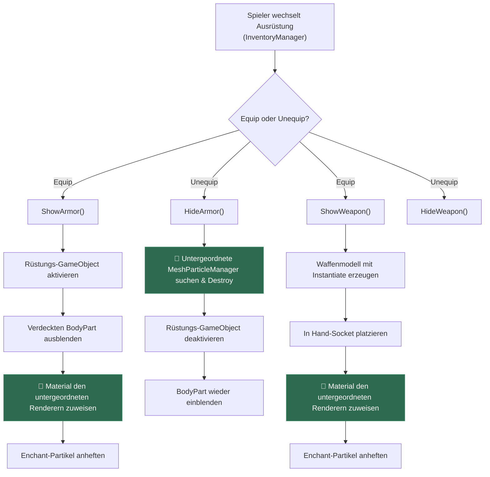

Während der Entwicklung des Projekts Gilong World (GLW) mit Unity 6 hatte die Speicheroptimierung (insbesondere die Minimierung von Garbage Collection – GC) stets höchste Priorität, um eine flüssige Framerate sicherzustellen.

Heute teile ich eine praxisnahe Fallstudie zur Optimierung von Speicherallokationen (Memory Allocation) durch die Methode `GetComponentsInChildren` im Quellcode des Charakter-Erscheinungssystems (`PlayerAppearance`).

## Problemübersicht

Bei der Überprüfung mit dem Profiler meldete das System jedes Mal Speicherallokationen (GC Alloc), wenn der Charakter seine Ausrüstung wechselte. Die Ursache lag in der Verwendung der folgenden API:

> **Vor der Optimierung**: `GetComponentsInChildren<T>()` in der Variante ohne Listenparameter. Diese Methode gibt bei jedem Aufruf ein neues `T[]`-Array zurück und verursacht dadurch jedes Mal eine GC Alloc.
>
> **Nach der Optimierung**: Verwendung von `ListPool<T>.Get()` in Kombination mit dem Overload `GetComponentsInChildren(list)`. Dieser Ansatz ermöglicht die Wiederverwendung einer `List<T>` aus einem bestehenden Pool und erreicht **Zero Allocation**.

---

## Gesamtablaufdiagramm

Der Wechsel von Waffen und Rüstungen läuft wie unten dargestellt ab, wobei die Stellen, an denen eingegriffen werden muss, mit (🔧) markiert sind:



*Hinweis: Schritte ohne Schraubenschlüssel (🔧) sind die ursprünglichen Schritte und bleiben von dieser Änderung völlig unberührt.*

---

## Details zu den einzelnen Optimierungsstellen

Ich habe die Änderung an 4 Stellen in der Datei `PlayerAppearance.cs` vorgenommen. Nachfolgend sind 2 typische Fälle aufgeführt.

### ① Methode `ShowArmor()`

**Zweck**: Wenn der Spieler eine Rüstung anlegt, muss das System alle untergeordneten `Renderer`-Komponenten dieses Rüstungsteils durchlaufen, um ein neues Material zuzuweisen.

**VOR DER OPTIMIERUNG (Verursacht GC Alloc)**

```csharp
foreach (var Renderer in t.GetComponentsInChildren<Renderer>())
{
    Renderer.material = item.modelMaterial;
}
```

**NACH DER OPTIMIERUNG (Zero Alloc)**

```csharp
using (ListPool<Renderer>.Get(out var renderers))
{
    t.GetComponentsInChildren(renderers);
    foreach (var Renderer in renderers)
    {
        Renderer.material = item.modelMaterial;
    }
}
```

**Unveränderte Logik**: Der Code durchläuft weiterhin jeden untergeordneten `Renderer`, um `material` zuzuweisen. Der einzige Unterschied besteht darin, dass der Ergebnis-Container nun eine `List<Renderer>` ist, die über die `using`-Anweisung aus dem Pool ausgeliehen wird, anstatt ein komplett neues `Renderer[]`-Array zu erzeugen.

---

### ② Methode `HideArmor()`

**Zweck**: Beim Ablegen einer Rüstung müssen alle Effekte (wie `MeshParticleManager`), die an diesem Rüstungsteil hängen, gefunden und zerstört (`Destroy`) werden, bevor die Rüstung deaktiviert (`Deactivate`) wird.

**VOR DER OPTIMIERUNG (Verursacht GC Alloc)**

```csharp
MeshParticleManager[] meshManagers = t.GetComponentsInChildren<MeshParticleManager>();
foreach (var v in meshManagers)
{
    Destroy(v.gameObject);
}
```

**NACH DER OPTIMIERUNG (Zero Alloc)**

```csharp
using (ListPool<MeshParticleManager>.Get(out var meshManagers))
{
    t.GetComponentsInChildren(meshManagers);
    foreach (var v in meshManagers)
    {
        Destroy(v.gameObject);
    }
}
```

**Unveränderte Logik**: Der Code durchläuft weiterhin die Liste und ruft `Destroy(v.gameObject)` auf.

Einige fragen sich vielleicht: *„Ist es unbedenklich, Destroy() für die Elemente aufzurufen, während sich die Liste noch im using-Block befindet?“*.  
Die Antwort lautet: Es ist absolut **sicher**. In Unity markiert `Destroy()` das GameObject lediglich für die Löschung am Ende des aktuellen Frames. Daher bleiben die Objekte innerhalb der Liste `meshManagers` während der gesamten Schleife vollkommen gültig. Sobald die Schleife endet, leert (`Clear`) die `using`-Anweisung die Liste automatisch und gibt sie an den Pool zurück.

*(Auf die gleiche Weise wird dieses Muster auch auf Methoden zur Waffendarstellung wie `ShowWeapon()` angewendet).*

---

## Warum bleibt die Spiellogik garantiert unberührt?

Beim Refactoring von Quellcode – insbesondere bei Code von Drittanbieter-Engines – hat Sorgfalt oberste Priorität. Nachfolgend die Risikobewertungstabelle für diese Änderung:

| Zu prüfender Punkt | Bewertung & Erläuterung |
|:---|:---|
| **Ändert sich das Abfrageergebnis?** | ❌ **Nein**. Die Methode `GetComponentsInChildren(List<T>)` liefert **dieselbe Menge an Components** in **exakt derselben Tiefensuche-Reihenfolge (DFS)** wie die Array-zurückgebende Variante. |
| **Ist Destroy sicher?** | ✅ Unitys `Destroy()` wird bis zum Ende des Frames verzögert (delayed). Das Objekt verschwindet nicht sofort, sodass beim Durchlaufen der Liste kein Null-Referenz-Fehler entsteht. |
| **Unterscheidet sich die Materialzuweisung?** | ❌ **Nein**. Die Zuweisung `Renderer.material = ...` läuft identisch ab. |
| **Verarbeitungsreihenfolge der List?** | Bleibt erhalten. `List<T>` bewahrt die Einfügereihenfolge (insertion order) genauso wie ein `T[]`-Array. |
| **Ist ListPool thread-safe?** | ✅ `UnityEngine.Pool.ListPool<T>` (verfügbar ab Unity 2021+) verwendet intern eine `ConcurrentBag`, wodurch Thread-Sicherheit gewährleistet ist. |
| **Was passiert bei einem Fehler (Exception)?** | ✅ Der `using`-Block wird zu einer `try-finally`-Struktur kompiliert, was sicherstellt, dass die Liste stets geleert und an den Pool zurückgegeben wird, selbst wenn zwischendurch eine Exception geworfen wird. |

## Fazit

Mit einer kleinen Änderung durch den Einsatz von `ListPool<T>` haben wir unnötige GC Allocations bei jedem Ausrüstungswechsel vollständig beseitigt. Bei einem großen Projekt wie GLW, in dem Charaktere im Kampf fortlaufend ihre Ausrüstung wechseln können, summieren sich solche kleinen Optimierungen und bewahren das Spiel vor unnötigen Rucklern (Frame Drops), die durch den Garbage Collector ausgelöst werden.

Die Overloads der Unity-API sicher zu beherrschen und das richtige Design Pattern an der richtigen Stelle einzusetzen, ist der Schlüssel zum Schreiben von hochperformantem C#-Code!
