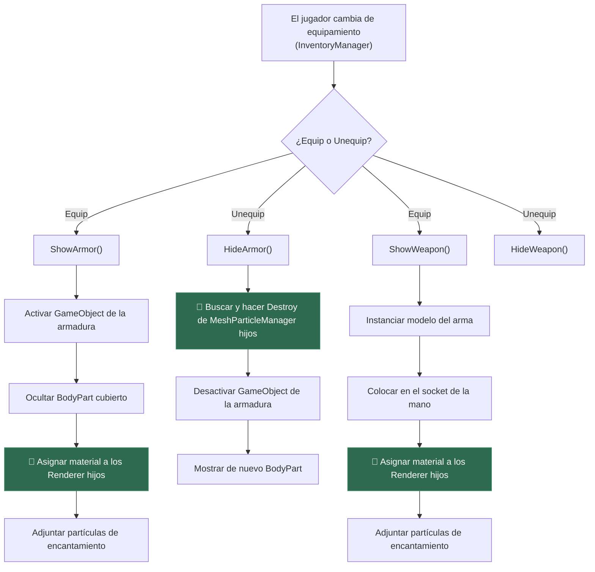

Durante el desarrollo del proyecto Gilong World (GLW) con Unity 6, la optimización de memoria (en especial la reducción del Garbage Collection - GC) ha sido siempre una prioridad absoluta para garantizar una tasa de fotogramas (framerate) fluida.

Hoy comparto un caso práctico real sobre la optimización de las asignaciones de memoria (Memory Allocation) generadas por la función `GetComponentsInChildren` en el código fuente del sistema de apariencia del personaje (`PlayerAppearance`).

## Descripción general del problema

Al inspeccionar el proyecto con el Profiler, el sistema notificaba asignaciones de memoria (GC Alloc) cada vez que el personaje cambiaba de equipamiento. La causa provenía del uso de la siguiente API:

> **Antes de optimizar**: `GetComponentsInChildren<T>()` en su forma sin parámetro de lista. Esta función siempre devuelve un nuevo array `T[]`, provocando GC Alloc en cada llamada.
> 
> **Después de optimizar**: Usar `ListPool<T>.Get()` junto con la sobrecarga `GetComponentsInChildren(list)`. Este método permite reutilizar una `List<T>` de un pool existente, logrando **Zero Allocation**.

---

## Diagrama del flujo de ejecución general

El cambio de armas y armaduras sigue el flujo que se muestra a continuación, y he marcado con (🔧) los puntos donde es necesario intervenir:



*Nota: Los pasos sin llave inglesa (🔧) son los pasos originales y no se ven afectados en absoluto por este cambio.*

---

## Detalle de cada punto optimizado

He aplicado esta modificación en 4 puntos del archivo `PlayerAppearance.cs`. A continuación se muestran 2 casos representativos.

### ① Función `ShowArmor()`

**Objetivo**: Cuando el jugador equipa una armadura, el sistema debe recorrer todos los `Renderer` hijos de esa pieza de armadura para asignarles el nuevo material.

**ANTES DE OPTIMIZAR (Genera GC Alloc)**

```csharp
foreach (var Renderer in t.GetComponentsInChildren<Renderer>())
{
    Renderer.material = item.modelMaterial;
}
```

**DESPUÉS DE OPTIMIZAR (Zero Alloc)**

```csharp
using (ListPool<Renderer>.Get(out var renderers))
{
    t.GetComponentsInChildren(renderers);
    foreach (var Renderer in renderers)
    {
        Renderer.material = item.modelMaterial;
    }
}
```

**Lógica intacta**: El código sigue recorriendo todos los `Renderer` hijos para asignar `material`. La única diferencia es que el contenedor que almacena el resultado ahora es una `List<Renderer>` tomada prestada del pool mediante la sentencia `using`, en lugar de crear un array `Renderer[]` completamente nuevo.

---

### ② Función `HideArmor()`

**Objetivo**: Al desequipar una armadura, es necesario buscar todos los efectos (como `MeshParticleManager`) adheridos a esa pieza y destruirlos (`Destroy`) antes de desactivar la armadura.

**ANTES DE OPTIMIZAR (Genera GC Alloc)**

```csharp
MeshParticleManager[] meshManagers = t.GetComponentsInChildren<MeshParticleManager>();
foreach (var v in meshManagers)
{
    Destroy(v.gameObject);
}
```

**DESPUÉS DE OPTIMIZAR (Zero Alloc)**

```csharp
using (ListPool<MeshParticleManager>.Get(out var meshManagers))
{
    t.GetComponentsInChildren(meshManagers);
    foreach (var v in meshManagers)
    {
        Destroy(v.gameObject);
    }
}
```

**Lógica intacta**: El código sigue recorriendo la lista y llamando a `Destroy(v.gameObject)`.

Algunos os podéis preguntar: *«¿Pasa algo por llamar a Destroy() sobre los elementos mientras la lista sigue dentro del bloque using?»*.  
La respuesta es que es totalmente **seguro**. En Unity, la función `Destroy()` solo marca el GameObject para eliminarlo al final del fotograma actual. Por lo tanto, los objetos dentro de la lista `meshManagers` siguen siendo completamente válidos durante todo el bucle. Al terminar el bucle, la sentencia `using` limpia automáticamente (`Clear`) la lista y la devuelve al pool.

*(De forma similar, las funciones que gestionan la visualización de armas, como `ShowWeapon()`, también aplican este mismo patrón).*

---

## ¿Por qué podemos asegurar que la lógica del juego NO se ve afectada?

Al realizar una refactorización (refactoring) del código fuente, especialmente cuando involucra código de motores de terceros, la precaución es la máxima prioridad. A continuación se presenta la tabla de evaluación de riesgos para este cambio:

| Aspecto a considerar | Evaluación y explicación |
|:---|:---|
| **¿Cambia el resultado de la consulta?** | ❌ **No**. La función `GetComponentsInChildren(List<T>)` devuelve **el mismo conjunto de componentes**, exactamente en el **mismo orden de búsqueda en profundidad (DFS)** que la sobrecarga que devuelve un array. |
| **¿Es seguro usar `Destroy`?** | ✅ La función `Destroy()` de Unity se difiere hasta el final del fotograma. El objeto no desaparece de inmediato, por lo que no produce errores de referencia nula al recorrer la lista. |
| **¿Cambia la asignación de Material?** | ❌ **No**. La instrucción `Renderer.material = ...` se ejecuta de forma idéntica. |
| **¿Orden de procesamiento de la List?** | Se mantiene igual. `List<T>` conserva el orden de inserción (insertion order) exactamente igual que un array `T[]`. |
| **¿Es `ListPool` thread-safe?** | ✅ `UnityEngine.Pool.ListPool<T>` (disponible desde Unity 2021+) utiliza internamente `ConcurrentBag`, lo que garantiza la seguridad entre hilos. |
| **¿Qué ocurre si hay una excepción?** | ✅ El bloque `using` se compila como una estructura `try-finally`, garantizando que la lista siempre se limpie y se devuelva al pool incluso si se lanza una excepción a mitad del bucle. |

## Conclusión

Con apenas un pequeño cambio usando `ListPool<T>`, hemos eliminado por completo el GC Alloc innecesario cada vez que el jugador cambia de equipamiento. En un proyecto grande como GLW, donde el personaje puede cambiar de equipo continuamente en pleno combate, la suma de estas pequeñas optimizaciones evita caídas de fotogramas (frame drops) innecesarias provocadas por el Garbage Collector.

¡Dominar las sobrecargas de la API de Unity y aplicar el patrón de diseño adecuado en el lugar correcto es la clave para escribir código C# de alto rendimiento!
