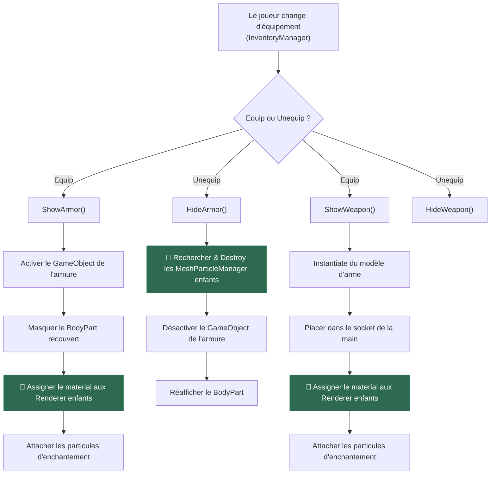

Au cours du développement du projet Gilong World (GLW) sous Unity 6, l'optimisation de la mémoire (en particulier la réduction du Garbage Collection - GC) a toujours été une priorité absolue afin de garantir une fréquence d'images (framerate) fluide.

Aujourd'hui, je partage une étude de cas concrète sur l'optimisation des allocations mémoire (Memory Allocation) causées par la méthode `GetComponentsInChildren` dans le code source du système d'apparence du personnage (`PlayerAppearance`).

## Aperçu du problème

Lors de l'inspection avec le Profiler, le système signalait des allocations mémoire (GC Alloc) chaque fois que le personnage changeait d'équipement. La cause provenait de l'utilisation de l'API suivante :

> **Avant optimisation** : Appel à `GetComponentsInChildren<T>()` sans paramètre de liste. Cette méthode retourne toujours un nouveau tableau `T[]`, générant une GC Alloc à chaque appel.
>
> **Après optimisation** : Utilisation de `ListPool<T>.Get()` combinée à la surcharge `GetComponentsInChildren(list)`. Cette approche permet de réutiliser une `List<T>` issue d'un pool existant, atteignant ainsi le **Zero Allocation**.

---

## Diagramme du flux d'exécution global

Le changement d'arme et d'armure suit le flux ci-dessous, avec les points d'intervention marqués par (🔧) :



*Remarque : Les étapes sans clé à molette (🔧) sont les étapes d'origine et ne sont absolument pas affectées par cette modification.*

---

## Détails de chaque point d'optimisation

J'ai appliqué cette modification à 4 endroits dans le fichier `PlayerAppearance.cs`. Voici 2 cas représentatifs.

### ① La méthode `ShowArmor()`

**Objectif** : Lorsque le joueur équipe une armure, le système doit parcourir tous les `Renderer` enfants de cette pièce d'armure afin de leur assigner un nouveau matériau (material).

**AVANT OPTIMISATION (Génère des GC Alloc)**

```csharp
foreach (var Renderer in t.GetComponentsInChildren<Renderer>())
{
    Renderer.material = item.modelMaterial;
}
```

**APRÈS OPTIMISATION (Zero Alloc)**

```csharp
using (ListPool<Renderer>.Get(out var renderers))
{
    t.GetComponentsInChildren(renderers);
    foreach (var Renderer in renderers)
    {
        Renderer.material = item.modelMaterial;
    }
}
```

**Logique préservée** : Le code parcourt toujours chaque `Renderer` enfant pour assigner `material`. La seule différence est que le conteneur stockant les résultats est désormais une `List<Renderer>` empruntée au pool via l'instruction `using`, au lieu de créer un tout nouveau tableau `Renderer[]`.

---

### ② La méthode `HideArmor()`

**Objectif** : Lors du retrait de l'armure, il faut rechercher tous les effets (tels que `MeshParticleManager`) attachés à cette pièce d'armure et les détruire (`Destroy`) avant de la désactiver (Deactivate).

**AVANT OPTIMISATION (Génère des GC Alloc)**

```csharp
MeshParticleManager[] meshManagers = t.GetComponentsInChildren<MeshParticleManager>();
foreach (var v in meshManagers)
{
    Destroy(v.gameObject);
}
```

**APRÈS OPTIMISATION (Zero Alloc)**

```csharp
using (ListPool<MeshParticleManager>.Get(out var meshManagers))
{
    t.GetComponentsInChildren(meshManagers);
    foreach (var v in meshManagers)
    {
        Destroy(v.gameObject);
    }
}
```

**Logique préservée** : Le code parcourt toujours la liste et appelle `Destroy(v.gameObject)`.

Certains d'entre vous se demandent peut-être : *« Est-ce sans risque d'appeler Destroy() sur les éléments alors que la liste est encore dans le bloc using ? »*.  
La réponse est que c'est tout à fait **sûr**. Dans Unity, la fonction `Destroy()` se contente de marquer le GameObject pour suppression à la fin de la frame courante. Par conséquent, les objets contenus dans la liste `meshManagers` restent parfaitement valides pendant toute la durée de la boucle. Une fois la boucle terminée, l'instruction `using` vide automatiquement (`Clear`) la liste et la retourne au pool.

*(De la même manière, les méthodes gérant l'affichage des armes comme `ShowWeapon()` appliquent exactement ce même modèle).*

---

## Pourquoi peut-on affirmer que la logique du jeu N'est PAS affectée ?

Lors de la refactorisation (refactoring) de code source, en particulier celui d'un moteur tiers, la prudence est la priorité absolue. Voici le tableau d'évaluation des risques pour cette modification :

| Point à considérer | Évaluation & Explication |
|:---|:---|
| **Les résultats de la requête changent-ils ?** | ❌ **Non**. La méthode `GetComponentsInChildren(List<T>)` retourne **exactement le même ensemble de Components**, dans le **même ordre de parcours en profondeur (DFS)** que la surcharge retournant un tableau. |
| **Destroy est-il sûr ?** | ✅ La méthode `Destroy()` d'Unity est différée (delayed) jusqu'à la fin de la frame. Les objets ne disparaissent pas immédiatement, ce qui évite toute erreur de référence nulle (null ref) lors du parcours de la liste. |
| **L'assignation du Material diffère-t-elle ?** | ❌ **Non**. L'instruction d'assignation `Renderer.material = ...` s'exécute à l'identique. |
| **L'ordre de traitement de la List ?** | Préservé. `List<T>` conserve exactement le même ordre d'insertion (insertion order) qu'un tableau `T[]`. |
| **ListPool est-il thread-safe ?** | ✅ `UnityEngine.Pool.ListPool<T>` (disponible depuis Unity 2021+) utilise un `ConcurrentBag` en interne, garantissant la sécurité des threads (thread-safety). |
| **Et si une erreur (Exception) survient ?** | ✅ Le bloc `using` est compilé en une structure `try-finally`, garantissant que la liste est toujours nettoyée et restituée au pool même si une exception est levée en cours d'exécution. |

## Conclusion

Avec une petite modification utilisant `ListPool<T>`, nous avons complètement éliminé les GC Alloc inutiles à chaque changement d'équipement par le joueur. Pour un projet d'envergure comme GLW, où le personnage peut changer d'équipement en continu pendant les combats, ces petites optimisations cumulées évitent au jeu de subir des saccades (frame drops) superflues déclenchées par le Garbage Collector.

Maîtriser les surcharges de l'API Unity et appliquer le bon Design Pattern au bon endroit est la clé pour écrire du code C# haute performance !
