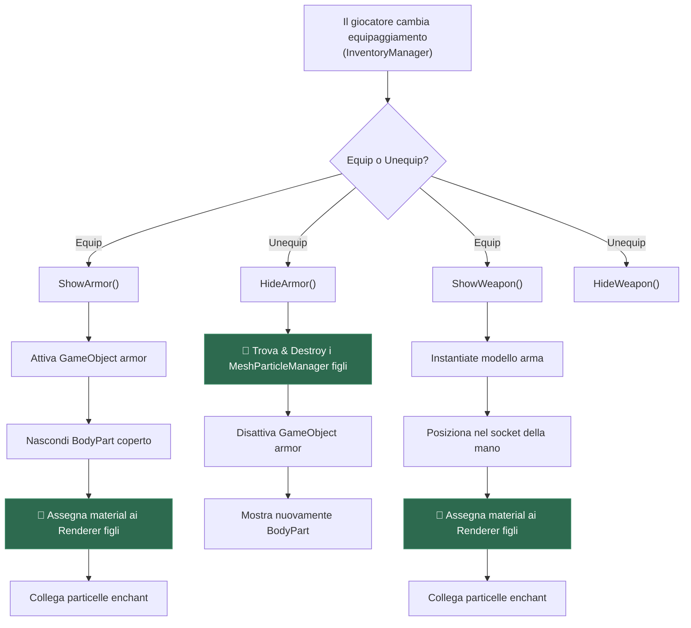

Durante lo sviluppo del progetto Gilong World (GLW) con Unity 6, l'ottimizzazione della memoria (in particolare la riduzione della Garbage Collection - GC) è sempre stata una priorità assoluta per garantire un framerate fluido.

Oggi condivido un caso di studio pratico sull'ottimizzazione delle allocazioni di memoria (Memory Allocation) generate dal metodo `GetComponentsInChildren` nel codice sorgente del sistema di aspetto del personaggio (`PlayerAppearance`).

## Panoramica del problema

Durante l'analisi con il Profiler, il sistema segnalava allocazioni di memoria (GC Alloc) ogni volta che il personaggio cambiava equipaggiamento. La causa derivava dall'utilizzo della seguente API:

> **Prima dell'ottimizzazione**: `GetComponentsInChildren<T>()` nella forma senza parametro di lista. Questo metodo restituisce sempre un nuovo array `T[]`, causando una GC Alloc a ogni chiamata.
>
> **Dopo l'ottimizzazione**: Uso di `ListPool<T>.Get()` combinato con l'overload `GetComponentsInChildren(list)`. Questo approccio consente di riutilizzare una `List<T>` da un pool preesistente, raggiungendo il livello **Zero Allocation**.

---

## Diagramma del flusso di esecuzione generale

Il cambio di armi e armature segue il flusso seguente, e ho contrassegnato con (🔧) i punti su cui intervenire:



*Nota: I passaggi senza la chiave inglese (🔧) sono i passaggi originali e non vengono minimamente influenzati da questa modifica.*

---

## Dettagli di ogni punto di ottimizzazione

Ho applicato la modifica in 4 punti del file `PlayerAppearance.cs`. Di seguito sono riportati 2 casi rappresentativi.

### ① Metodo `ShowArmor()`

**Scopo**: Quando il giocatore indossa un'armatura, il sistema deve scorrere tutti i `Renderer` figli di quel pezzo d'armatura per assegnare il nuovo materiale (material).

**PRIMA DELL'OTTIMIZZAZIONE (Causa GC Alloc)**

```csharp
foreach (var Renderer in t.GetComponentsInChildren<Renderer>())
{
    Renderer.material = item.modelMaterial;
}
```

**DOPO L'OTTIMIZZAZIONE (Zero Alloc)**

```csharp
using (ListPool<Renderer>.Get(out var renderers))
{
    t.GetComponentsInChildren(renderers);
    foreach (var Renderer in renderers)
    {
        Renderer.material = item.modelMaterial;
    }
}
```

**Logica invariata**: Il codice continua a iterare su ogni `Renderer` figlio per assegnare `material`. L'unica differenza è che il contenitore che raccoglie i risultati ora è una `List<Renderer>` presa in prestito dal pool tramite l'istruzione `using`, invece di creare un array `Renderer[]` completamente nuovo.

---

### ② Metodo `HideArmor()`

**Scopo**: Quando si rimuove l'armatura, è necessario trovare tutti gli effetti (come `MeshParticleManager`) applicati su quel pezzo di armatura e distruggerli (`Destroy`) prima di disattivare (Deactivate) l'armatura.

**PRIMA DELL'OTTIMIZZAZIONE (Causa GC Alloc)**

```csharp
MeshParticleManager[] meshManagers = t.GetComponentsInChildren<MeshParticleManager>();
foreach (var v in meshManagers)
{
    Destroy(v.gameObject);
}
```

**DOPO L'OTTIMIZZAZIONE (Zero Alloc)**

```csharp
using (ListPool<MeshParticleManager>.Get(out var meshManagers))
{
    t.GetComponentsInChildren(meshManagers);
    foreach (var v in meshManagers)
    {
        Destroy(v.gameObject);
    }
}
```

**Logica invariata**: Il codice continua a scorrere la lista e a chiamare `Destroy(v.gameObject)`.

Alcuni di voi potrebbero chiedersi: *"Chiamare Destroy() sugli elementi mentre la lista si trova ancora all'interno del blocco using crea problemi?"*.  
La risposta è che è del tutto **sicuro**. In Unity, la funzione `Destroy()` ha il solo effetto di contrassegnare il GameObject per la rimozione alla fine del frame corrente. Di conseguenza, gli oggetti all'interno della lista `meshManagers` rimangono completamente validi per tutta la durata del ciclo. Al termine del ciclo, l'istruzione `using` svuota automaticamente (`Clear`) la lista e la restituisce al pool.

*(Allo stesso modo, i metodi che gestiscono la visualizzazione delle armi come `ShowWeapon()` adottano esattamente questo stesso schema).*

---

## Perché possiamo affermare che la logica di gioco NON viene influenzata?

Quando si esegue il refactoring del codice sorgente, specialmente quello di Engine di terze parti, la cautela è la priorità numero uno. Ecco la tabella di valutazione dei rischi per questa modifica:

| Aspetto da considerare | Valutazione & Spiegazione |
|:---|:---|
| **Il risultato della query cambia?** | ❌ **No**. Il metodo `GetComponentsInChildren(List<T>)` restituisce **lo stesso identico insieme di Component**, esattamente secondo il **medesimo ordine di ricerca in profondità (DFS)** del metodo che restituisce un array. |
| **Destroy è sicuro?** | ✅ La funzione `Destroy()` di Unity è posticipata (delayed) fino alla fine del frame. Gli oggetti non scompaiono immediatamente, quindi non si verificano errori di riferimento nullo (null ref) durante l'iterazione sulla lista. |
| **L'assegnazione del Material cambia?** | ❌ **No**. L'istruzione di assegnazione `Renderer.material = ...` avviene in modo identico. |
| **Ordine di elaborazione della List?** | Invariato. `List<T>` preserva l'ordine di inserimento (insertion order) esattamente come l'array `T[]`. |
| **ListPool è thread-safe?** | ✅ `UnityEngine.Pool.ListPool<T>` (disponibile da Unity 2021+) utilizza internamente una `ConcurrentBag`, garantendo la thread-safety. |
| **Cosa succede in caso di errore (Exception)?** | ✅ Il blocco `using` viene compilato in una struttura `try-finally`, assicurando che la lista venga sempre ripulita e restituita al pool anche se viene lanciata un'eccezione a metà esecuzione. |

## Conclusione

Con una piccola modifica basata su `ListPool<T>`, abbiamo eliminato completamente le GC Alloc superflue ogni volta che il giocatore cambia equipaggiamento. Per un progetto di grandi dimensioni come GLW, in cui il personaggio può cambiare equipaggiamento continuamente in combattimento, queste piccole ottimizzazioni si sommano aiutando il gioco a evitare cali di framerate (frame drop) indesiderati causati dall'attivazione del Garbage Collector.

Padroneggiare gli overload dell'API Unity e applicare il giusto Design Pattern al posto giusto è la chiave per scrivere codice C# ad alte prestazioni!
