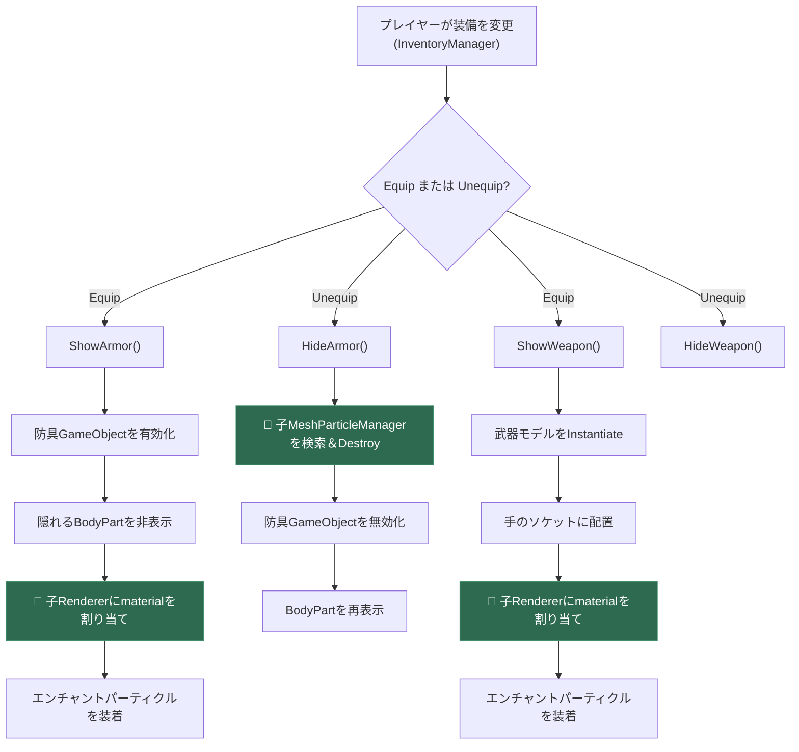

Unity 6でのGilong World（GLW）プロジェクト開発において、滑らかなフレームレート（framerate）を維持するためにメモリ最適化（特にガベージコレクション＝GCの最小化）は常に最優先事項です。

今回は、キャラクターの見た目システム（`PlayerAppearance`）のソースコードにおける、`GetComponentsInChildren`メソッドによるメモリ割り当て（Memory Allocation）を最適化した実践的なケーススタディを共有します。

## 問題の概要

Profilerで計測したところ、キャラクターが装備を変更するたびにメモリ割り当て（GC Alloc）が発生していることが判明しました。原因は以下のAPIの使い方でした。

> **最適化前**：リスト引数を受け取らない形式の`GetComponentsInChildren<T>()`。この関数は呼び出すたびに新しい`T[]`配列を返すため、毎回GC Allocが発生します。
>
> **最適化後**：`ListPool<T>.Get()`と`GetComponentsInChildren(list)`オーバーロードを組み合わせて使用します。この手法では既存のプールから`List<T>`を再利用するため、**Zero Allocation**を達成できます。

---

## 全体の処理フロー図

武器と防具の切り替えは以下のフローに沿って行われ、手を加える箇所を（🔧）でマークしています。



*注：スパナ（🔧）が付いていないステップは元のままの処理であり、この変更の影響を一切受けません。*

---

## 各最適化箇所の詳細

`PlayerAppearance.cs`ファイル内の4箇所に修正を適用しました。以下に代表的な2つのケースを紹介します。

### ① `ShowArmor()`メソッド

**目的**：プレイヤーが防具を装備する際、その防具パーツ配下のすべての`Renderer`を走査して新しいマテリアル（material）を割り当てます。

**最適化前（GC Allocが発生）**

```csharp
foreach (var Renderer in t.GetComponentsInChildren<Renderer>())
{
    Renderer.material = item.modelMaterial;
}
```

**最適化後（Zero Alloc）**

```csharp
using (ListPool<Renderer>.Get(out var renderers))
{
    t.GetComponentsInChildren(renderers);
    foreach (var Renderer in renderers)
    {
        Renderer.material = item.modelMaterial;
    }
}
```

**ロジックはそのまま**：コードは引き続きすべての子`Renderer`を走査して`material`を割り当てます。唯一の違いは、結果を格納するコンテナが、完全に新しい`Renderer[]`配列を生成する代わりに、`using`ステートメントを通じてプールから借りた`List<Renderer>`になった点です。

---

### ② `HideArmor()`メソッド

**目的**：防具を外す際、その防具パーツに付随するすべてのエフェクト（`MeshParticleManager`など）を検索し、防具を非アクティブ化（Deactivate）する前に破棄（Destroy）します。

**最適化前（GC Allocが発生）**

```csharp
MeshParticleManager[] meshManagers = t.GetComponentsInChildren<MeshParticleManager>();
foreach (var v in meshManagers)
{
    Destroy(v.gameObject);
}
```

**最適化後（Zero Alloc）**

```csharp
using (ListPool<MeshParticleManager>.Get(out var meshManagers))
{
    t.GetComponentsInChildren(meshManagers);
    foreach (var v in meshManagers)
    {
        Destroy(v.gameObject);
    }
}
```

**ロジックはそのまま**：コードは引き続きリストを走査して`Destroy(v.gameObject)`を呼び出します。

読者の中には*「リストがまだusingブロック内にある状態で各要素にDestroy()を呼んでも問題ないのか？」*と疑問に思う方もいるかもしれません。
答えは、完全に**安全**です。Unityでは、`Destroy()`関数は現在のフレームの終わりにGameObjectを削除するようマークするだけです。そのため、`meshManagers`リスト内のオブジェクトはループ中も完全に有効なまま保たれます。ループが終了すると、`using`ステートメントが自動的にリストを空（Clear）にしてプールへ返却します。

*（同様に、`ShowWeapon()`などの武器表示を処理するメソッドにもこのパターンをそのまま適用しています。）*

---

## ゲームロジックに影響がないと断言できる理由

ソースコードのリファクタリング、特にサードパーティ製エンジンのAPIを扱うコードを変更する際は、慎重さが最優先です。この変更に対するリスク評価表は以下の通りです。

| 検討事項 | 評価と解説 |
|:---|:---|
| **クエリ結果は変わるか？** | ❌ **いいえ**。`GetComponentsInChildren(List<T>)`は、配列を返すオーバーロードと**完全に同じComponentの集合**を、**同じ深さ優先探索（DFS）の順序**で返します。 |
| **Destroyは安全か？** | ✅ Unityの`Destroy()`はフレームの終了まで遅延（delayed）されます。オブジェクトは即座に消滅しないため、リスト走査中にnull参照エラーを起こすことはありません。 |
| **Materialの割り当ては変わるか？** | ❌ **いいえ**。`Renderer.material = ...`の代入処理はまったく同じように実行されます。 |
| **Listの処理順序は？** | そのまま維持されます。`List<T>`は`T[]`配列と同様に挿入順序（insertion order）を保持します。 |
| **ListPoolはスレッドセーフか？** | ✅ `UnityEngine.Pool.ListPool<T>`（Unity 2021+から利用可能）は内部で`ConcurrentBag`を使用しており、スレッドセーフが保証されています。 |
| **例外（Exception）が発生した場合は？** | ✅ `using`ブロックは`try-finally`構造にコンパイルされるため、途中で例外がスローされた場合でもリストは確実にクリアされてプールへ返却されます。 |

## まとめ

`ListPool<T>`を使う小さな変更だけで、プレイヤーが装備を変更するたびに発生していた無駄なGC Allocを完全に解消できました。GLWのように戦闘中にキャラクターが頻繁に装備を切り替える大規模プロジェクトでは、こうした小さな最適化の積み重ねが、ガベージコレクタの動作による不要なフレーム落ち（frame drop）やカクつきの防止につながります。

Unity APIのオーバーロードをしっかりと把握し、適切な場所にデザインパターン（Design Pattern）を適用することこそが、高性能なC#コードを書くための鍵となります！
