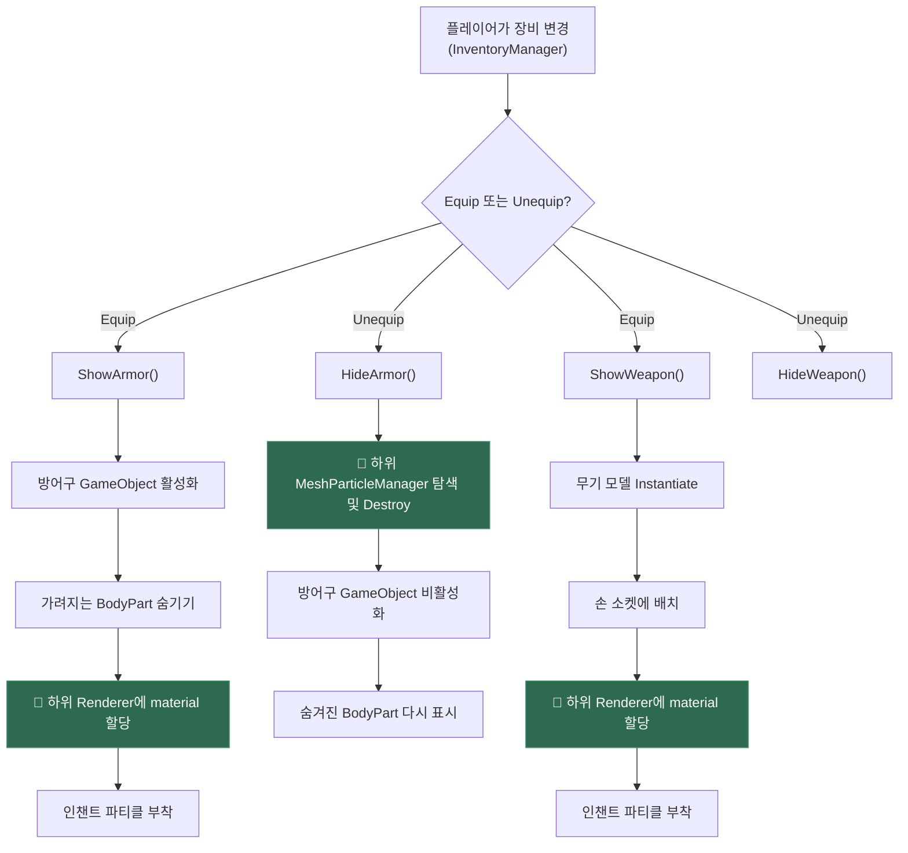

Unity 6으로 Gilong World(GLW) 프로젝트를 개발하는 과정에서, 부드러운 프레임레이트(framerate)를 유지하기 위해 메모리 최적화(특히 가비지 컬렉션 - GC 최소화)는 언제나 최우선 과제입니다.

오늘은 캐릭터 외형 시스템(`PlayerAppearance`) 코드에서 `GetComponentsInChildren` 함수로 인해 발생하는 메모리 할당(Memory Allocation)을 최적화한 실제 사례를 공유하고자 합니다.

## 문제 개요

Profiler로 점검했을 때 캐릭터가 장비를 변경할 때마다 메모리 할당(GC Alloc)이 발생하는 문제가 보고되었습니다. 원인은 다음 API의 사용 방식에 있었습니다.

> **최적화 전**: 리스트 매개변수를 받지 않는 형태의 `GetComponentsInChildren<T>()` 호출. 이 함수는 호출될 때마다 항상 새로운 `T[]` 배열을 반환하여 매번 GC Alloc을 유발합니다.
>
> **최적화 후**: `ListPool<T>.Get()`과 `GetComponentsInChildren(list)` 오버로드를 함께 사용합니다. 이 방식은 기존 풀(pool)에서 `List<T>`를 재사용하여 **Zero Allocation**을 달성합니다.

---

## 전체 처리 흐름도

무기와 방어구 교체는 아래 흐름에 따라 진행되며, 수정이 필요한 지점을 (🔧)로 표시했습니다.



*참고: 스패너(🔧) 표시가 없는 단계는 기존 단계 그대로이며, 이번 변경의 영향을 전혀 받지 않습니다.*

---

## 최적화 위치별 상세 설명

`PlayerAppearance.cs` 파일 내 총 4곳에 수정을 적용했습니다. 아래는 그중 대표적인 2가지 사례입니다.

### ① `ShowArmor()` 함수

**목적**: 플레이어가 방어구를 착용할 때, 해당 방어구 파츠의 모든 하위 Renderer를 순회하며 새로운 머티리얼(material)을 할당해야 합니다.

**최적화 전 (GC Alloc 유발)**

```csharp
foreach (var Renderer in t.GetComponentsInChildren<Renderer>())
{
    Renderer.material = item.modelMaterial;
}
```

**최적화 후 (Zero Alloc)**

```csharp
using (ListPool<Renderer>.Get(out var renderers))
{
    t.GetComponentsInChildren(renderers);
    foreach (var Renderer in renderers)
    {
        Renderer.material = item.modelMaterial;
    }
}
```

**동일하게 유지되는 로직**: 코드는 여전히 모든 하위 `Renderer`를 순회하며 `material`을 할당합니다. 유일한 차이점은 결과를 담는 컨테이너가 매번 새로 생성되는 `Renderer[]` 배열 대신 `using` 문을 통해 풀에서 빌려온 `List<Renderer>`로 바뀌었다는 점입니다.

---

### ② `HideArmor()` 함수

**목적**: 방어구를 해제할 때, 방어구 파츠에 붙어 있는 모든 이펙트(예: `MeshParticleManager`)를 찾아 방어구를 비활성화(Deactivate)하기 전에 파괴(Destroy)해야 합니다.

**최적화 전 (GC Alloc 유발)**

```csharp
MeshParticleManager[] meshManagers = t.GetComponentsInChildren<MeshParticleManager>();
foreach (var v in meshManagers)
{
    Destroy(v.gameObject);
}
```

**최적화 후 (Zero Alloc)**

```csharp
using (ListPool<MeshParticleManager>.Get(out var meshManagers))
{
    t.GetComponentsInChildren(meshManagers);
    foreach (var v in meshManagers)
    {
        Destroy(v.gameObject);
    }
}
```

**동일하게 유지되는 로직**: 코드는 여전히 리스트를 순회하며 `Destroy(v.gameObject)`를 호출합니다.

일부 독자분들은 *"리스트가 아직 using 블록 안에 있는 상태에서 요소들에 Destroy()를 호출해도 괜찮을까?"*라고 궁금해할 수 있습니다.
정답은 완전히 **안전하다**는 것입니다. Unity에서 `Destroy()` 함수는 현재 프레임의 마지막에 GameObject를 삭제하도록 표시만 해 둡니다. 따라서 반복문이 도는 동안 `meshManagers` 리스트 안의 오브젝트들은 여전히 완전히 유효합니다. 반복문이 끝나면 `using` 문이 자동으로 리스트를 정리(Clear)하고 풀로 반환합니다.

*(마찬가지로 `ShowWeapon()` 등 무기 표시를 처리하는 함수들에도 이 패턴을 동일하게 적용했습니다.)*

---

## 게임 로직에 영향이 없다고 확신할 수 있는 이유

코드 리팩토링(refactoring), 특히 서드파티 엔진 기반의 코드를 수정할 때는 신중함이 최우선입니다. 아래는 이번 변경 사항에 대한 리스크 평가표입니다.

| 고려 사항 | 평가 및 설명 |
|:---|:---|
| **쿼리 결과가 달라지는가?** | ❌ **아니요**. `GetComponentsInChildren(List<T>)` 함수는 배열을 반환하는 오버로드와 **정확히 동일한 Component 집합**을 **동일한 깊이 우선 탐색(DFS) 순서**로 반환합니다. |
| **Destroy 호출은 안전한가?** | ✅ Unity의 `Destroy()`는 프레임 끝까지 지연(delayed) 처리됩니다. 오브젝트가 즉시 사라지지 않으므로 리스트 순회 중 null 참조 오류가 발생하지 않습니다. |
| **Material 할당 방식이 달라지는가?** | ❌ **아니요**. `Renderer.material = ...` 할당 명령은 완전히 동일하게 실행됩니다. |
| **List의 처리 순서는?** | 그대로 유지됩니다. `List<T>`는 `T[]` 배열과 마찬가지로 삽입 순서(insertion order)를 보존합니다. |
| **ListPool은 스레드 안전한가(thread-safe)?** | ✅ `UnityEngine.Pool.ListPool<T>`(Unity 2021+부터 제공)는 내부적으로 `ConcurrentBag`을 사용하여 스레드 안전성을 보장합니다. |
| **예외(Exception)가 발생하면?** | ✅ `using` 블록은 `try-finally` 구조로 컴파일되므로, 실행 도중 예외가 발생하더라도 리스트가 항상 정리되어 풀로 반환됩니다. |

## 결론

`ListPool<T>`를 사용하는 작은 변경만으로 플레이어가 장비를 교체할 때마다 발생하던 불필요한 GC Alloc을 완전히 제거했습니다. 전투 중에 캐릭터가 장비를 끊임없이 교체할 수 있는 GLW 같은 대규모 프로젝트에서는 이러한 작은 최적화들이 쌓여 Garbage Collector 동작으로 인한 불필요한 프레임 드랍(frame drop)과 끊김 현상을 방지해 줍니다.

Unity API의 오버로드를 잘 파악하고 적재적소에 디자인 패턴(Design Pattern)을 적용하는 것이 고성능 C# 코드를 작성하는 핵심입니다!
