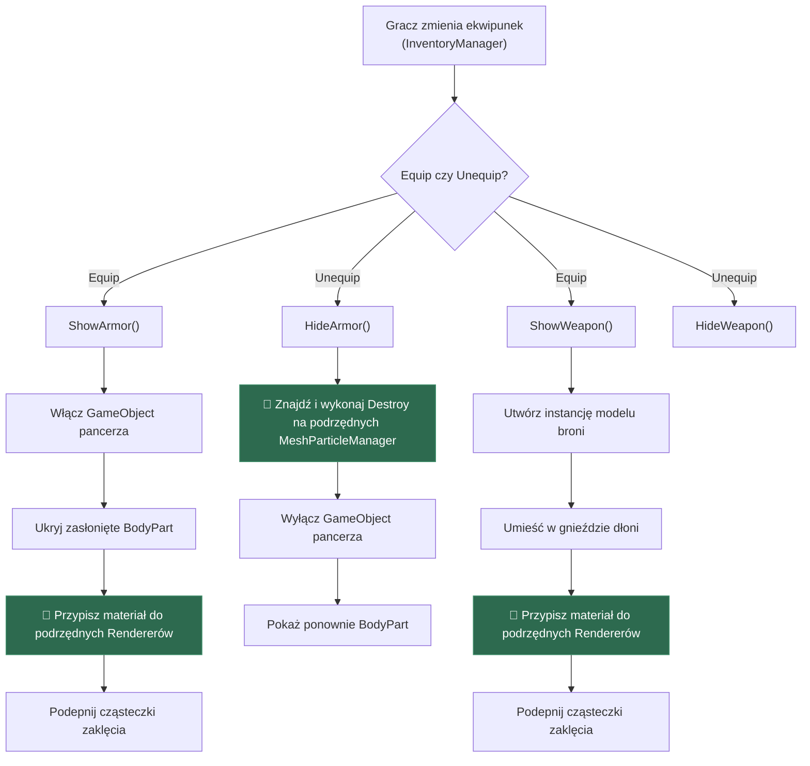

Podczas pracy nad projektem Gilong World (GLW) w Unity 6 optymalizacja pamięci (a szczególnie minimalizacja pracy Garbage Collectora – GC) od zawsze była priorytetem, aby zapewnić płynną liczbę klatek na sekundę (framerate).

Dzisiaj dzielę się praktycznym studium przypadku dotyczącym optymalizacji alokacji pamięci (Memory Allocation) generowanych przez metodę `GetComponentsInChildren` w kodzie systemu wyglądu postaci (PlayerAppearance).

## Przegląd problemu

Podczas analizy w Profilerze system zgłaszał alokacje pamięci (GC Alloc) za każdym razem, gdy postać zmieniała ekwipunek. Przyczyną było wywoływanie następującego API:

> **Przed optymalizacją**: Wywołanie `GetComponentsInChildren<T>()` w wersji bez parametru listy. Ta metoda za każdym razem tworzy i zwraca nową tablicę `T[]`, powodując GC Alloc przy każdym wywołaniu.
> 
> **Po optymalizacji**: Zastosowanie `ListPool<T>.Get()` w połączeniu z przeciążeniem `GetComponentsInChildren(list)`. Takie podejście pozwala ponownie wykorzystywać obiekt `List<T>` z gotowej puli, osiągając poziom **Zero Allocation**.

---

## Schemat ogólnego przepływu działania

Zmiana broni oraz pancerza przebiega zgodnie z poniższym schematem, na którym oznaczyłem (🔧) miejsca wymagające interwencji:



*Uwaga: Kroki bez ikony klucza (🔧) to kroki oryginalne, na które ta zmiana nie ma żadnego wpływu.*

---

## Szczegóły zoptymalizowanych miejsc

Poprawki wprowadziłem w 4 miejscach w pliku `PlayerAppearance.cs`. Poniżej przedstawiam 2 reprezentatywne przypadki.

### ① Metoda `ShowArmor()`

**Cel**: Gdy gracz zakłada pancerz, system musi przeiterować przez wszystkie podrzędne komponenty `Renderer` tego elementu zbroi, aby przypisać nowy materiał (material).

**PRZED OPTYMALIZACJĄ (Powoduje GC Alloc)**

```csharp
foreach (var Renderer in t.GetComponentsInChildren<Renderer>())
{
    Renderer.material = item.modelMaterial;
}
```

**PO OPTYMALIZACJI (Zero Alloc)**

```csharp
using (ListPool<Renderer>.Get(out var renderers))
{
    t.GetComponentsInChildren(renderers);
    foreach (var Renderer in renderers)
    {
        Renderer.material = item.modelMaterial;
    }
}
```

**Logika bez zmian**: Kod nadal przechodzi przez każdy podrzędny `Renderer`, aby przypisać `material`. Jedyną różnicą jest to, że kontenerem przechowującym wyniki jest teraz `List<Renderer>` wypożyczona z puli za pomocą instrukcji `using`, zamiast tworzenia zupełnie nowej tablicy `Renderer[]`.

---

### ② Metoda `HideArmor()`

**Cel**: Podczas zdejmowania pancerza należy znaleźć wszystkie efekty (takie jak `MeshParticleManager`) podpięte do danego elementu i zniszczyć je (`Destroy`) przed wyłączeniem (`Deactivate`) samego pancerza.

**PRZED OPTYMALIZACJĄ (Powoduje GC Alloc)**

```csharp
MeshParticleManager[] meshManagers = t.GetComponentsInChildren<MeshParticleManager>();
foreach (var v in meshManagers)
{
    Destroy(v.gameObject);
}
```

**PO OPTYMALIZACJI (Zero Alloc)**

```csharp
using (ListPool<MeshParticleManager>.Get(out var meshManagers))
{
    t.GetComponentsInChildren(meshManagers);
    foreach (var v in meshManagers)
    {
        Destroy(v.gameObject);
    }
}
```

**Logika bez zmian**: Kod nadal iteruje po liście i wywołuje `Destroy(v.gameObject)`.

Niektórzy z Was mogą się zastanawiać: *„Czy wywołanie Destroy() na elementach, gdy lista nadal znajduje się w bloku using, nie stwarza problemu?”*.  
Odpowiedź brzmi: jest to całkowicie **bezpieczne**. W Unity metoda `Destroy()` jedynie oznacza obiekt GameObject do usunięcia pod koniec bieżącej klatki. Dzięki temu obiekty na liście `meshManagers` pozostają w pełni poprawne przez cały czas trwania pętli. Po zakończeniu pętli instrukcja `using` automatycznie wyczyści (`Clear`) listę i zwróci ją do puli.

*(Analogicznie ten sam schemat zastosowano w metodach obsługujących wyświetlanie broni, takich jak `ShowWeapon()`).*

---

## Dlaczego możemy mieć pewność, że logika gry NIE ulegnie zmianie?

Podczas refaktoryzacji (refactoring) kodu źródłowego, zwłaszcza w przypadku kodu opartego na zewnętrznym silniku, ostrożność jest absolutnym priorytetem. Poniżej znajduje się tabela oceny ryzyka dla tej zmiany:

| Kwestia do rozważenia | Ocena i wyjaśnienie |
|:---|:---|
| **Czy zmienia się wynik zapytania?** | ❌ **Nie**. Metoda `GetComponentsInChildren(List<T>)` zwraca **dokładnie ten sam zestaw komponentów**, dokładnie w tej **samej kolejności przeszukiwania w głąb (DFS)**, co przeciążenie zwracające tablicę. |
| **Czy `Destroy` jest bezpieczne?** | ✅ Metoda `Destroy()` w Unity jest opóźniona (delayed) do końca klatki. Obiekt nie znika natychmiast, więc nie powoduje błędów null reference podczas iterowania po liście. |
| **Czy zmienia się przypisanie Material?** | ❌ **Nie**. Przypisanie `Renderer.material = ...` przebiega identycznie. |
| **Kolejność przetwarzania Listy?** | Pozostaje bez zmian. `List<T>` zachowuje kolejność wstawiania (insertion order) tak samo jak tablica `T[]`. |
| **Czy `ListPool` jest bezpieczny wątkowo?** | ✅ `UnityEngine.Pool.ListPool<T>` (dostępne od Unity 2021+) wykorzystuje pod spodem kolekcję `ConcurrentBag`, zapewniając bezpieczeństwo wątkowe (thread-safety). |
| **Co jeśli wystąpi błąd (Exception)?** | ✅ Blok `using` kompiluje się do konstrukcji `try-finally`, gwarantując, że lista zawsze zostanie wyczyszczona i zwrócona do puli, nawet jeśli w trakcie wykonania zostanie rzucony wyjątek. |

## Podsumowanie

Za pomocą jednej niewielkiej zmiany wykorzystującej `ListPool<T>` całkowicie wyeliminowaliśmy zbędne GC Alloc przy każdej zmianie ekwipunku przez gracza. W dużym projekcie takim jak GLW, gdzie postać może bez przerwy zmieniać wyposażenie w trakcie walki, takie drobne optymalizacje kumulują się i pomagają uniknąć niepotrzebnych zacięć (frame dropów) wywołanych przez uruchomienie Garbage Collectora.

Dobra znajomość przeciążeń Unity API i stosowanie właściwego wzorca projektowego (Design Pattern) we właściwym miejscu to klucz do pisania wydajnego kodu w C#!
