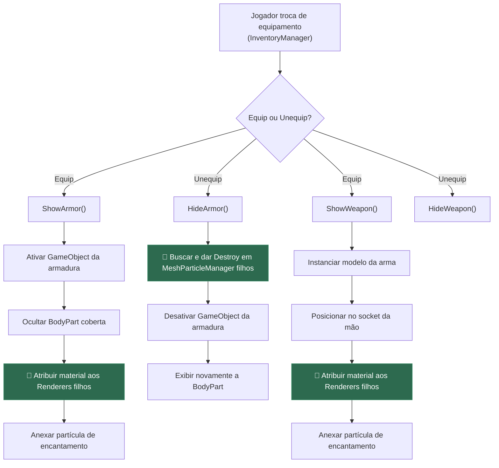

Durante o desenvolvimento do projeto Gilong World (GLW) com o Unity 6, a otimização de memória (especialmente a redução do Garbage Collection - GC) sempre foi uma prioridade máxima para garantir uma taxa de quadros (framerate) fluida.

Hoje, vou compartilhar um estudo de caso prático sobre a otimização de alocação de memória (Memory Allocation) causada pela função `GetComponentsInChildren` no código-fonte do sistema de aparência do personagem (PlayerAppearance).

## Visão geral do problema

Ao inspecionar com o Profiler, o sistema apontou alocações de memória (GC Alloc) toda vez que o personagem trocava de equipamento. A causa vinha do uso da seguinte API:

> **Antes da otimização**: `GetComponentsInChildren<T>()` na forma que não recebe um parâmetro de lista. Essa função sempre retorna um novo array `T[]`, gerando GC Alloc a cada chamada.
> 
> **Depois da otimização**: Usar `ListPool<T>.Get()` em conjunto com o overload `GetComponentsInChildren(list)`. Essa abordagem permite reutilizar uma `List<T>` de um pool já existente, atingindo **Zero Allocation**.

---

## Diagrama do fluxo geral de processamento

A troca de armas e armaduras segue o fluxo abaixo, e marquei com (🔧) os pontos em que é necessário intervir:



*Observação: As etapas sem chave inglesa (🔧) são etapas originais e não são afetadas de forma alguma por essa mudança.*

---

## Detalhes de cada ponto otimizado

Apliquei as alterações em 4 locais no arquivo `PlayerAppearance.cs`. Abaixo estão 2 casos representativos.

### ① Função `ShowArmor()`

**Objetivo**: Quando o jogador veste uma armadura, o sistema precisa percorrer todos os Renderers filhos dessa peça de armadura para atribuir o novo material.

**ANTES DA OTIMIZAÇÃO (Gera GC Alloc)**

```csharp
foreach (var Renderer in t.GetComponentsInChildren<Renderer>())
{
    Renderer.material = item.modelMaterial;
}
```

**DEPOIS DA OTIMIZAÇÃO (Zero Alloc)**

```csharp
using (ListPool<Renderer>.Get(out var renderers))
{
    t.GetComponentsInChildren(renderers);
    foreach (var Renderer in renderers)
    {
        Renderer.material = item.modelMaterial;
    }
}
```

**Lógica preservada**: O código continua percorrendo cada `Renderer` filho para atribuir `material`. A única diferença é que o contêiner que armazena o resultado agora é uma `List<Renderer>` pega emprestada do pool por meio da instrução `using`, em vez de criar um array `Renderer[]` totalmente novo.

---

### ② Função `HideArmor()`

**Objetivo**: Ao remover a armadura, é preciso encontrar todos os efeitos (como `MeshParticleManager`) presos à peça e destruí-los (`Destroy`) antes de desativar (`Deactivate`) a armadura.

**ANTES DA OTIMIZAÇÃO (Gera GC Alloc)**

```csharp
MeshParticleManager[] meshManagers = t.GetComponentsInChildren<MeshParticleManager>();
foreach (var v in meshManagers)
{
    Destroy(v.gameObject);
}
```

**DEPOIS DA OTIMIZAÇÃO (Zero Alloc)**

```csharp
using (ListPool<MeshParticleManager>.Get(out var meshManagers))
{
    t.GetComponentsInChildren(meshManagers);
    foreach (var v in meshManagers)
    {
        Destroy(v.gameObject);
    }
}
```

**Lógica preservada**: O código continua percorrendo a lista e chamando `Destroy(v.gameObject)`.

Alguns de vocês podem se perguntar: *"Tem algum problema chamar Destroy() nos elementos enquanto a lista ainda está dentro do bloco using?"*.  
A resposta é que é totalmente **seguro**. No Unity, a função `Destroy()` apenas marca o GameObject para remoção ao final do frame atual. Portanto, os objetos dentro da lista `meshManagers` continuam completamente válidos durante todo o loop. Quando o loop termina, a instrução `using` limpa (`Clear`) automaticamente a lista e a devolve para o pool.

*(Da mesma forma, as funções que lidam com a exibição de armas, como `ShowWeapon()`, também seguem exatamente esse mesmo padrão).*

---

## Por que podemos afirmar que a lógica do jogo NÃO é afetada?

Ao realizar a refatoração (refactoring) do código-fonte, especialmente código de engines de terceiros, ter cautela é prioridade máxima. Abaixo está a tabela de avaliação de risco para essa alteração:

| Ponto considerado | Avaliação e Explicação |
|:---|:---|
| **O resultado da query muda?** | ❌ **Não**. A função `GetComponentsInChildren(List<T>)` retorna **exatamente o mesmo conjunto de Components**, na **mesma ordem de busca em profundidade (DFS)** que a função que retorna um array. |
| **O `Destroy` é seguro?** | ✅ A função `Destroy()` do Unity é adiada (delayed) até o final do frame. O objeto não desaparece imediatamente, portanto não causa erro de referência nula (null ref) ao percorrer a lista. |
| **A atribuição de Material muda?** | ❌ **Não**. A instrução `Renderer.material = ...` ocorre de forma idêntica. |
| **Ordem de processamento da List?** | Mantida. `List<T>` preserva a ordem de inserção (insertion order) exatamente como um array `T[]`. |
| **O `ListPool` é thread-safe?** | ✅ `UnityEngine.Pool.ListPool<T>` (disponível a partir do Unity 2021+) usa `ConcurrentBag` por baixo dos panos, garantindo segurança entre threads. |
| **E se ocorrer um erro (Exception)?** | ✅ O bloco `using` é compilado para uma estrutura `try-finally`, garantindo que a lista seja sempre limpa e devolvida ao pool mesmo que uma exceção seja lançada no meio do caminho. |

## Conclusão

Com apenas uma pequena alteração usando `ListPool<T>`, eliminamos por completo o GC Alloc inútil toda vez que o jogador troca de equipamento. Para um projeto grande como GLW, em que o personagem pode trocar de itens continuamente em combate, essas pequenas otimizações se somam para ajudar o jogo a evitar engasgos e travamentos (frame drops) desnecessários provocados pelo Garbage Collector.

Dominar os overloads da API do Unity e aplicar o Design Pattern certo no lugar certo é a chave para escrever código C# de alta performance!
