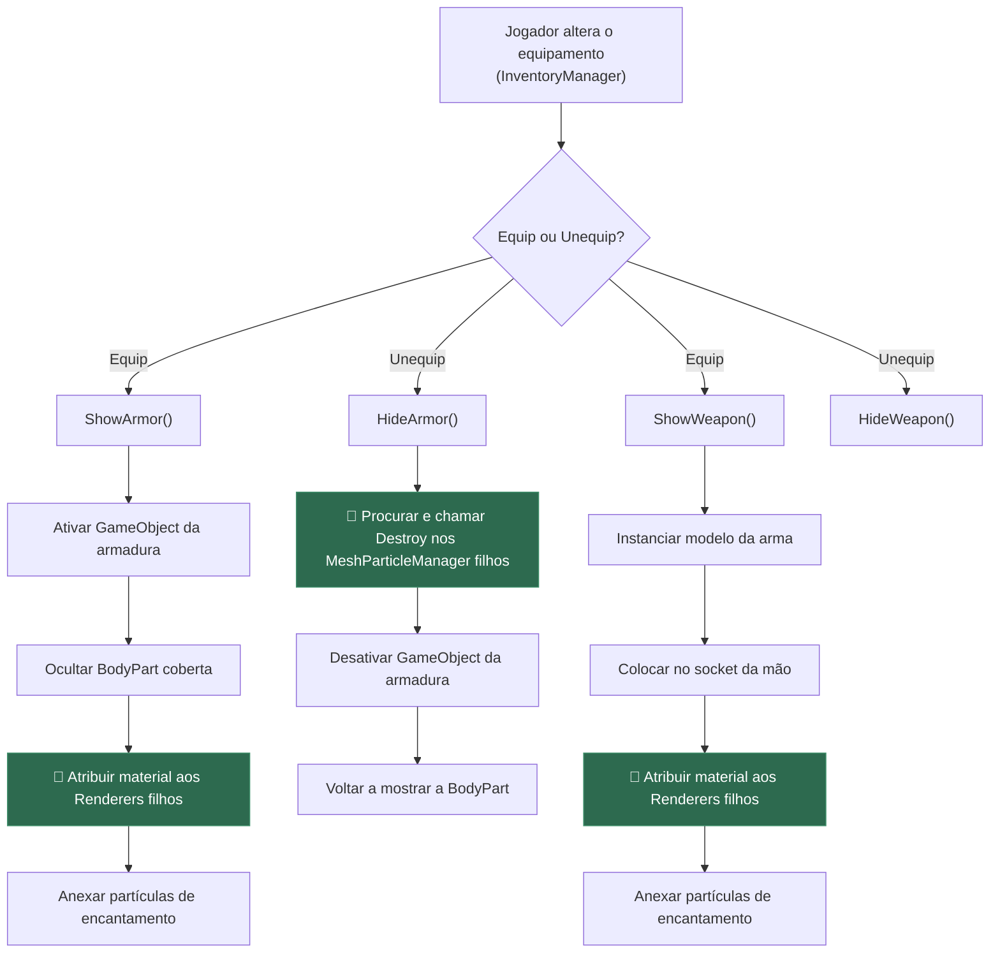

Durante o desenvolvimento do projeto Gilong World (GLW) em Unity 6, a otimização da memória (especialmente a redução do Garbage Collection - GC) tem sido sempre uma prioridade máxima para assegurar uma taxa de fotogramas (framerate) fluida.

Hoje, partilho um estudo de caso prático na otimização da alocação de memória (Memory Allocation) originada pela função `GetComponentsInChildren` no código-fonte do sistema de aparência da personagem (PlayerAppearance).

## Visão geral do problema

Ao inspecionar com o Profiler, o sistema registava alocações de memória (GC Alloc) sempre que a personagem alterava o equipamento. A causa provinha da utilização da seguinte API:

> **Antes da otimização**: `GetComponentsInChildren<T>()` na variante sem parâmetro de lista. Esta função devolve sempre um novo array `T[]`, provocando GC Alloc em cada chamada.
> 
> **Depois da otimização**: Utilizar `ListPool<T>.Get()` em conjunto com a sobrecarga `GetComponentsInChildren(list)`. Este método permite reutilizar uma `List<T>` de um pool pré-existente, atingindo o nível **Zero Allocation**.

---

## Diagrama do fluxo geral de processamento

A troca de armas e armaduras decorre segundo o fluxo abaixo, tendo assinalado (🔧) os pontos onde é necessário intervir:



*Nota: Os passos sem chave inglesa (🔧) são os passos originais, não sendo afetados por esta alteração.*

---

## Detalhe de cada ponto otimizado

Apliquei alterações em 4 pontos no ficheiro `PlayerAppearance.cs`. Apresentam-se abaixo 2 casos representativos.

### ① Função `ShowArmor()`

**Objetivo**: Quando o jogador equipa uma armadura, o sistema necessita de percorrer todos os Renderers filhos dessa peça de armadura para atribuir o novo material.

**ANTES DA OTIMIZAÇÃO (Provoca GC Alloc)**

```csharp
foreach (var Renderer in t.GetComponentsInChildren<Renderer>())
{
    Renderer.material = item.modelMaterial;
}
```

**DEPOIS DA OTIMIZAÇÃO (Zero Alloc)**

```csharp
using (ListPool<Renderer>.Get(out var renderers))
{
    t.GetComponentsInChildren(renderers);
    foreach (var Renderer in renderers)
    {
        Renderer.material = item.modelMaterial;
    }
}
```

**Lógica mantida**: O código continua a percorrer cada `Renderer` filho para atribuir `material`. A única diferença é que o contentor que guarda os resultados passa a ser uma `List<Renderer>` obtida por empréstimo do pool através da instrução `using`, em vez de criar um array `Renderer[]` inteiramente novo.

---

### ② Função `HideArmor()`

**Objetivo**: Ao desequipar uma armadura, é necessário encontrar todos os efeitos (como `MeshParticleManager`) associados a essa peça e destruí-los (`Destroy`) antes de desativar (`Deactivate`) a armadura.

**ANTES DA OTIMIZAÇÃO (Provoca GC Alloc)**

```csharp
MeshParticleManager[] meshManagers = t.GetComponentsInChildren<MeshParticleManager>();
foreach (var v in meshManagers)
{
    Destroy(v.gameObject);
}
```

**DEPOIS DA OTIMIZAÇÃO (Zero Alloc)**

```csharp
using (ListPool<MeshParticleManager>.Get(out var meshManagers))
{
    t.GetComponentsInChildren(meshManagers);
    foreach (var v in meshManagers)
    {
        Destroy(v.gameObject);
    }
}
```

**Lógica mantida**: O código continua a percorrer a lista e a invocar `Destroy(v.gameObject)`.

Alguns leitores poderão questionar-se: *"Há algum problema em chamar Destroy() sobre os elementos enquanto a lista ainda se encontra dentro do bloco using?"*.  
A resposta é que é totalmente **seguro**. Em Unity, a função `Destroy()` limita-se a marcar o GameObject para remoção no final do fotograma atual. Por conseguinte, os objetos dentro da lista `meshManagers` mantêm-se inteiramente válidos ao longo de todo o ciclo. Quando o ciclo termina, a instrução `using` encarrega-se de limpar (`Clear`) e devolver automaticamente a lista ao pool.

*(De modo semelhante, as funções que gerem a exibição de armas, como `ShowWeapon()`, seguem igualmente este mesmo padrão).*

---

## Porque podemos garantir que a lógica do jogo NÃO é afetada?

Ao efetuar a refatorização (refactoring) do código-fonte, em particular código de motores de terceiros, a prudência é a principal prioridade. Encontra-se abaixo a tabela de avaliação de risco para esta alteração:

| Aspeto a ponderar | Avaliação e Explicação |
|:---|:---|
| **O resultado da consulta altera-se?** | ❌ **Não**. A função `GetComponentsInChildren(List<T>)` devolve **exatamente o mesmo conjunto de Components**, segundo a **mesma ordem de pesquisa em profundidade (DFS)** que a função que devolve um array. |
| **O `Destroy` é seguro?** | ✅ A função `Destroy()` do Unity é diferida (delayed) até ao final do fotograma. O objeto não desaparece de imediato, pelo que não provoca erros de referência nula (null ref) ao percorrer a lista. |
| **A atribuição de Material muda?** | ❌ **Não**. A instrução `Renderer.material = ...` decorre de forma idêntica. |
| **Ordem de processamento da List?** | Mantém-se inalterada. A `List<T>` preserva a ordem de inserção (insertion order) tal como o array `T[]`. |
| **O `ListPool` é thread-safe?** | ✅ `UnityEngine.Pool.ListPool<T>` (disponível desde o Unity 2021+) utiliza internamente `ConcurrentBag`, assegurando a segurança entre threads. |
| **E se ocorrer uma exceção?** | ✅ O bloco `using` compila para uma estrutura `try-finally`, garantindo que a lista é sempre limpa e devolvida ao pool mesmo que seja lançada uma exceção a meio da execução. |

## Conclusão

Com apenas uma pequena alteração utilizando `ListPool<T>`, eliminámos por completo o GC Alloc desnecessário sempre que o jogador troca de equipamento. Num projeto de grande dimensão como o GLW, onde a personagem pode trocar de equipamento continuamente em combate, estas pequenas otimizações acumulam-se e ajudam o jogo a evitar quebras de fluidez (frame drops) desnecessárias desencadeadas pelo Garbage Collector.

Dominar as sobrecargas da API do Unity e aplicar o Design Pattern adequado no local certo é a chave para escrever código C# de elevado desempenho!
