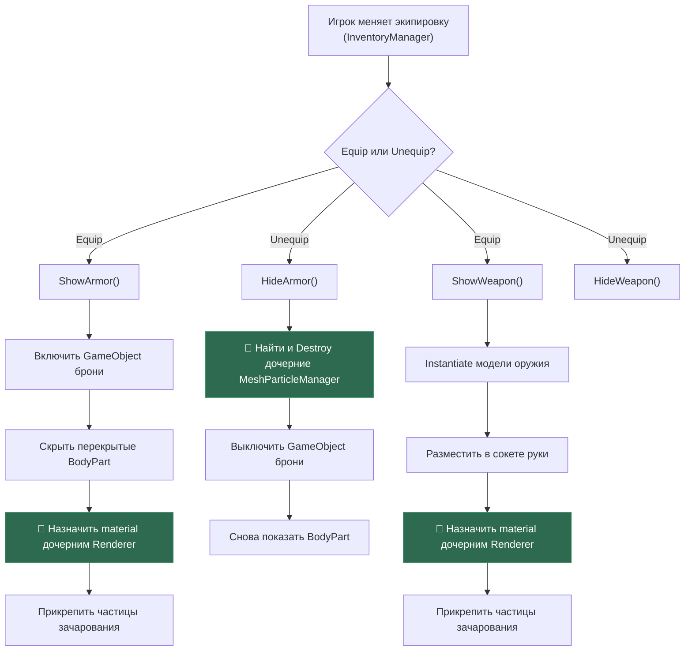

В процессе разработки проекта Gilong World (GLW) на Unity 6 оптимизация памяти (особенно минимизация работы сборщика мусора — Garbage Collection, GC) всегда остаётся главным приоритетом для поддержания плавной частоты кадров (framerate).

Сегодня я поделюсь реальным кейсом оптимизации выделения памяти (Memory Allocation) в методе `GetComponentsInChildren` в исходном коде системы внешнего вида персонажа (`PlayerAppearance`).

## Обзор проблемы

При проверке через Profiler система фиксировала выделение памяти (GC Alloc) каждый раз, когда персонаж менял экипировку. Причина крылась в использовании следующего API:

> **До оптимизации**: вызов `GetComponentsInChildren<T>()` без параметра списка. Этот метод всегда возвращает новый массив `T[]`, вызывая GC Alloc при каждом обращении.
>
> **После оптимизации**: использование `ListPool<T>.Get()` в сочетании с перегрузкой `GetComponentsInChildren(list)`. Такой подход позволяет повторно использовать `List<T>` из готового пула, достигая уровня **Zero Allocation**.

---

## Общая схема потока обработки

Смена оружия и брони происходит по следующей схеме, где значком (🔧) отмечены места, требующие доработки:



*Примечание: шаги без значка гаечного ключа (🔧) являются исходными и совершенно не затронуты этим изменением.*

---

## Подробный разбор точек оптимизации

Я внёс изменения в 4 местах файла `PlayerAppearance.cs`. Ниже приведены 2 показательных примера.

### ① Метод `ShowArmor()`

**Назначение**: когда игрок надевает броню, системе необходимо обойти все дочерние компоненты `Renderer` этого элемента брони, чтобы назначить новый материал (material).

**ДО ОПТИМИЗАЦИИ (вызывает GC Alloc)**

```csharp
foreach (var Renderer in t.GetComponentsInChildren<Renderer>())
{
    Renderer.material = item.modelMaterial;
}
```

**ПОСЛЕ ОПТИМИЗАЦИИ (Zero Alloc)**

```csharp
using (ListPool<Renderer>.Get(out var renderers))
{
    t.GetComponentsInChildren(renderers);
    foreach (var Renderer in renderers)
    {
        Renderer.material = item.modelMaterial;
    }
}
```

**Логика сохранена**: код по-прежнему проходит по всем дочерним `Renderer` и назначает `material`. Единственное отличие заключается в том, что контейнером для результатов теперь выступает `List<Renderer>`, временно взятый из пула с помощью конструкции `using`, вместо создания совершенно нового массива `Renderer[]`.

---

### ② Метод `HideArmor()`

**Назначение**: при снятии брони необходимо найти все эффекты (такие как `MeshParticleManager`), прикреплённые к этой детали брони, и уничтожить (`Destroy`) их перед её деактивацией (`Deactivate`).

**ДО ОПТИМИЗАЦИИ (вызывает GC Alloc)**

```csharp
MeshParticleManager[] meshManagers = t.GetComponentsInChildren<MeshParticleManager>();
foreach (var v in meshManagers)
{
    Destroy(v.gameObject);
}
```

**ПОСЛЕ ОПТИМИЗАЦИИ (Zero Alloc)**

```csharp
using (ListPool<MeshParticleManager>.Get(out var meshManagers))
{
    t.GetComponentsInChildren(meshManagers);
    foreach (var v in meshManagers)
    {
        Destroy(v.gameObject);
    }
}
```

**Логика сохранена**: код по-прежнему обходит список и вызывает `Destroy(v.gameObject)`.

У некоторых читателей может возникнуть вопрос: *«Безопасно ли вызывать Destroy() для элементов, пока список всё ещё находится внутри блока using?»*
Ответ: это абсолютно **безопасно**. В Unity метод `Destroy()` лишь помечает GameObject для удаления в конце текущего кадра. Следовательно, все объекты внутри списка `meshManagers` остаются полностью валидными на протяжении всего цикла. После завершения цикла конструкция `using` автоматически очистит (`Clear`) список и вернёт его обратно в пул.

*(Аналогичным образом этот же шаблон был применён и к методам отображения оружия, таким как `ShowWeapon()`).*

---

## Почему можно уверенно утверждать, что логика игры НЕ затронута?

При рефакторинге исходного кода — особенно кода, взаимодействующего со сторонним движком — осторожность превыше всего. Ниже приведена таблица оценки рисков для данного изменения:

| Аспект рассмотрения | Оценка и объяснение |
|:---|:---|
| **Изменится ли результат запроса?** | ❌ **Нет**. Метод `GetComponentsInChildren(List<T>)` возвращает **тот же самый набор компонентов** в **точном порядке поиска в глубину (DFS)**, что и перегрузка, возвращающая массив. |
| **Безопасен ли вызов Destroy?** | ✅ Метод `Destroy()` в Unity откладывает удаление (delayed) до конца кадра. Объекты не исчезают мгновенно, поэтому при обходе списка не возникнет ошибок null reference. |
| **Изменится ли присвоение Material?** | ❌ **Нет**. Операция присваивания `Renderer.material = ...` выполняется абсолютно идентично. |
| **Порядок обработки элементов List?** | Сохраняется без изменений. `List<T>` сохраняет порядок вставки (insertion order) точно так же, как массив `T[]`. |
| **Потокобезопасен ли ListPool?** | ✅ `UnityEngine.Pool.ListPool<T>` (доступен начиная с Unity 2021+) использует внутри `ConcurrentBag`, что гарантирует потокобезопасность. |
| **Что произойдёт при исключении (Exception)?** | ✅ Блок `using` компилируется в конструкцию `try-finally`, гарантируя, что список всегда будет очищен и возвращён в пул, даже если посреди выполнения возникнет исключение. |

## Заключение

Всего лишь с помощью небольшого изменения с использованием `ListPool<T>` мы полностью избавились от лишних GC Alloc при каждой смене экипировки игроком. Для крупного проекта вроде GLW, где персонажи могут постоянно менять снаряжение прямо в бою, подобные небольшие оптимизации накапливаются и помогают игре избегать нежелательных просадок кадров (frame drop), вызванных срабатыванием сборщика мусора.

Глубокое понимание перегрузок Unity API и уместное применение паттернов проектирования — ключ к написанию высокопроизводительного кода на C#!
