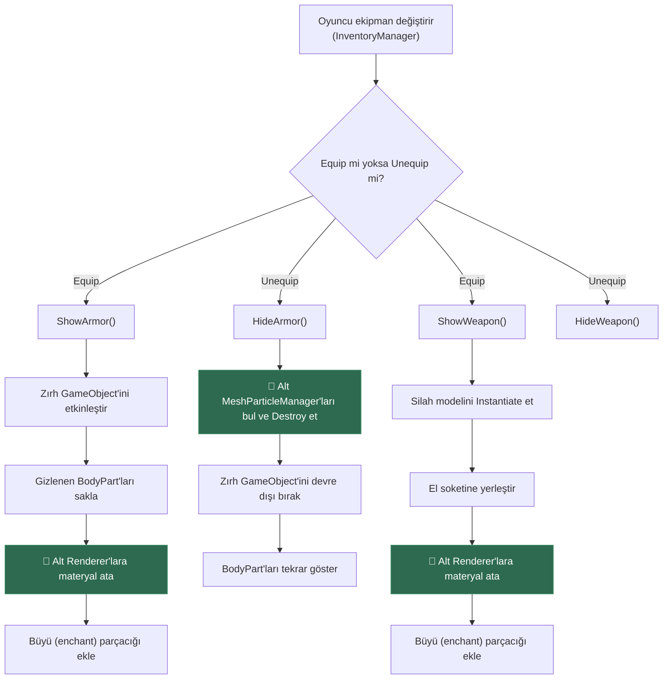

Gilong World (GLW) projesinin Unity 6 ile geliştirilmesi sürecinde, akıcı bir kare hızı (framerate) sağlamak için bellek optimizasyonu (özellikle Çöp Toplamayı — Garbage Collection / GC — en aza indirmek) her zaman en yüksek önceliğimiz olmuştur.

Bugün, karakter görünüm sisteminin (`PlayerAppearance`) kaynak kodunda `GetComponentsInChildren` metodundan kaynaklanan bellek ayırma (Memory Allocation) sorununu optimize ettiğimiz gerçek bir vaka çalışmasını paylaşacağım.

## Soruna Genel Bakış

Unity Profiler ile inceleme yaptığımızda, karakter her ekipman değiştirdiğinde sistem bellek ayırma (GC Alloc) uyarısı veriyordu. Bu sorunun kaynağı aşağıdaki API kullanımından geliyordu:

> **Optimizasyon öncesi**: Liste parametresi almayan `GetComponentsInChildren<T>()` çağrısı. Bu metot her çağrıda yeni bir `T[]` dizisi (array) döndürdüğü için her seferinde GC Alloc oluşturur.
> 
> **Optimizasyon sonrası**: `ListPool<T>.Get()` ile `GetComponentsInChildren(list)` aşırı yüklemesinin (overload) birlikte kullanılması. Bu yöntem, mevcut bir havuzdan `List<T>` nesnesini yeniden kullanarak **Sıfır Ayırma (Zero Allocation)** düzeyine ulaşır.

---

## Genel İşlem Akışı Diyagramı

Silah ve zırh değiştirme süreci aşağıdaki akışa göre gerçekleşir ve müdahale edilmesi gereken noktalar (🔧) ile işaretlenmiştir:



*Not: İngiliz anahtarı (🔧) olmayan adımlar orijinal adımlardır ve bu değişiklikten tamamen etkilenmeden kalır.*

---

## Her Optimizasyon Noktasının Detayları

Değişiklikleri `PlayerAppearance.cs` dosyasındaki 4 farklı konumda uyguladım. Aşağıda en temsili 2 örnek yer almaktadır.

### ① `ShowArmor()` Metodu

**Amaç**: Oyuncu zırh kuşandığında, yeni materyali (material) atamak için o zırh parçasının tüm alt `Renderer` bileşenleri üzerinde gezinmek gerekir.

**OPTİMİZASYON ÖNCESİ (GC Alloc Oluşturur)**

```csharp
foreach (var Renderer in t.GetComponentsInChildren<Renderer>())
{
    Renderer.material = item.modelMaterial;
}
```

**OPTİMİZASYON SONRASI (Zero Alloc)**

```csharp
using (ListPool<Renderer>.Get(out var renderers))
{
    t.GetComponentsInChildren(renderers);
    foreach (var Renderer in renderers)
    {
        Renderer.material = item.modelMaterial;
    }
}
```

**Mantık aynı kalır**: Kod hâlâ her alt `Renderer` üzerinden geçerek `material` ataması yapar. Tek fark, sonuçları tutan taşıyıcının sıfırdan yeni bir `Renderer[]` dizisi oluşturmak yerine, `using` bloğu aracılığıyla havuzdan ödünç alınan bir `List<Renderer>` olmasıdır.

---

### ② `HideArmor()` Metodu

**Amaç**: Zırh çıkarıldığında, zırh parçasını devre dışı bırakmadan (Deactivate) önce üzerine bağlı tüm efekt bileşenlerini (`MeshParticleManager` gibi) bulup yok etmek (`Destroy`) gerekir.

**OPTİMİZASYON ÖNCESİ (GC Alloc Oluşturur)**

```csharp
MeshParticleManager[] meshManagers = t.GetComponentsInChildren<MeshParticleManager>();
foreach (var v in meshManagers)
{
    Destroy(v.gameObject);
}
```

**OPTİMİZASYON SONRASI (Zero Alloc)**

```csharp
using (ListPool<MeshParticleManager>.Get(out var meshManagers))
{
    t.GetComponentsInChildren(meshManagers);
    foreach (var v in meshManagers)
    {
        Destroy(v.gameObject);
    }
}
```

**Mantık aynı kalır**: Kod hâlâ liste üzerinde gezinir ve `Destroy(v.gameObject)` çağrısını yapar.

Bazı geliştiriciler şunu merak edebilir: *"Liste hâlâ `using` bloğunun içindeyken elemanlar üzerinde `Destroy()` çağırmak sorun çıkarır mı?"*  
Cevap: Kesinlikle **güvenlidir**. Unity'de `Destroy()` yalnızca GameObject'i mevcut karenin (frame) sonunda silinmek üzere işaretler. Dolayısıyla `meshManagers` listesindeki nesneler döngü boyunca tamamen geçerli kalır. Döngü sona erdiğinde `using` ifadesi listeyi otomatik olarak temizler (`Clear`) ve havuza geri iade eder.

*(Benzer şekilde `ShowWeapon()` gibi silah görünümü işleyen metotlarda da aynı kalıp uygulanmıştır).*

---

## Oyun Mantığının Etkilenmeyeceği Neden Garanti Edilebilir?

Kod yeniden düzenleme (refactoring) yaparken, özellikle de üçüncü parti motor veya sistem kodlarında, dikkatli olmak en büyük önceliktir. İşte bu değişiklik için risk değerlendirme tablosu:

| Değerlendirilen Konu | Değerlendirme ve Açıklama |
|:---|:---|
| **Sorgu sonuçları değişir mi?** | ❌ **Hayır**. `GetComponentsInChildren(List<T>)` metodu, dizi döndüren aşırı yüklemeyle birebir **aynı Component kümesini** ve **aynı derinlik öncelikli arama (DFS) sırasını** döndürür. |
| **`Destroy` güvenli mi?** | ✅ Unity'nin `Destroy()` fonksiyonu karenin sonuna kadar ertelenir (delayed). Nesneler anında yok edilmediği için liste üzerinde gezinirken null referans (null ref) hatası oluşmaz. |
| **Material atama işlemi farklılaşır mı?** | ❌ **Hayır**. `Renderer.material = ...` ataması tamamen aynı şekilde gerçekleşir. |
| **List işlem sırası korunur mu?** | Korunur. `List<T>`, eklenme sırasını (insertion order) tıpkı `T[]` dizisi gibi korur. |
| **`ListPool` thread-safe mi?** | ✅ `UnityEngine.Pool.ListPool<T>` (Unity 2021+ itibarıyla mevcuttur) arka planda `ConcurrentBag` kullanarak iş parçacığı güvenliğini (thread safety) sağlar. |
| **Bir hata (Exception) oluşursa ne olur?** | ✅ `using` bloğu derlendiğinde bir `try-finally` yapısına dönüşür; bu da döngü ortasında bir istisna fırlatılsa bile listenin her zaman temizlenip havuza geri döndürülmesini garanti eder. |

## Sonuç

`ListPool<T>` kullanan küçük bir değişiklikle, oyuncu her ekipman değiştirdiğinde oluşan gereksiz GC Alloc yükünü tamamen ortadan kaldırdık. GLW gibi karakterlerin savaş ortasında sürekli ekipman değiştirebildiği büyük ölçekli bir projede, bu tür küçük optimizasyonlar birikerek Garbage Collector'ın tetiklediği istenmeyen takılmaları (frame drop) önler.

Unity API aşırı yüklemelerine (overload) hâkim olmak ve Tasarım Desenlerini (Design Pattern) doğru yerde uygulamak, yüksek performanslı C# kodu yazmanın anahtarıdır!
