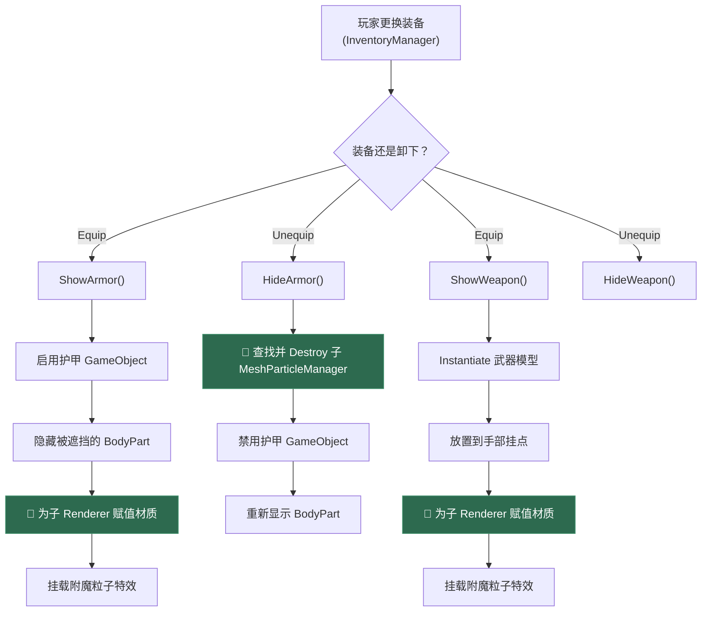

在使用 Unity 6 开发 Gilong World (GLW) 项目的过程中，内存优化（尤其是减少垃圾回收，即 Garbage Collection - GC）始终是保证流畅帧率（framerate）的首要任务。

今天，我将分享一个真实的项目实战案例：如何在角色外观系统（`PlayerAppearance`）的源代码中，优化 `GetComponentsInChildren` 方法带来的内存分配（Memory Allocation）问题。

## 问题概述

通过 Unity Profiler 检测时，每次角色更换装备，系统都会报告产生内存分配（GC Alloc）。问题根源在于调用了以下 API：

> **优化前**：不传入列表参数的 `GetComponentsInChildren<T>()` 形式。该方法每次调用都会返回一个全新的 `T[]` 数组，导致每次调用都产生 GC Alloc。
> 
> **优化后**：结合使用 `ListPool<T>.Get()` 与 `GetComponentsInChildren(list)` 重载版本。该方法从已有对象池中复用 `List<T>`，从而实现 **Zero Allocation（零分配）**。

---

## 整体处理流程图

武器和护甲的更换按照以下流程执行，其中需要改造的位置已用（🔧）标出：



*注意：没有扳手图标（🔧）的步骤为原始流程，完全不受此次改动的影响。*

---

## 各优化位置详解

我在 `PlayerAppearance.cs` 文件中的 4 处位置应用了此修改。下面列举其中 2 个典型示例。

### ① `ShowArmor()` 方法

**目的**：当玩家穿上护甲时，系统需要遍历该护甲下的所有子级 `Renderer` 组件，以赋予新的材质（material）。

**优化前（产生 GC Alloc）**

```csharp
foreach (var Renderer in t.GetComponentsInChildren<Renderer>())
{
    Renderer.material = item.modelMaterial;
}
```

**优化后（Zero Alloc）**

```csharp
using (ListPool<Renderer>.Get(out var renderers))
{
    t.GetComponentsInChildren(renderers);
    foreach (var Renderer in renderers)
    {
        Renderer.material = item.modelMaterial;
    }
}
```

**逻辑保持不变**：代码依然遍历每一个子 `Renderer` 并为其赋值 `material`。唯一的区别在于，用于接收结果的容器不再是全新分配的 `Renderer[]` 数组，而是通过 `using` 语句从对象池借用的 `List<Renderer>`。

---

### ② `HideArmor()` 方法

**目的**：当卸下护甲时，需要先找到挂载在该护甲上的所有特效组件（如 `MeshParticleManager`）并将它们销毁（`Destroy`），然后再停用（Deactivate）护甲。

**优化前（产生 GC Alloc）**

```csharp
MeshParticleManager[] meshManagers = t.GetComponentsInChildren<MeshParticleManager>();
foreach (var v in meshManagers)
{
    Destroy(v.gameObject);
}
```

**优化后（Zero Alloc）**

```csharp
using (ListPool<MeshParticleManager>.Get(out var meshManagers))
{
    t.GetComponentsInChildren(meshManagers);
    foreach (var v in meshManagers)
    {
        Destroy(v.gameObject);
    }
}
```

**逻辑保持不变**：代码依然遍历列表并调用 `Destroy(v.gameObject)`。

有些开发者可能会疑惑：*“在列表还处于 `using` 代码块内时，就对元素调用 `Destroy()` 会有问题吗？”*  
答案是完全**安全**。在 Unity 中，`Destroy()` 方法的作用只是将 GameObject 标记为在当前帧结束时删除。因此，`meshManagers` 列表中的对象在整个循环过程中依然完全有效。当循环结束时，`using` 语句会自动清空（`Clear`）并将列表归还给对象池。

*（同理，`ShowWeapon()` 等处理武器显示的方法也采用了这一完全相同的模式）。*

---

## 为什么可以确保游戏逻辑不受影响？

在进行代码重构（refactoring）时——尤其是涉及第三方引擎或框架的代码——谨慎是第一要务。以下是本次修改的风险评估表：

| 考量事项 | 评估与说明 |
|:---|:---|
| **查询结果是否会改变？** | ❌ **不会**。`GetComponentsInChildren(List<T>)` 返回的**组件集合完全一致**，并且遵循与返回数组的方法完全相同的**深度优先搜索（DFS）顺序**。 |
| **`Destroy` 是否安全？** | ✅ Unity 的 `Destroy()` 会延迟（delayed）到当前帧结束时才真正销毁。对象不会立即消失，因此在遍历列表时不会引发空引用（null ref）错误。 |
| **材质赋值操作是否有差异？** | ❌ **没有**。`Renderer.material = ...` 的赋值过程完全一致。 |
| **列表的处理顺序？** | 保持不变。`List<T>` 与 `T[]` 数组一样，完全保留插入顺序（insertion order）。 |
| **`ListPool` 是否线程安全？** | ✅ `UnityEngine.Pool.ListPool<T>`（自 Unity 2021+ 起提供）底层使用 `ConcurrentBag`，能够确保线程安全（thread-safe）。 |
| **如果发生异常（Exception）怎么办？** | ✅ `using` 代码块在编译后会转换为 `try-finally` 结构，即使在循环中途抛出异常，也能确保列表始终被清空并归还到对象池。 |

## 总结

仅通过一处使用 `ListPool<T>` 的小改动，我们就彻底消除了玩家每次更换装备时产生的无谓 GC Alloc。对于像 GLW 这样角色在战斗中可能频繁切换装备的大型项目而言，这些点滴优化不断累积，能够有效避免由垃圾回收器触发的不必要掉帧卡顿（frame drop）。

熟练掌握 Unity API 的各类重载并在恰当的位置运用设计模式（Design Pattern），正是编写高性能 C# 代码的关键所在！
