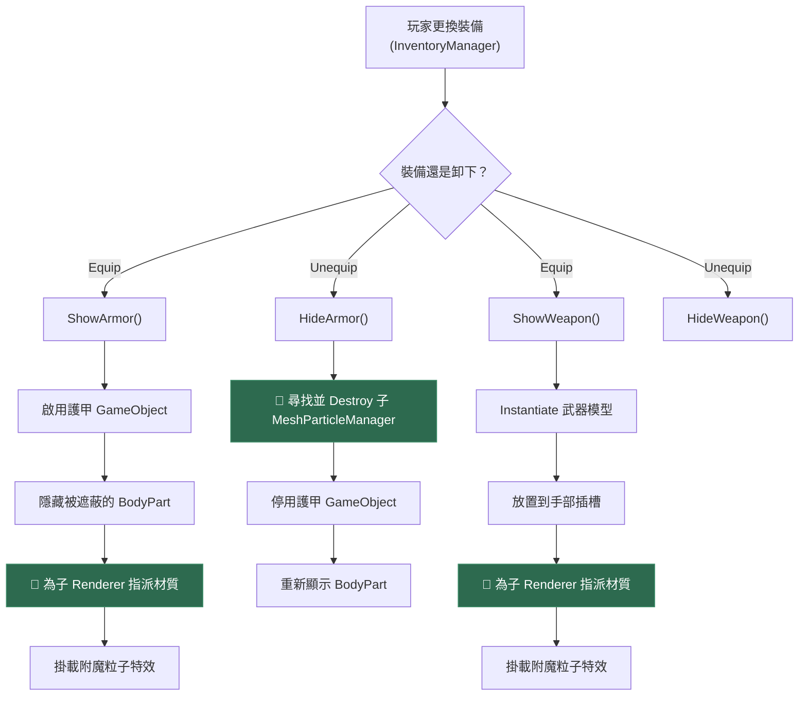

在使用 Unity 6 開發 Gilong World (GLW) 專案的過程中，記憶體最佳化（特別是減少垃圾回收，即 Garbage Collection - GC）始終是確保流暢幀率（framerate）的首要任務。

今天，我將分享一個實務案例：如何在角色外觀系統（`PlayerAppearance`）的原始碼中，最佳化 `GetComponentsInChildren` 函式所造成的記憶體配置（Memory Allocation）問題。

## 問題概述

透過 Unity Profiler 進行檢測時，每次角色更換裝備，系統都會回報產生記憶體配置（GC Alloc）。問題的根源來自於以下 API 的呼叫方式：

> **最佳化前**：不傳入清單參數的 `GetComponentsInChildren<T>()` 呼叫方式。該函式每次呼叫都會傳回一個全新的 `T[]` 陣列，導致每次執行都產生 GC Alloc。
> 
> **最佳化後**：搭配使用 `ListPool<T>.Get()` 與 `GetComponentsInChildren(list)` 多載（overload）版本。此方法會從既有的物件池（pool）中重複使用 `List<T>`，達到 **Zero Allocation（零配置）** 的水準。

---

## 整體處理流程圖

武器與護甲的更換會依照以下流程進行，其中需要介入調整的位置已標記為（🔧）：



*注意：沒有板手圖示（🔧）的步驟為原始流程，完全不受此次變更的影響。*

---

## 各最佳化位置詳細說明

我在 `PlayerAppearance.cs` 檔案中的 4 個位置套用了此修改。以下列出其中 2 個具代表性的案例。

### ① `ShowArmor()` 函式

**目的**：當玩家穿上護甲時，系統需要走訪該護甲底下所有的子 `Renderer` 元件，以指派新的材質（material）。

**最佳化前（會產生 GC Alloc）**

```csharp
foreach (var Renderer in t.GetComponentsInChildren<Renderer>())
{
    Renderer.material = item.modelMaterial;
}
```

**最佳化後（Zero Alloc）**

```csharp
using (ListPool<Renderer>.Get(out var renderers))
{
    t.GetComponentsInChildren(renderers);
    foreach (var Renderer in renderers)
    {
        Renderer.material = item.modelMaterial;
    }
}
```

**邏輯維持不變**：程式碼依然會走訪每一個子 `Renderer` 並指派 `material`。唯一的差別在於，用來儲存結果的容器不再是重新配置出的全新 `Renderer[]` 陣列，而是透過 `using` 陳述式從集區借用的 `List<Renderer>`。

---

### ② `HideArmor()` 函式

**目的**：當卸下護甲時，必須先找出附著在該護甲上的所有特效元件（例如 `MeshParticleManager`）並將其銷毀（`Destroy`），接著再停用（Deactivate）該護甲。

**最佳化前（會產生 GC Alloc）**

```csharp
MeshParticleManager[] meshManagers = t.GetComponentsInChildren<MeshParticleManager>();
foreach (var v in meshManagers)
{
    Destroy(v.gameObject);
}
```

**最佳化後（Zero Alloc）**

```csharp
using (ListPool<MeshParticleManager>.Get(out var meshManagers))
{
    t.GetComponentsInChildren(meshManagers);
    foreach (var v in meshManagers)
    {
        Destroy(v.gameObject);
    }
}
```

**邏輯維持不變**：程式碼依然會走訪清單並呼叫 `Destroy(v.gameObject)`。

部分開發者可能會好奇：*「當清單還留在 `using` 區塊內時，就對元素呼叫 `Destroy()` 會有問題嗎？」*  
答案是完全**安全**。在 Unity 中，`Destroy()` 的作用僅是將 GameObject 標記為於目前影格（frame）結束時移除。因此，在整個迴圈執行期間，`meshManagers` 清單內的物件依然完全有效。當迴圈結束後，`using` 陳述式會自動清除（`Clear`）清單內容並將其歸還至集區。

*（同理，`ShowWeapon()` 等處理武器顯示的函式也套用了完全相同的範本）。*

---

## 為何能確定遊戲邏輯不受影響？

進行程式碼重構（refactoring）時，特別是針對第三方引擎或框架的原始碼，謹慎行事永遠是最高原則。以下為本次變更的風險評估表：

| 評估項目 | 評估與說明 |
|:---|:---|
| **查詢結果是否會改變？** | ❌ **不會**。`GetComponentsInChildren(List<T>)` 會傳回**完全相同的元件集合**，且遵循與傳回陣列的多載版本完全一致的**深度優先搜尋（DFS）順序**。 |
| **`Destroy` 是否安全？** | ✅ Unity 的 `Destroy()` 會延遲（delayed）至目前影格結束時才執行銷毀。物件不會立刻消失，因此走訪清單時不會引發 Null 參考（null ref）錯誤。 |
| **材質指派操作是否有差異？** | ❌ **不會**。`Renderer.material = ...` 的指派行為完全相同。 |
| **清單的處理順序？** | 維持不變。`List<T>` 會如同 `T[]` 陣列般完整保留插入順序（insertion order）。 |
| **`ListPool` 是否具備執行緒安全？** | ✅ `UnityEngine.Pool.ListPool<T>`（自 Unity 2021+ 起內建）底層採用 `ConcurrentBag`，可確保執行緒安全（thread-safe）。 |
| **如果發生例外狀況（Exception）怎麼辦？** | ✅ `using` 區塊在編譯後會轉為 `try-finally` 結構，即便在迴圈中途擲出例外狀況，也能確保清單必定被清除並歸還至集區。 |

## 結論

僅透過一處採用 `ListPool<T>` 的小幅修改，我們便徹底消除了玩家每次更換裝備時所產生的無謂 GC Alloc。對於像 GLW 這樣角色可能在戰鬥中頻繁切換裝備的大型專案而言，這些細微的最佳化累積起來，將能有效避免因垃圾回收器觸發而造成的不必要掉幀卡頓（frame drop）。

熟練掌握 Unity API 的各種多載函式，並在對的地方套用設計模式（Design Pattern），正是撰寫高效能 C# 程式碼的關鍵！
