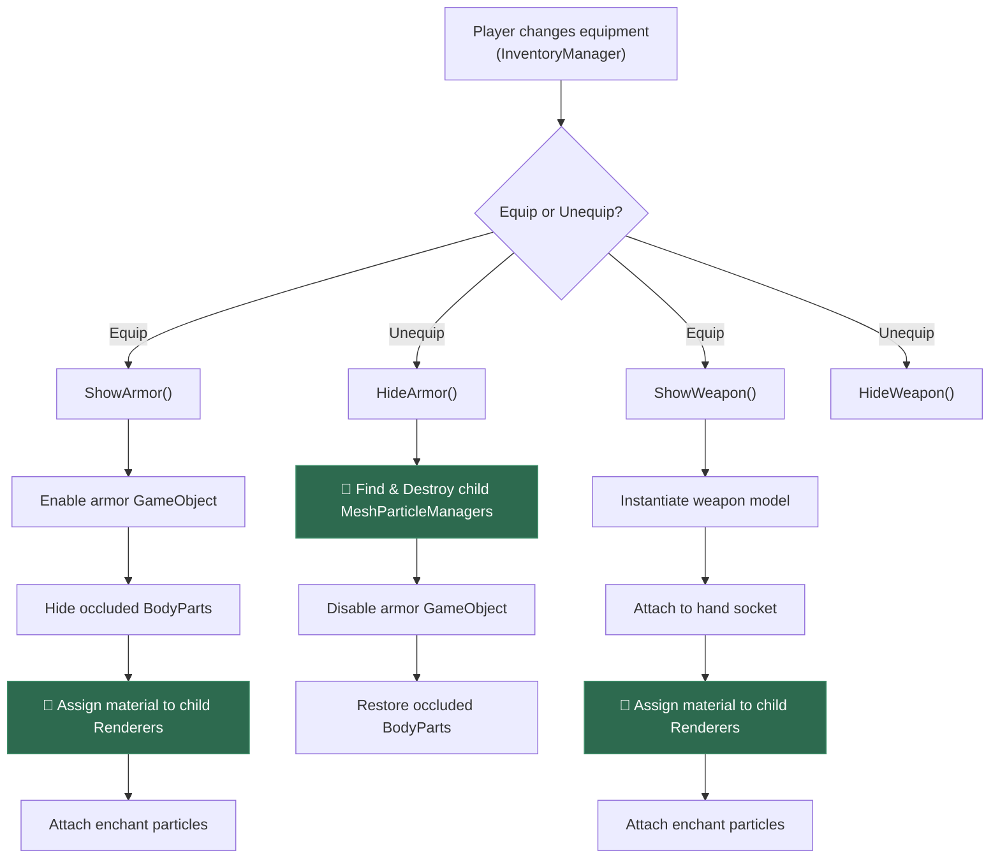

During the development of the Gilong World (GLW) project in Unity 6, memory optimization—particularly minimizing Garbage Collection (GC)—has always been a top priority to maintain a smooth framerate.

Today, I am sharing a practical case study on eliminating memory allocations (Memory Allocation) caused by `GetComponentsInChildren` inside the character appearance system (`PlayerAppearance`).

## Problem Overview

When inspecting the project with the Unity Profiler, the system flagged GC Allocations (GC Alloc) every time the character changed equipment. The root cause came from calling the following API:

> **Before optimization**: Calling `GetComponentsInChildren<T>()` without a list parameter. This overload allocates and returns a brand-new `T[]` array on every invocation, causing GC Alloc each time it is called.
> 
> **After optimization**: Using `ListPool<T>.Get()` together with the `GetComponentsInChildren(list)` overload. This approach reuses a `List<T>` from a pre-existing pool, achieving **Zero Allocation**.

---

## Overall Execution Flow

Swapping weapons and armor follows the flow below, with the intervention points marked by (🔧):



*Note: Steps without a wrench (🔧) are the original steps and remain completely unaffected by this change.*

---

## Detailed Optimization Breakdown

I applied this change across 4 locations in `PlayerAppearance.cs`. Below are 2 representative cases.

### ① The `ShowArmor()` Method

**Purpose**: When the player equips armor, the system iterates over all child `Renderer` components of that armor piece to assign the new material.

**BEFORE OPTIMIZATION (Causes GC Alloc)**

```csharp
foreach (var Renderer in t.GetComponentsInChildren<Renderer>())
{
    Renderer.material = item.modelMaterial;
}
```

**AFTER OPTIMIZATION (Zero Alloc)**

```csharp
using (ListPool<Renderer>.Get(out var renderers))
{
    t.GetComponentsInChildren(renderers);
    foreach (var Renderer in renderers)
    {
        Renderer.material = item.modelMaterial;
    }
}
```

**Logic preserved**: The code still iterates through every child `Renderer` to assign `material`. The only difference is that the container holding the results is now a `List<Renderer>` borrowed from the pool via a `using` statement, rather than allocating an entirely new `Renderer[]` array.

---

### ② The `HideArmor()` Method

**Purpose**: When unequipping armor, the system must find all attached effect components (such as `MeshParticleManager`) on that armor piece and destroy them (`Destroy`) before deactivating the armor.

**BEFORE OPTIMIZATION (Causes GC Alloc)**

```csharp
MeshParticleManager[] meshManagers = t.GetComponentsInChildren<MeshParticleManager>();
foreach (var v in meshManagers)
{
    Destroy(v.gameObject);
}
```

**AFTER OPTIMIZATION (Zero Alloc)**

```csharp
using (ListPool<MeshParticleManager>.Get(out var meshManagers))
{
    t.GetComponentsInChildren(meshManagers);
    foreach (var v in meshManagers)
    {
        Destroy(v.gameObject);
    }
}
```

**Logic preserved**: The code still iterates through the collection and invokes `Destroy(v.gameObject)`.

Some developers may wonder: *"Is it safe to call `Destroy()` on elements while the list is still inside the `using` block?"*  
The answer is completely **safe**. In Unity, `Destroy()` only marks a GameObject for destruction at the end of the current frame. Therefore, all objects referenced inside `meshManagers` remain completely valid throughout the loop. Once the loop finishes, the `using` block automatically clears (`Clear`) and returns the list to the pool.

*(Similarly, weapon display methods such as `ShowWeapon()` follow this exact same pattern).*

---

## Why Game Logic Is Guaranteed to Remain Unaffected

When refactoring code—especially third-party engine or framework code—caution is paramount. Below is the risk assessment matrix for this change:

| Consideration | Evaluation & Explanation |
|:---|:---|
| **Do query results change?** | ❌ **No**. `GetComponentsInChildren(List<T>)` returns the **exact same set of Components** in the **exact same depth-first search (DFS) order** as the array-returning overload. |
| **Is `Destroy` safe?** | ✅ Unity's `Destroy()` is deferred until the end of the frame. Objects are not destroyed immediately, so iterating over the list will not trigger null reference exceptions. |
| **Does material assignment differ?** | ❌ **No**. The `Renderer.material = ...` assignment executes identically. |
| **List iteration order?** | Preserved. `List<T>` maintains insertion order identically to a `T[]` array. |
| **Is `ListPool` thread-safe?** | ✅ `UnityEngine.Pool.ListPool<T>` (available since Unity 2021+) uses a `ConcurrentBag` under the hood, ensuring thread safety. |
| **What if an exception occurs?** | ✅ The `using` block compiles down to a `try-finally` block, guaranteeing the list is cleared and returned to the pool even if an exception is thrown mid-loop. |

## Conclusion

With a small change to adopt `ListPool<T>`, we completely eliminated unnecessary GC Allocations every time a player swaps equipment. For a large-scale project like GLW—where characters can rapidly switch gear mid-combat—these incremental optimizations compound to prevent unwarranted frame drops triggered by the Garbage Collector.

Mastering Unity API overloads and applying the right Design Patterns in the right places is the key to writing high-performance C# code!
