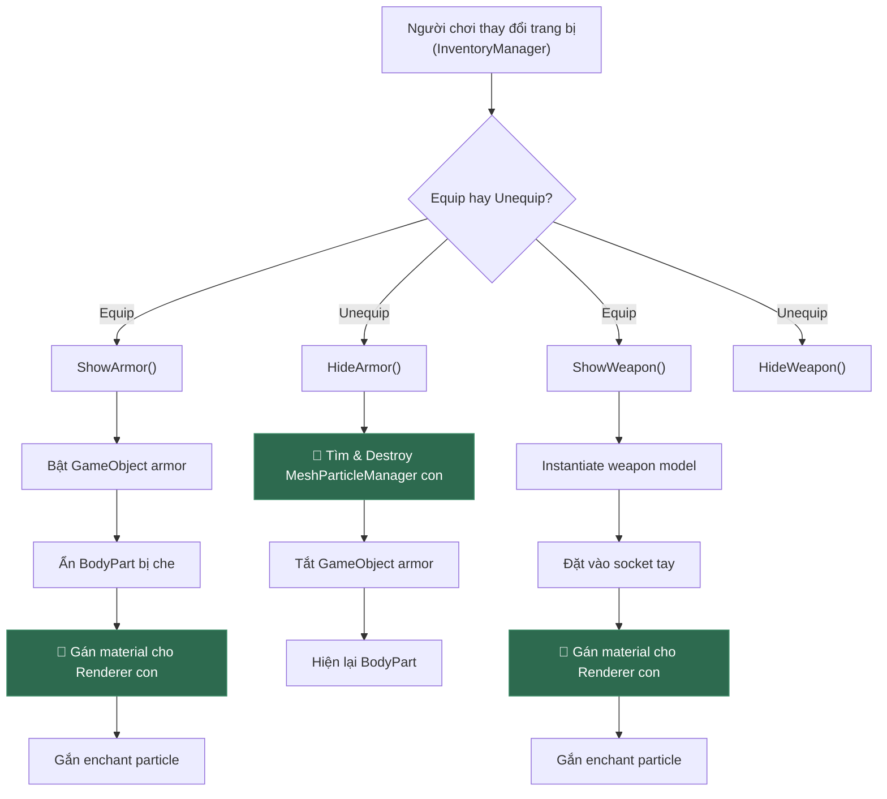

Trong quá trình phát triển dự án Gilong World (GLW) với Unity 6, việc tối ưu hóa bộ nhớ (đặc biệt là giảm thiểu Garbage Collection - GC) luôn là ưu tiên hàng đầu để đảm bảo khung hình (framerate) mượt mà. 

Hôm nay, mình sẽ chia sẻ một case study thực tế trong việc tối ưu hóa cấp phát bộ nhớ (Memory Allocation) từ hàm `GetComponentsInChildren` trong mã nguồn của hệ thống nhân vật (PlayerAppearance).

## Tổng quan vấn đề

Khi kiểm tra với Profiler, hệ thống báo lỗi cấp phát bộ nhớ (GC Alloc) mỗi lần nhân vật thay đổi trang bị. Nguyên nhân đến từ việc sử dụng API sau:

> **Trước khi tối ưu**: `GetComponentsInChildren<T>()` dạng không nhận tham số danh sách. Hàm này luôn trả về một mảng `T[]` mới, gây ra GC Alloc mỗi lần gọi.
> 
> **Sau khi tối ưu**: Dùng `ListPool<T>.Get()` kết hợp với overload `GetComponentsInChildren(list)`. Phương pháp này giúp tái sử dụng `List<T>` từ một pool có sẵn, đạt mức **Zero Allocation**.

---

## Sơ đồ luồng xử lý tổng thể

Việc thay đổi vũ khí và áo giáp diễn ra theo luồng sau, và mình đã đánh dấu (🔧) các vị trí cần can thiệp:



*Lưu ý: Các bước không có cờ lê (🔧) là những bước nguyên bản, hoàn toàn không bị ảnh hưởng bởi thay đổi này.*

---

## Chi tiết từng vị trí tối ưu

Mình đã áp dụng sửa đổi ở 4 vị trí trong file `PlayerAppearance.cs`. Dưới đây là 2 trường hợp tiêu biểu.

### ① Hàm `ShowArmor()` 

**Mục đích**: Khi người chơi mặc giáp, hệ thống cần duyệt qua tất cả Renderer con của mảnh giáp đó để gán vật liệu (material) mới.

**TRƯỚC KHI TỐI ƯU (Gây GC Alloc)**
```csharp
foreach (var Renderer in t.GetComponentsInChildren<Renderer>())
{
    Renderer.material = item.modelMaterial;
}
```

**SAU KHI TỐI ƯU (Zero Alloc)**
```csharp
using (ListPool<Renderer>.Get(out var renderers))
{
    t.GetComponentsInChildren(renderers);
    foreach (var Renderer in renderers)
    {
        Renderer.material = item.modelMaterial;
    }
}
```

**Logic giữ nguyên**: Code vẫn duyệt qua mọi `Renderer` con để gán `material`. Điểm khác biệt duy nhất là container chứa kết quả nay là `List<Renderer>` được mượn từ pool thông qua câu lệnh `using`, thay vì tạo ra một mảng `Renderer[]` mới hoàn toàn.

---

### ② Hàm `HideArmor()`

**Mục đích**: Khi tháo giáp, cần tìm tất cả các hiệu ứng (như `MeshParticleManager`) đang dính trên mảnh giáp và hủy (Destroy) chúng trước khi tắt (Deactivate) mảnh giáp.

**TRƯỚC KHI TỐI ƯU (Gây GC Alloc)**
```csharp
MeshParticleManager[] meshManagers = t.GetComponentsInChildren<MeshParticleManager>();
foreach (var v in meshManagers)
{
    Destroy(v.gameObject);
}
```

**SAU KHI TỐI ƯU (Zero Alloc)**
```csharp
using (ListPool<MeshParticleManager>.Get(out var meshManagers))
{
    t.GetComponentsInChildren(meshManagers);
    foreach (var v in meshManagers)
    {
        Destroy(v.gameObject);
    }
}
```

**Logic giữ nguyên**: Code vẫn duyệt qua list và gọi `Destroy(v.gameObject)`. 

Một số bạn có thể thắc mắc: *"Gọi Destroy() các phần tử trong khi list vẫn đang nằm trong khối using có sao không?"*. 
Câu trả lời là hoàn toàn **an toàn**. Trong Unity, hàm `Destroy()` chỉ có tác dụng đánh dấu GameObject để xóa vào cuối frame hiện tại. Do đó, các object bên trong danh sách `meshManagers` vẫn hoàn toàn hợp lệ trong suốt vòng lặp. Khi vòng lặp kết thúc, câu lệnh `using` sẽ tự động dọn dẹp (Clear) và trả list về lại pool.

*(Tương tự, các hàm xử lý hiển thị vũ khí như `ShowWeapon()` cũng được áp dụng nguyên mẫu này).*

---

## Tại sao có thể khẳng định logic game KHÔNG bị ảnh hưởng?

Khi thực hiện việc tái cấu trúc (refactoring) mã nguồn, đặc biệt là mã nguồn của các Engine bên thứ ba, sự cẩn trọng là ưu tiên hàng đầu. Dưới đây là bảng đánh giá rủi ro cho thay đổi này:

| Vấn đề cân nhắc | Đánh giá & Giải thích |
|:---|:---|
| **Kết quả query có thay đổi?** | ❌ **Không**. Hàm `GetComponentsInChildren(List<T>)` trả về **cùng một tập hợp Component**, theo **đúng thứ tự tìm kiếm chiều sâu (DFS)** giống hệt như hàm trả về mảng. |
| **Destroy có an toàn?** | ✅ Hàm `Destroy()` của Unity trễ (delayed) đến cuối frame. Object không biến mất ngay lập tức nên không gây lỗi null ref khi duyệt list. |
| **Phép gán Material có khác đi?** | ❌ **Không**. Lệnh gán `Renderer.material = ...` diễn ra y hệt. |
| **Thứ tự xử lý của List?** | Giữ nguyên. `List<T>` bảo toàn thứ tự chèn (insertion order) y như mảng `T[]`. |
| **ListPool có thread-safe không?** | ✅ `UnityEngine.Pool.ListPool<T>` (có từ Unity 2021+) sử dụng `ConcurrentBag` ngầm bên dưới, đảm bảo an toàn luồng. |
| **Nếu xảy ra lỗi (Exception)?** | ✅ Khối `using` biên dịch thành cấu trúc `try-finally`, đảm bảo danh sách luôn được dọn dẹp và trả về pool dù có exception ném ra giữa chừng. |

## Kết Luận

Chỉ với một thay đổi nhỏ sử dụng `ListPool<T>`, chúng ta đã loại bỏ hoàn toàn GC Alloc vô ích mỗi khi người chơi thay đổi trang bị. Đối với một dự án lớn như GLW, nơi nhân vật có thể thay đổi đồ liên tục trong chiến đấu, những tối ưu nhỏ này cộng dồn lại sẽ giúp game tránh được tình trạng giật lag (frame drop) không đáng có do Garbage Collector kích hoạt.

Việc nắm vững các overload của Unity API và áp dụng Design Pattern đúng chỗ là chìa khóa để viết mã C# hiệu năng cao!
