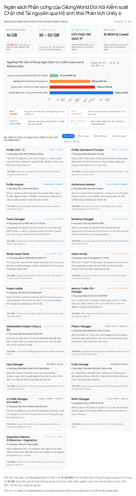
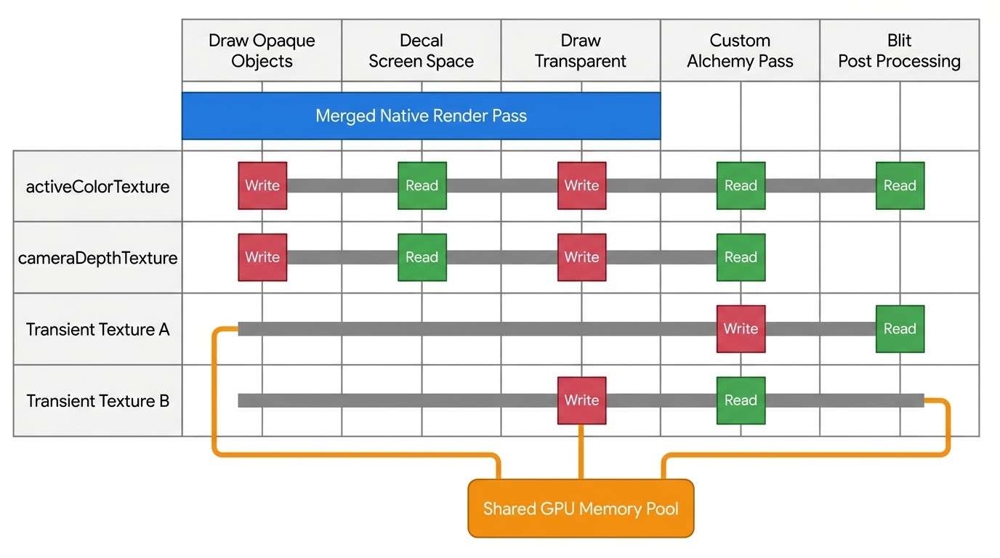

## **《GilongWorld》的技術特性與效能挑戰分析**

由 Long Gil Studio 與開發者 Huynh Long Gil 共同開發並發行的《*GilongWorld*》，是一款定位高品質（AAA Indie）的科幻動作角色扮演結合開放世界（Sci-Fi Action RPG Open World）類型獨立遊戲專案[^1]。《*GilongWorld*》在技術架構上最複雜之處，在於五項最耗費系統資源的玩法系統必須在第三人稱（Third Person）沙盒環境中同步運作[^2]。遊戲一方面需要動作角色扮演戰鬥系統的高影格率即時回應，以應對科幻武器、爆破炸彈與毒素產生的大量粒子視覺特效（VFX）；另一方面也必須維持包含各自擁有獨立屬性數值與超自然技能之龍族在內的神話生物馴服與指揮系統[^2]。這套夥伴生物系統透過骨架動畫矩陣轉換、尋路演算法以及主角與坐騎編隊之間持續的狀態資料通訊，對中央處理器（CPU）造成龐大壓力[^2]。

除了戰鬥與人工智慧帶來的負載外，《*GilongWorld*》更整合了讓玩家將荒野改造成堅固堡壘的基地建造機制，並結合培育外星作物種群的農耕系統，以及煉製仙藥、藥丸和爆炸物的鍊金工藝系統[^2]。從遊戲引擎架構層面來看，允許玩家自由興建建築會在執行時期產生數以千計的動態物件，導致記憶體碎片化、破壞傳統的靜態批次處理（Static Batching）能力，同時迫使物理系統與導覽網格必須持續更新[^2]。與此同時，農耕系統在玩家跨越未探索領土時需要大範圍的生長狀態更新迴圈與永續資料儲存機制，而鍊金系統則要求在使用者介面上管理數百種複雜的製作配方[^2]。這套多機制組合必須在 Steam 平台預先定義的硬體預算框架內運行，並滿足基於 DirectX 12 指令集運作的寫實畫面強制規格[^2]。

| 系統規格參數 | 最低配備（Minimum） | 建議配備（Recommended） | 《GilongWorld》的架構影響與最佳化限制 |
| :---- | :---- | :---- | :---- |
| **作業系統與 API** | Windows 10 (DirectX 12)[^2] | Windows 10/11 (DirectX 12)[^2] | 必須依據現代 DX12 標準最佳化圖形命令串流（Render Thread）與 GPU 緩衝區管理[^2]。 |
| **處理器（CPU）** | Intel Core i5-8500 / AMD Ryzen 5 2600X[^2] | Intel Core i5-11600K / AMD Ryzen 5 5600[^2] | 受限於 6 個實體核心；所有生物 AI、基地物理與農耕迴圈都必須移轉至多執行緒（Job System / Burst）[^2]。 |
| **系統記憶體（RAM）** | **16 GB RAM**[^2] | **16 GB RAM**[^2] | 兩階配備之間完全不會提升的絕對記憶體上限；嚴禁出現記憶體洩漏（Memory Leak）與 AssetBundle 內的資源重複[^2]。 |
| **顯示卡（GPU）** | GTX 1060 / RX 6500 XT[^2] | RTX 2080 / RX 6700 XT[^2] | RX 6500 XT 僅配備 4 GB 顯示記憶體且記憶體頻寬狹窄；必須重複使用暫態算繪貼圖（Transient Resources）並徹底壓縮貼圖[^2]。 |
| **儲存空間** | **35 GB** 可用空間[^2] | **50 GB** 可用空間[^2] | 龐大的資源規模（35–50 GB）會引發載入串流瓶頸（Asset Streaming）風險，並拉長編輯器內的匯入（Import）耗時[^2]。 |

從上述規格參數表中浮現出一個核心技術矛盾：儘管儲存空間從 35 GB 擴展至 50 GB，圖形處理效能也從入門主流階的 GTX 1060 / RX 6500 XT 躍升至高階 RTX 2080 / RX 6700 XT，但系統記憶體容量在最低配備與建議配備中卻始終維持在 16 GB 不變[^2]。由於 Windows 10/11 作業系統與 DirectX 12 驅動程式已佔用可觀的背景記憶體，《*GilongWorld*》的執行處理程序在容納整個開放世界地形、玩家興建的堡壘結構、馴服生物模型與鍊金特效時，必須承受極為嚴苛的記憶體上限[^2]。此外，工作環境中出現 Render Graph Viewer、Performance Markers 與 Project Auditor 等專用工具，顯示該專案正採用具備現代 Universal Render Pipeline（URP）算繪流程的 Unity 6 平台進行開發[^10]。熟練掌握 `Window > Analysis` 選單中的全部 13 款工具以及各項隱藏診斷工具，是解決這道效能難題的關鍵所在[^13]。

{: .shadow .rounded-10 }
_圖 1：《GilongWorld》硬體預算（16 GB RAM、35–50 GB、GTX 1060 / RX 6500 XT、i5-8500）與 Unity 6 Analysis 工具及隱藏工具矩陣_

## **Analysis 選單中 13 款工具的詳細剖析與《GilongWorld》實務應用**

為了最佳化像《*GilongWorld*》這樣複雜的專案，`Window > Analysis` 選單中的 13 款工具可劃分為四個專業功能群組，分別對應 Unity Engine 的核心架構層級[^13]。

### **第 1 組：執行時期與編輯器效能分析（Runtime & Editor Performance Profiling）**

第一組工具扮演雷達監測系統的角色，在遊戲與編輯器運作期間持續監控 CPU 執行時間、記憶體耗用量與影格延遲[^8]。

#### **Profiler (Ctrl+7)**

Profiler 是一款逐格擷取應用程式遙測資料的工具，結合了內建於 Unity Engine C++ 原始碼中的效能標記，以及透過 `ProfilerMarker` API 在 C# 程式碼中定義的自訂標記[^19]。收集到的資料被區分為多個專用模組，包含 CPU Usage、Rendering、Memory、Audio、Physics、UI and UI Details、File Access、Global Illumination、Video 與 Asset Loading[^8]。在《*GilongWorld*》的實務開發情境中，此工具在控管戰鬥與鍊金製作期間的 CPU 尖峰（CPU Spikes）上扮演決定性角色[^2]。當玩家引爆鍊金炸藥或神話生物施放範圍技能時，分析 CPU Usage 模組能協助技術團隊精確判斷畫面頓挫是源自於主執行緒的粒子物件實例化與垃圾回收記憶體配置（GC Allocation），抑或是源自於處理 DirectX 12 繪製命令時過載的算繪執行緒（Render Thread）[^2]。同時，監測 Asset Loading 與 File Access 兩個模組，讓工程師能在玩家騎乘坐騎穿越未探索領土時檢查從 35–50 GB 儲存封裝檔讀取資料的速度，確保非同步資源載入執行緒不會阻塞主執行緒[^2]。

#### **Profiler (Standalone Process)**

透過 `Window > Analysis > Profiler (Standalone Process)` 路徑啟動時，Unity 會將 Profiler 視窗分離為一個完全獨立於 Unity Editor 處理程序之外的作業系統處理程序[^16]。這種處理程序隔離機制解決了兩大技術問題：第一，在主編輯器內部繪製 Profiler 圖表介面與儲存歷史資料本身也會消耗 CPU 與記憶體，在連接至遊戲獨立建置版本（standalone builds）時容易干擾量測結果；第二，該獨立處理程序專為量測 Unity Editor 本身的效能而設計[^16]。套用至《*GilongWorld*》時，於最低目標硬體配備（Core i5-8500 與 16 GB RAM）上測試建置版時使用 Profiler (Standalone Process)，能將 Profiler UI 的負擔自執行中的目標處理程序抽離，以擷取最準確的數據[^2]。更進一步而言，Long Gil Studio 開發團隊可利用此工具診斷內部設計工具——例如鍊金配方編輯器、生物屬性設定工具或 Scene View 中的基地建造工具——藉此立即揪出拖慢日常開發作業的編輯器函式[^2]。

#### **Profile Analyzer**

相較於標準 Profiler 視窗專注於詳細解剖單一影格的細節，Profile Analyzer 是一款針對連續多格序列進行數學統計分析的工具，用以找出系統性的效能瓶頸[^20]。透過彙整數百甚至數千個影格內各標記的執行時間，並允許直接並排比對程式碼修改前後的兩份紀錄檔，此工具能夠消除影格之間隨機波動所帶來的誤差[^24]。在像《*GilongWorld*》這樣互動密度極高的開放世界中，數百株外星作物持續生長的同時，玩家堡壘周圍還有數十隻野生生物穿梭移動，每一格的處理時間始終劇烈浮動[^2]。若僅檢視 Profiler 中的單一影格，程式設計師極易對最佳化成效做出錯誤推論。擷取一段基地內長時間戰鬥的紀錄並匯入 Profile Analyzer，即可提供嚴謹的量化證據，證實導入多執行緒後馴服生物尋路指令碼或農場更新迴圈的中位數處理時間下降幅度[^2]。

#### **Performance Markers**

於 Unity 6 生態系中現身於 `Window > Analysis > Performance Markers` 路徑的專用視窗，透過 Performance Trackers（查詢代碼 `perf:`）與 Profiler Markers（查詢代碼 `profile:`）兩項資料提供者充分發揮 Unity Search 搜尋引擎的威力[^14]。此工具以統計表格形式呈現來自兩種標記的資料：`ProfilerMarker`（於開啟 Profiler 時啟用，記錄執行時間與記憶體配置的詳細資訊）以及 `EditorPerformanceTracker`（始終在編輯器內以極低開銷預載運行，記錄各項工作的執行時間）[^21]。Performance Markers 的強大之處在於依據時間與記憶體單位進行量化篩選的查詢語法，例如 `avg>1ms`、`avg<512kb`、`lastTime<1ms`、`peak=0.5`、`count>1000` 或 `total=0.5`，並結合雙擊任一標記即可啟用區域 Deep Profiling 的能力，開啟僅顯示該標記底下呼叫樹狀圖的 Profiler 視窗[^14]。針對《*GilongWorld*》，當基地建築放置系統或生物距離偵測系統需要透過 Burst Job 與 `RaycastCommand` 在每一格執行數百次射線投射（raycast）時，工程師只需開啟 Performance Markers 直接查詢 `Physics.Raycast`，即可確認其平均執行時間維持在數微秒等級（例如在偵錯模式下為 3.7 微秒），而不必在整格龐大的階層樹中人工翻找[^2]。

### **第 2 組：圖形與算繪管線偵錯（Graphics & Rendering Pipeline Debugging）**

面對在 DirectX 12 指令集上呈現寫實科幻視覺風格、同時必須確保 GTX 1060 與 RX 6500 XT 等主流顯示卡維持流暢效能的目標，圖形工具群組正是釋放 GPU 瓶頸的關鍵鑰匙[^2]。

#### **Frame Debugger**

Frame Debugger 允許在任意影格凍結算繪流程，並將該影格完整拆解為依序傳送至 GPU 的繪製事件（Draw Calls）序列[^10]。在檢視每一個繪製步驟時，開發者能觀察該繪製命令完成當下的影像緩衝區（render target）狀態、檢查傳入著色器（Shader）的參數，並診斷物件無法合併為單一繪製呼叫（batching）的原因[^10]。在《*GilongWorld*》專案中，當玩家建起一座由數千個牆面、地板、冶金機械組成的龐大堡壘，且四周環繞外星作物農田與坐騎隊伍時，透過 DirectX 12 送出的繪製呼叫數量可能急遽暴增並使 Core i5-8500 處理器過載[^2]。在視角正對基地的位置啟用 Frame Debugger，能協助圖形工程師立即驗證 URP 的批次處理機制（SRP Batcher）在模組化建築元件上是否正常運作，抑或因不一致的材質變體而中斷[^2]。

#### **Rendering Debugger**

Rendering Debugger 是整合於 URP 算繪流程中的即時診斷工具，讓開發者能在遊戲執行期間直接檢視並覆寫材質屬性、光照模式與影像緩衝區圖層，完全無須重新編譯著色器[^27]。在《*GilongWorld*》裡，動用鍊金炸彈、劇毒迷霧並搭配生物超自然技能的戰鬥場面，經常會堆疊出多層半透明粒子[^2]。在記憶體頻寬受到嚴格限制的最低配備顯示卡 RX 6500 XT 上，這些毒霧造成的像素過度繪製（Overdraw）會迅速拖垮影格率[^2]。透過啟用 Rendering Debugger，技術美術能夠開啟過度繪製密度檢查模式，並在開放世界的多種光照條件下驗證科幻 PBR 材質通道的正確性，進而即時微調粒子尺寸[^2]。

#### **Render Graph Viewer**

於 Unity 6 的 `Window > Analysis > Render Graph Viewer` 路徑中登場的工具，能將每一格經過最佳化後的完整 Universal Render Pipeline 算繪鏈視覺化呈現[^13]。Render Graph 系統不再讓程式設計師手動配置並釋放影像緩衝區——這種寫法容易引起記憶體洩漏或透過全域變數產生隱性相依衝突——而是要求每個算繪通道（`ScriptableRenderPass`）必須在 `RecordRenderGraph` 方法內部明確宣告資源讀取（`AccessFlags.Read`）與寫入（`AccessFlags.Write`）的意圖[^6]。依據這些宣告，Render Graph 編譯器會自動建構相依性圖譜並套用三項核心最佳化機制：自動剔除對最終輸出畫面毫無貢獻的算繪通道（Culling）、為生命週期不重疊的暫態緩衝區（Transient Textures）重複利用 GPU 記憶體，以及將多個連續且相容的算繪通道合併為單一原生流程（Pass Merging）[^6]。

在 Render Graph Viewer 的介面中，算繪通道沿著水平軸由左至右排列，而影像資源與資料緩衝區則沿著垂直軸由上而下堆疊[^10]。工具會以綠色標示讀取操作、以紅色標示寫入操作，並在已成功合併的算繪通道下方繪製一條連續的藍色底線（例如從 Draw Opaque Objects 到 Setup Post FX 的 5 個通道序列）[^6]。除此之外，該視窗還提供篩選器以顯示 Unsafe Pass（如 `AddBlitPass` 或使用舊版相容 API `SetRenderTarget` 的通道）和 Compute Pass，並支援點擊直接跳轉至 C# 編輯器中定義該通道的程式碼行[^10]。

{: .shadow .rounded-10 }
_圖 2：Render Graph 圖解，說明 Read（綠色）/ Write（紅色）操作、Merged Native Render Pass 以及透過 Shared GPU Memory Pool 重複使用 Transient Texture 的機制_

將 Render Graph Viewer 套用至《*GilongWorld*》時，技術團隊在實作科幻熱像儀護目鏡、鍊金毒素暈眩效果或馴服生物時的發光特效等自訂後製處理（Post-Processing）效果時，能直接最佳化 GTX 1060 與 RX 6500 XT 的顯示記憶體耗用量[^2]。透過觀察相依性圖表，圖形工程師可以立刻察覺如 Copy Color 等多餘的緩衝區複製步驟，並確認通道之間共用的所有資料皆透過 `FrameData` 物件傳遞，而非使用會降低效能的全域變數[^10]。

### **第 3 組：物理、輸入與介面偵錯（Physics, Input & IMGUI Debugging）**

第三組工具直接切入物理互動層、玩家操作訊號辨識系統與開發者工具介面層。

#### **Physics Debugger**

Physics Debugger 提供在 Scene 三維空間中直接視覺化檢視所有碰撞體幾何形狀、物理剛體活動狀態與碰撞圖層矩陣的能力。對《*GilongWorld*》而言，將自由基地建造機制與巨型神話生物的戰鬥結合在一起，帶來極高的物理系統過載風險[^2]。當玩家拼裝數百道堡壘牆壁、冶煉設備與農耕地塊時，若這些物件未正確設定為靜態碰撞體，或未能切換至休眠狀態（Sleeping），物理模擬執行緒將會在 Core i5-8500 處理器上耗用大量 CPU 週期[^2]。運用 Physics Debugger 能讓工程師以視覺化方式全面檢查堡壘結構，移除不必要的複雜網格碰撞體（Mesh Collider），同時在高速交鋒中檢視綁定於巨龍與野生怪獸骨架上的受擊判定區（Hitbox）貼合精準度[^2]。

#### **Input Debugger**

Input Debugger 是輸入系統的深度診斷工具，能即時監測硬體裝置狀態、輸入事件串流與控制動作映射（Action Map）的啟用狀態。在《*GilongWorld*》這種具備多重機制的遊戲中，玩家必須頻繁切換於多種不同的操作語境之間：從第三人稱角色戰鬥操作、對馴服生物下達技能指令、開啟鍊金製藥面板，到建造堡壘時的網格對齊模式與採收農作物[^2]。若發生衝突錯誤，導致原本用於放置建築構件的滑鼠點擊意外觸發武器攻擊或投擲爆炸藥瓶，Input Debugger 將協助程式設計師精準追蹤究竟是哪一組控制指令在遊戲狀態切換後仍於背景運作且未及時停用[^2]。

#### **IMGUI Debugger**

IMGUI Debugger 用於檢查以傳統 Immediate Mode GUI 系統撰寫的介面排版結構、顯示規則與呼叫堆疊。在《*GilongWorld*》開發過程中，儘管玩家端主介面可能採用更新穎的技術打造，IMGUI 系統依然經常出現在 Unity Editor 的內部工具視窗，或用於召喚生物及測試鍊金配方的快捷測試主控台（Cheat Console）之中[^2]。當某個編輯器設計工具視窗發生面板錯位或無法接收滑鼠點擊時，IMGUI Debugger 會明確指出是哪一個控制項正在佔據操作焦點，讓工具程式設計師得以即時排除問題。

### **第 4 組：原始碼、資源與專案組態稽核（Static Analysis, Asset Pipeline & Code Quality）**

第四組工具猶如駐守在原始碼與資源資料庫層級的自動化品質管制系統，可在產品封裝打包之前就防堵容量膨脹與效能衰退問題[^17]。

#### **Code Coverage**

Code Coverage 與自動化測試框架 Unity Test Framework 整合，負責量測透過 Edit Mode 與 Play Mode 測試所實際執行的 C# 程式碼行數、條件分支與方法百分比[^20]。在《*GilongWorld*》中，具備嚴謹數學與規則邏輯的系統——例如鍊金仙藥調配演算法、外星作物生長週期計算公式、基地資源管理系統與馴服生物戰力數值換算表——皆要求絕對的運算精確度[^2]。透過為這些核心系統建置自動化測試套件並利用 Code Coverage 追蹤覆蓋率，技術團隊能找出從未被測試到的邊界邏輯分支（例如採收農產時背包溢位的情況，或是疊加毒素傷害的計算錯誤），進而確保遊戲的長期穩定性[^2]。

#### **Import Activity**

可透過 `Window > Analysis > Import Activity` 開啟，或在 Project 視窗／Inspector 標題列中對任意資源點擊右鍵並選擇 `View in Import Activity Window` 來啟動，此工具將資源匯入 Asset Database 的完整歷史紀錄與效能資料一覽無遺地呈現出來[^11]。Import Activity 介面提供了詳盡的 GUID 識別碼、來源檔案大小（`Asset Size`）、以毫秒計算的匯入耗時（`Duration`）、觸發資源重新匯入的具體原因（`Reason for Import`）、於 `Library` 資料夾中產生的結果檔案清單及其 Artifact ID（`Produced Files / Artifacts`，含 `PreviewImporter` 產生的預覽檔案），以及該資源的完整相依性鏈（`Dependencies`）[^12]。特別是點選工具列上的 `Show Overview` 後，總覽表格會統計出擁有最多相依項目的資源清單（`Most Dependencies`）以及匯入耗時最久的資源清單（`Longest Import Duration`），並提供 `Analyze Import Process` 功能自動點出匯入流程中的問題並附上修正指引[^11]。

值得留意的一項技術細節是，由於背景執行的 Artifact 垃圾清理程式運作之故，先前的匯入歷史清單（`Show previous imports`）會在重新啟動 Unity Editor 時自動清空；若希望跨多個工作階段保留這份歷史以供深度分析，工程師必須前往 `Edit > Project Settings > Editor`，找到 `Asset Pipeline` 項目並停用 `Remove unused Artifacts on Restart` 選項[^11]。此外，自訂指令碼中 `OnPostprocessAllAssets` 方法的處理時間，並不會被計入統計總表內個別資源的匯入耗時中[^37]。在《*GilongWorld*》專案裡，面對總量達 35–50 GB、包含大批會產生眾多材質與動畫等子 artifact 的巨龍與神話生物 `.fbx` 模型，加上在切換平台或修改相依檔案時極易整批重新匯入的複雜 Compute Shader 系統，Import Activity 是縮短整個開發團隊等待時間不可或缺的工具[^2]。

#### **Project Auditor**

Project Auditor（由 `com.unity.project-auditor` 搭配規則套件 `com.unity.project-auditor-rules` 運作，並自 Unity 6.4 版本起直接內建於編輯器內）是一款全面的靜態分析工具，專門掃描 C# 原始碼、資源、專案設定與建置報告（`BuildReport`）以提出最佳化警告[^15]。Project Auditor 一項極具價值的特點，是能解碼並視覺化呈現 `BuildReport` 物件——這份包含每個建置步驟耗時（`Build Steps`）與各項資源佔用容量（`Size information`）的資料在每次輸出建置檔後通常都會被隱藏[^18]。只要在 `ProjectAuditorConfig` 設定檔（通常置於 `Assets/Editor`）中啟用 `Save Build Reports` 選項，所有建置報告都會自動以資源形式儲存在 `Assets/BuildReports` 資料夾中，方便隨時調閱[^18]。

套用於《*GilongWorld*》實戰中，執行 Project Auditor 可協助全面清查戰鬥、農耕與鍊金系統的原始碼，在送交測試前即早揪出引發 GC 垃圾記憶體配置或拖慢 CPU 的 API 呼叫[^2]。同時，`BuildReport` 與資源分析功能能協助技術團隊將安裝容量嚴格控制在 35–50 GB 的門檻內，迅速發覺未依 DirectX 12 系統與 16 GB RAM 規範完成正確壓縮的貼圖或音訊檔案[^2]。

## **依《GilongWorld》開發階段劃分的工具部署策略**

若零散地使用這 13 款分析工具，或等到專案接近完工時才著手量測，將會面臨必須重寫核心架構的巨大風險。對於像《*GilongWorld*》這樣的多系統開放世界專案而言，`Window > Analysis` 選單內的工具必須依照一套貫穿產品生命週期五個階段的策略藍圖來依序啟用[^2]。

| 開發階段 | 《GilongWorld》重點技術目標 | 需部署的核心 Analysis 工具 | 標準執行頻率與作業流程 |
| :---- | :---- | :---- | :---- |
| **1. 前期製作與資源匯入（Pre-Production & Asset Ingestion）** | 標準化 3D 怪獸模型、科幻基地建築、貼圖與音效（35–50 GB 規模）的匯入流程[^2]。 | Import Activity、Project Auditor（Assets 與 Settings 分支）[^11]。 | 每次新增資源套件或撰寫 `AssetPostprocessor` 指令碼時進行檢核，以將匯入耗時壓至最低[^11]。 |
| **2. 核心功能程式開發（Feature Prototyping & Iteration）** | 建置動作 RPG 戰鬥機制、坐騎操控、基地建築放置、農耕與鍊金介面[^2]。 | Input Debugger、Physics Debugger、Performance Markers、IMGUI Debugger[^7]。 | 在撰寫每項功能程式碼的過程中每日使用，以驗證碰撞邏輯、輸入繫結與新函式的微秒級開銷[^7]。 |
| **3. 圖形與特效開發（LookDev, Shaders & VFX）** | 建立開放世界光照、於 DirectX 12 上為 URP 撰寫 Custom Renderer Feature、製作毒霧／鍊金炸藥特效[^2]。 | Render Graph Viewer、Rendering Debugger、Frame Debugger[^13]。 | 撰寫 `RecordRenderGraph` 或微調 Material/VFX 時直接常駐開啟，以確保 Pass 成功合併且無過度繪製[^6]。 |
| **4. 持續整合與自動化測試（Automated Testing & CI/CD）** | 維護鍊金配方運算正確性、基地存檔／讀檔完整性，並阻擋低品質程式碼合入主分支[^2]。 | Code Coverage、Project Auditor（透過 CLI `-batchmode` 執行）[^20]。 | 在建置伺服器上每晚或每次建立合併分支時，透過命令列參數 `-executeMethod` 自動執行[^40]。 |
| **5. 深度最佳化與組態鎖定（Deep Optimization & Pre-Release）** | 確保在 Core i5-8500 + GTX 1060 / RX 6500 XT 上維持穩定 FPS，記憶體嚴格壓在 16 GB RAM 以下，封裝體積控制在 35–50 GB 以內[^2]。 | Profiler、Profiler (Standalone Process)、Profile Analyzer、Project Auditor (BuildReport)[^16]。 | 於最低目標硬體上運行的獨立建置版本進行量測；永遠使用 Profile Analyzer 對修正前後的紀錄進行統計比對[^23]。 |

在第一階段，當 3D 美術團隊持續將神話生物模型、基地建築與科幻材質匯入專案時，必須立即動用 Import Activity 與 Project Auditor 的資源檢核分支來建立標準匯入預設集（Presets），防止單一資源拖垮整個團隊的編譯等待時間[^2]。進入第二階段功能開發時，玩法程式設計師應保持 Performance Markers 視窗開啟，隨時輸入如 `avg>1ms` 或 `avg<512kb` 等快速查詢來檢視剛寫好之演算法（例如放置基地建築時的地面檢測射線）的執行成本，並同步開啟 Physics Debugger 與 Input Debugger 細調戰鬥手感與坐騎操作回饋[^2]。

當專案推進至第三階段圖形精修時，Render Graph Viewer、Rendering Debugger 與 Frame Debugger 三大工具便成為圖形團隊的主力工作平台，用來管控 URP 內的每道 Render Pass，確保所有鍊金特效與科幻光照在 DirectX 12 上都能充分發揮通道合併與暫態記憶體重複利用的優勢[^2]。與此同時，在第四階段持續整合中，應透過命令列以無頭模式（headless）啟動 Unity，將 Code Coverage 與 Project Auditor 納入自動化檢查流程[^20]：

```bash
path/to/unity/executable -batchmode -quit -projectPath path/to/your/project -executeMethod ProjectAuditorCI.AuditAndExport
```

在這份自動化指令碼中，工程師可以建立鎖定 `Assembly-CSharp` 程式碼組件上 `IssueCategory.Code` 類別的 `AnalysisParams` 物件，結合 `AnalysisParams.WithAdditionalDiagnosticRules` 方法拉高檢核規則的嚴重性（Severity），並將結果匯出為 `.json` 檔案，藉此在會造成效能低落的程式碼合入主開發分支前就即時攔截[^40]。最終，在上市前的全面最佳化階段，將連接於最低配備實機建置版的 Profiler (Standalone Process)，與 Profile Analyzer 及 Project Auditor 中的 `BuildReport` 報告結合起來，便能確保《*GilongWorld*》在 16 GB RAM 與 GTX 1060 / RX 6500 XT 顯示卡的限制下達到絕對穩定的表現[^2]。

## **值得特別留意的隱藏分析工具與擴充診斷套件**

除了直接呈現於 `Window > Analysis` 選單中的 13 款工具外，Unity 生態系中還藏有許多深層分析工具，分別隱身於其他選單分支、內部診斷設定面板（`Edit > Preferences > Diagnostics`）、命令列參數之中，或是作為 Package Manager 裡的擴充套件提供[^43]。對於像《*GilongWorld*》這樣技術要求極端嚴謹的專案來說，啟用這些隱藏工具能有效填補預設工具組尚未徹底涵蓋的盲點。

### **進階 Memory Profiler 套件（`com.unity.memoryprofiler`）**

內建於標準 Profiler 視窗中的 Memory 模組僅提供依主要類別彙整記憶體配置容量的概略計數器[^8]。為了真正駕馭《*GilongWorld*》在最低與建議配備之間維持不變的 **16 GB RAM** 天花板，技術團隊必須透過 Package Manager 安裝 **Memory Profiler**（`com.unity.memoryprofiler`）套件，以解鎖專用的記憶體分析視窗[^2]。此工具支援擷取完整的記憶體快照（Memory Snapshots），將兩個不同時間點擷取的快照置於同台比對以精確追查造成記憶體洩漏的物件，同時也能將虛擬記憶體配置圖（Memory Layout）視覺化以偵測記憶體碎片化現象[^8]。在玩家探索開放世界、不斷建造基地、採收作物並召喚數十種不同怪獸的過程中，比對跨越不同區域前後的記憶體快照，能讓程式設計師立刻發現尚未從 RAM 釋放的龐大圖形資源[^2]。

### **Addressables Analyze 視窗（`Window > Asset Management > Addressables > Analyze`）**

由於總儲存容量高達 **最低 35 GB、建議 50 GB**，《*GilongWorld*》封裝與載入資源的方式將直接左右硬碟空間與 RAM 記憶體的耗用[^2]。採用 Addressables 系統時，一項極為重要的分析工具就隱藏在 `Window > Asset Management > Addressables > Analyze` 路徑下[^45]。此視窗可執行多項資源佈局檢核規則——其中最核心的是偵測封裝體之間重複相依項的規則（`Check Duplicate Bundle Dependencies`）——並允許程式設計師依據專案架構需求自行撰寫自訂的 `AnalyzeRules` 規則[^9]。若某份科幻金屬材質、鍊金粒子特效或音訊檔案未經獨立拆出，而同時被基地資源群組與怪獸資源群組參照，Unity 便會將該資源複製進多個不同的 AssetBundle 之中，不僅浪費磁碟空間，更會在遊戲執行期間將重複資料載入 16 GB RAM 記憶體內[^2]。執行 Addressables Analyze 報告能將所有重複節點攤在陽光下，讓工程師得以最佳化重組資料封裝架構[^9]。

### **UI Toolkit Debugger 與 Event Debugger（`Window > UI Toolkit > Debugger`）**

針對《*GilongWorld*》繁複的使用者介面系統——涵蓋多層級鍊金製造台、物品欄、農耕管理介面與馴服生物名冊——若專案採用現代化的 UI Toolkit 平台，對應的診斷工具並不位於 Analysis 選單內，而是設於 `Window > UI Toolkit > Debugger`（亦可在 Play Mode 下透過快捷鍵 ``Ctrl + Shift + ` ``，或點擊 Game View 與 UI Builder 視窗角落的三點選單圖示 `⋮` 快速開啟）[^2]。運作方式近似於網頁瀏覽器元素檢視器的 UI Toolkit Debugger，能即時顯示 `VisualElement` 階層樹、列出所有符合的 USS 樣式選擇器（`Matching Selectors`）、支援直接修改顯示屬性以即時檢視結果，並可切換重繪區域（Repaint）、版面配置（Layout）與線框（Wireframe）等視覺檢核圖層[^43]。

在 UI Builder 內直接偵錯時，開發者必須開啟 Preview 模式（視埠周圍會出現橘色邊框）以停用設計器專用之攔截滑鼠事件的隱藏元素，進而讓 `Pick Element` 工具能精確點選底層的實際 UI 元素[^43]。此外，因為 `ScrollView`、`ListView`、`Slider` 或 `DropdownField` 等複合控制項內部總是包覆著在 UI Builder 中呈現淡化顯示的隱藏子元素（如 `#unity-content-container`），將 UI Toolkit Debugger 搭配 Event Debugger 一同使用，是在設計《*GilongWorld*》介面時探查內部 USS 類別名稱並追蹤滑鼠事件串流的唯一可靠方式[^56]。

### **Preferences、Project Settings 與命令列參數中的底層診斷開關**

深藏於 `Edit > Preferences > Diagnostics`（macOS 上為 `Unity > Settings > Diagnostics`）、`Edit > Preferences > Jobs` 以及 Asset Pipeline 設定之中的內部診斷開關，能協助解決最棘手的引擎底層錯誤[^12]。

| 隱藏診斷開關 / CLI 參數 | Unity 內啟用路徑 | 深度診斷機制與《GilongWorld》應用 |
| :---- | :---- | :---- |
| **ObjectSetDirty Diagnostic Flag** | `Edit > Preferences > Diagnostics > Core > ObjectSetDirty`（重新啟動編輯器並將 Stack Trace Logging 設為 Full）[^12]。 | 每當物件被標記為已變更（`Increment Dirty(count) : [InstanceID] ObjectName`）或清除標記（`Clear Dirty(0)`）時，將完整呼叫堆疊輸出至 Editor Log[^12]。當《*GilongWorld*》的怪獸 Prefab 或 Scene 無故自動變髒並引發 Git 衝突及迫使編輯器持續重新匯入資源時，可用來揪出元兇[^12]。 |
| **Enable FMOD Profiling** | `Edit > Preferences > Diagnostics > Audio > Enable FMOD Profiling`[^61]。 | 解鎖量測 Audio Mixer 中每一個音效濾波器（DSP Effect）CPU 消耗量的能力[^61]。搭配 `Auto Mixer Suspend` 功能（將靜音暫停門檻調高至高於預設 `-80 dB` 的數值），避免數百個於背景運作的環境音效與怪獸叫聲引發 CPU 頓挫[^61]。 |
| **Jobs Leak Detection Level + CLI Stats** | `Edit > Preferences > Jobs > Leak Detection Level > Enabled with Stack Trace` 搭配啟動參數 `-log-memory-performance-stats`[^47]。 | 當《*GilongWorld*》使用 Burst Jobs 與 UniTask 進行尋路或射線投射時[^7]，若忘記對 `NativeContainer` 呼叫 `Dispose()` 或讓暫時性配置器存活超過 4 個影格（未改用 `Allocator.Persistent`），便會引發原生記憶體洩漏[^47]。此設定會印出導致洩漏的精確呼叫堆疊[^47]。 |
| **還原診斷開關（`--reset-diagnostic-switches`）** | 開啟專案時透過 Unity Hub 或 `.bat` 批次檔傳入 `--reset-diagnostic-switches` 參數[^47]。 | 由於 `Preferences > Diagnostics` 下的旗標會深入影響引擎核心且可能造成編輯器不穩定，此命令列參數作為安全機制，能將所有診斷設定還原回預設狀態[^47]。 |
| **隱藏的資源匯入管線最佳化（Asset Pipeline Tweaks）** | `Project Settings > Editor > Asset Pipeline > Parallel Import` 與 `Preferences > Asset Pipeline > Compress Textures on Import`[^12]。 | 開啟 `Parallel Import` 以對紋理、模型與音訊執行多執行緒並行匯入；關閉 `Compress Textures on Import`（或在 `EditorUserSettings.asset` 內將 `m_CompressAssetsOnImport` 設為 `0`），停用 Rider 自動重新整理並關閉 `Index on Editor Startup`（`Preferences > Search > Indexing`），藉此大幅加速 35–50 GB 資源庫的開發作業速度[^12]。 |

除了上述內部開關之外，當程式設計師為《*GilongWorld*》的開放世界開發批次資源處理工具時（例如使用 `AssetDatabase.CopyAsset` 或 `DeleteAsset` 自動產生作物 Prefab 或基地建築構件的工具），務必留意將該段指令區塊包覆在呼叫次數精準成對匹配的 `AssetDatabase.StartAssetEditing()` 與 `AssetDatabase.StopAssetEditing()` 函式之間，藉此在每行命令執行後暫停資料庫更新程序，進而防止編輯器凍結無回應[^2]。最後，在 DirectX 12 硬體層級上，Unity 已支援將 GPU 效能標記（GPU Performance Markers / `D3DPERF_BeginEvent` 與 `D3DPERF_EndEvent`）直接輸出至顯示卡驅動程式[^2]。在針對 GTX 1060 / RTX 2080 以及 RX 6500 XT / RX 6700 XT 進行最終最佳化階段時，技術團隊應結合硬體製造商提供的底層圖形分析器（例如 NVIDIA Nsight 或 AMD 分析工具）讀取這些標記，精準量測各目標 GPU 架構上 Vertex Shader、Pixel Shader 與 Compute Shader 階段的實際忙碌時間[^2]。

## **總結與《GilongWorld》實務推動藍圖**

為確保像《*GilongWorld*》這樣匯聚多項複雜機制的大型專案在 DirectX 12 指令集上展現最佳效能，同時不逾越 **16 GB RAM** 限制、**35–50 GB** 儲存容量以及最低配備 **Core i5-8500 / Ryzen 5 2600X** 與 **GTX 1060 / RX 6500 XT** 的硬體規格上限，Long Gil Studio 開發團隊必須將 Unity 6 的分析工具生態系整合為一套貫徹始終的工程作業流程[^2]。

在日常開發作業中，啟用 Parallel Import、透過 Import Activity 控管相依性鏈以及運用隱藏的 `ObjectSetDirty` 旗標，能在面對龐大資源規模時守住編輯器的運作流暢度[^11]。在打造戰鬥、馴服怪獸、興建堡壘與鍊金系統的過程中，定期使用 Performance Markers、Physics Debugger、Input Debugger 與 UI Toolkit Debugger，將協助程式設計師在微觀瓶頸萌芽之初即予消除[^2]。在圖形與記憶體層面，Render Graph Viewer、Frame Debugger、Rendering Debugger、擴充版 Memory Profiler 套件以及 Addressables Analyze 視窗之間的緊密協作，能確保所有影像緩衝區均獲得高效重複利用，且絕無任何資源被重複載入記憶體[^6]。最終，於持續整合管線中自動化執行 Project Auditor 與 Code Coverage，並結合運用 Profiler (Standalone Process) 與 Profile Analyzer 進行的對照量測方法，將構築出堅實的品質管制體系，將《*GilongWorld*》推升至完備 AAA Indie 專案的技術標竿[^3]。

---

## **參考文獻**

[^1]: GilongWorld trên Steam - [https://store.steampowered.com/app/4615990/GilongWorld/?l=vietnamese](https://store.steampowered.com/app/4615990/GilongWorld/?l=vietnamese)
[^2]: GilongWorld on Steam - [https://store.steampowered.com/app/4615990/GilongWorld/](https://store.steampowered.com/app/4615990/GilongWorld/)
[^3]: Support Long Gil Studio - Ko-fi - [https://ko-fi.com/A0A01PQDEB/posts](https://ko-fi.com/A0A01PQDEB/posts)
[^4]: GilongWorld - SteamDB - [https://steamdb.info/app/4615990/](https://steamdb.info/app/4615990/)
[^5]: GilongWorld - Steam Community - [https://steamcommunity.com/app/4615990](https://steamcommunity.com/app/4615990)
[^6]: Unity 6 URP Render Graph Deep Dive: Why Rendering Moved to a - [https://gamedevllm.com/en/unity6-urp-render-graph-basics-en/](https://gamedevllm.com/en/unity6-urp-render-graph-basics-en/)
[^7]: Best way to detect a true range of a transform? : r/Unity3D - Reddit - [https://www.reddit.com/r/Unity3D/comments/1s1xhs6/best_way_to_detect_a_true_range_of_a_transform/](https://www.reddit.com/r/Unity3D/comments/1s1xhs6/best_way_to_detect_a_true_range_of_a_transform/)
[^8]: Memory Profiler module introduction • Unity Editor • Unity Docs - [https://docs.unity.com/en-us/engine/6000.5/manual/analysis/profiler/visualizing-data/memory/introduction](https://docs.unity.com/en-us/engine/6000.5/manual/analysis/profiler/visualizing-data/memory/introduction)
[^9]: Suggested Addressables Analyze tool improvements - [https://discussions.unity.com/t/suggested-addressables-analyze-tool-improvements/777614](https://discussions.unity.com/t/suggested-addressables-analyze-tool-improvements/777614)
[^10]: Migrating to Render Graph tutorial: Understanding the RenderGraph - [https://discussions.unity.com/t/migrating-to-render-graph-tutorial-understanding-the-rendergraph-samples/1715833](https://discussions.unity.com/t/migrating-to-render-graph-tutorial-understanding-the-rendergraph-samples/1715833)
[^11]: Import Activity window introduction - Unity Documentation - [https://docs.unity.com/en-us/engine/7000.0/manual/assets-and-media/import-assets/import-analyze/import-activity-window](https://docs.unity.com/en-us/engine/7000.0/manual/assets-and-media/import-assets/import-analyze/import-activity-window)
[^12]: Reducing Assets Import times in Unity - DEV Community - [https://dev.to/attiliohimeki/reducing-assets-import-times-in-unity-2kn2](https://dev.to/attiliohimeki/reducing-assets-import-times-in-unity-2kn2)
[^13]: Analyze a render graph in URP - Unity - Manual - [https://docs.unity3d.com/6000.1/Documentation/Manual/urp/render-graph-view.html](https://docs.unity3d.com/6000.1/Documentation/Manual/urp/render-graph-view.html)
[^14]: Search performance trackers - Unity Docs - [https://docs.unity.com/en-us/engine/6000.6/manual/unity-editor/editor-navigating-managing/editor-searching/search-overview/search-by-provider/search-performance-and-debugging-overview/search-performance](https://docs.unity.com/en-us/engine/6000.6/manual/unity-editor/editor-navigating-managing/editor-searching/search-overview/search-by-provider/search-performance-and-debugging-overview/search-performance)
[^15]: Project Auditor package - Unity - Manual - [https://docs.unity3d.com/Packages/com.unity.project-auditor@latest/](https://docs.unity3d.com/Packages/com.unity.project-auditor@latest/)
[^16]: Running the Profiler in its own process - Unity - Manual - [https://docs.unity3d.com/Manual/profiler-standalone-process.html](https://docs.unity3d.com/Manual/profiler-standalone-process.html)
[^17]: Import Activity window reference - Unity Docs - [https://docs.unity.com/en-us/engine/7000.0/manual/assets-and-media/import-assets/import-analyze/import-activity-window-reference](https://docs.unity.com/en-us/engine/7000.0/manual/assets-and-media/import-assets/import-analyze/import-activity-window-reference)
[^18]: Getting Started with Project Auditor - Unity - Manual - [https://docs.unity3d.com/Packages/com.unity.project-auditor@0.10/manual/GettingStarted.html](https://docs.unity3d.com/Packages/com.unity.project-auditor@0.10/manual/GettingStarted.html)
[^19]: Import Activity window - Unity - Manual - [https://docs.unity3d.com/2021.3/Documentation/Manual/ImportActivityWindow.html](https://docs.unity3d.com/2021.3/Documentation/Manual/ImportActivityWindow.html)
[^20]: Search profiler markers - Unity - Manual - [https://docs.unity3d.com/6000.2/Documentation/Manual/search-profiler-markers.html](https://docs.unity3d.com/6000.2/Documentation/Manual/search-profiler-markers.html)
[^21]: Performance Markers Editor Window - Unity Discussions - [https://discussions.unity.com/t/performance-markers-editor-window/1668474](https://discussions.unity.com/t/performance-markers-editor-window/1668474)
[^22]: UI Toolkit Debugger - Unity - Manual - [https://docs.unity3d.com/2022.3/Documentation/Manual/UIE-ui-debugger.html](https://docs.unity3d.com/2022.3/Documentation/Manual/UIE-ui-debugger.html)
[^23]: Understanding Memory usage - Unity Discussions - [https://discussions.unity.com/t/understanding-memory-usage/934773](https://discussions.unity.com/t/understanding-memory-usage/934773)
[^24]: Remote Visualization and Optimization of Fluid Dynamics Using - [https://www.mdpi.com/2076-3417/15/16/9017](https://www.mdpi.com/2076-3417/15/16/9017)
[^25]: Remote Visualization and Optimization in Fluid Dynamics via Mixed - [https://par.nsf.gov/servlets/purl/10597014](https://par.nsf.gov/servlets/purl/10597014)
[^26]: Search profiler markers • Unity Editor • Unity Docs - [https://docs.unity.com/en-us/engine/7000.0/manual/unity-editor/editor-navigating-managing/editor-searching/search-overview/search-by-provider/search-performance-and-debugging-overview/search-profiler-markers](https://docs.unity.com/en-us/engine/7000.0/manual/unity-editor/editor-navigating-managing/editor-searching/search-overview/search-by-provider/search-performance-and-debugging-overview/search-profiler-markers)
[^27]: Render graph system in URP - Unity - Manual - [https://docs.unity3d.com/6000.5/Documentation/Manual/urp/render-graph.html](https://docs.unity3d.com/6000.5/Documentation/Manual/urp/render-graph.html)
[^28]: Render graph system in URP - Unity Docs - [https://docs.unity.com/en-us/engine/6000.0/manual/render-pipelines/universal-render-pipeline/customizing-urp/render-graph](https://docs.unity.com/en-us/engine/6000.0/manual/render-pipelines/universal-render-pipeline/customizing-urp/render-graph)
[^29]: Render Graph Viewer window reference for URP - Unity - Manual - [https://docs.unity3d.com/6000.0/Documentation/Manual/urp/render-graph-viewer-reference.html](https://docs.unity3d.com/6000.0/Documentation/Manual/urp/render-graph-viewer-reference.html)
[^30]: Analyze a render graph in URP - Unity Docs - [https://docs.unity.com/en-us/engine/7000.0/manual/render-pipelines/universal-render-pipeline/customizing-urp/render-graph/view](https://docs.unity.com/en-us/engine/7000.0/manual/render-pipelines/universal-render-pipeline/customizing-urp/render-graph/view)
[^31]: Render Graph - Introduction - The Knights of U - [https://theknightsofu.com/render-graph-introduction/](https://theknightsofu.com/render-graph-introduction/)
[^32]: Introduction of Render Graph in the Universal Render Pipeline (URP) - [https://discussions.unity.com/t/introduction-of-render-graph-in-the-universal-render-pipeline-urp/930355?page=16](https://discussions.unity.com/t/introduction-of-render-graph-in-the-universal-render-pipeline-urp/930355?page=16)
[^33]: Render graph system in URP - Unity - Manual - [https://docs.unity3d.com/6000.0/Documentation/Manual/urp/render-graph.html](https://docs.unity3d.com/6000.0/Documentation/Manual/urp/render-graph.html)
[^34]: Unity 6000.0.23f1 - [https://unity.com/releases/editor/whats-new/6000.0.23f1](https://unity.com/releases/editor/whats-new/6000.0.23f1)
[^35]: Manual: Optimize a render graph - Unity - [https://docs.unity.cn/6000.6/Documentation/Manual/urp/render-graph-optimize.html](https://docs.unity.cn/6000.6/Documentation/Manual/urp/render-graph-optimize.html)
[^36]: Project Auditor • Unity Editor • Unity Docs - [https://docs.unity.com/ko-KR/engine/6000.3/manual/packages-list/packages-all/pack-safe/com-unity-project-auditor](https://docs.unity.com/ko-KR/engine/6000.3/manual/packages-list/packages-all/pack-safe/com-unity-project-auditor)
[^37]: 【Unity2021.2新機能】各アセットのインポート時間が一覧表示 - [https://light11.hatenadiary.com/entry/2021/09/06/201931](https://light11.hatenadiary.com/entry/2021/09/06/201931)
[^38]: Unity Docs - Project Auditor Rules - [https://docs.unity.com/en-us/engine/6000.6/manual/packages-list/packages-all/pack-safe/com-unity-project-auditor-rules](https://docs.unity.com/en-us/engine/6000.6/manual/packages-list/packages-all/pack-safe/com-unity-project-auditor-rules)
[^39]: Importing assets - Unity Docs - [https://docs.unity.com/engine/6000.5/manual/assets-and-media/import-assets](https://docs.unity.com/engine/6000.5/manual/assets-and-media/import-assets)
[^40]: Run Project Auditor from the command line - Unity Documentation - [https://docs.unity.com/en-us/engine/7000.0/manual/analysis/project-auditor/programming/run-from-command-line](https://docs.unity.com/en-us/engine/7000.0/manual/analysis/project-auditor/programming/run-from-command-line)
[^41]: Static code and project analysis with Project Auditor : r/Unity3D - [https://www.reddit.com/r/Unity3D/comments/1cbxlco/static_code_and_project_analysis_with_project/](https://www.reddit.com/r/Unity3D/comments/1cbxlco/static_code_and_project_analysis_with_project/)
[^42]: Creating custom analyzers | Project Auditor | 2.0.0 - Unity - Manual - [https://docs.unity3d.com/Packages/com.unity.project-auditor@2.0/manual/custom-analyzers.html](https://docs.unity3d.com/Packages/com.unity.project-auditor@2.0/manual/custom-analyzers.html)
[^43]: UI Toolkit Debugger - Unity Docs - [https://docs.unity.com/engine/7000.0/manual/uitoolkits/uielements/uie-test-ui/uie-ui-debugger](https://docs.unity.com/engine/7000.0/manual/uitoolkits/uielements/uie-test-ui/uie-ui-debugger)
[^44]: Memory Profiler module - Unity - Manual - [https://docs.unity3d.com/2022.3/Documentation/Manual/ProfilerMemory.html](https://docs.unity3d.com/2022.3/Documentation/Manual/ProfilerMemory.html)
[^45]: Analyze tool | Addressables | 1.25.1 - Unity - Manual - [https://docs.unity3d.com/Packages/com.unity.addressables@1.25/manual/AnalyzeTool.html](https://docs.unity3d.com/Packages/com.unity.addressables@1.25/manual/AnalyzeTool.html)
[^46]: Reducing Assets Import times in Unity - Technical Articles - [https://discussions.unity.com/t/reducing-assets-import-times-in-unity/1702346](https://discussions.unity.com/t/reducing-assets-import-times-in-unity/1702346)
[^47]: How to get useful information from memory leak log? - [https://discussions.unity.com/t/how-to-get-useful-information-from-memory-leak-log/949612](https://discussions.unity.com/t/how-to-get-useful-information-from-memory-leak-log/949612)
[^48]: Memory Profiler | 1.0.0 - Unity - Manual - [https://docs.unity3d.com/Packages/com.unity.memoryprofiler@1.0/manual/index.html](https://docs.unity3d.com/Packages/com.unity.memoryprofiler@1.0/manual/index.html)
[^49]: Unity Editor • Unity Docs - Memory Profiler - [https://docs.unity.com/ko-KR/engine/6000.0/manual/packages-list/packages-all/pack-safe/com-unity-memoryprofiler](https://docs.unity.com/ko-KR/engine/6000.0/manual/packages-list/packages-all/pack-safe/com-unity-memoryprofiler)
[^50]: Extended Q&A: Optimizing memory and build size with Addressables - [https://unity.com/blog/engine-platform/extended-q-a-optimizing-memory-and-build-size-with-addressables](https://unity.com/blog/engine-platform/extended-q-a-optimizing-memory-and-build-size-with-addressables)
[^51]: Addressables Analyze window reference - Unity - Manual - [https://docs.unity3d.com/Packages/com.unity.addressables@2.7/manual/analyze-addressables-window-reference.html](https://docs.unity3d.com/Packages/com.unity.addressables@2.7/manual/analyze-addressables-window-reference.html)
[^52]: Addressables Analyze window | Addressables | 3.1.0 - Unity - Manual - [https://docs.unity3d.com/Packages/com.unity.addressables@3.1/manual/analyze-addressables-window.html](https://docs.unity3d.com/Packages/com.unity.addressables@3.1/manual/analyze-addressables-window.html)
[^53]: Addressables Analyze | Package Manager UI website - Unity - Manual - [https://docs.unity3d.com/Packages/com.unity.addressables@1.1/manual/AddressableAssetsAnalyze.html](https://docs.unity3d.com/Packages/com.unity.addressables@1.1/manual/AddressableAssetsAnalyze.html)
[^54]: Addressables-Sample - Unity-Technologies - GitHub - [https://github.com/Unity-Technologies/Addressables-Sample](https://github.com/Unity-Technologies/Addressables-Sample)
[^55]: UI Toolkit Debugger - Unity - Manual - [https://docs.unity3d.com/6000.1/Documentation/Manual/UIE-ui-debugger.html](https://docs.unity3d.com/6000.1/Documentation/Manual/UIE-ui-debugger.html)
[^56]: Mastering Unity UI Toolkit: Styling Complex Elements - Medium - [https://medium.com/@lemapp09/mastering-unity-ui-toolkit-styling-complex-elements-9d339636de00](https://medium.com/@lemapp09/mastering-unity-ui-toolkit-styling-complex-elements-9d339636de00)
[^57]: Manual: UI Toolkit - Unity - [https://docs.unity.cn/2020.3/Documentation/Manual/UIElements.html](https://docs.unity.cn/2020.3/Documentation/Manual/UIElements.html)
[^58]: Test UI in UI Builder - Unity Docs - [https://docs.unity.com/en-us/engine/6000.5/manual/uitoolkits/uielements/uibuilder/uib-testing-ui](https://docs.unity.com/en-us/engine/6000.5/manual/uitoolkits/uielements/uibuilder/uib-testing-ui)
[^59]: Test UI - Unity Docs - [https://docs.unity.com/en-us/engine/7000.0/manual/uitoolkits/uielements/uie-test-ui](https://docs.unity.com/en-us/engine/7000.0/manual/uitoolkits/uielements/uie-test-ui)
[^60]: Inspect UI Toolkit events with Event Debugger - Unity Documentation - [https://docs.unity.com/ko-kr/engine/6000.7/manual/uitoolkits/uielements/uie-test-ui/event-debugger](https://docs.unity.com/ko-kr/engine/6000.7/manual/uitoolkits/uielements/uie-test-ui/event-debugger)
[^61]: AudioGroup Inspector - Unity - Manual - [https://docs.unity3d.com/6000.1/Documentation/Manual/AudioMixerInspectors.html](https://docs.unity3d.com/6000.1/Documentation/Manual/AudioMixerInspectors.html)
[^62]: AudioGroup Inspector - Unity - Manual - [https://docs.unity3d.com/6000.6/Documentation/Manual/AudioMixerInspectors.html](https://docs.unity3d.com/6000.6/Documentation/Manual/AudioMixerInspectors.html)
[^63]: Unity 2020.1.0a25 - [https://unity.com/releases/editor/alpha/2020.1.0a25](https://unity.com/releases/editor/alpha/2020.1.0a25)
[^64]: Previous version features and release notes - AMD GPUOpen - [https://gpuopen.com/archived/previous-version-features-release-notes/](https://gpuopen.com/archived/previous-version-features-release-notes/)
