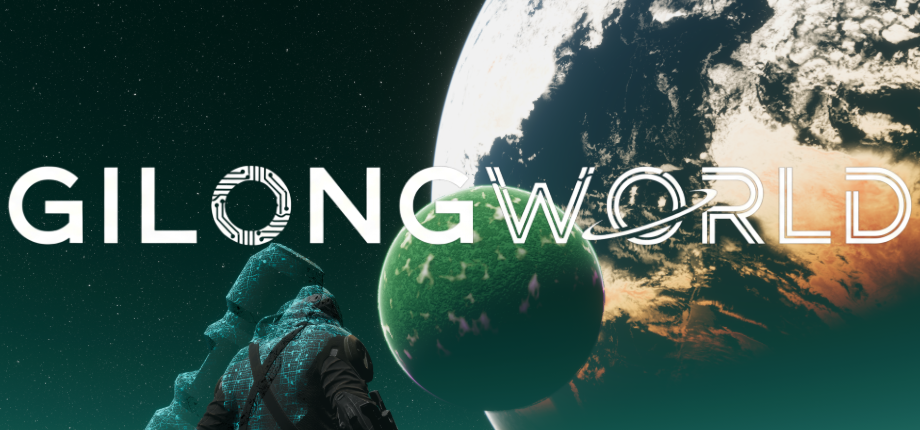

---
# the default layout is 'page'
icon: fas fa-info-circle
order: 4
---

Welcome to **Long Gil Studio**! This official engineering blog and devlog documents our deep-dive technical research, Unity 6 optimizations, and development journey while building **GilongWorld**.

## About GilongWorld

Discover **GilongWorld** — an ambitious Sci-Fi Action RPG set across uncharted alien worlds. Master the arts of alchemy and exotic farming, tame and collect mythical creatures with unique abilities, and construct an impenetrable fortress base. Prepare to fight, gather rare resources, and survive in a hostile frontier!

Chart the unknown and write your own story of survival and return.

> 🎮 [**Wishlist GilongWorld on Steam now!**](https://store.steampowered.com/app/4615990/GilongWorld?utm_source=devlog&utm_medium=referral&utm_campaign=about_page&utm_content=en)
> 🔗 <https://store.steampowered.com/app/4615990/GilongWorld>
>
> 

### Alchemy, Crafting & Exotic Farming

Preparation is the key to survival. Cultivate exotic alien flora to harvest rare reagents, and master an in-depth alchemy system to brew potent elixirs, combat tonics, explosives, and toxins that turn the tide of battle.

### Mythical Creature Taming

This frontier is more than just hostile territory. Confront, subdue, and tame extraordinary creatures — each carrying unique stats, elemental traits, and active skills. Raise and train them into loyal companions and mounts.

### Base Building & Fortification

Claim and customize your own sanctuary. Starting from raw terrain, gather resources, unlock advanced sci-fi tech, and engineer a fortified stronghold to protect yourself and your tamed companions against lurking threats.

## Official Channels

Follow our development progress, read technical devlogs, and connect with Long Gil Studio:

- 🎮 **Steam:** [Wishlist GilongWorld](https://store.steampowered.com/app/4615990/GilongWorld?utm_source=devlog&utm_medium=referral&utm_campaign=about_links&utm_content=en)
  - 🔗 Steam Store: <https://store.steampowered.com/app/4615990/GilongWorld>
- 💬 **Discord:** [Join our Community Server](https://discord.gg/DbzpYe5T2P)
- 📺 **YouTube:** [@LongGilStudio](https://www.youtube.com/@LongGilStudio)
- 🌐 **Website:** [longgilstudio.com](https://longgilstudio.com)

> 🔗 [**View all official links →**](https://longgilstudio.com/links)

Chào mừng đến với **Long Gil Studio**! Blog này được lập ra để ghi chép và chia sẻ những nghiên cứu kỹ thuật chuyên môn cũng như nhật ký phát triển (devlog) trong hành trình chúng tôi xây dựng thế giới của tựa game **GilongWorld**.

## Về tựa game GilongWorld

Khám phá **GilongWorld** - tựa game Hành động Nhập vai (Action RPG) bối cảnh Sci-Fi ấn tượng. Làm chủ nghệ thuật luyện dược, giả kim. Thuần hóa, thu thập kỹ năng các sinh vật kỳ bí và xây dựng căn cứ vững chắc. Sẵn sàng chiến đấu, thu thập tài nguyên và sinh tồn trong một thế giới đầy rẫy hiểm nguy!

Khám phá những vùng đất vô định và viết nên câu chuyện trở về của riêng bạn.

> 🎮 [**Wishlist GilongWorld trên Steam ngay!**](https://store.steampowered.com/app/4615990/GilongWorld?utm_source=devlog&utm_medium=referral&utm_campaign=about_page&utm_content=vi)
> 🔗 <https://store.steampowered.com/app/4615990/GilongWorld>
>
> 

### Nghệ thuật Luyện dược - Giả kim & Trồng trọt

Sự chuẩn bị là chìa khóa của sinh tồn. Canh tác những giống cây trồng ngoại lai để thu hoạch nguyên liệu quý hiếm. Làm chủ hệ thống luyện dược - giả kim chuyên sâu để pha chế những lọ đan dược, ma dược, chất nổ hay độc dược mạnh mẽ, mang lại tài nguyên và lợi thế xoay chuyển cục diện.

### Thuần hóa sinh vật kỳ bí

Thế giới này không chỉ có kẻ thù. Hãy đối đầu, khuất phục và thuần hóa những sinh vật mang sức mạnh siêu việt. Mỗi sinh vật mang trong mình những kỹ năng và chỉ số độc nhất. Thu thập, nuôi dưỡng và biến chúng thành những người bạn đồng hành đắc lực.

### Xây dựng căn cứ vững chắc

Thiết lập và cá nhân hóa nơi trú ẩn của riêng bạn. Từ một vùng đất thô sơ ban đầu, hãy thu thập tài nguyên, nâng cấp công nghệ và xây dựng nên một pháo đài bất khả xâm phạm để bảo vệ bản thân và các sinh vật đã thuần hóa trước những mối đe dọa rình rập trong vùng vô định.

## Liên kết liên quan

Theo dõi tiến độ phát triển, tham gia thảo luận và trải nghiệm game tại các kênh chính thức của Long Gil Studio:

- 🎮 **Steam:** [Wishlist GilongWorld](https://store.steampowered.com/app/4615990/GilongWorld?utm_source=devlog&utm_medium=referral&utm_campaign=about_links&utm_content=vi)
  - 🔗 Link Steam: <https://store.steampowered.com/app/4615990/GilongWorld>
- 💬 **Discord:** [Tham gia máy chủ](https://discord.gg/DbzpYe5T2P)
- 📺 **YouTube:** [@LongGilStudio](https://www.youtube.com/@LongGilStudio)
- 🌐 **Website:** [longgilstudio.com](https://longgilstudio.com)

> 🔗 [**Xem tất cả liên kết →**](https://longgilstudio.com/links)

